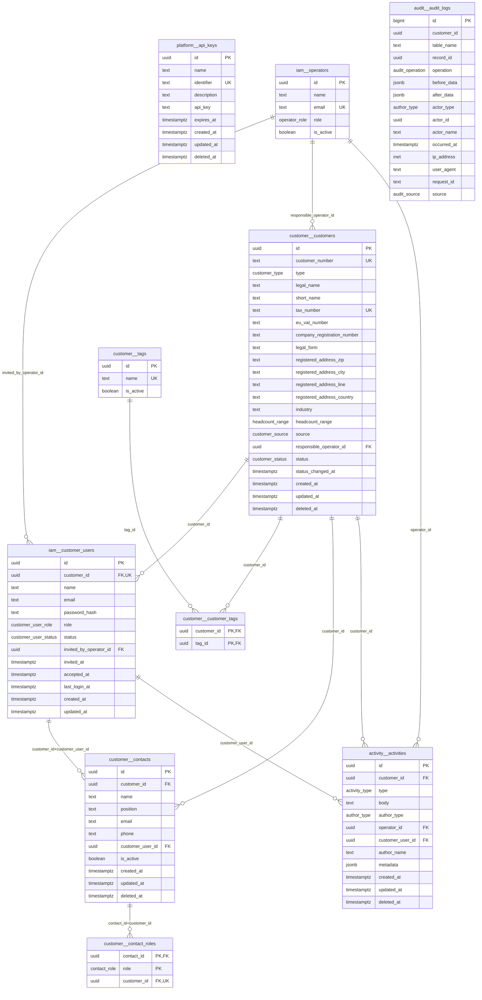

# Adatbázis séma — táblák és relációk

**Utolsó frissítés:** 2026-11-22

**Státusz:** generált élő dokumentum — kézi szerkesztés tilos.
**Igazságforrás:** [`apps/api/src/db/schema.ts`](../../apps/api/src/db/schema.ts) — Drizzle séma-kód
**Generátor:** [`scripts/db/schema-diagram.mjs`](../../scripts/db/schema-diagram.mjs)

> Ez a fájl **generált**: a tartalma a Drizzle sémából származik, ezért kézzel
> javítani hibás — a javítás a `schema.ts`-ben történik, utána újra kell generálni.
>
> - újragenerálás: `pnpm db:diagram`
> - ellenőrzés (nem ír, elavult fájl esetén `2`-es kilépési kód): `pnpm db:diagram:check`
>
> A Mermaid `erDiagram` entity-neve nem tartalmazhat pontot, ezért a
> `<séma>.<tábla>` név a diagramon `<séma>__<tábla>` alakban szerepel; a
> táblánkénti szakaszokban a valódi, pontos név áll.

---

## 1. Kapcsolati diagram

A diagram **10 táblát** és **11 relációt** mutat
összesen **95 oszloppal**, 5 Postgres sémában.



---

## 2. Táblák sémánként

| Séma | Táblák | Enum típusok |
| --- | --- | --- |
| `platform` | `api_keys` | — |
| `customer` | `customers`, `tags`, `customer_tags`, `contacts`, `contact_roles` | `customer_type`, `customer_status`, `customer_source`, `headcount_range`, `contact_role` |
| `iam` | `operators`, `customer_users` | `customer_user_role`, `customer_user_status`, `operator_role` |
| `activity` | `activities` | `activity_type`, `author_type` |
| `audit` | `audit_logs` | `audit_operation`, `audit_source` |

### 2.1 `platform` séma

#### `platform.api_keys`

Drizzle deklaráció: `apiKeys` · Mermaid entity: `platform__api_keys`

| # | Oszlop | Típus | NULL | Default | Kulcs | Hivatkozás |
| --- | --- | --- | --- | --- | --- | --- |
| 1 | `id` | `uuid` | nem | `gen_random_uuid()` | PK | — |
| 2 | `name` | `text` | nem | — | — | — |
| 3 | `identifier` | `text` | nem | — | UK | — |
| 4 | `description` | `text` | igen | — | — | — |
| 5 | `api_key` | `text` | nem | — | — | — |
| 6 | `expires_at` | `timestamptz` | igen | — | — | — |
| 7 | `created_at` | `timestamptz` | nem | `now()` | — | — |
| 8 | `updated_at` | `timestamptz` | nem | `now()` | — | — |
| 9 | `deleted_at` | `timestamptz` | igen | — | — | — |

**Megkötések és indexek**

| Név | Fajta | Oszlopok | Hivatkozott tábla | Megjegyzés |
| --- | --- | --- | --- | --- |
| `api_keys_identifier_key` | UNIQUE | `identifier` | — | — |
| `api_keys_deleted_at_idx` | INDEX | `deleted_at` | — | — |

### 2.2 `customer` séma

#### `customer.customers`

Drizzle deklaráció: `customers` · Mermaid entity: `customer__customers`

| # | Oszlop | Típus | NULL | Default | Kulcs | Hivatkozás |
| --- | --- | --- | --- | --- | --- | --- |
| 1 | `id` | `uuid` | nem | `gen_random_uuid()` | PK | — |
| 2 | `customer_number` | `text` | nem | — | UK | — |
| 3 | `type` | `customer_type` | nem | — | — | — |
| 4 | `legal_name` | `text` | nem | — | — | — |
| 5 | `short_name` | `text` | igen | — | — | — |
| 6 | `tax_number` | `text` | igen | — | UK | — |
| 7 | `eu_vat_number` | `text` | igen | — | — | — |
| 8 | `company_registration_number` | `text` | igen | — | — | — |
| 9 | `legal_form` | `text` | igen | — | — | — |
| 10 | `registered_address_zip` | `text` | igen | — | — | — |
| 11 | `registered_address_city` | `text` | igen | — | — | — |
| 12 | `registered_address_line` | `text` | igen | — | — | — |
| 13 | `registered_address_country` | `text` | nem | `'HU'` | — | — |
| 14 | `industry` | `text` | igen | — | — | — |
| 15 | `headcount_range` | `headcount_range` | igen | — | — | — |
| 16 | `source` | `customer_source` | igen | — | — | — |
| 17 | `responsible_operator_id` | `uuid` | igen | — | FK | `iam.operators.id` (ON DELETE set null) |
| 18 | `status` | `customer_status` | nem | — | — | — |
| 19 | `status_changed_at` | `timestamptz` | nem | `now()` | — | — |
| 20 | `created_at` | `timestamptz` | nem | `now()` | — | — |
| 21 | `updated_at` | `timestamptz` | nem | `now()` | — | — |
| 22 | `deleted_at` | `timestamptz` | igen | — | — | — |

**Megkötések és indexek**

| Név | Fajta | Oszlopok | Hivatkozott tábla | Megjegyzés |
| --- | --- | --- | --- | --- |
| `customers_customer_number_key` | UNIQUE | `customer_number` | — | — |
| `customers_tax_number_key` | UNIQUE INDEX | `tax_number` | — | WHERE `tax_number IS NOT NULL AND deleted_at IS NULL` |
| `customers_tax_number_format_check` | CHECK | — | — | `tax_number IS NULL OR tax_number ~ '^\d{8}-[1-5]-\d{2}$'` |

#### `customer.tags`

Drizzle deklaráció: `tags` · Mermaid entity: `customer__tags`

| # | Oszlop | Típus | NULL | Default | Kulcs | Hivatkozás |
| --- | --- | --- | --- | --- | --- | --- |
| 1 | `id` | `uuid` | nem | `gen_random_uuid()` | PK | — |
| 2 | `name` | `text` | nem | — | UK | — |
| 3 | `is_active` | `boolean` | nem | `true` | — | — |

**Megkötések és indexek**

| Név | Fajta | Oszlopok | Hivatkozott tábla | Megjegyzés |
| --- | --- | --- | --- | --- |
| `tags_name_key` | UNIQUE | `name` | — | — |

#### `customer.customer_tags`

Drizzle deklaráció: `customerTags` · Mermaid entity: `customer__customer_tags`

| # | Oszlop | Típus | NULL | Default | Kulcs | Hivatkozás |
| --- | --- | --- | --- | --- | --- | --- |
| 1 | `customer_id` | `uuid` | nem | — | PK, FK | `customer.customers.id` (ON DELETE cascade) |
| 2 | `tag_id` | `uuid` | nem | — | PK, FK | `customer.tags.id` (ON DELETE cascade) |

**Megkötések és indexek**

| Név | Fajta | Oszlopok | Hivatkozott tábla | Megjegyzés |
| --- | --- | --- | --- | --- |
| `customer_tags_pkey` | PRIMARY KEY | `customer_id`, `tag_id` | — | — |
| `customer_tags_tag_id_idx` | INDEX | `tag_id` | — | — |

#### `customer.contacts`

Drizzle deklaráció: `contacts` · Mermaid entity: `customer__contacts`

| # | Oszlop | Típus | NULL | Default | Kulcs | Hivatkozás |
| --- | --- | --- | --- | --- | --- | --- |
| 1 | `id` | `uuid` | nem | `gen_random_uuid()` | PK | — |
| 2 | `customer_id` | `uuid` | nem | — | FK | `customer.customers.id` (ON DELETE cascade) |
| 3 | `name` | `text` | nem | — | — | — |
| 4 | `position` | `text` | igen | — | — | — |
| 5 | `email` | `text` | igen | — | — | — |
| 6 | `phone` | `text` | igen | — | — | — |
| 7 | `customer_user_id` | `uuid` | igen | — | FK | `iam.customer_users.id` |
| 8 | `is_active` | `boolean` | nem | `true` | — | — |
| 9 | `created_at` | `timestamptz` | nem | `now()` | — | — |
| 10 | `updated_at` | `timestamptz` | nem | `now()` | — | — |
| 11 | `deleted_at` | `timestamptz` | igen | — | — | — |

**Megkötések és indexek**

| Név | Fajta | Oszlopok | Hivatkozott tábla | Megjegyzés |
| --- | --- | --- | --- | --- |
| `contacts_id_customer_id_key` | UNIQUE | `id`, `customer_id` | — | — |
| `contacts_customer_user_id_fkey` | FOREIGN KEY | `customer_id`, `customer_user_id` | `iam.customer_users` (`customer_id`, `id`) | — |
| `contacts_customer_id_name_idx` | INDEX | `customer_id`, `name` | — | — |

#### `customer.contact_roles`

Drizzle deklaráció: `contactRoles` · Mermaid entity: `customer__contact_roles`

| # | Oszlop | Típus | NULL | Default | Kulcs | Hivatkozás |
| --- | --- | --- | --- | --- | --- | --- |
| 1 | `contact_id` | `uuid` | nem | — | PK, FK | `customer.contacts.id` (ON DELETE cascade) |
| 2 | `role` | `contact_role` | nem | — | PK | — |
| 3 | `customer_id` | `uuid` | nem | — | FK, UK | `customer.contacts.customer_id` (ON DELETE cascade) |

**Megkötések és indexek**

| Név | Fajta | Oszlopok | Hivatkozott tábla | Megjegyzés |
| --- | --- | --- | --- | --- |
| `contact_roles_pkey` | PRIMARY KEY | `contact_id`, `role` | — | — |
| `contact_roles_contact_id_fkey` | FOREIGN KEY | `contact_id`, `customer_id` | `customer.contacts` (`id`, `customer_id`) | ON DELETE cascade |
| `contact_roles_primary_key` | UNIQUE INDEX | `customer_id` | — | WHERE `role = 'primary'` |

### 2.3 `iam` séma

#### `iam.operators`

Drizzle deklaráció: `operators` · Mermaid entity: `iam__operators`

| # | Oszlop | Típus | NULL | Default | Kulcs | Hivatkozás |
| --- | --- | --- | --- | --- | --- | --- |
| 1 | `id` | `uuid` | nem | `gen_random_uuid()` | PK | — |
| 2 | `name` | `text` | nem | — | — | — |
| 3 | `email` | `text` | nem | — | UK | — |
| 4 | `role` | `operator_role` | nem | — | — | — |
| 5 | `is_active` | `boolean` | nem | `true` | — | — |

**Megkötések és indexek**

| Név | Fajta | Oszlopok | Hivatkozott tábla | Megjegyzés |
| --- | --- | --- | --- | --- |
| `operators_email_key` | UNIQUE | `email` | — | — |

#### `iam.customer_users`

Drizzle deklaráció: `customerUsers` · Mermaid entity: `iam__customer_users`

| # | Oszlop | Típus | NULL | Default | Kulcs | Hivatkozás |
| --- | --- | --- | --- | --- | --- | --- |
| 1 | `id` | `uuid` | nem | `gen_random_uuid()` | PK | — |
| 2 | `customer_id` | `uuid` | nem | — | FK, UK | `customer.customers.id` (ON DELETE cascade) |
| 3 | `name` | `text` | nem | — | — | — |
| 4 | `email` | `text` | nem | — | — | — |
| 5 | `password_hash` | `text` | igen | — | — | — |
| 6 | `role` | `customer_user_role` | nem | — | — | — |
| 7 | `status` | `customer_user_status` | nem | — | — | — |
| 8 | `invited_by_operator_id` | `uuid` | igen | — | FK | `iam.operators.id` (ON DELETE set null) |
| 9 | `invited_at` | `timestamptz` | igen | — | — | — |
| 10 | `accepted_at` | `timestamptz` | igen | — | — | — |
| 11 | `last_login_at` | `timestamptz` | igen | — | — | — |
| 12 | `created_at` | `timestamptz` | nem | `now()` | — | — |
| 13 | `updated_at` | `timestamptz` | nem | `now()` | — | — |

**Megkötések és indexek**

| Név | Fajta | Oszlopok | Hivatkozott tábla | Megjegyzés |
| --- | --- | --- | --- | --- |
| `customer_users_customer_id_id_key` | UNIQUE | `customer_id`, `id` | — | — |
| `customer_users_email_key` | UNIQUE INDEX | — | — | `lower(email)` |
| `customer_users_customer_owner_key` | UNIQUE INDEX | `customer_id` | — | WHERE `role = 'owner' AND status = 'active'` |
| `customer_users_customer_id_idx` | INDEX | `customer_id` | — | — |

### 2.4 `activity` séma

#### `activity.activities`

Drizzle deklaráció: `activities` · Mermaid entity: `activity__activities`

| # | Oszlop | Típus | NULL | Default | Kulcs | Hivatkozás |
| --- | --- | --- | --- | --- | --- | --- |
| 1 | `id` | `uuid` | nem | `gen_random_uuid()` | PK | — |
| 2 | `customer_id` | `uuid` | nem | — | FK | `customer.customers.id` (ON DELETE cascade) |
| 3 | `type` | `activity_type` | nem | — | — | — |
| 4 | `body` | `text` | nem | — | — | — |
| 5 | `author_type` | `author_type` | nem | — | — | — |
| 6 | `operator_id` | `uuid` | igen | — | FK | `iam.operators.id` |
| 7 | `customer_user_id` | `uuid` | igen | — | FK | `iam.customer_users.id` |
| 8 | `author_name` | `text` | nem | — | — | — |
| 9 | `metadata` | `jsonb` | igen | — | — | — |
| 10 | `created_at` | `timestamptz` | nem | `now()` | — | — |
| 11 | `updated_at` | `timestamptz` | igen | — | — | — |
| 12 | `deleted_at` | `timestamptz` | igen | — | — | — |

**Megkötések és indexek**

| Név | Fajta | Oszlopok | Hivatkozott tábla | Megjegyzés |
| --- | --- | --- | --- | --- |
| `activities_author_reference_check` | CHECK | — | — | `( (author_type = 'system' AND operator_id IS NULL AND customer_user_id IS NULL) OR (author_type = 'operator' AND operator_id IS NOT NULL AND customer_user_id IS NULL) OR (author_type = 'customer_user' AND operator_id IS NULL AND customer_user_id IS NOT NULL) OR (author_type = 'api_key' AND operator_id IS NULL AND customer_user_id IS NULL) )` |
| `activities_customer_created_idx` | INDEX | — | — | `customer_id, created_at.desc()` WHERE `deleted_at IS NULL` |

### 2.5 `audit` séma

#### `audit.audit_logs`

Drizzle deklaráció: `auditLogs` · Mermaid entity: `audit__audit_logs`

| # | Oszlop | Típus | NULL | Default | Kulcs | Hivatkozás |
| --- | --- | --- | --- | --- | --- | --- |
| 1 | `id` | `bigint` | nem | — | PK | — |
| 2 | `customer_id` | `uuid` | igen | — | — | — |
| 3 | `table_name` | `text` | nem | — | — | — |
| 4 | `record_id` | `uuid` | igen | — | — | — |
| 5 | `operation` | `audit_operation` | nem | — | — | — |
| 6 | `before_data` | `jsonb` | igen | — | — | — |
| 7 | `after_data` | `jsonb` | igen | — | — | — |
| 8 | `actor_type` | `author_type` | nem | — | — | — |
| 9 | `actor_id` | `uuid` | igen | — | — | — |
| 10 | `actor_name` | `text` | nem | — | — | — |
| 11 | `occurred_at` | `timestamptz` | nem | `now()` | — | — |
| 12 | `ip_address` | `inet` | igen | — | — | — |
| 13 | `user_agent` | `text` | igen | — | — | — |
| 14 | `request_id` | `text` | igen | — | — | — |
| 15 | `source` | `audit_source` | igen | — | — | — |

**Megkötések és indexek**

| Név | Fajta | Oszlopok | Hivatkozott tábla | Megjegyzés |
| --- | --- | --- | --- | --- |
| `audit_logs_customer_occurred_idx` | INDEX | — | — | `customer_id, occurred_at.desc()` |
| `audit_logs_table_record_idx` | INDEX | `table_name`, `record_id` | — | — |
| `audit_logs_request_id_idx` | INDEX | `request_id` | — | — |

---

## 3. Relációk

Minden él egy idegen kulcs: a bal oldal a hivatkozó (`FROM`), a jobb oldal a
hivatkozott (`REFERENCES`) tábla. A `||--o{` jelölés azt jelenti, hogy egy
hivatkozott sorhoz nulla vagy több hivatkozó sor tartozhat, a hivatkozó sor
pedig pontosan egy hivatkozott sorra mutat.

| # | Megkötés | Honnan | Oszlop(ok) | Hová | Oszlop(ok) | ON DELETE |
| --- | --- | --- | --- | --- | --- | --- |
| 1 | `customers_responsible_operator_id_operators_id_fk` * | `customer.customers` | `responsible_operator_id` | `iam.operators` | `id` | set null |
| 2 | `customer_tags_customer_id_customers_id_fk` * | `customer.customer_tags` | `customer_id` | `customer.customers` | `id` | cascade |
| 3 | `customer_tags_tag_id_tags_id_fk` * | `customer.customer_tags` | `tag_id` | `customer.tags` | `id` | cascade |
| 4 | `customer_users_customer_id_customers_id_fk` * | `iam.customer_users` | `customer_id` | `customer.customers` | `id` | cascade |
| 5 | `customer_users_invited_by_operator_id_operators_id_fk` * | `iam.customer_users` | `invited_by_operator_id` | `iam.operators` | `id` | set null |
| 6 | `contacts_customer_id_customers_id_fk` * | `customer.contacts` | `customer_id` | `customer.customers` | `id` | cascade |
| 7 | `contacts_customer_user_id_fkey` | `customer.contacts` | `customer_id`, `customer_user_id` | `iam.customer_users` | `customer_id`, `id` | nincs megadva (NO ACTION) |
| 8 | `contact_roles_contact_id_fkey` | `customer.contact_roles` | `contact_id`, `customer_id` | `customer.contacts` | `id`, `customer_id` | cascade |
| 9 | `activities_customer_id_customers_id_fk` * | `activity.activities` | `customer_id` | `customer.customers` | `id` | cascade |
| 10 | `activities_operator_id_operators_id_fk` * | `activity.activities` | `operator_id` | `iam.operators` | `id` | nincs megadva (NO ACTION) |
| 11 | `activities_customer_user_id_customer_users_id_fk` * | `activity.activities` | `customer_user_id` | `iam.customer_users` | `id` | nincs megadva (NO ACTION) |

\* A megkötésnév a Postgres alapértelmezett nevezési sémája szerint
származtatott (`<tábla>_<oszlop>_<cél_tábla>_<cél_oszlop>_fk`), mert az
oszlopszintű `.references()` nem nevezi el a constraintet. A séma-kódban
kiírt nevek (összetett idegen kulcsok) változtatás nélkül szerepelnek.

---

## 4. Enum típusok

| Séma | Típus | Értékek |
| --- | --- | --- |
| `customer` | `customer_type` | `company`, `sole_proprietor`, `organization`, `tax_number_individual` |
| `customer` | `customer_status` | `prospect`, `registered`, `trial`, `active`, `suspended`, `churned`, `anonymized` |
| `customer` | `customer_source` | `website`, `referral`, `in_person`, `questionnaire`, `partner`, `manual` |
| `customer` | `headcount_range` | `sole`, `2_5`, `6_20` |
| `customer` | `contact_role` | `primary`, `technical`, `alerting` |
| `iam` | `customer_user_role` | `owner`, `admin`, `member`, `viewer` |
| `iam` | `customer_user_status` | `invited`, `active`, `inactive` |
| `iam` | `operator_role` | `superadmin`, `operator` |
| `activity` | `activity_type` | `note`, `call`, `email`, `meeting`, `status_change`, `system` |
| `activity` | `author_type` | `operator`, `customer_user`, `system`, `api_key` |
| `audit` | `audit_operation` | `insert`, `update`, `delete`, `soft_delete` |
| `audit` | `audit_source` | `admin_api`, `web`, `worker`, `cron` |

---

## 5. Ami szándékosan nincs a diagramon

| Elem | Miért nincs |
| --- | --- |
| `platform.__drizzle_migrations` | a Drizzle migrációs runner könyvelő táblája; nem a `schema.ts` deklarálja, ezért a sématervezés része nem ez a fájl. |
| `pg_catalog`, `information_schema`, `pg_toast` | Postgres belső katalógusok. |
| A soft delete (`deleted_at`) és a `created_at` / `updated_at` oszlopok | a diagramon **szerepelnek** (oszlopok), de a rájuk épülő olvasási szabály („minden olvasás `deleted_at IS NULL`”) a repository-kódban él, nem a sémában. |

---

## 6. Újragenerálás

```bash
pnpm db:diagram          # újraírja ezt a fájlt a schema.ts alapján
pnpm db:diagram:check    # csak ellenőriz, 2-essel jelez, ha elavult
```

A generátor a [`scripts/db/`](../../scripts/db/README.md) mappában él, és szándékosan a
**séma-kódból** dolgozik, nem egy futó adatbázisból: így fut adatbázis és hálózat
nélkül is, és pontosan azt dokumentálja, amiből a migráció készül. Ha a
`schema.ts` változik, a `pnpm --filter @callback/api db:generate` után futtasd a
`pnpm db:diagram`-ot is, hogy a dokumentum egy commitban maradjon a migrációval.

Az adatbázis lokális felállítása, a grant-mátrix és a verifikációs query-k a
[`Database-Local.md`](Database-Local.md) specben vannak.
