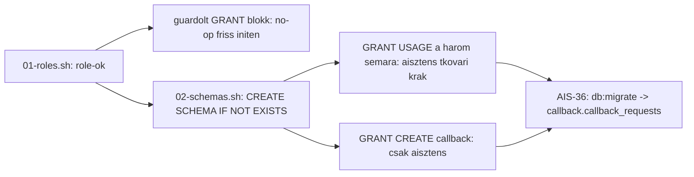

# AIS-35 — Per-context Postgres sémák és jogosultságok az init scriptekben

**Jira:** AIS-35 (Subtask) — szülő: AIS-29 *DB: séma-mint-kód migrációs workflow és Postgres-alapú visszahívás-tároló*
**Dátum:** 2026-10-19
**Állapot:** terv, jóváhagyásra vár
**Érintett területek:** [`infra/postgres/init/`](../../infra/postgres/init/), [`scripts/test/`](../../scripts/test/), `docs/Specs/`

---

## 1. Kontextus

Az AIS-29 story a memóriabeli `Map` alapú visszahívás-tárolót Postgres-re cseréli, Drizzle séma-mint-kód
workflow-val. A story 5 sub-taskra bomlik; ez a terv **kizárólag a 2. sub-taskot (AIS-35)** fedi le: a
per-kontext Postgres sémák és a hozzájuk tartozó grantok létrehozása az init scriptekben.

A többi sub-task (AIS-34 dependenciák — már kész, AIS-36 séma + első migráció, AIS-37 unit tesztek,
AIS-38 Postgres repository + e2e) **nincs ebben a tervben**. A migrációs runner (advisory lock) és a
deploy-pipeline-beli futtatás a Story 3 hatóköre.

Miért kell ez most: a `callback_requests` tábla a `callback` sémába kerül (AIS-36), a migrációt futtató
`aisztens` role-nak tehát object-létrehozási joga kell a sémában, különben a `db:migrate` a dev szerveren
és lokálisan is `permission denied for schema callback` hibával áll meg.

## 2. Kiinduló állapot (mért tények)

| Tény | Bizonyíték |
|---|---|
| Az init csak role-okat hoz létre, sémát nem | [`01-roles.sh`](../../infra/postgres/init/01-roles.sh:1) — `CREATE ROLE` ×3, `ALTER DATABASE ... OWNER`, `GRANT CONNECT` |
| A `DO $$ ... $$` blokk tiltott (a `:'var'` nem interpolálódik benne) | [`01-roles.sh`](../../infra/postgres/init/01-roles.sh:9) fejléc |
| A teljes init könyvtár bind-mountolva van, tehát új script automatikusan bekerül | [`docker-compose.yml`](../../infra/docker-compose.yml:123), [`docker-compose.db.yml`](../../infra/docker-compose.db.yml:41) |
| Az init könyvtárat minden deploy path küldi (`scp -r`) | [`deploy/deploy.sh`](../../deploy/deploy.sh:490), `.github/workflows/deploy.yml` scp source lista |
| Az init **csak üres `pgdata` volume első inicializálásakor** fut | [`Infrastructure-Docker.md`](../../docs/Specs/Infrastructure-Docker.md:150) |
| `AISZTENS_DB_USER` már a konténer env-jében van, compose módosítás nem kell | [`docker-compose.yml`](../../infra/docker-compose.yml:117) |
| Az `aisztens` role a database tulajdonosa, tehát `CREATE SCHEMA` joga megvan (Drizzle bookkeeping séma) | [`01-roles.sh`](../../infra/postgres/init/01-roles.sh:54) |
| A role-okra már van smoke check, sémákra nincs | [`20-cross-service.sh`](../../scripts/test/lib/20-cross-service.sh:72) |

## 3. Döntések

| # | Döntés | Indok |
|---|---|---|
| D1 | Új [`02-schemas.sh`](../../infra/postgres/init/02-schemas.sh) script birtokolja a `CREATE SCHEMA IF NOT EXISTS` DDL-t a `platform`, `callback`, `email` sémákra | Alfabetikusan a `01` után fut a friss initen; önállóan újrafuttatható meglévő volume-on |
| D2 | `USAGE` mindhárom sémára az `aisztens`, `tkovari` és `krak` role-nak; `CREATE` a `callback`-re **kizárólag** az `aisztens` role-nak. Ugyanez `\gexec`-guarddal a `01-roles.sh`-ban is (`WHERE EXISTS (SELECT 1 FROM pg_namespace ...)`) | A ticket a grantot a `01-roles.sh`-ban kéri; a guard miatt a fájl sorrend-független és idempotens marad (friss initen no-op, meglévő volume-on hatásos). Az operátoroknak olvasáshoz (`\dt`, `SELECT`) kell a `USAGE`, object-létrehozáshoz nem — a `CREATE` szándékosan csak az app role-é |
| D3 | A sémák tulajdonosa a bootstrap superuser marad, az `aisztens` csak jogosultságot kap | Nem kell ownership-átírás; a grant-felület követi a modulhatárt (email-modul design döntés) |
| D4 | Nincs `ALTER DEFAULT PRIVILEGES` | A Drizzle által létrehozott objektumokat maga az `aisztens` hozza létre, tehát eleve ő a tulajdonos |
| D5 | A `__drizzle_migrations` / `drizzle` séma **nem** része ennek a tasknak | Az `aisztens` a database tulajdonosa, így a migrátor létre tudja hozni; ellenőrzés AIS-36/38-ban |
| D6 | Két teszt-szint: throwaway-konténeres shell teszt (idempotencia + jogosultságok, stack nélkül) **és** a meglévő smoke suite bővítése | Az init csak egyszer fut, ezért a friss-volume útját külön kell bizonyítani; a smoke a valós stack-en igazol |

### Grant mátrix

| Séma | `aisztens` (app) | `tkovari` (owner operátor) | `krak` (operátor) |
|---|---|---|---|
| `platform` | USAGE | USAGE | USAGE |
| `callback` | USAGE + **CREATE** | USAGE | USAGE |
| `email` | USAGE | USAGE | USAGE |

Object-szintű (tábla) grantok nincsenek ebben a taskban: a `callback` sémában az `aisztens` hozza létre a
táblákat (ezért ő a tulajdonos), az operátorok séma-szintű `USAGE` joga a későbbi read-only operátori
hozzáférés alapja. Az operátor role-nevek literálisan szerepelnek (mint a `01-roles.sh`-ban), tehát
átnevezés esetén mindkét scriptben módosítandók — ezt a `02-schemas.sh` fejléce dokumentálja.

## 4. Lépések

1. **`infra/postgres/init/02-schemas.sh`** — idempotens psql wrapper (`psql -v ON_ERROR_STOP=1`, `--set aisztens_db_user`),
   `CREATE SCHEMA IF NOT EXISTS` a három sémára, majd `GRANT USAGE` mindhárom sémára az `aisztens`, `tkovari`
   és `krak` role-nak, végül `GRANT CREATE ON SCHEMA callback` csak az `aisztens` role-nak.
   Fejléc: `DO $$` tilalom, first-run-only viselkedés, manuális újrafuttatás, role-név literálok.
2. **`infra/postgres/init/01-roles.sh`** — `\gexec`-guardolt `GRANT USAGE ON SCHEMA` (három séma × három role)
   és `GRANT CREATE ON SCHEMA callback` (csak `aisztens`) blokk, `pg_namespace` létezésre szűrve;
   fejléc-hivatkozás a `02-schemas.sh`-ra.
3. **`scripts/test/_postgres-init-schemas-test.sh`** — eldobható `postgres:16-alpine` konténer, `01` + `02` kétszer,
   majd assertek: mindkét futás exit 0, `\dn` listázza a három sémát, `has_schema_privilege('aisztens', ..., 'USAGE')`
   mindháromra igaz, `CREATE` a `callback`-re igaz; `tkovari` és `krak` `USAGE` mindháromra igaz, `CREATE` rájuk hamis.
   Nincs host-port publikálás, `trap` alapú cleanup, nem-nulla exit hibánál.
4. **`scripts/test/lib/20-cross-service.sh`** — a meglévő role-check után `postgres-schemas` és
   `postgres-schema-privileges` check (app role `USAGE` + `CREATE`, operátorok `USAGE`), a korábban javított
   `psql -U "$POSTGRES_USER"` mintával.
5. **`docs/Specs/Infrastructure-Docker.md`** §6.2 — `02-schemas.sh`, séma↔kontextus mapping, a fenti grant-mátrix,
   manuális újrafuttatás parancsa; `Utolsó frissítés` dátum frissítése.
6. **`docs/Specs/Local-Development.md`** — a `postgres/init` hivatkozásnál mindkét init script és a friss-volume követelmény.
7. **Verifikáció** — `docker compose -f infra/docker-compose.db.yml --env-file infra/.env.local down -v`, majd
   `pnpm db:up`; `\dn` + `has_schema_privilege` ellenőrzés mindhárom role-ra; a két script újrafuttatása a futó
   konténeren (idempotencia).
8. **Tesztek** — `bash scripts/test/_postgres-init-schemas-test.sh`, `pnpm test:stack` zöld.
9. **Dokumentáció** — ez a terv `docs/history/` alatt, plusz a változás-napló bejegyzés és milestone
   (a séma-határ és a first-run-only init megkötés miatt milestone indokolt).
10. **Commit** — conventional commit, `AIS-35` hivatkozással; sub-task státusz léptetése.

## 5. Fájlok

| Fájl | Változás |
|---|---|
| `infra/postgres/init/02-schemas.sh` | új: séma DDL + grantok, idempotens |
| `infra/postgres/init/01-roles.sh` | guardolt grant blokk + fejléc megjegyzés |
| `scripts/test/_postgres-init-schemas-test.sh` | új: throwaway-konténeres init teszt |
| `scripts/test/lib/20-cross-service.sh` | séma + jogosultság smoke checkek |
| `docs/Specs/Infrastructure-Docker.md` | §6.2 frissítés |
| `docs/Specs/Local-Development.md` | init scriptekre hivatkozás frissítése |
| `docs/history/2026-10-19--21-15-00-ais-35-postgres-schemas-plan.md` | ez a terv |
| `docs/history/2026-10-19--*.md` | változás-napló bejegyzés az implementáció után |
| `docs/milestones/2026-10-19--*.milestone.md` | milestone |

## 6. Elfogadási kritériumok

- Friss volume-on a `\dn` listázza a `platform`, `callback`, `email` sémákat.
- `has_schema_privilege('aisztens', 'callback', 'CREATE')` igaz; `USAGE` mindhárom sémára igaz.
- `has_schema_privilege('tkovari', <séma>, 'USAGE')` és `has_schema_privilege('krak', <séma>, 'USAGE')` igaz
  mindhárom sémára; `CREATE` rájuk nem igaz.
- Mindkét init script kétszeri futtatása exit 0 (idempotens), hiba nélkül.
- `pnpm test:stack` zöld az új checkekkel; a shell teszt zöld.
- A `docs/Specs` és a milestone a kóddal egy commitban frissül.

## 7. Kockázatok

| Kockázat | Kezelés |
|---|---|
| Meglévő `pgdata` volume-on az init nem fut le, így a sémák hiányozhatnak | A `02-schemas.sh` önállóan futtatható; a spec dokumentálja a manuális parancsot, a smoke check pedig elkapja a hiányt |
| A guardolt grant a `01`-ben halott kódnak tűnik friss initen | Fejléc-komment indokolja (ordering + meglévő volume javítása) |
| Sémajog híján a későbbi `db:migrate` fut el | A `CREATE` grant explicit tesztelt (nem csak a `USAGE`) |
| Az init script új fájlja kimarad a deploy csomagból | A könyvtárat a deploy path `scp -r`-rel viszi; a fájl a meglévő mappába kerül, plusz ellenőrzés a smoke-ban |
| Operátor role-név literálok két scriptben | A `02-schemas.sh` fejléce jelzi az összetartozást; a shell teszt mindhárom role-t ellenőrzi |

## 8. Döntési napló

| Kérdés | Döntés |
|---|---|
| Kapjon-e `USAGE` jogot a `tkovari` és `krak` role is a három sémára? | **Igen**, mindhárom sémára (2026-10-19, felhasználói döntés). `CREATE` nem. |
| Maradjon-e a guardolt grant blokk a `01-roles.sh`-ban? | **Igen** — a ticket ott kéri; a guard miatt idempotens és sorrend-független. |

Nyitott pont nem maradt; a terv implementálható.
