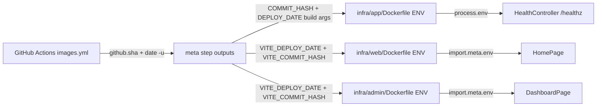

# Plan: show deploy date + commit hash on SPA front pages and in API health

**Date:** 2026-10-12
**Status:** ✅ implemented (2026-10-12 13:20) — see
[`docs/history/2026-10-12--13-20-00-deploy-meta-version-display.md`](../history/2026-10-12--13-20-00-deploy-meta-version-display.md)
for the implementation narrative and
[`docs/milestones/2026-10-12--13-20-00-deploy-meta-version-display.milestone.md`](../milestones/2026-10-12--13-20-00-deploy-meta-version-display.milestone.md)
for the decision-grade summary.
**Scope:** bake build metadata (build timestamp + full commit SHA) into the
api/web/admin images at CI build time and surface it:
- `web` front page `/` → [`apps/web/src/pages/HomePage.tsx`](../../apps/web/src/pages/HomePage.tsx:1)
- `admin` front page `/` → [`apps/admin/src/pages/DashboardPage.tsx`](../../apps/admin/src/pages/DashboardPage.tsx:1)
- `api` `GET /healthz` → [`apps/api/src/health/health.controller.ts`](../../apps/api/src/health/health.controller.ts:12)

---

## 1. Decision (confirmed with requester)

| Question | Decision |
|---|---|
| Date source | Build time of `.github/workflows/images.yml` (immutable, baked into image) |
| Hash format | Full 40-char commit SHA (`github.sha`) |
| Consistency | api / web / admin all show the SAME values for a given revision |

Local builds (`scripts/dev-stack.sh up`, `pnpm --filter ... dev`) do **not**
pass these args, so the Dockerfiles keep empty-string defaults and the UI /
health endpoint degrade gracefully (empty string / `null`).

---

## 2. Data flow



---

## 3. Changes

### 3.1 [` .github/workflows/images.yml `](../../.github/workflows/images.yml:147)

Extend the `meta` step with two new outputs (the existing `short_sha` stays):

```bash
short_sha="${GITHUB_SHA::7}"
commit_hash="$GITHUB_SHA"
deploy_date="$(date -u +%Y-%m-%dT%H:%M:%SZ)"
echo "short_sha=$short_sha"     >> "$GITHUB_OUTPUT"
echo "commit_hash=$commit_hash" >> "$GITHUB_OUTPUT"
echo "deploy_date=$deploy_date" >> "$GITHUB_OUTPUT"
```

Then add build args to the three application build steps:

- api ([`images.yml:165`](../../.github/workflows/images.yml:165)):
  ```yaml
  build-args: |
    APP_ENV=${{ steps.resolve.outputs.app_env }}
    COMMIT_HASH=${{ steps.meta.outputs.commit_hash }}
    DEPLOY_DATE=${{ steps.meta.outputs.deploy_date }}
  ```
- web ([`images.yml:181`](../../.github/workflows/images.yml:181)) and
  admin ([`images.yml:198`](../../.github/workflows/images.yml:198)) — same
  two lines added:
  ```yaml
  VITE_DEPLOY_DATE=${{ steps.meta.outputs.deploy_date }}
  VITE_COMMIT_HASH=${{ steps.meta.outputs.commit_hash }}
  ```

No change to the monitor image (it does not need the metadata).

### 3.2 [` infra/app/Dockerfile `](../../infra/app/Dockerfile:44) — runtime stage

The build args must be declared and exported as ENV in the **runtime**
stage (an ENV set in an intermediate stage does not carry over):

```dockerfile
ARG COMMIT_HASH
ARG DEPLOY_DATE
ENV COMMIT_HASH=${COMMIT_HASH} \
    DEPLOY_DATE=${DEPLOY_DATE}
```

Place this before the final `CMD` (e.g. next to the existing
`ENV NODE_OPTIONS=...` block), while the stage is still `root`.

### 3.3 [` infra/web/Dockerfile `](../../infra/web/Dockerfile:51) and [` infra/admin/Dockerfile `](../../infra/admin/Dockerfile:43)

Add two ARGs and extend the existing build-stage ENV so Vite sees them
(Vite only exposes `VITE_*`-prefixed variables to the client bundle):

```dockerfile
ARG VITE_DEPLOY_DATE
ARG VITE_COMMIT_HASH

ENV APP_ENV=${APP_ENV} \
    VITE_API_BASE_URL=${VITE_API_BASE_URL} \
    VITE_DEPLOY_DATE=${VITE_DEPLOY_DATE} \
    VITE_COMMIT_HASH=${VITE_COMMIT_HASH}
```

### 3.4 [` apps/api/src/health/health.controller.ts `](../../apps/api/src/health/health.controller.ts:14)

Add `deployDate` and `commitHash` right after `status` (read from env at
call time; `null` when unset in local/dev-server runs):

```ts
check(): {
  status: 'oks';
  deployDate: string | null;
  commitHash: string | null;
  uptime: number;
  timestamp: string;
} {
  return {
    status: 'oks',
    deployDate: process.env.DEPLOY_DATE ?? null,
    commitHash: process.env.COMMIT_HASH ?? null,
    uptime: Math.round(process.uptime()),
    timestamp: new Date().toISOString(),
  };
}
```

The route stays guard/pipe/middleware-free (liveness contract unchanged).

### 3.5 [` apps/api/src/health/health.controller.spec.ts `](../../apps/api/src/health/health.controller.spec.ts:19)

Add cases:
- with `DEPLOY_DATE`/`COMMIT_HASH` set → returned verbatim;
- without them → both `null`;
- existing `status`/`uptime`/`timestamp` assertions stay.

### 3.6 [` apps/web/src/pages/HomePage.tsx `](../../apps/web/src/pages/HomePage.tsx:1)

Render a small footer line on the front page (below the feature grid):

```tsx
const deployDate = import.meta.env.VITE_DEPLOY_DATE as string | undefined;
const commitHash = import.meta.env.VITE_COMMIT_HASH as string | undefined;
```

Show `deployDate` (humanised) and the full `commitHash`, hiding or
rendering `—` when undefined (local `vite` dev server has no such vars).

### 3.7 [` apps/admin/src/pages/DashboardPage.tsx `](../../apps/admin/src/pages/DashboardPage.tsx:1)

Same build-info line, placed at the bottom of the authenticated `/`
dashboard (admin `/` is [`DashboardPage`](../../apps/admin/src/pages/DashboardPage.tsx:18)).

---

## 4. Verification

```bash
# local (graceful empty values)
scripts/dev-stack.sh up
curl -s http://localhost:3000/healthz
#   -> {"status":"oks","deployDate":null,"commitHash":null,"uptime":N,"timestamp":"..."}

# CI path: push to dev -> images.yml bakes real values -> deploy.yml ships
curl -s https://api.aisztens.hu/healthz
#   -> {"status":"oks","deployDate":"2026-10-12T12:xx:xxZ","commitHash":"<40 chars>",...}
# web / admin front pages show the same date + hash footer
```

API unit tests: `pnpm --filter @callback/api test`.

---

## 5. Docs to update with the implementation

- [`docs/Specs/Production-Runbook.md`](../../docs/Specs/Production-Runbook.md:91) —
  `/healthz` response shape gains `deployDate` + `commitHash`.
- [`docs/Specs/Infrastructure-Docker.md`](../../docs/Specs/Infrastructure-Docker.md:105) —
  the `images.yml` build-args list gains the three metadata args.
- [`docs/Specs/Functional-Specification.md`](../../docs/Specs/Functional-Specification.md:1) —
  front pages of web/admin now show build metadata (if the spec documents page content).
- `docs/history/<timestamp>-deploy-meta-version-display.md` — implementation narrative.
- `docs/milestones/<timestamp>-deploy-meta-version-display.milestone.md` — feature
  milestone (multi-file, deploy-artefact change).
