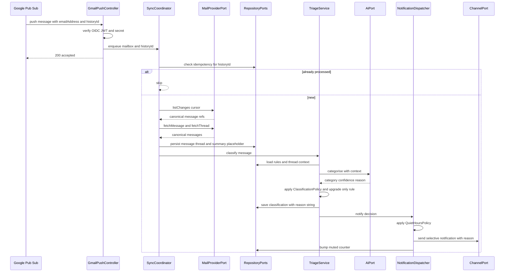
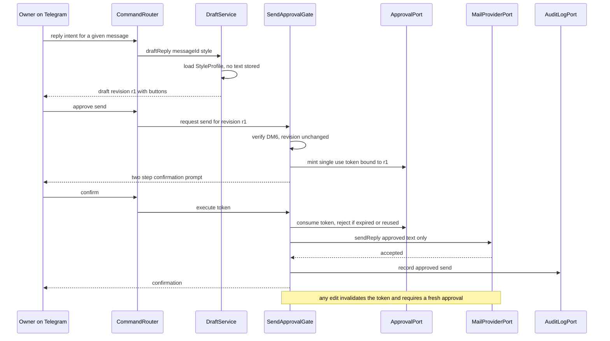

# Plan — Email Module structural design inside `apps/api` (2026-10-14)

- Source requirement: [`docs/temp/Email-modul  MVP.md`](../temp/Email-modul%20%20MVP.md)
- Scope: structural design only — components, connectors, interfaces, target layout, phases
- Status: awaiting approval before implementation

## 1. Goal and constraints

| #   | Constraint                                               | Consequence on the design                                                                                         |
| --- | -------------------------------------------------------- | ----------------------------------------------------------------------------------------------------------------- |
| C1  | MVP supports **Gmail only** (`A1`, `D2`)                 | Only a Gmail adapter is built now; the Gmail-specific parts must be confined to `infrastructure/`                 |
| C2  | Later must support **other mail providers**              | The application and domain layers must depend on ports only; adding a provider must not touch them                |
| C3  | The module lives in [`apps/api`](../../apps/api)         | No new deployable, no new container                                                                               |
| C4  | One mailbox today, many later (`D45`)                    | `Account` and `Mailbox` are separate entities; every port call takes a `MailboxRef`                               |
| C5  | Push-first ingestion, polling as fallback                | Gmail `users.watch` + Pub/Sub push; a provider that has no watch capability degrades to polling via the same port |
| C6  | No email leaves without explicit approval (`U14`, `D21`) | Approval is a domain invariant enforced in one place, not a controller concern                                    |
| C7  | External services are executors only                     | All state lives in our database; the Gmail/Pub-Sub/Telegram payloads are inputs, never the source of truth        |
| C8  | Existing code style                                      | NestJS 12 + Fastify, ESM, strict TS, feature folders, DI tokens for injectable config                             |

## 2. Architecture decision

**Hexagonal module (ports and adapters) inside the existing modular monolith.**

Rationale:

- C2 is the whole problem statement. A port/adapter split is the only structure where "add Outlook" is a new folder plus one registry line, instead of an `if (provider === 'gmail')` spread across the codebase.
- C3 and the existing one-container/one-database operating model rule out a separate service.
- The repository already uses the token-provider pattern for injectable config ([`vapi-webhook-config.ts`](../../apps/api/src/vapi-webhooks/vapi-webhook-config.ts)), so the port-token style is consistent with the codebase.
- The already approved bounded-context split in [`docs/plans/2026-09-21--18-12-48-email-assistant-mvp-integration-plan.md`](../plans/2026-09-21--18-12-48-email-assistant-mvp-integration-plan.md) assumed a generic unified mail API. The MVP document now says Gmail direct, so that plan's `MailProvider` port is kept as-is conceptually but its implementation changes from Unipile/Nylas to Gmail + a future adapter set.

Rejected alternatives:

| Option                                     | Why not                                                                        |
| ------------------------------------------ | ------------------------------------------------------------------------------ |
| Gmail calls inline in services             | C2 fails immediately; provider terms leak into triage, digest and draft logic  |
| Unified aggregator API (Unipile/Nylas) now | Not what the MVP says; adds a vendor and a data processor for no MVP gain      |
| Separate `apps/email` deployable           | More infra than the current single-droplet model and two-person team justifies |

## 3. Target layout

```
apps/api/src/
  platform/                     shared, provider-agnostic, non-email
    jobs/                       JobSchedulerPort + pg/Nest adapter + outbox retry worker
    persistence/                DB access, tenant scoping, repositories base
    secrets/                    SecureTokenStorePort + AES-GCM cipher adapter
    audit/                      AuditLogPort + append-only writer
    clock/                      ClockPort
    observability/              LoggerPort, MetricsPort, OperatorAlertPort
  modules/
    callback/                   existing voice bounded context, unchanged in behaviour
    email/
      email.module.ts           wires ports to adapters for the MVP provider
      api/                      inbound adapters
        gmail-push.controller.ts
        oauth-callback.controller.ts
        mailbox-admin.controller.ts
        chat-webhook.controller.ts
        dto/
      application/              use cases, one file per use case
        ports/                  OUTBOUND port interfaces + DI tokens  <-- the seam for C2
        use-cases/
        policies/               domain policies, pure functions/classes
      domain/                   entities and value objects, no framework imports
      infrastructure/           adapters, the only place allowed to know Gmail
        mail/gmail/
        mail/imap/              fallback poller + future provider
        ai/claude/
        channel/telegram/
        persistence/pg/
      jobs/                     scheduled use-case triggers
packages/shared/src/
  schemas/email/               Zod schemas shared with admin and web apps
  types/email/                 Email, Classification, Rule, StyleProfile, Draft, Digest
```

Boundary rules:

1. `domain/` imports nothing but TypeScript and `packages/shared` types.
2. `application/` imports `domain/` and `application/ports/` only — never `infrastructure/`, never the Gmail SDK, never the Telegram SDK.
3. `infrastructure/` may import `domain/` and the vendor SDKs; it may not be imported by `application/`.
4. `apps/api/src/modules/email` must not be imported by `modules/callback` and vice versa.
5. Adding a provider = new folder under `infrastructure/mail/<provider>` + one line in the provider registry + env entries. Zero changes in `application/`, `domain/`, `api/`.

## 4. Components

### 4.1 Inbound adapters `api/`

| ID  | Component                 | Responsibility                                                                                                                      | Provided interface                        |
| --- | ------------------------- | ----------------------------------------------------------------------------------------------------------------------------------- | ----------------------------------------- |
| IA1 | `GmailPushController`     | Receives Pub/Sub push, verifies OIDC token + shared secret, resolves `emailAddress` to a mailbox, enqueues ingest, returns 2xx fast | `POST /api/email/webhooks/gmail`          |
| IA2 | `OAuthCallbackController` | Provider-neutral OAuth redirect landing for mailbox connect; delegates to the registry by `:provider`                               | `GET /api/email/oauth/:provider/callback` |
| IA3 | `MailboxAdminController`  | Admin UI surface: connect, disconnect, suspend, settings, rule list, change log                                                     | Admin REST under `/api/admin/email/*`     |
| IA4 | `ChatWebhookController`   | Inbound channel events: button presses, free-text replies, drafts approvals                                                         | `POST /api/email/webhooks/telegram`       |

External callers (admin web app, Google Pub/Sub, Telegram) are actors, not components of this module.

### 4.2 Application use cases

| ID   | Component                | Responsibility                                                                                                          | Depends on ports                                          |
| ---- | ------------------------ | ----------------------------------------------------------------------------------------------------------------------- | --------------------------------------------------------- |
| AS1  | `MailboxRegistry`        | Resolve provider adapter by mailbox, guard for suspended/disconnected mailboxes                                         | `MailProviderRegistry`, `MailboxRepositoryPort`           |
| AS2  | `OnboardingService`      | Backfill last N days, seed VIP list and base style profile, activation                                                  | `MailProviderPort`, `AiPort`, repositories                |
| AS3  | `SyncCoordinator`        | Consume a change notification, dedupe by `historyId`/`messageId`, build canonical messages, persist, hand off to triage | `MailProviderPort`, `MessageStorePort`, `IdempotencyPort` |
| AS4  | `TriageService`          | The five-category classification, urgency threshold, context upgrade, reasoning string                                  | `AiPort`, `ContextAssembler`, `ClassificationPolicy`      |
| AS5  | `ContextAssembler`       | Assemble thread history: full text for active threads, summaries for older ones, VIP and rule context                   | `MessageStorePort`, `SummaryStorePort`                    |
| AS6  | `RuleSetService`         | CRUD for VIP, blocklist, topic and domain rules with `source: ai \| user \| feedback`; writes change log                | `RuleRepositoryPort`, `ChangeLogPort`                     |
| AS7  | `DraftService`           | Reply drafting with style profile, length variants, resummarise, save-as-draft                                          | `AiPort`, `StyleProfilePort`, `MailProviderPort`          |
| AS8  | `SendApprovalGate`       | **The only path to a send.** Mints a single-use approval for a frozen draft revision, two-step confirm, then executes   | `ApprovalPort`, `MailProviderPort`, `AuditLogPort`        |
| AS9  | `NotificationDispatcher` | Selective notify, quiet hours, per-notification muted counter, raw notification on persistent AI failure                | `ChannelPort`, `QuietHoursPolicy`, `SummaryStorePort`     |
| AS10 | `DigestComposer`         | Periodic digest, merge window, max 5 per category, unhandled marking, empty digest                                      | `ChannelPort`, `DigestPolicy`                             |
| AS11 | `CommandRouter`          | Map an unstructured chat turn to an intent and dispatch to the right use case                                           | all use cases, `AiPort`                                   |
| AS12 | `FeedbackRuleService`    | Turn a classification feedback into a proposed rule and confirm it                                                      | `RuleSetService`, `ChannelPort`                           |
| AS13 | `SettingsService`        | Everyday settings from chat with old-to-new confirmation; admin-only refusals                                           | repositories, `ChannelPort`                               |
| AS14 | `SearchService`          | Retrieval over the 90-day stored set, 5 hits plus more, ambiguity re-prompt                                             | `SummaryStorePort`, `AiPort`                              |
| AS15 | `RetentionService`       | Daily purge by retention table, disconnect recovery window, immediate delete                                            | repositories, `MailProviderPort`                          |
| AS16 | `WatchManager`           | Register, renew and release provider watch; decide push vs polling per mailbox                                          | `MailWatchPort`, `SyncSourcePolicy`                       |
| AS17 | `MailboxActionService`   | Archive, mark read, label, mute — capability-aware, degrades when provider lacks the feature                            | `MailProviderPort`, capability matrix                     |

### 4.3 Domain policies `domain/`

| ID  | Policy                 | Rule it encodes                                                                                                    |
| --- | ---------------------- | ------------------------------------------------------------------------------------------------------------------ |
| DM1 | `ClassificationPolicy` | Category order urgent → important → maybe → newsletter/spam (`D5`); urgency threshold default 24h, max 48h (`A10`) |
| DM2 | `RulePrecedence`       | VIP always important, blocked always muted, explicit topic rules win                                               |
| DM3 | `ContextUpgradePolicy` | Context may only upgrade, never downgrade (`D8`)                                                                   |
| DM4 | `RetentionPolicy`      | 14 days full text, 90 days summaries, 30 days muted senders, 12 months change log                                  |
| DM5 | `StyleProfilePolicy`   | Profiles hold features only, never message text; per-sender, deletable                                             |
| DM6 | `ApprovalPolicy`       | No send without an approved, unmodified draft revision; no reply-all, no attachments (`D19`, `D21`)                |
| DM7 | `DigestPolicy`         | Merge window default 2h, max 5 items per category, unhandled flag, empty digest still sent (`D29`)                 |
| DM8 | `QuietHoursPolicy`     | Urgent passes always; important configurable; retained items flow into the post-quiet digest (`D3`, `D6`)          |
| DM9 | `SourceAttribution`    | Every rule carries `ai \| user \| feedback` and the removal rules of `D11`/`D22`                                   |

### 4.4 Outbound ports — the provider-neutrality seam

| ID  | Port                     | Core methods                                                                                                                                                  | MVP adapter                                     | Future adapter                            |
| --- | ------------------------ | ------------------------------------------------------------------------------------------------------------------------------------------------------------- | ----------------------------------------------- | ----------------------------------------- |
| P1  | `MailProviderPort`       | `listChanges(cursor)`, `fetchMessage`, `fetchThread`, `sendReply`, `saveDraft`, `applyAction(action)`                                                         | `GmailMailAdapter`                              | `GraphMailAdapter`, `ImapMailAdapter`     |
| P2  | `MailProviderRegistry`   | `forMailbox(ref)`, `capabilities(ref)`                                                                                                                        | Gmail registration                              | one registration per provider             |
| P3  | `MailWatchPort`          | `subscribe`, `renew`, `unsubscribe`, `ttlSeconds`                                                                                                             | `GmailWatchAdapter`                             | optional — absence means polling          |
| P4  | `ProviderCredentialPort` | `connect`, `refresh`, `revoke`, `status`                                                                                                                      | `GoogleOAuthAdapter`                            | per-provider OAuth adapter                |
| P5  | `AiPort`                 | `categorise`, `summarise`, `draftReply`, `answerQuestion`, `inferStyleProfile`, `classifyIntent`                                                              | `ClaudeAgentAdapter`                            | swappable model routing, no caller change |
| P6  | `ChannelPort`            | `sendNotification`, `sendDigest`, `askWithButtons`, `sendMessage`                                                                                             | `TelegramChannelAdapter`                        | Slack adapter, same port                  |
| P7  | `SecureTokenStorePort`   | `put`, `get`, `delete`                                                                                                                                        | AES-GCM cipher over Postgres                    | KMS/secret manager                        |
| P8  | `JobSchedulerPort`       | `enqueue`, `scheduleCron`, `cancel`                                                                                                                           | DB-backed scheduler                             | managed queue                             |
| P9  | Repositories             | `MailboxRepositoryPort`, `MessageStorePort`, `SummaryStorePort`, `RuleRepositoryPort`, `StyleProfilePort`, `ChangeLogPort`, `IdempotencyPort`, `ApprovalPort` | Postgres, tenant-scoped                         | —                                         |
| P10 | `AuditLogPort`           | `record(event)`                                                                                                                                               | append-only writer                              | —                                         |
| P11 | `OperatorAlertPort`      | `alert(severity, message)`                                                                                                                                    | Telegram + email fan-out (`D57`)                | —                                         |
| P12 | `ClockPort`              | `now()`                                                                                                                                                       | system clock (keeps policies pure and testable) | —                                         |

Capability negotiation is the mechanism that makes C2 real:

```ts
interface MailCapabilities {
  readonly threads: boolean; // Gmail and Graph yes, plain IMAP maybe not
  readonly labels: boolean; // Gmail-specific; others fall back to folders or a local tag table
  readonly archive: boolean;
  readonly watch: boolean; // false means WatchManager installs polling
  readonly attachments: boolean; // MVP stores none, but the flag exists for 2nd round
}
```

`MailboxActionService` reads `capabilities()` and degrades: no `labels` means the label lives in our own `message_tags` table, no `watch` means polling. The application layer never learns the provider name — only capability booleans.

### 4.5 Infrastructure adapters

| ID  | Adapter                      | Notes                                                                                                                                                                       |
| --- | ---------------------------- | --------------------------------------------------------------------------------------------------------------------------------------------------------------------------- |
| AD1 | `GmailMailAdapter`           | Gmail REST: `users.history.list`, `users.messages.get`, `users.threads.get`, `messages.send`, `drafts.create`, `messages.modify`, `messages.trash`; maps to canonical model |
| AD2 | `GmailWatchAdapter`          | `users.watch` with `topicName`, expiry ~7 days, renew daily; `users.stop` on disconnect                                                                                     |
| AD3 | `GoogleOAuthAdapter`         | Google OAuth 2.0, offline access, scopes `gmail.readonly`, `gmail.modify`, `gmail.compose`, `gmail.send`, `userinfo.email`                                                  |
| AD4 | `ImapPollingMailAdapter`     | Fallback safety net now, generic provider later                                                                                                                             |
| AD5 | `ClaudeAgentAdapter`         | Tool-use agent with a fixed tool registry; every tool call audited                                                                                                          |
| AD6 | `TelegramChannelAdapter`     | Bot API send + inline keyboards; pairing via one-time code (`D53`)                                                                                                          |
| AD7 | `PostgresPersistenceAdapter` | Tenant-scoped repositories; MVP can start with in-memory slice as `CallbackRequestsService` does today                                                                      |
| AD8 | `DbBackedSchedulerAdapter`   | No Redis: jobs and the outbox live in Postgres                                                                                                                              |
| AD9 | `OperatorAlertAdapter`       | Telegram channel + owner email, 3 failures or 15 minutes (`D57`)                                                                                                            |

### 4.6 Jobs

| ID  | Job                                | Cadence                | Purpose                                                               |
| --- | ---------------------------------- | ---------------------- | --------------------------------------------------------------------- |
| JB1 | `WatchRenewalJob`                  | daily                  | Renew every Gmail watch before expiry; alert on failure               |
| JB2 | `FallbackPollJob`                  | every 5–15 min         | Poll `listChanges` as a safety net when push is silent or unavailable |
| JB3 | `DigestJob`                        | morning and/or evening | Compose and send the periodic digest, honouring the merge window      |
| JB4 | `RetentionJob`                     | daily                  | Apply `RetentionPolicy`, purge expired rows                           |
| JB5 | `BackfillJob`                      | on activation          | Onboarding backfill, default 30 days (`A12`)                          |
| JB6 | `OutboxRetryWorker`                | continuous             | Retry with attempts, then operator alert (`R2`)                       |
| JB7 | `ApprovalExpiryJob`                | continuous             | Expire unused approval tokens                                         |
| JB8 | `QuietHoursFlushJob`               | at quiet-hour end      | Send retained important and urgent items (`D3`)                       |
| JB9 | `ReminderJob`, `UnansweredMailJob` | 2nd round              | Deferred, listed for the port shape to stay compatible                |

## 5. Connectors

| #   | From → To                      | Kind                | Protocol / mechanism                 | Notes                                                  |
| --- | ------------------------------ | ------------------- | ------------------------------------ | ------------------------------------------------------ |
| 1   | Google Pub/Sub → IA1           | inbound sync        | HTTPS POST, OIDC JWT + shared secret | At-least-once: idempotency by `historyId` is mandatory |
| 2   | Telegram → IA4                 | inbound async       | HTTPS webhook, secret token header   | Every event mapped to one mailbox                      |
| 3   | Admin web app → IA2, IA3       | inbound sync        | HTTPS, session auth                  | Admin-only settings stay here (`D34`)                  |
| 4   | AD1, AD2 → Gmail API           | outbound sync       | HTTPS REST, OAuth bearer             | Rate-limit and quota aware, exponential backoff        |
| 5   | AD6 → Telegram Bot API         | outbound sync       | HTTPS REST                           | Notification, digest, buttons                          |
| 6   | AD5 → Claude API               | outbound sync       | HTTPS REST                           | Tool-use loop, audited                                 |
| 7   | AD7, AD8 → Postgres            | outbound sync       | TCP connection pool                  | Single database, `tenant_id` on every row              |
| 8   | Use cases → `JobSchedulerPort` | internal async      | in-process DI + DB-backed queue      | Keeps request handlers short, survives restart         |
| 9   | Application → ports            | internal in-process | NestJS DI tokens                     | The only direction allowed by the boundary rules       |
| 10  | AD9 → Telegram + email         | outbound            | HTTPS / SMTP or provider API         | Operational alerting path                              |

## 6. UML component diagram

```mermaid
flowchart TB
  subgraph Ext["External systems and actors"]
    GOOG[Google Gmail API]
    PUBSUB[Google Pub Sub]
    CLAUDE[Claude API]
    TG[Telegram Bot API]
    ADMIN[Admin web app]
    PG[(Postgres)]
  end

  subgraph Api["apps/api - email bounded context"]
    subgraph Inbound["Inbound adapters"]
      IA1[GmailPushController]
      IA2[OAuthCallbackController]
      IA3[MailboxAdminController]
      IA4[ChatWebhookController]
    end
    subgraph App["Application use cases"]
      AS3[SyncCoordinator]
      AS4[TriageService]
      AS5[ContextAssembler]
      AS7[DraftService]
      AS8[SendApprovalGate]
      AS9[NotificationDispatcher]
      AS10[DigestComposer]
      AS11[CommandRouter]
      AS12[RuleSetService]
      AS14[SearchService]
      AS15[RetentionService]
      AS16[WatchManager]
      AS17[MailboxActionService]
    end
    subgraph Dom["Domain policies"]
      DM1[ClassificationPolicy]
      DM3[ContextUpgradePolicy]
      DM6[ApprovalPolicy]
      DM7[DigestPolicy]
      DM8[QuietHoursPolicy]
      DM4[RetentionPolicy]
    end
    subgraph Ports["Ports - neutral interfaces"]
      P1[MailProviderPort]
      P2[MailProviderRegistry]
      P3[MailWatchPort]
      P4[ProviderCredentialPort]
      P5[AiPort]
      P6[ChannelPort]
      P9[RepositoryPorts]
      P8[JobSchedulerPort]
      P11[OperatorAlertPort]
    end
    subgraph Infra["Infrastructure adapters"]
      AD1[GmailMailAdapter]
      AD2[GmailWatchAdapter]
      AD3[GoogleOAuthAdapter]
      AD4[ImapMailAdapter]
      AD5[ClaudeAgentAdapter]
      AD6[TelegramChannelAdapter]
      AD7[PgRepositories]
      AD8[DbSchedulerAdapter]
    end
    subgraph Jobs["Scheduled jobs"]
      JB1[WatchRenewalJob]
      JB2[FallbackPollJob]
      JB3[DigestJob]
      JB4[RetentionJob]
      JB5[BackfillJob]
      JB6[RetryWorker]
      JB8[QuietHoursFlushJob]
    end
  end

  PUBSUB --> IA1
  TG --> IA4
  ADMIN --> IA2
  ADMIN --> IA3
  IA1 --> AS3
  IA2 --> P4
  IA3 --> AS12
  IA3 --> AS15
  IA4 --> AS11
  AS3 --> P1
  AS4 --> P5
  AS4 --> DM1
  AS4 --> DM3
  AS5 --> P9
  AS7 --> P5
  AS8 --> DM6
  AS8 --> P1
  AS9 --> P6
  AS9 --> DM8
  AS10 --> DM7
  AS10 --> P6
  AS11 --> AS7
  AS11 --> AS8
  AS11 --> AS14
  AS14 --> P9
  AS15 --> DM4
  AS16 --> P3
  AS17 --> P1
  JB1 --> AS16
  JB2 --> AS3
  JB3 --> AS10
  JB4 --> AS15
  JB5 --> P1
  JB6 --> P8
  JB8 --> AS9
  App --> P8
  P1 -.implemented by.-> AD1
  P1 -.implemented by.-> AD4
  P3 -.implemented by.-> AD2
  P4 -.implemented by.-> AD3
  P5 -.implemented by.-> AD5
  P6 -.implemented by.-> AD6
  P9 -.implemented by.-> AD7
  P8 -.implemented by.-> AD8
  AD1 --> GOOG
  AD2 --> GOOG
  AD4 --> GOOG
  AD5 --> CLAUDE
  AD6 --> TG
  AD7 --> PG
  AD8 --> PG
  P11 --> AD6
```



## 7. Sequence — push ingest to notification



## 8. Sequence — the approval gate, the safety-critical path



## 9. Data model sketch

| Table              | Key columns                                                                                             | Retention                        |
| ------------------ | ------------------------------------------------------------------------------------------------------- | -------------------------------- |
| `accounts`         | `id`, `google_sub`, `email`                                                                             | until deletion                   |
| `mailboxes`        | `id`, `account_id`, `provider_kind`, `address`, `status`, `history_cursor`, `watch_expires_at`          | until disconnect plus 30 days    |
| `messages`         | `id`, `mailbox_id`, `thread_id`, `provider_message_id`, `sender`, `subject`, `body_text`, `received_at` | full text 14 days, then nulled   |
| `summaries`        | `id`, `message_id`, `category`, `reason`, `summary`, `urgency_facts`, `ai_failed`                       | 90 days                          |
| `threads`          | `id`, `mailbox_id`, `subject`, `last_message_at`                                                        | follows messages                 |
| `rules`            | `id`, `mailbox_id`, `kind`, `value`, `source`, `active`                                                 | subscription lifetime            |
| `style_profiles`   | `id`, `mailbox_id`, `sender`, `features_json`                                                           | subscription lifetime, deletable |
| `drafts`           | `id`, `message_id`, `revision`, `body`, `state`, `approval_token_id`                                    | short                            |
| `approvals`        | `id`, `draft_id`, `revision`, `state`, `expires_at`                                                     | short                            |
| `notifications`    | `id`, `mailbox_id`, `message_id`, `channel`, `sent_at`, `muted_counter`                                 | 90 days                          |
| `channel_bindings` | `id`, `mailbox_id`, `channel`, `external_chat_id`, `pair_code`                                          | until unpair                     |
| `change_log`       | `id`, `mailbox_id`, `origin`, `key`, `old_value`, `new_value`, `at`                                     | 12 months                        |
| `processed_events` | `id`, `mailbox_id`, `provider_event_id`, `at`                                                           | 30 days                          |
| `muted_messages`   | `id`, `mailbox_id`, `sender`, `subject`, `at`                                                           | 30 days (`D61`)                  |

Every table carries `tenant_id` / `mailbox_id`; cross-tenant reads are prevented in the repository base class, not by reviewer discipline.

### 9.1 Store choice — reuse the existing Postgres 16, no new datastore

Decision: one Postgres 16 instance, the `postgres` service already defined in [`infra/docker-compose.yml`](../../infra/docker-compose.yml:101), reached through the `DATABASE_URL` that is already wired into the `api` service environment ([line 60](../../infra/docker-compose.yml:60)). No second datastore for the email module.

Why it fits:

- **Shape.** `accounts → mailboxes → threads → messages → summaries` is a relational tree that needs referential integrity; rules, VIP entries, idsempotency keys and approvals are sets that need unique constraints, not documents.
- **The safety-critical paths are transaction-shaped.** Consuming a single-use approval token, deduplicating a redelivered Pub/Sub event, and purging expired rows while writing the audit entry must each be one atomic transaction.
- **Postgres 16 already provides everything the extra stores would be added for.** JSONB for style profiles and raw AI payloads; `pg_trgm`, `unaccent`, `citext` and `pgcrypto` from contrib; `SELECT ... FOR UPDATE SKIP LOCKED` as a real job queue; materialised views for the billing counters.
- **Operational cost of reuse is zero.** Init script, roles, healthcheck, volume, backup path, tuning (`shared_buffers` 128MB, `work_mem` 4MB, `effective_cache_size` 512MB) and the deploy pipeline already exist.

What going elsewhere would cost: a second backup and restore path, a second migration history, more credentials in the deploy chain, and dual-write consistency between our source of truth and the other store — the exact failure mode the project's key principle forbids. Concretely: Redis would duplicate what `SKIP LOCKED` already does; Elasticsearch would put a JVM on a 2 GB droplet; MongoDB buys nothing for parent-child mailbox data.

Real caveats, and the answer to each:

| Caveat                                                                            | Answer                                                                                                                                                                                                                                                                                                     |
| --------------------------------------------------------------------------------- | ---------------------------------------------------------------------------------------------------------------------------------------------------------------------------------------------------------------------------------------------------------------------------------------------------------- |
| Instance is capped at 400m memory, `work_mem` 4MB, `shared_buffers` 128MB         | Batch the onboarding backfill and the retention deletes; never store attachments, which the MVP already excludes; keep bodies as `text` and let TOAST handle them                                                                                                                                          |
| PostgreSQL has no Hungarian stemmer, so `to_tsvector('hungarian')` does not exist | Do not build search on full-text stemming. Use `pg_trgm` over subject and summary to get candidates, then let `AiPort` rank and interpret. Semantic search later means `pgvector`, which is NOT in `postgres:16-alpine` and would require an image change — a deliberate future decision, not a silent one |
| Two retention windows and 90 days of summaries live here                          | Comfortably inside this instance at pilot scale; the trigger to revisit is measured row counts in `messages`, `summaries` and `change_log`, not intuition                                                                                                                                                  |
| One instance is a single point of failure shared by both products                 | Accepted for the pilot. A heavy email job must not be able to starve the call-back product, so bounded batch sizes, statement timeouts and a job concurrency limit belong to Phase 0                                                                                                                       |
| Encrypted refresh tokens would sit next to the data they unlock                   | Encrypt in the application with a key from env via `SecureTokenStorePort`; `pgcrypto` in-database is the fallback, not the default                                                                                                                                                                         |
| The same database holds two bounded contexts                                      | Use Postgres schemas per context — `platform`, `callback`, `email` — so the module boundary is also a DB-level boundary and grants can follow it. That touches [`infra/postgres/init/01-roles.sh`](../../infra/postgres/init/01-roles.sh:1), so it ships with the required `docs/Specs` update             |
| No automated backup policy is visible in this stack today                         | Out of scope for the module but must be raised: a 12-month change log retention implies an expectation of durability that the current single `pgdata` volume alone does not satisfy                                                                                                                        |

ORM: not Prisma. Its query-engine binary and CommonJS shape fight both the 400m memory cap and the ESM setup that already forced the token-provider workaround in [`vapi-webhook-config.ts`](../../apps/api/src/vapi-webhooks/vapi-webhook-config.ts:22). Use Drizzle or Kysely with typed SQL, or hand-written SQL behind the repository ports, and record the choice as an ADR.

### 9.2 Redis: not needed now, and the exact trigger that would change that

Decision: no Redis, in the MVP or in the listed 2nd-round scope. Every role Redis normally plays in a design like this is already covered transactionally by Postgres 16 that is running anyway.

| Usual role of Redis                                                        | What this design does instead                                                                                            | Trigger that would flip the decision                                                                                          |
| -------------------------------------------------------------------------- | ------------------------------------------------------------------------------------------------------------------------ | ----------------------------------------------------------------------------------------------------------------------------- |
| Job queue, delayed jobs, retries                                           | Outbox table plus `FOR UPDATE SKIP LOCKED`, behind `JobSchedulerPort`                                                    | Job volume or fan-out far beyond one Postgres, or a real need for priorities, job flows and per-provider rate-limited workers |
| Distributed locks, for example one watch renewal or one digest per mailbox | `pg_advisory_xact_lock` — transactional, and cannot leak on a crash                                                      | Never. Redis locks are weaker than advisory locks here, not stronger                                                          |
| Idempotency keys with TTL                                                  | `processed_events`, whose retention window the design already defines                                                    | Key traffic in the millions per day                                                                                           |
| Caching AI results, thread context, settings                               | In-process LRU plus the database; there is exactly one `api` container today                                             | More than one `api` replica needing a genuinely shared cache                                                                  |
| Rate limiting against Gmail, Telegram and AI quotas                        | In-process limiter per replica plus DB counters                                                                          | Multiple replicas, or limits that must be globally exact per second                                                           |
| Admin UI session store                                                     | Signed cookie or DB-backed session                                                                                       | Horizontal scaling of the web tier without sticky sessions                                                                    |
| Server push to clients                                                     | Not needed: Telegram delivery is webhook-in. For live admin updates, `LISTEN`/`NOTIFY` already covers in-process fan-out | WebSocket scale-out across many replicas                                                                                      |
| Ephemeral conversation state                                               | DB rows — draft state is small and must be durable anyway, because sending depends on it                                 | Chat churn high enough that write amplification actually hurts                                                                |

The decisive argument is not performance, it is **atomicity**: "mark the message processed and queue the notification" must commit or roll back as one unit. Postgres gives that for free in a single transaction. Redis turns it into a dual write with a consistency window — the same class of problem the project's key principle forbids. Starting with Redis as the queue would trade a correctness property for throughput we do not need.

Cost of adding it later, if a trigger above is ever hit: one compose service with a `mem_limit`, credentials in the deploy chain, and one new adapter per port. Because queue, cache, dedupe and locking all sit behind `JobSchedulerPort`, `IdempotencyPort` and the repository ports, it is an adapter swap, not a redesign. The single invariant to preserve for that to stay true: nothing outside `infrastructure/` may ever assume the queue is Postgres-backed.

## 10. Provider extensibility — worked example

Adding Microsoft 365 later:

1. `infrastructure/mail/graph/graph-mail.adapter.ts` implementing `MailProviderPort`.
2. `infrastructure/mail/graph/graph-watch.adapter.ts` implementing `MailWatchPort` with subscription renewal.
3. `infrastructure/mail/graph/graph-oauth.adapter.ts` implementing `ProviderCredentialPort`.
4. Register the three adapters in `email.module.ts` under `provider_kind: 'graph'`.
5. Add env entries and a mailbox row with `provider_kind = 'graph'`.

No change in `domain/`, `application/`, or `api/`. This is the acceptance test for the structure: if step 1–5 ever requires editing a use case, the boundary has been violated.

## 11. Testing strategy

| Level               | What is proven                                                                                                                                                                       |
| ------------------- | ------------------------------------------------------------------------------------------------------------------------------------------------------------------------------------ |
| Domain unit         | `ClassificationPolicy` ordering and threshold, `ContextUpgradePolicy` upgrade-only, `DM6` approval invariants, `DigestPolicy` merge and caps, `QuietHoursPolicy` urgent pass-through |
| Port contract tests | One shared suite run against every `MailProviderPort` implementation, so a new provider cannot silently break behaviour                                                              |
| Use case unit       | Triage, digest, retention and approval gate with fake ports; idempotency on duplicate `historyId`                                                                                    |
| Adapter unit        | Canonical mapping from Gmail payloads, OIDC verification, token refresh, capability reporting                                                                                        |
| E2E                 | Push webhook to notification to approve to send with mocked Google, Claude and Telegram; duplicate push delivery is a no-op; unapproved send is rejected                             |
| Boundary guard      | An import-ban test asserting `application/` never imports `infrastructure/` or a vendor SDK                                                                                          |

## 12. Implementation phases

1. **Phase 0 — platform prerequisites**: record the ORM/persistence ADR, create the per-context Postgres schemas and the first migration, tenant scoping, `ClockPort`, `AuditLogPort`, `JobSchedulerPort`, `SecureTokenStorePort`, `OperatorAlertPort`, plus bounded batch sizes and statement timeouts so an email job cannot starve the call-back product.
2. **Phase 1 — ports and canonical model**: `MailProviderPort`, capabilities, registry, Zod contracts in `packages/shared`, port contract test harness.
3. **Phase 2 — Gmail ingress**: OAuth connect, `users.watch`, push controller with verification, `SyncCoordinator` with idempotency, `WatchManager`, `WatchRenewalJob`, `FallbackPollJob`.
4. **Phase 3 — triage and notification v1**: rules, VIP list, `ClassificationPolicy`, `AiPort` with categorise and summarise, `TelegramChannelAdapter`, selective notification with reason, muted counter.
5. **Phase 4 — conversation**: `CommandRouter`, full message, re-summarise, archive, read, label via `MailboxActionService`, feedback to rule.
6. **Phase 5 — drafting and the approval gate**: `StyleProfilePolicy`, `DraftService`, `SendApprovalGate`, two-step send, audit trail.
7. **Phase 6 — digests, settings, retention**: `DigestComposer`, quiet hours, settings from chat, change log, search, `RetentionService`, disconnect recovery.
8. **Phase 7 — hardening**: retry and operator alerting, disconnect suspend behaviour, quota handling, load check on backfill.

## 13. Risks and open questions

| #   | Risk                                                             | Mitigation / decision needed                                                               |
| --- | ---------------------------------------------------------------- | ------------------------------------------------------------------------------------------ |
| R1  | Gmail watch expiry silently stops ingestion                      | Daily renewal plus the `FallbackPollJob` safety net plus a staleness alert                 |
| R2  | Pub/Sub at-least-once duplicates reaching triage                 | Mandatory `IdempotencyPort` check on `historyId` and `provider_message_id`                 |
| R3  | Sending mail with restricted scopes triggers Google verification | Submit for verification early; scope set is the minimum that satisfies `U11`, `U12`, `U14` |
| R4  | Storing full body text has privacy weight                        | Retention job is part of Phase 6, not a follow-up; token vault encrypted at rest           |
| R5  | Gmail labels have no generic equivalent                          | Capability flag plus a local `message_tags` fallback, already in the design                |
| R6  | Chat free-text intent routing is fuzzy                           | `CommandRouter` returns a clarification prompt rather than guessing (`D27` style)          |
| R7  | Open question: process isolation for the ingest queue            | Assumed same process, DB-backed queue; revisit only if triage latency blocks the webhook   |

## 14. Documentation to produce with the implementation

| File                                                                       | Action                                                                                                                     |
| -------------------------------------------------------------------------- | -------------------------------------------------------------------------------------------------------------------------- |
| `docs/Specs/Email-Module.md`                                               | New living spec: components, ports, capability matrix, connectors                                                          |
| `docs/Specs/Functional-Specification.md`                                   | Add the email module as a second bounded context                                                                           |
| `docs/history/<timestamp>-email-module-structural-design.md`               | Narrative entry once the structure is implemented                                                                          |
| `docs/milestones/<timestamp>-email-module-ports-and-adapters.milestone.md` | Decision-grade record: why hexagonal inside the monolith, why push-first with polling fallback, why capability negotiation |
| `docs/Specs/Caddy-Reverse-Proxy.md`                                        | Only if the Pub/Sub or Telegram ingress needs a Caddy route, as the VAPI webhook does today                                |
