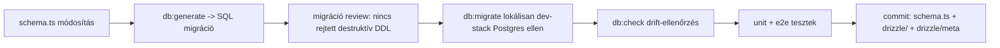
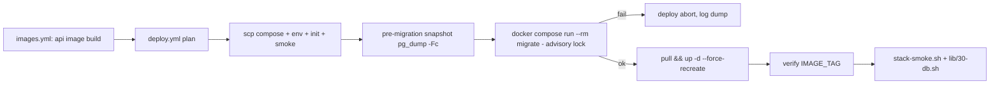

# Terv: adatbázis-migráció, backup és rollback (2026-10-16)

**Dátum:** 2026-10-16 (Europe/Budapest)
**Státusz:** tervezett — jóváhagyásra vár
**Szerző:** architect mode (Zoo)
**Érintett területek:** [`apps/api/`](../../apps/api/), [`infra/docker-compose.yml`](../../infra/docker-compose.yml:27),
[`infra/app/Dockerfile`](../../infra/app/Dockerfile:1), [`infra/postgres/init/`](../../infra/postgres/init/),
[`.github/workflows/deploy.yml`](../../.github/workflows/deploy.yml:1), [`.github/workflows/ci.yml`](../../.github/workflows/ci.yml:1),
[`deploy/deploy.sh`](../../deploy/deploy.sh:1), [`scripts/`](../../scripts/), [`docs/Specs/`](../../docs/Specs/)

---

## 0. Miért kell ez?

A stack már provisionálja a PostgreSQL-t (hivatalos image + idempotens role/db bootstrap
[`01-roles.sh`](../../infra/postgres/init/01-roles.sh:1)), de:

- **Nincs séma.** Az [`callback-requests.service.ts`](../../apps/api/src/callback-requests/callback-requests.service.ts:12)
  továbbra is in-memory `Map`-et használ; nincs `CREATE TABLE`, nincs ORM, nincs migrációs eszköz.
- **A spec előrébb tart a kódnál.** A [`Three-Env-Verification.md`](../../docs/Specs/Three-Env-Verification.md:265)
  már `SELECT count(*) FROM callback_requests` lekérdezést dokumentál, de a táblát semmi sem definiálja.
- **Nincs backup/restore.** A [`Caddy-Reverse-Proxy.md`](../../docs/Specs/Caddy-Reverse-Proxy.md:309) §7
  és a [`snapshot-2026-10-01.md`](../../docs/snapshot-2026-10-01.md:260) is hiányként jelöli.
- **Rollback csak image-szinten** létezik (`IMAGE_TAG` újra-deploy), adat-szinten nincs.

A képalapú deploy-modell a kemény korlát: a droplet **nem buildel és nem kap forráskódot**
(lásd [`deploy.yml`](../../.github/workflows/deploy.yml:1) fejléce). Minden migrációs futóeszköznek
**az image-be kell kerülnie**, ugyanazzal az `IMAGE_TAG`-gel pinelve.

---

## 1. Célok

### Funkcionális célok

- **F1.** A séma **kódként** él a repóban, verziózva, és a migrációk determinisztikusan, sorrendben, egyszer futnak le.
- **F2.** A deploy pipeline **a migráció előtt, az app indulása előtt** alkalmazza a séma-változást; hiba esetén az app **nem** indul el a nem-migrált sémával.
- **F3.** Éjszakai + migráció-előtti backup létezik, **off-host** (DO Spaces), titkosítva, retention-politikával, hibajelzéssel.
- **F4.** A rollback policy explicit: forward-only migráció, image-rollback `IMAGE_TAG`-gel, destruktív DDL külön, backup-gated műveletként.

### Nem-funkcionális célok

- **N1.** A 2 GB-os droplet memóriakeretén belül maradjon (a migrációs konténer rövid életű, a `pg_dump` streamelt, alacsony RAM).
- **N2.** A meglévő pipeline-invariánsok megmaradjanak: nincs `--build` a dropleten, `deploy.yml` és `deploy.sh` ugyanazt csinálja.
- **N3.** Minden új kódhoz **unit teszt**, a deploy-lánchoz **smoke teszt** tartozik, plusz a lent javasolt további tesztfajták.
- **N4.** A dokumentáció (specs, runbook) a kóddal együtt frissül (lásd a `.roo/rules/instructions.md` specs-karbantartási szabályát).

### Anti-célok (szándékosan nem tesszük)

- Nem használunk Prisma-t (a query-engine bináris és a CommonJS forma ütközik a 400m memória-korláttal és az ESM setup-tal — már kizárva a [`2026-10-14-email-module-structural-design-plan.md`](../../docs/history/2026-10-14-email-module-structural-design-plan.md:454)-ben).
- Nem alkalmazunk migrációt az app bootstrapjekor (nem kapcsoljuk össze a liveness-t a DDL-lel, és nem blokkoljuk az indulást hosszú `ALTER`-rel).
- Nem írunk `down` migrációkat a jelenlegi release-nél régebbi változásokhoz.

---

## 2. Eszközök (döntés)

| Terület | Eszköz | Indoklás |
|---|---|---|
| ORM / query réteg | **Drizzle ORM** (`drizzle-orm`) | ESM-native, nincs Rust/query-engine bináris, elfér a 400 MB-os korlátban |
| Migráció-generálás | **`drizzle-kit generate`** | Verziózott SQL fájlokat állít elő, commitolható és review-olható |
| Migráció-futtatás | **one-shot `migrate` compose service** (az `api` image, más `command`) | A droplet nem buildel; a futóeszköz az image-ben van |
| Concurrency-védelem | `pg_advisory_lock` + `lock_timeout` + `statement_timeout` | Két deployer ne futhasson egymásra; korlátos lock-várakozás |
| Backup | `pg_dump -Fc` + `age`/`gpg` titkosítás + `rclone`/`aws s3` → **DO Spaces** | Off-host, tömörített, szelektíven visszaállítható |
| Restore | `pg_restore --clean --if-exists` + throwaway `postgres:16-alpine` drill | Visszaállítási drill, ami havonta fut |
| Ütemezés | droplet cron / systemd timer | Nem növelünk hosszú életű sidecar-konténert a dropleten |
| Tesztek | Jest (unit/e2e) + [`stack-smoke.sh`](../../scripts/test/stack-smoke.sh:1) + CI drift/destructive lint | A meglévő teszt-rétegek kiegészítése |

---

## 3. Folyamatok — a négy élethelyzet

### 3.1 Fejlesztés (development)



1. A fejlesztő a [`schema.ts`](../../apps/api/src/db/schema.ts) (Drizzle) definíciót módosítja.
2. `pnpm --filter @callback/api db:generate` előállítja a verziózott SQL migrációt a `drizzle/` mappába.
3. A migráció review-ja: destruktív utasítás (`DROP COLUMN`, `DROP TABLE`, `ALTER ... TYPE ... USING`, `TRUNCATE`) csak `-- destructive` flaggel mehet.
4. `pnpm --filter @callback/api db:migrate` a helyi Postgres ellen (a [`dev-stack.sh`](../../scripts/dev-stack.sh:1) által indított stacken).
5. `pnpm --filter @callback/api db:check` drift-ellenőrzés (a séma és a migrációk eltérését jelzi).
6. Unit + e2e tesztek futnak (lásd §5).
7. A commit tartalmazza a `schema.ts`-t, a generált SQL migrációt és a `drizzle/meta` snapshotot — a meta nélkül a drift-check nem reprodukálható.

### 3.2 Deploy



1. [`images.yml`](../../.github/workflows/images.yml:1) beégeti a `drizzle/` migrációkat és a `dist/migrate.js`-t az `api` image-be.
2. [`deploy.yml`](../../.github/workflows/deploy.yml:353) a `pull` után, az `up -d` **előtt** futtatja a migrációt:
   - előtte pre-migration snapshot (nem-additív migrációnál kötelező, additívnál opcionális);
   - `docker compose run --rm migrate`;
   - nem-nulla exit kód esetén a deploy megáll, az app **nem** indul el az új sémát feltételező kóddal.
3. [`deploy.sh`](../../deploy/deploy.sh:1) kap egy `migrate` parancsot ugyanezzel a logikával (a CI és a kézi út azonos).
4. A `migrate` service ki van zárva a `Verify every service is running IMAGE_TAG` lépésből (one-shot, a postgres/caddy mellé).

### 3.3 Backup

1. **Éjszakai (RPO = 24h):** [`scripts/db/backup.sh`](../../scripts/db/backup.sh) →
   `pg_dump -Fc` → `age`/`gpg` titkosítás → `rclone`/`aws s3` feltöltés DO Spaces-be →
   retention (7 napi / 4 heti / 6 havi) → hiba esetén alert a meglévő `MONITOR_ALERT_WEBHOOK_URL` webhookra.
2. **Migráció előtti snapshot (RPO = 0 a változás pillanatára):** a deploy-lánc a nem-additív
   migráció előtt `pg_dump -Fc` snapshotot készít `<migration>-<short-sha>` névvel, helyben és (ha beállított) Spaces-ben.
3. **Visszaállítási drill (havonta):** a legújabb artifact visszaállítása egy throwaway
   `postgres:16-alpine` konténerbe, `SELECT count(*)` sanity check, majd a konténer törlése.

### 3.4 Rollback

| Helyzet | Művelet |
|---|---|
| App-hiba, séma kompatibilis | **Image-rollback:** `IMAGE_TAG=sha-<old>` + `up -d --force-recreate`, vagy `deploy.yml` `workflow_dispatch` az `image_tag` inputtal |
| Séma-változás, amit az app még nem használ | **Nincs DB-rollback** — az expand/contract biztosítja, hogy a régi image működik az új sémával |
| Destruktív DDL adatvesztést okozott | **Pre-migration snapshot restore** ([`restore.sh`](../../scripts/db/restore.sh)) — az egyetlen igazi adat-visszaállítás |
| Teljes droplet-kiesés | Spaces-ből restore + stack újraindítás (RTO ≈ 15 perc) |

**Expand/contract szabály (a lényeg):** N-ben hozzáadunk (nullable, dual-write), N+1-ben az app az új alakot használja, N+2-ben töröljük a régit — és csak **verifikált backup után**.

---

## 4. Feladatok (végrehajtási sorrendben, verifikációval)

Minden feladat sora tartalmazza, hogyan ellenőrizzük, hogy az elkészült kód **működik**.

| # | Feladat | Verifikáció (működik-e?) |
|---|---|---|
| 1 | `drizzle-orm` + `drizzle-kit` függőségek és `db:generate` / `db:migrate` / `db:check` scriptek az [`apps/api/package.json`](../../apps/api/package.json:9)-ben | `pnpm --filter @callback/api db:check` fut; `db:generate` SQL fájlt hoz létre |
| 2 | Per-context Postgres sémák (`platform`, `callback`, `email`) új idempotens init scriptben, role-grant igazítás a [`01-roles.sh`](../../infra/postgres/init/01-roles.sh:1)-ben | friss droplet-en a `\dn` listázza a három sémát; `aisztens` role-nak van USAGE jogosultsága |
| 3 | Drizzle séma + első migráció (`callback_requests` tábla a `callback` sémában, migration bookkeeping) | `SELECT count(*) FROM callback.callback_requests` fut; `__drizzle_migrations` tábla létrejön |
| 4 | [`migrate.ts`](../../apps/api/src/db/migrate.ts) futóeszköz: `pg_advisory_lock` + `lock_timeout=5s` + `statement_timeout=60s`, non-zero exit hibánál | unit teszt: lock-ütközés esetén a második futó várakozik/kilép; hibás migráció → non-zero exit |
| 5 | Migráció + `dist/migrate.js` beégetése az [`infra/app/Dockerfile`](../../infra/app/Dockerfile:1)-be | `docker run <image> node apps/api/dist/migrate.js --help` (vagy dry-run) fut a buildelt image-ből |
| 6 | One-shot `migrate` service a [`docker-compose.yml`](../../infra/docker-compose.yml:27)-ben (`restart: "no"`, `depends_on postgres healthy`) | `docker compose run --rm migrate` helyi stacken lefut, másodjára no-op |
| 7 | Migrációs lépés a [`deploy.yml`](../../.github/workflows/deploy.yml:353)-ben `pull` és `up -d` között + `migrate` parancs a [`deploy.sh`](../../deploy/deploy.sh:1)-ben | CI deploy során a `run --rm migrate` step zöld; hibás migráció esetén a deploy megáll |
| 8 | Pre-migration snapshot a deploy-láncban (nem-additív migrációnál kötelező) | deploy után a `/opt/aisztens/backups/pre-migrate-*` fájl létezik |
| 9 | [`scripts/db/backup.sh`](../../scripts/db/backup.sh): éjszakai `pg_dump` + titkosítás + DO Spaces + retention + alert | kézi futtatás → Spaces-ben megjelenik a titkosított dump; hiba-ág → webhook alert |
| 10 | [`scripts/db/restore.sh`](../../scripts/db/restore.sh) + [`restore-drill.sh`](../../scripts/db/restore-drill.sh): `pg_restore` + throwaway-konténeres drill | drill lefut: dump → throwaway postgres → `SELECT count(*)` egyezik → konténer törölve |
| 11 | [`lib/30-db.sh`](../../scripts/test/lib/30-db.sh) smoke checkek + bekötés a [`stack-smoke.sh`](../../scripts/test/stack-smoke.sh:81)-be | `pnpm test:stack` a DB-checkekkel zöld: migration at head, idempotens újrafutás, táblák léteznek, insert/read/delete round-trip |
| 12 | Drift-check + destruktív-DDL lint a [`ci.yml`](../../.github/workflows/ci.yml:1)-ben | séma-változás migráció nélkül → PR vörös; `DROP ...` `-- destructive` nélkül → PR vörös |
| 13 | E2E: a `callback-requests` in-memory `Map` cseréje valódi Postgres store-ra | [`test/`](../../apps/api/test/app.e2e-spec.ts:1): `POST /api/callback-requests` → sor a `callback.callback_requests` táblában |
| 14 | Rollback-policy + RPO/RTO dokumentálása | a runbook-ban a parancsok és a várt RPO/RTO szerepelnek; egy dokumentált drill lefuttatható |
| 15 | Dokumentáció: új [`Database-Migrations-and-Backup.md`](../../docs/Specs/Database-Migrations-and-Backup.md) + a Production-Runbook, Infrastructure-Docker, Caddy-Reverse-Proxy §7 frissítése | a spec-karbantartási szabály szerint a doksik a kóddal együtt naprakészek |

---

## 5. Tesztstratégia

### Kötelező

| Szint | Hol | Mit ellenőriz |
|---|---|---|
| **Unit** | [`apps/api/src/db/*.spec.ts`](../../apps/api/src/db/) | séma-mapping, repository CRUD, migrációs futó lock/timeout viselkedése, backup retention logika |
| **Smoke** | [`lib/30-db.sh`](../../scripts/test/lib/30-db.sh) | migration at head, idempotens újrafutás, elvárt táblák/oszlopok, synthetic `callback_request` insert/read/delete round-trip, `pg_isready` |

### Javasolt további tesztek

| Tesztfajta | Cél | Hogyan |
|---|---|---|
| **E2E / integráció** | a valódi store működik a HTTP rétegen át | Jest e2e: `POST /api/callback-requests` → sor a Postgresben; a [`test/lib/app-module-gate.ts`](../../apps/api/test/lib/app-module-gate.ts:1) mintájára |
| **Drift-check** | séma-változás migráció nélkül ne jusson ki | `db:check` a CI-ban (`drizzle-kit` diff/check) |
| **Destruktív-DDL lint** | `DROP`/`TRUNCATE`/`ALTER TYPE USING` csak explicit flaggel | CI lint a `drizzle/` SQL fájlokra |
| **Idempotencia-teszt** | a migráció kétszeri futtatása no-op | smoke: második `migrate` futás 0 változással |
| **Concurrency-teszt** | két párhuzamos migráció ne ütközzön | unit/smoke: advisory lock alatt a második futó blokkol vagy kilép |
| **Restore-drill** | a backup tényleg visszaállítható | ütemezett `restore-drill.sh` + havi automatikus futtatás |
| **Data-loss guard** | destruktív migráció előtt legyen snapshot | deploy-gate: `-- destructive` migráció snapshot nélkül → megáll |
| **Perf/regresszió** | a migráció a timeout alatt fut | `statement_timeout` + a futási idő logolása a deploy stepben |

---

## 6. Fájl-változás lista

| Fájl | Változás |
|---|---|
| [`apps/api/src/db/schema.ts`](../../apps/api/src/db/schema.ts) | Drizzle séma (`callback_requests` + `callback` schema) |
| [`apps/api/src/db/client.ts`](../../apps/api/src/db/client.ts) | `pg`/`postgres` kliens `DATABASE_URL`-ből |
| [`apps/api/src/db/migrate.ts`](../../apps/api/src/db/migrate.ts) | advisory-locked migrációs futó → `dist/migrate.js` |
| [`apps/api/src/db/drizzle.config.ts`](../../apps/api/src/db/drizzle.config.ts) | drizzle-kit konfig |
| `apps/api/drizzle/` | generált SQL migrációk (commitolt) + `meta/` |
| [`apps/api/package.json`](../../apps/api/package.json:9) | `drizzle-orm`, `pg`/`postgres`, dev `drizzle-kit`; `db:*` scriptek |
| [`infra/app/Dockerfile`](../../infra/app/Dockerfile:1) | `drizzle/` + `dist/migrate.js` beégetése |
| [`infra/docker-compose.yml`](../../infra/docker-compose.yml:27) | one-shot `migrate` service |
| [`infra/postgres/init/`](../../infra/postgres/init/) | per-context sémák + role-grantok |
| [`.github/workflows/deploy.yml`](../../.github/workflows/deploy.yml:353) | pre-migration snapshot + `run --rm migrate` + tag-check kivétel |
| [`.github/workflows/ci.yml`](../../.github/workflows/ci.yml:1) | drift-check + destruktív-DDL lint |
| [`deploy/deploy.sh`](../../deploy/deploy.sh:1) | `migrate` parancs + snapshot tükör |
| `scripts/db/backup.sh`, `restore.sh`, `restore-drill.sh` | backup/restore/drill |
| [`scripts/test/lib/30-db.sh`](../../scripts/test/lib/30-db.sh) + [`stack-smoke.sh`](../../scripts/test/stack-smoke.sh:81) | DB smoke checkek |
| [`docs/Specs/Database-Migrations-and-Backup.md`](../../docs/Specs/Database-Migrations-and-Backup.md) | új élő spec |
| Production-Runbook, Infrastructure-Docker, Caddy-Reverse-Proxy | runbook/spec frissítés |

---

## 7. Kockázatok és mitigáció

| Kockázat | Mitigáció |
|---|---|
| Két deployer migrációja ütközik | advisory lock + per-env deploy concurrency (már létezik a `deploy.yml`-ben) |
| Hosszú `ALTER TABLE` lockolja az appot | `lock_timeout`, `statement_timeout`, indexeknél `CONCURRENTLY` |
| A backup csendben sérült | havi restore-drill, ami hangosan hibázik |
| Spaces credential kiszivárgása | titkosítás at-rest; privát kulcs off-host; `BACKUP_S3_*` az `infra/.env`-ben (`chmod 600`) |
| 2 GB droplet memória a `pg_dump` alatt | `pg_dump` streamelt, alacsony RAM; a titkosítás streamelt |
| Első deploy meglévő dev droplet ellen, migrációs tábla nélkül | `migrate.ts` első futáskor létrehozza a bookkeeping táblát; nem kell kézi baseline |

---

## 8. JIRA-ba importálható subtask-lista

Epic: **DB platform** (Persistence + Migrations + Backup). Story: `DB-1` ADR a döntéshez, `DB-2..DB-5` a migrációs platform, `DB-6..DB-8` a backup, `DB-9..DB-10` a verifikáció és a doksi.

| Key | Summary (EN) | Type | Acceptance criteria (EN) |
|---|---|---|---|
| DB-1 | Record Drizzle ORM migration-tooling ADR in docs/history | Task | ADR names Drizzle Kit as tool, one-shot compose service as runner, DO Spaces as backup target; Prisma exclusion referenced |
| DB-2 | Add drizzle-orm and drizzle-kit deps plus db scripts to apps/api | Sub-task | `db:generate`, `db:migrate`, `db:check` run; `db:check` passes on clean tree |
| DB-3 | Create per-context Postgres schemas and role grants in init scripts | Sub-task | `platform`, `callback`, `email` schemas exist on a fresh droplet; `aisztens` has USAGE |
| DB-4 | Define Drizzle schema and generate first callback_requests migration | Sub-task | `callback.callback_requests` and `__drizzle_migrations` exist after migrate |
| DB-5 | Implement advisory-locked migration runner dist/migrate.js | Sub-task | Lock, lock_timeout, statement_timeout; unit test proves concurrent run blocks and failure exits non-zero |
| DB-6 | Bake migrations and migrate.js into the api Docker image | Sub-task | Built image contains drizzle/ and dist/migrate.js |
| DB-7 | Add one-shot migrate service to docker-compose.yml | Sub-task | `docker compose run --rm migrate` runs twice, second run is a no-op |
| DB-8 | Wire migration step into deploy.yml and deploy.sh migrate command | Sub-task | CI deploy runs migrate between pull and up -d; failed migration aborts deploy |
| DB-9 | Implement pre-migration snapshot in the deploy path | Sub-task | Non-additive migrations produce pre-migrate-<migration>-<sha>.dump |
| DB-10 | Add schema-drift and destructive-DDL lint to ci.yml | Sub-task | Schema change without migration and unflagged DROP fail the PR |
| DB-11 | Implement scripts/db/backup.sh with encryption, DO Spaces and retention | Sub-task | Nightly run lands an encrypted dump in Spaces; failure triggers the alert webhook |
| DB-12 | Implement scripts/db/restore.sh and restore-drill.sh | Sub-task | Drill restores newest artifact into throwaway postgres and row counts match |
| DB-13 | Add DB smoke checks lib/30-db.sh wired into stack-smoke.sh | Sub-task | `pnpm test:stack` passes: at head, idempotent, tables exist, CRUD round-trip |
| DB-14 | Replace in-memory callback-requests store with Postgres store and add e2e test | Sub-task | `POST /api/callback-requests` persists a row; e2e asserts it |
| DB-15 | Document rollback policy, RPO and RTO in the runbook | Sub-task | Runbook contains image rollback, expand/contract, snapshot restore, RPO/RTO |
| DB-16 | Create Database-Migrations-and-Backup spec and update related specs | Sub-task | New spec plus Production-Runbook, Infrastructure-Docker, Caddy-Reverse-Proxy §7 updated in sync |

CSV-váz az importáláshoz (Summary;Issue Type;Acceptance criteria oszlopokkal):

```csv
Summary,Issue Type,Acceptance criteria
"Record Drizzle ORM migration-tooling ADR in docs/history",Task,"ADR names Drizzle Kit, one-shot compose runner, DO Spaces target"
"Add drizzle-orm and drizzle-kit deps plus db scripts to apps/api",Sub-task,"db:generate/db:migrate/db:check run and pass on clean tree"
"Create per-context Postgres schemas and role grants in init scripts",Sub-task,"schemas exist on fresh droplet; aisztens has USAGE"
"Define Drizzle schema and generate first callback_requests migration",Sub-task,"callback.callback_requests and __drizzle_migrations exist"
"Implement advisory-locked migration runner dist/migrate.js",Sub-task,"lock/timeout; unit test for concurrency and failure exit"
"Bake migrations and migrate.js into the api Docker image",Sub-task,"built image contains drizzle/ and dist/migrate.js"
"Add one-shot migrate service to docker-compose.yml",Sub-task,"run twice; second run no-op"
"Wire migration step into deploy.yml and deploy.sh migrate command",Sub-task,"migrate between pull and up -d; failure aborts"
"Implement pre-migration snapshot in the deploy path",Sub-task,"non-additive migrations produce pre-migrate dump"
"Add schema-drift and destructive-DDL lint to ci.yml",Sub-task,"drift or unflagged DROP fails the PR"
"Implement scripts/db/backup.sh with encryption, DO Spaces and retention",Sub-task,"encrypted dump in Spaces; failure alerts"
"Implement scripts/db/restore.sh and restore-drill.sh",Sub-task,"drill restores and row counts match"
"Add DB smoke checks lib/30-db.sh wired into stack-smoke.sh",Sub-task,"pnpm test:stack passes DB checks"
"Replace in-memory callback-requests store with Postgres store and add e2e test",Sub-task,"POST persists a row; e2e asserts"
"Document rollback policy, RPO and RTO in the runbook",Sub-task,"runbook contains rollback paths and RPO/RTO"
"Create Database-Migrations-and-Backup spec and update related specs",Sub-task,"specs updated in sync with code"
```

---

## 9. Jóváhagyási kérdések

1. A **DO Spaces** mint off-host backup-cél megfelelő, vagy más S3-kompatibilis targetet (pl. Backblaze B2) szeretnél?
2. A **per-context sémák** (`platform` / `callback` / `email`) már az első migrációban létrejöjjenek, vagy csak a `callback` most, a többi később?
3. A **restore-drill** havi automatikus ütemezést kapjon a dropleten, vagy maradjon manuálisan futtatható?
4. Jóváhagyod-e a §8 subtask-bontást JIRA-importra, vagy epics/story szerkezetet is szeretnél?
