# Database migrations, backup & recovery — implementation plan

**Date:** 2026-10-16
**Status:** Approved for implementation (phases 1–3)
**Scope:** schema-as-code migrations, nightly + pre-migration backups, restore/rollback, and DB-aware smoke verification for the AIsztens stack.

## 1. Context and problem

The stack already provisions PostgreSQL via the official image and an idempotent
role/bootstrap script (`infra/postgres/init/01-roles.sh`), but:

- **There is no schema yet.** `apps/api` still uses an in-memory `Map` in
  [`callback-requests.service.ts`](../../apps/api/src/callback-requests/callback-requests.service.ts:12).
  No `CREATE TABLE`, no ORM, no migration tooling exists anywhere in the repo.
- **Specs are ahead of the code.** [`docs/Specs/Three-Env-Verification.md`](../../docs/Specs/Three-Env-Verification.md:265)
  already documents `SELECT count(*) FROM callback_requests`, but no DDL
  defines that table.
- **No backup/restore flow.** Explicitly flagged as a gap in
  [`docs/Specs/Caddy-Reverse-Proxy.md`](../../docs/Specs/Caddy-Reverse-Proxy.md:309) §7
  and [`docs/snapshot-2026-10-01.md`](../../docs/snapshot-2026-10-01.md:260).
- **Rollback exists only for images** (`IMAGE_TAG` re-dispatch), not for data.

The image-based deploy model (`images.yml` builds → `deploy.yml` pulls and
starts on the droplet, no build step on the host) is the hard constraint: any
migration runner must ship **inside** an image pinned to the same `IMAGE_TAG`.

## 2. Decisions (ADR summary)

| Decision | Choice | Rationale |
|---|---|---|
| ORM / query layer | **Drizzle ORM** (`drizzle-orm` + `drizzle-kit`) | ESM-native, no Rust/query-engine binary, fits the 400 MB memory cap; Prisma is already ruled out in [`2026-10-14-email-module-structural-design-plan.md`](../../docs/plans/2026-10-14-email-module-structural-design-plan.md:454) |
| Migration format | **SQL files generated by `drizzle-kit generate`**, committed and reviewed | Human-auditable, deterministic, and independent of the runtime ORM |
| Migration application | **One-shot compose service** in [`infra/docker-compose.yml`](../../infra/docker-compose.yml:27), pinned to the same `IMAGE_TAG`, `restart: "no"` | The droplet has no source and no build step; the runner must live in the `api` image |
| Migration timing | **Between `pull` and `up -d`** in the deploy pipeline | The app never starts against an un-migrated schema |
| Concurrency safety | `pg_advisory_lock` on a fixed key + `lock_timeout` + `statement_timeout` | Prevents two deployers racing; bounds lock wait and long statements |
| Rollback policy | **Expand/contract, forward-only migrations**; image rollback via `IMAGE_TAG`; destructive DDL is a separate, backup-gated operation | Schema cannot roll back cleanly; the old image must keep working against the new schema |
| Backup destination | **DigitalOcean Spaces** (off-host), encrypted with age/gpg | A dump on the same droplet dies with the droplet |
| Backup format | `pg_dump -Fc` (custom format) | Compressed, supports selective restore and `pg_restore --clean --if-exists` |

## 3. Target architecture

```mermaid
flowchart LR
    A[git push dev] --> B[images.yml: api image bakes schema + migrations + migrate.js]
    B --> C[deploy.yml plan job]
    C --> D[scp compose + env + init + smoke]
    D --> E[pre-migration snapshot pg_dump -Fc]
    E --> F[one-shot migrate service advisory lock]
    F --> G[pull && up -d --force-recreate]
    G --> H[verify IMAGE_TAG]
    H --> I[stack-smoke.sh + lib/30-db.sh]
    I --> J[daily cron: pg_dump -> encrypt -> DO Spaces]
    J --> K[monthly restore drill into throwaway postgres]
```



## 4. Phase 1 — migrations as code

### 4.1 Schema definition and migration runner

1. Create `apps/api/src/db/` with:
   - `schema.ts` — Drizzle schema definitions (start with `callback_requests`;
     later per-context tables under `platform`, `callback`, `email` schemas).
   - `client.ts` — a `pg` pool or `postgres.js` client reading `DATABASE_URL`.
   - `migrate.ts` — the standalone runner (compiled to `dist/migrate.js`):
     * acquires `pg_advisory_lock(<fixed-key>)`;
     * sets `SET lock_timeout = '5s'` and `SET statement_timeout = '60s'`;
     * applies pending migrations from the bundled `drizzle/` folder via
       Drizzle's migrator against a tracked `__drizzle_migrations` table;
     * releases the lock and exits non-zero on failure.
   - `drizzle.config.ts` — `drizzle-kit` config, `dialect: postgresql`,
     `out: ./drizzle`.
2. Add `npm` scripts in `apps/api/package.json`:
   - `db:generate` → `drizzle-kit generate`
   - `db:migrate` → `node dist/migrate.js`
   - `db:check` → drift check (see §7).
3. Add dependencies: `drizzle-orm`, `postgres` (or `pg`), dev `drizzle-kit`.
4. Generate the **first migration** creating the `callback_requests` table
   (and the `callback` schema), matching the shared Zod type in
   [`packages/shared/src/types/callback-request.ts`](../../packages/shared/src/types/callback-request.ts:1).
5. Add a `migrate` entrypoint to [`infra/app/Dockerfile`](../../infra/app/Dockerfile:1)
   so the image contains `drizzle/` and `dist/migrate.js`.

### 4.2 One-shot compose service

In [`infra/docker-compose.yml`](../../infra/docker-compose.yml:27):

```yaml
migrate:
  image: ${REGISTRY:-ghcr.io}/${GHCR_OWNER:-local}/aisztens-api:${IMAGE_TAG:-latest}
  restart: "no"
  mem_limit: 256m
  environment:
    NODE_ENV: production
    APP_ENV: ${APP_ENV:-dev}
    DATABASE_URL: postgres://${AISZTENS_DB_USER:-aisztens}:${AISZTENS_DB_PASSWORD}@postgres:5432/${POSTGRES_DB:-aisztens_db}
  command: ["node", "apps/api/dist/migrate.js"]
  depends_on:
    postgres:
      condition: service_healthy
  networks:
    - internal
```

The `migrate` service is excluded from the `Verify every service is running
IMAGE_TAG` step in `deploy.yml` (it is one-shot, alongside postgres/caddy
exemptions).

### 4.3 Deploy wiring

- [`deploy.yml`](../../.github/workflows/deploy.yml:353): after `pull`, run
  `docker compose ... run --rm migrate` (preceded by the pre-migration
  snapshot from §5.2), then `up -d --force-recreate`. Fail the deploy if the
  migration exits non-zero.
- [`deploy/deploy.sh`](../../deploy/deploy.sh:1): add a `migrate` command that
  mirrors the workflow step, plus a pre-migration snapshot. Keep the manual
  and CI paths identical, per the existing invariant.

## 5. Phase 2 — backups and restore

### 5.1 Nightly logical backup (DO Spaces)

New `scripts/db/backup.sh`, run from a droplet cron/systemd timer:

1. `docker exec postgres pg_dump -Fc -U <superuser> -d aisztens_db > /tmp/...dump`.
2. Encrypt with `age` (or gpg) using a key whose private half lives off-host.
3. Upload to DO Spaces via `rclone` (or `aws s3 cp` with an S3-compatible
   endpoint) using `BACKUP_S3_*` credentials from `infra/.env`.
4. Retention: keep 7 daily / 4 weekly / 6 monthly; prune by filename prefix.
5. Alert on any failure via the existing `MONITOR_ALERT_WEBHOOK_URL` webhook.

Backups include the per-context schemas (`pg_dump -n platform -n callback -n email`
plus roles via `--no-owner` handling as needed) so a restore is complete.

### 5.2 Pre-migration snapshot

Before any migration in the deploy path, take `pg_dump -Fc` and store it
locally on the droplet under `/opt/aisztens/backups/pre-migrate-<migration>-<short-sha>.dump`
and (when configured) push a copy to Spaces. This is the rollback grip for
the exact point of change. Pure-additive migrations may skip this (configurable),
destructive migrations must never skip it.

### 5.3 Restore and restore drill

- `scripts/db/restore.sh`: `pg_restore --clean --if-exists -d aisztens_db <dump>`
  with a pre-restore confirmation and a post-restore `SELECT count(*)` sanity check.
- `scripts/db/restore-drill.sh`: pulls the newest artifact from Spaces, starts a
  throwaway `postgres:16-alpine` container on a scratch port, restores, runs
  sanity queries, then removes the container. Scheduled monthly and runnable
  manually; failure alerts to the monitor webhook.

## 6. Phase 3 — verification, drift and rollback

### 6.1 Smoke tests (`scripts/test/lib/30-db.sh`)

Wire into [`scripts/test/stack-smoke.sh`](../../scripts/test/stack-smoke.sh:81):

1. Postgres readiness (existing) + `migrate` state: the tracked migration
   table exists and is at head for the bundled migration set.
2. Idempotency: running the migration a second time is a no-op.
3. Expected tables/columns exist (`callback_requests`).
4. Round-trip: insert a synthetic callback request, read it back, assert,
   delete it — proving the real store works end to end.

### 6.2 Drift and destructive-DDL lint in CI

- Add `db:check` (`drizzle-kit` diff/check against `schema.ts`) to
  [`ci.yml`](../../.github/workflows/ci.yml:1): a schema change with no
  committed migration fails the PR.
- Add a lint that flags destructive statements (`DROP COLUMN`, `DROP TABLE`,
  `ALTER ... TYPE ... USING`, `TRUNCATE`) unless the migration is explicitly
  marked `-- destructive`. Destructive migrations are deploy-gated on a backup.

### 6.3 Rollback policy (documented)

- **Forward-only.** No `down` migrations except for the release currently
  being rolled out.
- **Image rollback** stays the primary lever: `IMAGE_TAG=sha-<old>` +
  `up -d --force-recreate`, or `deploy.yml` `workflow_dispatch` with `image_tag`.
- **Data rollback** = restore the pre-migration snapshot; document RPO/RTO:
  RPO = 24 h (nightly) or 0 for the pre-migration snapshot; RTO = ~15 min
  (restore from Spaces + restart stack).

## 7. File-by-file change list

| File | Change |
|---|---|
| `apps/api/src/db/schema.ts` | Drizzle schema (callback_requests + callback schema) |
| `apps/api/src/db/client.ts` | `pg`/`postgres` client from `DATABASE_URL` |
| `apps/api/src/db/migrate.ts` | advisory-locked migration runner (→ `dist/migrate.js`) |
| `apps/api/src/db/drizzle.config.ts` | drizzle-kit config |
| `apps/api/drizzle/` | generated SQL migrations (committed) |
| `apps/api/package.json` | `drizzle-orm`, `pg`/`postgres`, dev `drizzle-kit`; `db:*` scripts |
| `infra/app/Dockerfile` | bake `drizzle/` + `dist/migrate.js` into the image |
| `infra/docker-compose.yml` | add one-shot `migrate` service |
| `.github/workflows/deploy.yml` | pre-migration snapshot + `run --rm migrate` + tag-check exemption |
| `.github/workflows/ci.yml` | drift check + destructive-DDL lint |
| `deploy/deploy.sh` | `migrate` command + pre-migration snapshot mirror |
| `scripts/db/backup.sh` | nightly dump → encrypt → DO Spaces → retention → alert |
| `scripts/db/restore.sh` | `pg_restore` with sanity checks |
| `scripts/db/restore-drill.sh` | throwaway-container restore drill |
| `scripts/test/lib/30-db.sh` | DB smoke checks |
| `scripts/test/stack-smoke.sh` | call `run_db_checks` |
| `docs/Specs/Database-Migrations-and-Backup.md` | new living spec |
| `docs/Specs/Production-Runbook.md` | backup/restore/rollback runbook sections |
| `docs/Specs/Infrastructure-Docker.md` | `migrate` service in the service table |
| `docs/Specs/Caddy-Reverse-Proxy.md` | close the §7 backup gap |

## 8. Risks and mitigations

| Risk | Mitigation |
|---|---|
| Migration races between two deployers | advisory lock + single deploy job per env (already enforced by `deploy.yml` concurrency) |
| Long `ALTER TABLE` locks the app | `lock_timeout`, `statement_timeout`, `CONCURRENTLY` for indexes |
| Backup silently corrupt | restore drill runs monthly and fails loudly |
| Spaces credentials leak | encrypted at rest; private key off-host; `BACKUP_S3_*` kept in `infra/.env` (already `chmod 600`) |
| 2 GB droplet memory during `pg_dump` | `pg_dump` is a streamed, low-RAM operation; encryption is streamed via `age`/gpg |
| First deploy against an existing dev droplet without the migration table | `migrate.ts` creates the bookkeeping table on first run; no manual baseline needed |

## 9. Verification of this plan (done at the end of each phase)

1. `pnpm --filter @callback/api db:generate && db:migrate` succeeds locally.
2. `pnpm test:stack` passes including the new `30-db` checks.
3. A full CI deploy (`images.yml` → `deploy.yml`) runs the one-shot migration
   before `up -d`, and the smoke suite's DB checks pass on the live droplet.
4. `scripts/db/backup.sh` produces an encrypted dump in DO Spaces; the restore
   drill restores it into a throwaway container and reports success.

## 10. Follow-ups (out of scope for phases 1–3)

- WAL archiving / PITR (`wal-g` or `pgBackRest`) for minute-level RPO.
- Whole-volume `pgdata` snapshots for whole-host DR (DigitalOcean snapshots).
- Secret rotation for `BACKUP_S3_*` and the age/gpg key.
