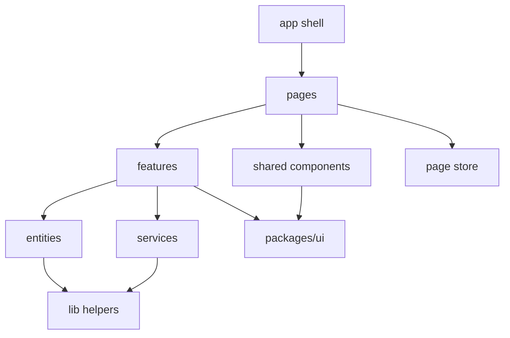

# React UI Architecture & AI Code-Generation Instructions — Implementation Plan

**Date:** 2026-10-18
**Status:** Draft (awaiting approval)
**Scope:** [`apps/web`](../../apps/web/package.json:1), [`apps/admin`](../../apps/admin/package.json:1), new `packages/ui`, new `packages/api-client`
**Decisions confirmed by owner:** TanStack Query for server state + Zustand page-scoped stores (factory + provider, auto-reset) + react-hook-form for forms; shared token & primitive package `packages/ui`; both apps.

## 1. Problem

The frontend has no architecture contract:

| Symptom | Evidence |
|---|---|
| No layer separation — pages fetch and decide | [`CallbackFormPage.tsx`](../../apps/web/src/pages/CallbackFormPage.tsx:20-28), [`DashboardPage.tsx`](../../apps/admin/src/pages/DashboardPage.tsx:21-24) |
| Transport code duplicated per app | [`apps/web/src/lib/api.ts`](../../apps/web/src/lib/api.ts:10), [`apps/admin/src/lib/api.ts`](../../apps/admin/src/lib/api.ts:6) |
| Only global state is an auth context | [`AuthContext.tsx`](../../apps/admin/src/auth/AuthContext.tsx:11) |
| No design tokens, palette colors inline | [`App.tsx`](../../apps/admin/src/App.tsx:19), [`DashboardPage.tsx`](../../apps/admin/src/pages/DashboardPage.tsx:8-16) |
| Flat dark theme, not dark neomorphism | [`index.css`](../../apps/web/src/index.css:1-6) |
| No frontend tests, no lint gate | [`package.json`](../../apps/web/package.json:14-15) |

Goal: one AI-readable rule set plus a migrated structure that makes the rules mechanically true.

## 2. Deliverables

| File | Purpose |
|---|---|
| [`.roo/rules/react.coding-standards.md`](../../.roo/rules/react.coding-standards.md:1) | Enforced, imperative AI rules (layers, state, tokens, forbidden patterns, checklists) |
| [`docs/Specs/UI-Architecture.md`](docs/Specs/UI-Architecture.md:1) | Living spec: folder tree, layer contracts, per-page state plan, token catalogue |
| `packages/ui/src/styles/theme.css` | Single source of Tailwind v4 `@theme` tokens |
| `packages/ui/src/components/**` | CVA primitives — the only place token classes are combined |
| `packages/api-client/**` | Typed fetch client, `ApiError`, domain service interfaces (no React) |
| `apps/*/src/**` | Migrated to layered structure |
| `eslint.config.mjs` (both apps) | Guardrails against layer violations and hardcoded colors |
| `apps/*/vitest.config.ts` + `src/test/mocks/**` | Test harness per TS testing rules |
| `docs/history/<timestamp>-react-ui-architecture.md`, `docs/milestones/<timestamp>-ui-architecture.milestone.md` | Required session + decision records |

## 3. Target structure

```text
apps/<app>/src/
  app/                 providers, router, layout shell, error boundary
  pages/<page>/
    <Page>.tsx         route entry: composition only
    <page>.store.ts    page-scoped Zustand factory
    <page>.interface.ts
    <page>.const.ts    query keys, defaults
    ui/                page-only presentational parts
  features/<use-case>/
    use-<use-case>.ts  query/mutation hooks
    <use-case>.logic.ts pure business rules
    <use-case>.interface.ts
    <use-case>.const.ts
  entities/<entity>/   domain types, mappers, read-only display
  services/            wiring: http client instance, auth token provider
  components/          shared presentational shells (layout, errors)
  lib/                 pure helpers, formatters
```

```text
packages/ui/src/
  styles/theme.css     @theme tokens + base layer
  components/<primitive>/<Primitive>.tsx + <primitive>.variants.ts
  index.ts
```

Dependency direction (acyclic, one-way):



Hard rules: `pages` never import another `pages` folder; `features` never import another `features` folder (share through `entities`/`lib`); `services` contain no React import; `components` fetch nothing and hold no business rules.

## 4. Service layer

- `packages/api-client/src/http-client.ts` — `request<T>()` wrapper: base URL, JSON, timeout, typed `ApiError` (status, code, message), optional token supplier injected via constructor (no direct storage access).
- `packages/api-client/src/<domain>/<domain>.service.ts` — implements `<Domain>Service` interface; validates responses with the shared Zod schemas, never throws raw `Error`.
- `apps/<app>/src/services/api.service.ts` — composition root: creates the client with `import.meta.env.VITE_API_BASE_URL` and the token supplier from the session store.
- Consumption only through `features/*/use-*.ts` (TanStack Query). Components never import services.

## 5. Business logic layer

- Logic lives in pure `*.logic.ts` functions (no hooks, no JSX) — unit-testable without DOM.
- Orchestration lives in `features/*/use-*.ts` (TanStack Query `queryFn`/`mutationFn`, cache invalidation).
- Components receive props and emit callbacks only. Mapping/sorting/filtering/status→variant decisions move out of JSX (today: [`statusBadgeClass()`](../../apps/admin/src/pages/DashboardPage.tsx:6) belongs to `entities/callback-request`).

## 6. State storage plan per page

Three explicit buckets — never mix:

| Page | Server state (TanStack Query key) | Page UI state (Zustand) | Form state |
|---|---|---|---|
| web / Home | — | — | — |
| web / Callback | `mutation submit-callback-request` | `campaignSource`, `submittedId` | RHF + shared Zod schema |
| web / Thank you | router state, later `query callback-request/:id` | — | — |
| web / Legal | — | — | — |
| admin / Login | `mutation login` | — | RHF |
| admin / Dashboard | `['callback-requests', filters]` | `filters`, `sort`, `selectedId`, `page` | — |
| admin / Calls (planned) | `['calls', filters]`, `['call', id]` | `filters`, `activeTab`, `playbackId` | — |
| admin / Request detail (planned) | `['callback-request', id]` | `tab`, `drawerOpen` | — |
| app shell | — | `useSessionStore` (token, role) — the only global store | — |

Store contract:

- One `createPageStore()` factory (`zustand/vanilla` + `createStore`) per page, exposed via a page-local provider.
- Mounted inside the route element → unmount resets state (except an explicit `persist` whitelist, e.g. dashboard filters).
- Selector hooks only (`usePageStore(s => s.filters)`); no whole-store subscriptions.
- No store import outside its own page folder; no server data in Zustand; no UI state in TanStack Query cache.
- Query keys and defaults in `<page>.const.ts` (or `features/*/*.const.ts`) to keep keys DRY.

## 7. Dark neomorphism design system

`packages/ui/src/styles/theme.css` — Tailwind v4 `@theme` tokens, the only place color literals exist:

| Group | Tokens |
|---|---|
| Brand | `--color-primary`, `--color-primary-foreground`, `--color-secondary`, `--color-tertiary`, `--color-quaternary` (+ each `-foreground`) |
| Surface | `--color-surface-base`, `--color-surface-raised`, `--color-surface-sunken`, `--color-surface-overlay` |
| Border | `--color-border-hairline`, `--color-border-default`, `--color-border-strong`, `--color-border-focus` |
| Text | `--color-text-primary`, `--color-text-secondary`, `--color-text-muted`, `--color-text-inverse` |
| State | `--color-success`, `--color-warning`, `--color-danger`, `--color-info` (+ `-foreground`) |
| Depth | `--shadow-neu-raised`, `--shadow-neu-inset`, `--shadow-neu-pressed`, `--shadow-focus-ring` |
| Thickness | `--border-width-hairline`, `--border-width-default`, `--border-width-strong` |
| Shape | `--radius-control`, `--radius-card`, `--radius-pill` |
| Motion | `--duration-fast`, `--duration-base`, `--ease-neu` |

Neomorphic recipe (documented in the rules file): raised = `surface-raised` + 1px `border-hairline` + light shadow top-left + dark shadow bottom-right; pressed/inset = inverted inset shadows; focus = `border-focus` + `shadow-focus-ring`; text tokens must meet WCAG AA on their surface.

Primitives (built with CVA variants): `Button`, `Input`, `Textarea`, `Field`, `Card`, `Badge`, `Alert`, `Table`, `Spinner`, `Modal`. Pages and features use these — they may not compose raw token classes for new visual concepts; design additions go into `packages/ui`.

Forbidden in app code: hex/rgb/hsl literals, Tailwind palette names (`slate-*`, `indigo-*`, `red-*`, …), opacity modifiers on palette colors, arbitrary color values (`bg-[#...]`).

## 8. Enforcement

- ESLint flat config per app: `typescript-eslint`, `react-hooks`, `no-restricted-syntax` regexes for color literals and palette utilities, `no-restricted-imports` for layer boundaries.
- `pnpm lint` wired per app and in the root script (currently stubs).
- Vitest + Testing Library per app; mocks centralized in `src/test/mocks/**` (per TS rules); logic and store tests mandatory, component tests for primitives.
- Review checklist embedded in the rules file (used by the AI before finishing any UI task).

## 9. Execution order

1. Write the AI rules file and the living UI architecture spec.
2. Scaffold `packages/ui` (workspace package, exports `theme.css` + primitives).
3. Scaffold `packages/api-client` (client, `ApiError`, `CallbackRequestsService`).
4. Migrate `apps/web` (tokens, services, CallbackForm feature + page store, page decomposition).
5. Migrate `apps/admin` (query hooks, dashboard page store, tokenized primitives, session store).
6. Add ESLint guardrails + Vitest harness, retrofit tests for migrated logic.
7. Verify build/lint/test and visual parity, then update specs, history entry and milestone.
8. Keep [`docs/Specs/UI-Architecture.md`](docs/Specs/UI-Architecture.md:1) in sync from then on (rules/instructions require it).

## 10. Acceptance criteria

- Zero color literals, palette classes and arbitrary color values in `apps/*/src`.
- No page/component performs `fetch`, and no component holds domain rules.
- Every page has an explicit state entry in the state plan; no ad-hoc `useState` for page-wide UI state.
- `pnpm -r build`, `pnpm lint`, `pnpm test` pass.
- Visual result: dark neomorphic surfaces on both apps, driven solely by `packages/ui` tokens.

## 11. Risks

- Tailwind v4 `@theme` must be imported after `@import "tailwindcss"`; CSS exports from a workspace package need an `exports` entry and a build step or source import.
- Neomorphism reduces contrast — text tokens must be chosen per surface to stay AA.
- Cross-app shared primitives raise the cost of one-off design changes; accepted in exchange for uniformity.
