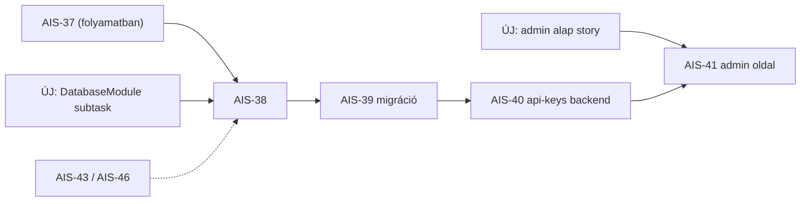

# Admin ↔ API ↔ DB alap — Jira ticket restructure (terv)

**Jira:** AIS-29 (Story), AIS-30 (Story) — érintett, nem módosított subtaskok: AIS-37…AIS-42
**Dátum:** 2026-10-21
**Státusz:** jóváhagyásra vár (a ticket létrehozás a terv jóváhagyása után történik)
**Kapcsolódó:** [`2026-10-21--12-54-00-ais-37-repository-unit-tests-plan.md`](2026-10-21--12-54-00-ais-37-repository-unit-tests-plan.md)

## 1. Kiinduló állapot (felmérés)

A kérdés az volt: _van-e olyan ticket, amely lefedi mindazt, ami ahhoz kell, hogy az admin appban
DB-ig érő oldalakat lehessen fejleszteni._ A kódból és a Jirá-ból felvett tények:

| Terület                         | Tény                                                                                                                | Bizonyíték                                                                                                                                                                  |
| ------------------------------- | ------------------------------------------------------------------------------------------------------------------- | --------------------------------------------------------------------------------------------------------------------------------------------------------------------------- |
| API → DB perzisztencia          | a HTTP réteg még **memóriabeli `Map`**, a DB-t nem éri el                                                           | [`callback-requests.service.ts:11`](../../apps/api/src/callback-requests/callback-requests.service.ts:11)                                                                   |
| DB provider / DI                | repository kész és tesztelt, de **nincs bekötve**: nincs `database.module.ts`, nincs provider a `DATABASE` tokenhez | [`database.const.ts:10`](../../apps/api/src/db/database.const.ts:10), [`callback-requests.module.ts:5`](../../apps/api/src/callback-requests/callback-requests.module.ts:5) |
| Migráció futtatás               | lokálisan `db:migrate`, deploy-ban külön story (AIS-31)                                                             | [`package.json:12`](../../apps/api/package.json:12)                                                                                                                         |
| Admin auth                      | nincs sehol (a login kamu tokent állít, az API-n nincs guard)                                                       | [`LoginPage.tsx:17`](../../apps/admin/src/pages/LoginPage.tsx:17)                                                                                                           |
| `packages/api-client`           | **nem létezik**                                                                                                     | [`packages/`](../../packages) csak `shared`                                                                                                                                 |
| `packages/ui`                   | **nem létezik**                                                                                                     | ugyanaz                                                                                                                                                                     |
| Megosztott response séma        | csak a _request_ séma van                                                                                           | [`packages/shared/src/index.ts:1`](../../packages/shared/src/index.ts:1)                                                                                                    |
| Admin teszt/lint                | `test` és `lint` script csak `echo`                                                                                 | [`apps/admin/package.json:14`](../../apps/admin/package.json:14)                                                                                                            |
| `docs/Specs/UI-Architecture.md` | hiányzik (a React szabály hivatkozik rá)                                                                            | —                                                                                                                                                                           |

Jira lefedettség (`issuetype = Story`, egész projekt): AIS-2…AIS-33. Ebben **nincs** frontend-alap,
api-client, illetve auth story. A meglévő subtaskok a DB→API oldalt lefedik:

| Hiányzó rész                    | Meglévő ticket          |
| ------------------------------- | ----------------------- |
| perzisztálás + DI bekötés + e2e | AIS-38                  |
| migráció deploy-ban             | AIS-43, AIS-46 (AIS-31) |
| új Nest resource minta          | AIS-39, AIS-40          |
| minta admin oldal               | AIS-41                  |
| how-to doksi                    | AIS-42, AIS-55          |

## 2. Probléma

1. Az **admin oldali alap** (kliens, UI kit, hook/store minta, teszt- és lint-harness) egyetlen
   ticketben sincs benne, miközben a repó saját React szabályai ezt kötelezővé teszik.
2. AIS-41 szövege kimondottan a **meglévő** [`lib/api.ts`](../../apps/admin/src/lib/api.ts:1)
   mintát írja elő — azaz a szabályok által tiltott `fetch` + `as` cast + paletta-osztály minta
   bebetonozását kéri. Ha ez így valósul meg, AIS-19…AIS-22 mind ezt másolja.
3. A `DatabaseModule` (újrafelhasználható provider) csak **impliciten** szerepel AIS-38-ban, a
   `callback-requests` modulra szűkítve; AIS-40 kénytelen lenne duplikálni.

## 3. Döntések

| #   | Döntés                                                                         | Miért                                                                                                                                                                                                      |
| --- | ------------------------------------------------------------------------------ | ---------------------------------------------------------------------------------------------------------------------------------------------------------------------------------------------------------- |
| D1  | A frontend-alap **nem** kerül bele AIS-30-ba                                   | AIS-30 értéke a _kicsi, másolható vertikális szelet_; 4 subtaskja és oldal-szintű DoD-ja van. A csomag-scaffolding + tooling egy sprintben elérhetetlenné tenné a DoD-t, és rontaná a példa olvashatóságát |
| D2  | A frontend-alap **nem** kerül bele AIS-29-be                                   | AIS-29 explicit DB-scope-ú story; a frontend cross-cutting, rossz tulajdonos                                                                                                                               |
| D3  | Frontend-alap → **új Story**, az AIS-30 testvére, **AIS-41 előtt**             | A AIS-19…AIS-22 is ezt fogja használni; egyszer megépíteni olcsóbb, mint utólag refaktorálni                                                                                                               |
| D4  | `DatabaseModule` → **új Subtask AIS-29 alá**                                   | Szerver-oldali perzisztencia-infra, oda tartozik; láthatóvá teszi a függőséget AIS-40 előtt                                                                                                                |
| D5  | AIS-41 szövegének pontosítása („a `packages/api-client` service-én keresztül”) | A ticket jelenlegi szövege a tiltott mintát írja elő; a módosítás 1 sor, a kód viszont utána nem kerül zsákutcába                                                                                          |
| D6  | Auth **most nem** része egyik új ticketnek sem                                 | A user döntése: később. Az api-client `getToken()` injection pointot viszont most kialakítjuk, hogy az auth később egy one-liner legyen, ne refaktor                                                       |
| D7  | Az új story subtaskokra bontva jön létre                                       | A repó mintája szerint (AIS-29/AIS-30 is így épül fel), és így párhuzamosítható                                                                                                                            |

## 4. Végrehajtás — ticket változások

### 4.1 Új Subtask (AIS-29 alatt)

**Cím:** `Újrafelhasználható DatabaseModule (DATABASE provider + connection lifecycle)`

**Leírás (ticket body):**

- `apps/api/src/db/database.module.ts` létrehozása: `@Global()` vagy explicit exportált modul,
  amely a `DATABASE` tokenhez `postgres.js` klienssel létrehozott Drizzle példányt adja
  (`drizzle(client, { schema })`), a `DATABASE_URL`-t a `ConfigService`-ből olvasva.
- `onApplicationShutdown` / `onModuleDestroy` hook a kliens lezárására (`client.end()`), hogy az
  e2e és a konténer leállítás ne akadjon a nyitott poolon.
- Hiányzó `DATABASE_URL` → **hangos boot hiba**, nem csendes in-memory fallback.
- `CallbackRequestsModule` és minden későbbi modul ezt importálja, ne hozzon létre saját klienst.
- Unit teszt: provider factory (van URL / nincs URL / kliens lezárás hívva).
- DoD: `pnpm --filter @callback/api test` zöld; az app `DATABASE_URL` nélkül nem indul el;
  AIS-38 és AIS-40 ugyanezt a modult használja (nincs duplikált `postgres()` hívás a `src`-ben).

### 4.2 Új Story (AIS-30 testvére, AIS-41 előtt)

**Cím:** `Admin: fejlesztői alap a DB-t elérő admin oldalakhoz (api-client, UI kit, teszt harness)`

**Leírás (ticket body):** a cél, hogy egy új admin oldal megírása **ne** igényeljen új
infrastruktúrát. Scope: a repó React szabályai által előírt rétegek létrehozása, egy
referencia-erőforrással (`callback-requests`), amin a minta bizonyítható.

**Subtaskok:**

| #   | Cím                                               | Tartalom                                                                                                                                                               | DoD                                                                                             |
| --- | ------------------------------------------------- | ---------------------------------------------------------------------------------------------------------------------------------------------------------------------- | ----------------------------------------------------------------------------------------------- |
| 1   | Megosztott response sémák a `packages/shared`-ben | `callbackRequestSchema` (+ `apiKeySchema` előkészítés), `CallStatus` enum szinkron, export a `index.ts`-ből                                                            | séma unit teszt (valid / hiányzó mező / rossz enum), `pnpm --filter @callback/shared test` zöld |
| 2   | `packages/api-client` csomag létrehozása          | `http-client.ts` (`baseUrl` + opcionális `getToken()` injektálva), `ApiError`, `callback-requests.service.ts` + interfész, Zod parse a határon; **nincs React import** | service unit teszt mockolt fetch-csel (200 / 4xx / hibás payload / hálózati hiba)               |
| 3   | Admin feature hook minta                          | `features/use-callback-requests.ts`, query key konstansok `*.const.ts`-ben, `toErrorMessage()` helper                                                                  | hook teszt: loading / success / error; a `DashboardPage` átáll a hookra                         |
| 4   | `packages/ui` token primitívek                    | `theme.css` tokenek + `Button`, `Input`, `Card`, `Table`, `Badge`, `Alert`, `cn()`; CVA variánsok                                                                      | primitív render/variáns tesztek; `apps/admin/src`-ben nincs paletta-osztály (rg check)          |
| 5   | Admin tooling                                     | vitest + RTL konfig, `src/test/mocks/`, valódi `test`/`lint` script, eslint config                                                                                     | `pnpm --filter @callback/admin test` és `lint` zöld, mocks csak a `test/mocks` alatt            |
| 6   | `docs/Specs/UI-Architecture.md`                   | réteg-térkép, state-tábla (server / page / form), token lista, oldal-recept                                                                                            | a doksi létezik, a szabályokra mutat, és a state-táblában szerepel a `dashboard` sor            |

**Story DoD:** egy új admin oldal (a `callback-requests` listán kívül) megírható kizárólag a
`packages/api-client` service-ének, egy `features/` hooknak és `packages/ui` primitívek
felhasználásával, új függőség és `fetch` nélkül.

### 4.3 Módosítandó ticket

**AIS-41** — a „meglévő `apps/admin/src/lib/api.ts`-n keresztül” mondat cseréje:
„a `packages/api-client` `api-keys` service-én keresztül, `features/` hookból,
`packages/ui` primitívekkel”. Függőség: a 4.2 story-ra.

## 5. Sorrend és függőségek

## 6. Ellenőrzés (a ticket-létrehozás után)

1. `project = AIS AND issuetype = Story` listában megjelenik az új story az AIS-30 mellett.
2. `parent = AIS-29` listában megjelenik a `DatabaseModule` subtask, `To Do` státusszal.
3. AIS-41 leírása az új szöveget tartalmazza, és az új story-ra mutat függőségként.
4. Sehol nem keletkezett `In Progress` ticket, amit nem kezdtünk el.

## 7. Out of scope

- Admin auth / API guard — külön, későbbi story (D6).
- AIS-38, AIS-39, AIS-40, AIS-42 implementációja — ez a terv csak a ticket-struktúrát rendezi.
- A `apps/web` (publikus) oldal átállítása az api-clientre — későbbi, önálló task.

## 8. Kockázatok

| Kockázat                                                 | Kezelés                                                                                                                               |
| -------------------------------------------------------- | ------------------------------------------------------------------------------------------------------------------------------------- |
| Az új story túl nagyra nő (6 subtask)                    | a 4.2 subtaskok külön-külön is leszállíthatók; a `packages/ui` köre szándékosan a két minta-oldalhoz szükséges primitívekre szűkített |
| AIS-41 párhuzamosan indul és a régi mintát használja     | a ticket szövegének módosítása (4.3) + a story leírásában explicit függőség                                                           |
| A `DatabaseModule` `@Global()`-lása elrejti a függőséget | explicit export + import a modulokban, `@Global()` csak indokolt esetben                                                              |
