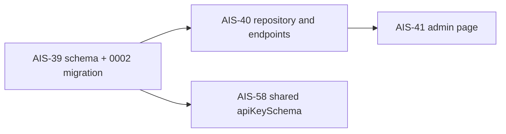

# AIS-39 — `platform.api_keys` table with migration (plan)

**Jira:** AIS-39 (Subtask) — parent: AIS-30
**Date:** 2026-10-21
**Status:** implemented (2026-10-21) — see [`history/2026-10-21--17-55-00-ais-39-platform-api-keys-table.md`](../history/2026-10-21--17-55-00-ais-39-platform-api-keys-table.md) and [`milestones/2026-10-21--17-55-00-api-keys-table-contract.milestone.md`](../milestones/2026-10-21--17-55-00-api-keys-table-contract.milestone.md)
**Related:** [AIS-64 removal plan](2026-10-21--15-37-00-ais-64-callback-removal-plan.md), [`docs/Specs/Database-Local.md`](../Specs/Database-Local.md)

## 1. Starting point

| Item | Fact |
|---|---|
| [`apps/api/src/db/schema.ts`](../../apps/api/src/db/schema.ts:23) | intentionally empty (`export {}`); the header comment already names `platform.api_keys` as the next table (AIS-64) |
| [`apps/api/drizzle.config.ts`](../../apps/api/drizzle.config.ts:37) | `schema: ./src/db/schema.ts`, `out: ./drizzle`, bookkeeping table `platform.__drizzle_migrations`; `db:generate` / `db:check` work offline |
| Migrations | `0000` (callback table, historical) + `0001` (drop) — `meta/_journal.json` has idx 0..1 |
| Infra | [`02-schemas.sh`](../../infra/postgres/init/02-schemas.sh) creates `platform` + `email`; `aisztens` holds `USAGE + CREATE` on `platform`, so the app role can create tables there |
| [`DatabaseModule`](../../apps/api/src/db/database.module.ts) | exists (AIS-56) but is **not touched** — no repository is written in this task |
| Unit test conventions | Jest `rootDir: src`, `testRegex: .*\.spec\.ts$`; globals used as in [`uuid.spec.ts`](../../apps/api/src/db/uuid.spec.ts:11); the old `schema.spec.ts` (AIS-64) asserted the table via `getTableConfig()` — same DB-free technique reused |
| Consumers | AIS-40 (repository + endpoints, needs `23505` → `409`), AIS-41 (admin page), AIS-57/58 (shared schema + api-client) |

## 2. Scope

**In:** `apiKeys` table in the `platform` Postgres schema, generated `0002` migration, unit tests for the mapping and the unique constraint, Specs/plan/history/milestone docs.

**Out:** repository / service / controller (AIS-40), shared Zod schema + `packages/api-client` (AIS-57/58), admin page (AIS-41), token hashing or encryption, extra indexes, table-level grants for `tkovari` / `krak`.

## 3. Decisions

| # | Decision | Why |
|---|---|---|
| D1 | `pgSchema('platform')`; every column name written explicitly (`api_key`, `expires_at`, …) | `drizzle.config.ts` sets no `casing`, so Drizzle will not snake_case `apiKey` automatically — an implicit `apiKey` column would break AIS-40 and AIS-41 |
| D2 | `id` uuid PK `defaultRandom()`; `name` text NOT NULL; `identifier` text NOT NULL; `description` text NULL; `api_key` text NOT NULL; `expires_at` timestamptz NULL; `created_at` / `updated_at` timestamptz NOT NULL `defaultNow()` | Matches the ticket; `description` and `expires_at` are optional in the admin form, and an API key may never expire |
| D3 | `expires_at` as `timestamp with time zone` instead of the ticket's `date` (**approved 2026-10-21**) | Expiry is a moment, not a calendar day; `date` loses the time and makes comparisons timezone-dependent. Alternative kept: literal `date` (`YYYY-MM-DD` string) if the ticket text must be followed verbatim |
| D4 | Unique constraint **named** `api_keys_identifier_key` (table extra config, `unique().on(t.identifier)`) | AIS-40 can check `error.constraint === 'api_keys_identifier_key'` (or just `23505`) instead of string-matching the message; a stable name also makes the DoD check readable |
| D5 | `updated_at` maintained by `$onUpdate(() => new Date())`, **no DB trigger** | The only writer is our API through Drizzle; a trigger would be invisible state. Documented, and a trigger is the deferred option if a second writer (psql, migration) appears |
| D6 | `text` for `name` / `description` / `api_key`, no length limits | Ticket wording; length/format limits belong to the DTO and the shared Zod schema (AIS-40/AIS-58), not to the DB |
| D7 | Generated migration is never edited except `CREATE SCHEMA "platform"` → `CREATE SCHEMA IF NOT EXISTS "platform"` | The schema already exists on every live volume; the same hand-fix was required for `0000` (AIS-36) |
| D8 | Tests use `getTableConfig()` only — no DB connection | Coding standard: mock/no real dependency in unit tests. Real DB behaviour (duplicate rejected) is proven by the manual DoD check now and by AIS-40 e2e later |
| D9 | Export `ApiKeyRow` / `NewApiKeyRow` (`$inferSelect` / `$inferInsert`) from `schema.ts` | AIS-40 depends on these types; keeps the row contract in one place |
| D10 | `api_key` stores the token as given | Ticket scope; hashing/rotation is a follow-up, recorded explicitly instead of silently ignored |

## 4. Files

| File | New/mod | Content |
|---|---|---|
| [`apps/api/src/db/schema.ts`](../../apps/api/src/db/schema.ts:1) | mod | `platformSchema`, `apiKeys` table (8 columns, PK, named unique), `ApiKeyRow` / `NewApiKeyRow`; header comment refreshed (platform is the only domain schema left) |
| `apps/api/drizzle/0002_<generated>.sql` | new | generated `CREATE TABLE "platform"."api_keys"` + `CONSTRAINT "api_keys_identifier_key" UNIQUE("identifier")`; `CREATE SCHEMA` hand-fixed to `IF NOT EXISTS` (D7) |
| `apps/api/drizzle/meta/0002_snapshot.json`, `meta/_journal.json` | new/mod | generated snapshot + journal entry idx 2 (committed) |
| `apps/api/src/db/schema.spec.ts` | new | test matrix in §6 |
| [`docs/Specs/Database-Local.md`](../Specs/Database-Local.md) | mod | §9 “exists” row for `platform.api_keys`, §9 “not yet” row removed, §6 migration count `2 → 3` + `api_keys` existence probe, header `Utolsó frissítés` bump |
| `docs/plans/2026-10-21--17-45-00-ais-39-platform-api-keys-table-plan.md` | new | this plan |
| `docs/history/2026-10-21--<hh-mm-ss>-ais-39-platform-api-keys-table.md` | new | implementation narrative + verification output |
| `docs/milestones/2026-10-21--<hh-mm-ss>-api-keys-table-contract.milestone.md` | new | the column/constraint contract AIS-40 and AIS-41 build on |

Not touched: `database.module.ts`, `database.interface.ts` (already references `apiKeys`), `app.module.ts`, `infra/postgres/init/*`, `packages/*`.

## 5. Expected migration

```sql
CREATE SCHEMA IF NOT EXISTS "platform";--> statement-breakpoint
CREATE TABLE "platform"."api_keys" (
	"id" uuid PRIMARY KEY DEFAULT gen_random_uuid() NOT NULL,
	"name" text NOT NULL,
	"identifier" text NOT NULL,
	"description" text,
	"api_key" text NOT NULL,
	"expires_at" timestamp with time zone,
	"created_at" timestamp with time zone DEFAULT now() NOT NULL,
	"updated_at" timestamp with time zone DEFAULT now() NOT NULL,
	CONSTRAINT "api_keys_identifier_key" UNIQUE("identifier")
);
```

## 6. Test matrix — `apps/api/src/db/schema.spec.ts`

| Case | Assertion |
|---|---|
| table identity | `getTableConfig(apiKeys)` → `schema === 'platform'`, `name === 'api_keys'` |
| column mapping | names and order: `id, name, identifier, description, api_key, expires_at, created_at, updated_at` |
| data types | `uuid`, `text`, `text`, `text`, `text`, `timestamp with time zone` ×3 |
| nullability | `description` + `expires_at` nullable; the other six `notNull` |
| defaults | `id` → `gen_random_uuid()`, `created_at` / `updated_at` → `now()` |
| primary key | exactly one PK, on `id`, single column |
| unique constraint | exactly one unique constraint, named `api_keys_identifier_key`, on `identifier` only (not composite) |
| no extra constraints/indexes | guards against a regenerated/edited migration drifting from the contract |
| not-found guard | `getTableConfig` on a non-table export is not applicable — covered by the explicit export list above |

## 7. Steps

1. Add `platformSchema` + `apiKeys` + row types to [`schema.ts`](../../apps/api/src/db/schema.ts:1); update the header comment.
2. `pnpm --filter @callback/api db:generate`; review the generated SQL, fix `CREATE SCHEMA` (D7), commit snapshot + journal.
3. Write `schema.spec.ts` (§6 matrix).
4. `db:migrate` against the DB-only stack; run the psql verification below (including the duplicate-`identifier` rejection that is the ticket DoD).
5. Update [`Database-Local.md`](../Specs/Database-Local.md) (§6 numbers, §9 rows, date bump).
6. Write the `docs/history/` entry and the milestone.



## 8. Verification

```bash
pnpm --filter @callback/api db:generate   # 0002_*.sql generated
pnpm --filter @callback/api db:generate   # second run: no schema changes (drift check)
pnpm --filter @callback/api db:check
pnpm --filter @callback/api build
pnpm --filter @callback/api test          # incl. the new schema.spec.ts
pnpm --filter @callback/api db:migrate    # cwd must be apps/api
pnpm --dir apps/api exec eslint src/db    # 0 errors on the new files
```

DB-side (DB-only stack running):

```bash
DC="docker compose --env-file infra/.env.local -f infra/docker-compose.db.yml"

$DC exec -T postgres psql -U aisztens -d aisztens_db -c '\d platform.api_keys'
$DC exec -T postgres psql -U aisztens -d aisztens_db -At \
  -c "SELECT count(*) FROM platform.__drizzle_migrations"          # 3

# DoD: duplicate identifier must fail
$DC exec -T postgres psql -U aisztens -d aisztens_db -c \
  "INSERT INTO platform.api_keys (name, identifier, api_key) VALUES ('a','dup','k1');
   INSERT INTO platform.api_keys (name, identifier, api_key) VALUES ('b','dup','k2');"
# expected: duplicate key value violates unique constraint "api_keys_identifier_key"
```

## 9. Risks

| Risk | Handling |
|---|---|
| `drizzle-kit` emits `CREATE SCHEMA "platform"` (no `IF NOT EXISTS`) → migration fails on an existing DB | review step in §7/2 (D7), same as the `0000` fix |
| The generator ignores the explicit constraint name (emits `api_keys_identifier_unique`) | the spec asserts the exact name; if the generator proves otherwise, the actual name is recorded in the plan + milestone and AIS-40 maps by `23505` rather than by name |
| `timestamptz` vs the ticket's `date` | D3 records both options; AIS-40 DTO and the AIS-41 form follow whichever is approved here |
| `$onUpdate` only fires through Drizzle `.update()` | documented in the milestone; a DB trigger is the deferred follow-up |
| Table exists but unused until AIS-40 | intentional; API boot and the existing test suite are unaffected |
| Migration runs with the `aisztens` role, which owns the table → `tkovari`/`krak` keep only schema-level `USAGE` | unchanged, already documented as a known limitation |

## 10. As-built (2026-10-21)

| # | Topic | What actually happened |
|---|---|---|
| A1 | Migration name | `drizzle/0002_minor_domino.sql`; `CREATE SCHEMA "platform"` hand-fixed to `IF NOT EXISTS` **plus an explanatory SQL comment** (a naive `not.toContain('CREATE SCHEMA "platform"')` assertion matched that comment, so the spec asserts the statement with a `^`-anchored regex instead) |
| A2 | Constraint name | the generator honoured the explicit name: `CONSTRAINT "api_keys_identifier_key" UNIQUE("identifier")`; confirmed in the DB as `"api_keys_identifier_key" UNIQUE CONSTRAINT, btree (identifier)` |
| A3 | Extra test helper | `apps/api/src/db/test/helpers/sql-expression.ts` renders a Drizzle default back to SQL text (`gen_random_uuid()`, `now()`), so the defaults are asserted as expressions, not just as "has some default" |
| A4 | Extension of D8 | four assertions read the committed `0002` SQL (`CREATE TABLE`, `IF NOT EXISTS`, the named constraint, three `timestamp with time zone` columns) — still no DB connection; it guards "generated but never reviewed" drift |
| A5 | Test count | `12 suites / 125 tests` (the new `schema.spec.ts` adds 25); `db:generate` a second time reports `No schema changes, nothing to migrate` |
| A6 | Local verification | `docker exec -T` is rejected by the Docker CLI in this environment (“unknown shorthand flag: 'T'”); the plain `docker exec …` form was used, the psql results are identical |
| A7 | DB state after migrate | `platform.__drizzle_migrations` = 3 rows; duplicate `identifier` insert rejected with `duplicate key value violates unique constraint "api_keys_identifier_key"`; `SELECT count(*) FROM platform.api_keys` = 0 afterwards (verification ran in a rolled-back transaction) |
