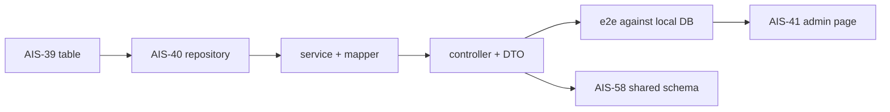

# AIS-40 — api-keys backend endpoints (plan)

**Jira:** AIS-40 (Subtask) — parent: AIS-30
**Date:** 2026-10-21
**Status:** implemented (2026-10-21) — see [`history/2026-10-21--18-55-00-ais-40-api-keys-backend.md`](../history/2026-10-21--18-55-00-ais-40-api-keys-backend.md) and [`milestones/2026-10-21--18-55-00-api-keys-error-mapping.milestone.md`](../milestones/2026-10-21--18-55-00-api-keys-error-mapping.milestone.md). Deviation from §3 D4: the classifier must walk the `cause` chain and read `constraint_name` (Drizzle wraps the driver error) — see the milestone §3.
**Related:** [AIS-39 table plan](2026-10-21--17-45-00-ais-39-platform-api-keys-table-plan.md), [`api-keys-table-contract.milestone.md`](../milestones/2026-10-21--17-55-00-api-keys-table-contract.milestone.md), [`Database-Local.md`](../Specs/Database-Local.md)

## 1. Starting point

| Fact | Where |
|---|---|
| Table exists: `platform.api_keys`, named unique `api_keys_identifier_key`, `timestamptz` columns | [`schema.ts`](../../apps/api/src/db/schema.ts:41), [`0002_minor_domino.sql`](../../apps/api/drizzle/0002_minor_domino.sql:1) |
| Row types ready: `ApiKeyRow`, `NewApiKeyRow` | [`schema.ts`](../../apps/api/src/db/schema.ts:63) |
| `DATABASE` / `DATABASE_CLIENT` tokens, `Database` type, lazy pool, loud boot failure without `DATABASE_URL` | [`database.const.ts`](../../apps/api/src/db/database.const.ts:21), [`database.providers.ts`](../../apps/api/src/db/database.providers.ts:16) |
| Global prefix `api` (except `healthz`), global `ValidationPipe` (`whitelist`, `forbidNonWhitelisted`, `transform`) — **applied in `main.ts` only** | [`main.ts`](../../apps/api/src/main.ts:38) |
| Module registration pattern | [`app.module.ts`](../../apps/api/src/app.module.ts:45) |
| Controller/service pattern (`@Controller`, `@Inject`-free constructor DI) | [`vapi-webhooks.controller.ts`](../../apps/api/src/vapi-webhooks/vapi-webhooks.controller.ts:33) |
| `class-validator` + `class-transformer` already dependencies | [`package.json`](../../apps/api/package.json:32) |
| e2e: `test/*.e2e-spec.ts`, `jest-e2e.json`, real `AppModule` behind `loadAppModuleOrSkip()` | [`app-module-gate.ts`](../../apps/api/test/lib/app-module-gate.ts:48) |
| No auth/guard on business routes yet | `main.ts` / `app.module.ts` |

## 2. Scope

**In:** `apps/api/src/api-keys/` feature module (repository, service, controller, DTO, error types, response mapper), registration in `AppModule`, unit tests for every layer, one e2e suite (create / list / lookup / duplicate-409), docs.

**Out:** admin page (AIS-41), `packages/shared` Zod schemas + `packages/api-client` (AIS-58/59), auth/guard, update/delete/rotation endpoints, pagination/search, token masking/encryption (explicitly out of scope in the story), migration changes (the table is final).

## 3. Decisions

| # | Decision | Why |
|---|---|---|
| D1 | Everything lives in `apps/api/src/api-keys/` (repository included), not in `src/db/` | The `db` folder is infrastructure (connection, schema, uuid); persistence of a domain belongs to the feature folder. `src/db/callback-requests.repository.ts` was a transitional layout, deliberately not copied. |
| D2 | Repository behind `ApiKeysRepository` interface + `API_KEYS_REPOSITORY` token; service injects the interface | SOLID/DIP, and the service becomes unit-testable with a plain mock — no Nest, no DB, no HTTP. |
| D3 | Repository is framework-free: it **returns rows and `null`**, throws only `ApiKeyIdentifierConflictError` | HTTP concerns (404/409) are Nest exceptions and belong to the service; the db-facing layer must not import `@nestjs/common` exceptions. |
| D4 | Duplicate `identifier` detected by `error.code === '23505'` (constraint name checked as a secondary signal), **never** by matching message text | Locale/version-proof; the constraint name from AIS-39 makes the intent explicit. |
| D5 | Blank/whitespace identifier → `null` **without** a query | Deterministic + avoids a guaranteed-empty round trip; mirrors the AIS-37 “validate before querying” rule. |
| D6 | Response mapping in a pure `toApiKeyResponse(row)` mapper: `Date → ISO 8601 string`, `null` stays `null` | The wire contract must be strings (AIS-58 will parse them with Zod); relying on `JSON.stringify(Date)` would hide the conversion inside Fastify. |
| D7 | List returns full rows **including `api_key`**; ordered `created_at DESC`; no pagination | Masking/rotation is explicitly out of scope in the story; a stable newest-first order makes the e2e deterministic. |
| D8 | Store `description`/`expires_at` as `null` when the client omits them (DTO optional → explicit null) | Keeps “absent” and “explicitly empty” from becoming two different states in the DB. |
| D9 | `POST` returns **201** with the created resource; duplicate → **409 Conflict**; unknown identifier → **404 Not Found**; invalid payload → **400** | Ticket DoD + REST conventions already used by the project. |
| D10 | e2e runs against the **real** local DB when `DATABASE_URL` resolves, otherwise self-skips with a warning (same mechanism as `loadAppModuleOrSkip`) and cleans up with a unique `e2e-<uuid>` identifier | The story’s DoD is “the row is persisted” — a mocked e2e would not prove it; skipping instead of failing keeps CI usable where no DB exists. |
| D11 | The e2e app must re-apply `setGlobalPrefix('api')` **and** the `ValidationPipe` | They live in `main.ts`; without re-applying them, validation tests would pass while production behaviour differs. |
| D12 | No response `Zod` parsing in this ticket | `zod` is not an `apps/api` dependency; AIS-58 introduces `apiKeySchema` in `@callback/shared` (already a dependency) and AIS-40’s contract test then becomes a one-line addition. |
| D13 | No auth guard on the new routes | Admin auth is a separate, deferred story; documented as a known limitation, not silently ignored. |

## 4. Files

| File | New | Content |
|---|---|---|
| `apps/api/src/api-keys/api-keys.const.ts` | new | `API_KEYS_REPOSITORY` token, route segment, DTO limits, unique-violation code `23505` |
| `apps/api/src/api-keys/api-keys.interface.ts` | new | `ApiKeyResponse`, `ApiKeysRepository` is separate, `CreateApiKeyInput` |
| `apps/api/src/api-keys/api-keys.repository.interface.ts` | new | `create(input): Promise<ApiKeyRow>`, `findAll(): Promise<ApiKeyRow[]>`, `findByIdentifier(identifier): Promise<ApiKeyRow \| null>` + JSDoc contract |
| `apps/api/src/api-keys/api-keys.repository.ts` | new | `DrizzleApiKeysRepository implements ApiKeysRepository`, `@Injectable()`, `@Inject(DATABASE)`, `orderBy(desc(createdAt))`, 23505 → conflict error |
| `apps/api/src/api-keys/api-keys.errors.ts` | new | `ApiKeyIdentifierConflictError` (`identifier`, `cause`) |
| `apps/api/src/api-keys/api-keys.mapper.ts` | new | `toApiKeyResponse(row)` pure function |
| `apps/api/src/api-keys/api-keys.service.ts` | new | orchestration + `ConflictException` / `NotFoundException` translation |
| `apps/api/src/api-keys/api-keys.controller.ts` | new | `GET /api/api-keys`, `GET /api/api-keys/:identifier`, `POST /api/api-keys` |
| `apps/api/src/api-keys/api-keys.module.ts` | new | `imports: [DatabaseModule]`, repository provider on the token, service, controller |
| `apps/api/src/api-keys/dto/create-api-key.dto.ts` | new | class-validator DTO (see §5) |
| `apps/api/src/api-keys/api-keys.repository.spec.ts` | new | query-chain mock; matrix in §6 |
| `apps/api/src/api-keys/api-keys.service.spec.ts` | new | repository mock; matrix in §6 |
| `apps/api/src/api-keys/api-keys.controller.spec.ts` | new | routing/delegation + status codes |
| `apps/api/src/api-keys/api-keys.mapper.spec.ts` | new | `Date → ISO`, `null → null` |
| `apps/api/src/api-keys/api-keys.module.spec.ts` | new | DI graph compiles with mocked `DATABASE`/`DATABASE_CLIENT` (guards `UnknownDependenciesException`) |
| `apps/api/src/api-keys/dto/create-api-key.dto.spec.ts` | new | `plainToInstance` + `validate()` per rule |
| `apps/api/src/api-keys/test/mocks/api-keys.mock.ts` | new | `buildApiKeyRow()`, `buildApiKeyResponse()`, `buildCreateApiKeyDto()` |
| `apps/api/src/api-keys/test/mocks/database.mock.ts` | new | chainable `insert/values/returning`, `select/from/orderBy`, typed failure scripting (`23505`) |
| `apps/api/test/api-keys.e2e-spec.ts` | new | create / list / lookup / duplicate-409 against the real DB |
| `apps/api/src/app.module.ts` | mod | register `ApiKeysModule` |
| [`docs/Specs/Database-Local.md`](../Specs/Database-Local.md) | mod | §9: the table now has a consumer; remove “nothing uses it” |
| docs history + milestone | new | see §9 |

Not touched: `schema.ts`, `drizzle/`, `DatabaseModule`, `vapi-webhooks`, `packages/*`.

## 5. API contract

```text
POST   /api/api-keys              201  ApiKeyResponse
GET    /api/api-keys              200  ApiKeyResponse[]
GET    /api/api-keys/:identifier  200  ApiKeyResponse | 404
                                                | 409 (duplicate identifier on POST)
                                                | 400 (validation)
```

```ts
interface ApiKeyResponse {
  id: string;              // uuid
  name: string;
  identifier: string;
  description: string | null;
  apiKey: string;
  expiresAt: string | null; // ISO 8601
  createdAt: string;        // ISO 8601
  updatedAt: string;        // ISO 8601
}
```

DTO (`CreateApiKeyDto`), enforced by the global `ValidationPipe`:

| Field | Rules |
|---|---|
| `name` | `@IsString() @IsNotEmpty() @MaxLength(200)` |
| `identifier` | `@IsString() @Matches(/^[A-Za-z0-9._-]{1,200}$/)` |
| `description` | `@IsOptional() @IsString() @MaxLength(2000)` |
| `apiKey` | `@IsString() @IsNotEmpty() @MaxLength(4000)` |
| `expiresAt` | `@IsOptional() @IsISO8601()` → parsed to `Date`, stored as `timestamptz` |

Unknown fields are rejected (`forbidNonWhitelisted`), so `id`, `createdAt`, `updatedAt` cannot be injected by a client.

## 6. Test matrix

**`api-keys.repository.spec.ts`** (mock `Database`)

| Case | Expectation |
|---|---|
| `create` happy path | input reaches `values()`, `returning()` row is returned |
| `create` duplicate | PG error with `code: '23505'` → `ApiKeyIdentifierConflictError` carrying the identifier |
| `create` other DB error | rejection propagated unchanged (no wrapping) |
| `findAll` | rows returned, `orderBy` invoked on `created_at` |
| `findAll` empty | `[]` |
| `findByIdentifier` found | row returned |
| `findByIdentifier` missing | `null` |
| `findByIdentifier` blank / whitespace | `null`, **`select` not called** (D5) |

**`api-keys.service.spec.ts`** (mock repository)

| Case | Expectation |
|---|---|
| `create` | repository called with the DTO mapped to `NewApiKeyRow`; response has ISO strings |
| `create` conflict error | `ConflictException` (HTTP 409) |
| `list` | mapped array, order preserved |
| `findByIdentifier` found | response with ISO strings |
| `findByIdentifier` missing | `NotFoundException` (404) |
| `expiresAt` null / set | `null` / ISO string in the response |

**`create-api-key.dto.spec.ts`**: valid payload; missing `name`; empty `identifier`; `identifier` with a slash/space; missing `apiKey`; bad `expiresAt`; unknown extra field.

**`api-keys.controller.spec.ts`**: routes delegate to the service; `POST` returns the service result (201 comes from Nest), `GET :identifier` passes the param through.

**`api-keys.module.spec.ts`**: `Test.createTestingModule({ imports: [ApiKeysModule] }).overrideProvider(DATABASE)…` compiles and resolves the controller.

**`test/api-keys.e2e-spec.ts`**: `POST` → 201 + row readable via `GET`; list contains the created identifier; lookup by identifier → 200; second `POST` with the same identifier → 409; `afterAll` deletes the `e2e-%` rows through the injected `DATABASE` handle.

## 7. Steps

1. `api-keys.const.ts`, `api-keys.interface.ts`, `api-keys.errors.ts`, `api-keys.mapper.ts`.
2. `api-keys.repository.interface.ts` + `api-keys.repository.ts` (+ mocks + spec).
3. `dto/create-api-key.dto.ts` (+ validation spec).
4. `api-keys.service.ts` (+ spec), `api-keys.controller.ts` (+ spec).
5. `api-keys.module.ts`, register in [`app.module.ts`](../../apps/api/src/app.module.ts:45), module spec.
6. e2e suite; run against the DB-only stack.
7. Docs (§9) + history + milestone.



## 8. Verification

```bash
pnpm --filter @callback/api build
pnpm --filter @callback/api test                  # unit: all layers
pnpm --filter @callback/api lint                  # pre-existing vapi lint errors are out of scope
pnpm --filter @callback/api test:e2e              # needs DATABASE_URL + migrated DB
pnpm --dir apps/api exec eslint src/api-keys      # 0 errors on the new files
```

Manual smoke (DB-only stack running, `DATABASE_URL` in `apps/api/.env.local`):

```bash
curl -s -X POST localhost:3000/api/api-keys -H 'content-type: application/json' \
  -d '{"name":"Vapi prod","identifier":"vapi-prod","apiKey":"tok_123","description":"primary","expiresAt":"2027-01-01T00:00:00.000Z"}'
curl -s localhost:3000/api/api-keys
curl -s localhost:3000/api/api-keys/vapi-prod
curl -s -o /dev/null -w '%{http_code}\n' -X POST localhost:3000/api/api-keys \
  -H 'content-type: application/json' -d '{"name":"dup","identifier":"vapi-prod","apiKey":"x"}'   # 409

docker exec infra-postgres-1 psql -U aisztens -d aisztens_db -c \
  "SELECT identifier, name, expires_at FROM platform.api_keys ORDER BY created_at DESC"
```

## 9. Documentation (part of the change)

| File | Content |
|---|---|
| `docs/plans/2026-10-21--18-25-00-ais-40-api-keys-backend-plan.md` | this plan |
| `docs/history/2026-10-21--<hh-mm-ss>-ais-40-api-keys-backend.md` | implementation narrative + verification output |
| `docs/milestones/2026-10-21--<hh-mm-ss>-api-keys-error-mapping.milestone.md` | the 23505 → 409 mapping, the null-vs-absent rule and the wire contract (AIS-41/AIS-58 build on it) |
| [`docs/Specs/Database-Local.md`](../Specs/Database-Local.md) | §9: `platform.api_keys` now has a reader/writer through the API |

## 10. Risks

| Risk | Handling |
|---|---|
| e2e needs a migrated DB, and CI may not have one | D10: self-skip with a loud warning when `DATABASE_URL` is unresolvable; the unit layer covers all branches |
| `ValidationPipe` not present in the e2e app → validation tests silently pass | D11: re-apply prefix + pipe in the e2e `beforeAll` |
| Drizzle chain mock is brittle against internal call order | assert only contract-level calls; the mock lives in one file (`test/mocks/database.mock.ts`) |
| Returning `api_key` in the list is a (deliberate) exposure | story declares masking/rotation out of scope; recorded in the milestone so it cannot be “forgotten” |
| `23505` could come from another constraint later | check `constraint === 'api_keys_identifier_key'` when the driver provides it, otherwise fall back to `code`, never to message text |
| Routes are unauthenticated | deferred story, stated explicitly in the milestone and in [`Database-Local.md`](../Specs/Database-Local.md) §9 |

## 11. Kick-off re-verification (2026-10-21, architect)

| Verified fact | Consequence for the implementation |
|---|---|
| [`DatabaseModule`](../../apps/api/src/db/database.module.ts:23) exists, exports `DATABASE` + `DATABASE_CLIENT`, closes the pool in `DatabaseLifecycleService`, is **not** `@Global()` | `api-keys.module.ts` only adds `imports: [DatabaseModule]`; no `postgres()` / `drizzle()` call in `api-keys/` |
| `DATABASE` provider is a schema-aware `Database` (`PostgresJsDatabase<typeof schema>`) | repository injects `DATABASE`, `orderBy(desc(apiKeys.createdAt))`, typed via `ApiKeyRow` |
| [`Database-Local.md`](../Specs/Database-Local.md) header date (line 5) and §9 still say the table is unused (“semmi nem használja”, ~line 308) | both sentences are part of this ticket’s doc update |
| `src/db/test/mocks/database.mock.ts` was **deleted** in AIS-64 together with the callback context | recreate the chainable mock under `src/api-keys/test/mocks/database.mock.ts`; do not resurrect the old path |
| [`uuid.ts`](../../apps/api/src/db/uuid.ts:1) is still unused and its docblock promises AIS-38 | `identifier` lookups do not need it — leave the file untouched |
| There is no repository left in `apps/api/src` | `api-keys.repository.ts` becomes the reference persistence pattern (decisions D1–D5), which AIS-19…AIS-22 will copy |
| AIS-40 is `In Progress`, parent AIS-30 | after DoD verification move it to `In Review` / `Done` |
| Jest `rootDir: src`, `testRegex: .*\.spec\.ts$`; e2e `rootDir: test`, `testRegex: .e2e-spec.ts$` | unit mocks live under `src/api-keys/test/mocks/`, the e2e suite under `test/` |
