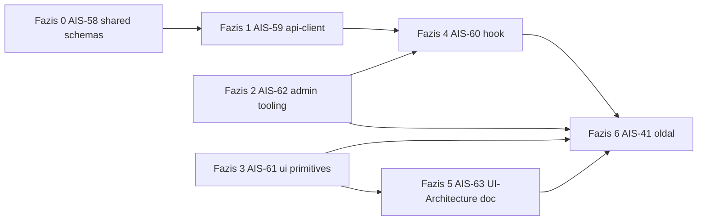

# Admin API kulcs oldal — AIS-57 (AIS-58…63) + AIS-41 összevont terv

**Jira:** AIS-57 (Story) + AIS-58, AIS-59, AIS-60, AIS-61, AIS-62, AIS-63 (subtaskok) + AIS-41 (subtask, AIS-30 alatt)
**Dátum:** 2026-10-21
**Státusz:** részben implementálva (2026-10-21 21:30) — Fázis 0, 1, 2, 3, 4 kész és zöld; Fázis 5–6 nyitott. Lásd §10.
**Kapcsolódó:** [AIS-40 backend terv](2026-10-21--18-25-00-ais-40-api-keys-backend-plan.md), [admin/API/DB ticket restructure](2026-10-21--14-13-00-admin-api-db-foundation-tickets-plan.md)

## 1. Kiinduló állapot

| Terület | Tény | Bizonyíték |
|---|---|---|
| Backend végpontok | kész: `GET /api/api-keys`, `GET /api/api-keys/:identifier`, `POST /api/api-keys` | [`api-keys.controller.ts:36`](../../apps/api/src/api-keys/api-keys.controller.ts:36) |
| Wire contract | `ApiKeyResponse` + `CreateApiKeyInput` (ISO string, explicit `null`) | [`api-keys.interface.ts:31`](../../apps/api/src/api-keys/api-keys.interface.ts:31) |
| Hibakódok | 400 validáció, 404 ismeretlen identifier, 409 duplicate identifier | [`api-keys.service.ts:71`](../../apps/api/src/api-keys/api-keys.service.ts:71) |
| Globális prefix | `/api` (a `healthz` kivétel) | [`main.ts:38`](../../apps/api/src/main.ts:38) |
| `packages/api-client` | **nem létezik** | `packages/` csak `shared` |
| `packages/ui` | **nem létezik**; admin az `index.css`-ben és az `App.tsx`-ben paletta-osztályokat használ | [`index.css:4`](../../apps/admin/src/index.css:4), [`App.tsx:19`](../../apps/admin/src/App.tsx:19) |
| Zod | csak `packages/shared`-ben van (`^3.24.1`), válasz-séma nincs | [`shared/package.json:20`](../../packages/shared/package.json:20) |
| Admin teszt/lint | `test` és `lint` script csak `echo` | [`apps/admin/package.json:14`](../../apps/admin/package.json:14) |
| Admin routing | `/`, `/calls`, `/login`; nav link a `ProtectedLayout`-ban | [`App.tsx:40`](../../apps/admin/src/App.tsx:40) |
| Query client | `QueryClientProvider` már bekötve | [`main.tsx:16`](../../apps/admin/src/main.tsx:16) |
| Session token | `sessionStorage`, `TOKEN_KEY` az `AuthContext`-ben, az API-n nincs guard | [`AuthContext.tsx:3`](../../apps/admin/src/auth/AuthContext.tsx:3) |

AIS-41 a ticket szerint AIS-57 után kezdhető; AIS-57 minden subtaskja `To Do`, ezért ez a terv a teljes
alapot és az oldalt együtt, sorrendezett fázisokban tartalmazza.

## 2. Scope

**In:** `@callback/shared` válasz-sémák, `packages/api-client` csomag, `packages/ui` token-primitívek,
admin feature hook, admin teszt/lint harness, `docs/Specs/UI-Architecture.md`, majd az `api-keys` oldal
(lista + felviteli űrlap) route/nav bekötéssel.

**Out:** admin auth / API guard (a `getToken()` injection point most készül el, de nem aktiváljuk),
kulcs törlés/szerkesztés/rotáció, keresés/szűrés, `apps/web` átállítása, a backend `api-keys.const.ts`
és a shared limitek egyesítése.

## 3. Wire contract (a kliens oldal számára kötelező)

```
GET  /api/api-keys            → 200 ApiKeyResponse[]  (created_at DESC)
POST /api/api-keys            → 201 ApiKeyResponse
                               400 validation | 409 identifier ütközés
```

```ts
// ApiKeyResponse — minden mező kötelező, a null-ok explicit null-ok
{ id: string(uuid), name: string, identifier: string,
  description: string | null, apiKey: string,
  expiresAt: string(ISO, Z) | null, createdAt: string(ISO), updatedAt: string(ISO) }

// CreateApiKeyInput — csak ez az 5 mező mehet POST-ban (forbidNonWhitelisted!)
{ name: string, identifier: string, description?: string, apiKey: string, expiresAt?: string }
```

Kritikus részletek:

* `expires_at` üres → a mezőt **ki kell hagyni** (nem `null`, nem `''`), különben `IsISO8601` → 400.
* `id` / `createdAt` / `updatedAt` soha nem küldhető.
* 409 detektálás **kizárólag** `error.status === 409` alapján, soha nem üzenet-szövegre illesztve
  (ugyanaz az elv, mint a backend `23505` kezelése).
* `apiKey` a listában **nem jelenik meg** (a válasz tartalmazza, a UI nem rendereli).

## 4. Döntések

| # | Döntés | Miért |
|---|---|---|
| D1 | A fázisok 1:1 megfelelnek a Jira subtaskoknak (AIS-58…63 + AIS-41), mindegyik önállóan zöld | a ticket-struktúra így követhető, és a review is fázisonként mehet |
| D2 | A válasz-séma **egyetlen** helyen él: `packages/shared`; az api-client ott parse-ol | nincs duplikált mezőlista, a backend contract-változás egy helyen törik |
| D3 | Az `http-client` `fetchImpl`-et is **injektál** (`baseUrl`, `getToken?`, `fetchImpl?`) | a service teszt hálózat nélkül fut, `fetch` mockolása a `test/mocks`-ban történik |
| D4 | `ApiError` hordozza a `status`-t + a Nest hibatestet (`message: string \| string[]`), és `isConflict(error)` helper dönt | field-szintű 409 hiba nem szöveg-illesztéssel készül |
| D5 | A táblázat **nem** rendereli az `apiKey` értéket; csak név, identifier, leírás, lejárat | a token plaintextben van a válaszban, a UI-ban nem terjesztjük |
| D6 | `expiresAt`: `<input type="date">` → **helyi** éjfél → `toISOString()`; megjelenítés `Intl.DateTimeFormat`-tal, `null` → „nincs lejárat” | a DB `timestamptz`; a naiv string→UTC konverzió időzóna-eltolást okozna |
| D7 | Űrlap: react-hook-form + zod resolver, a limitek a shared konstansokból | a kliens validáció nem térhet el a backendtől |
| D8 | A 409-et `setError('identifier', …)`-be tesszük, nem oldal-szintű hibába | a ticket contract note előírása |
| D9 | Az oldalnak **nincs** Zustand store-ja (nincs oldal-szintű UI állapot), ezt a UI-Architecture state-tábla rögzíti | felesleges állapot = felesleges kód |
| D10 | Sikeres POST → `invalidateQueries` a lista query kulcsára + űrlap reset | a DoD a lista frissülése, nem kézi cache-patch |
| D11 | Az `App.tsx` paletta-osztályai ugyanebben a változásban token-osztályokra cserélődnek | a React szabály „transitional” klauzulája: a módosított fájl nem kaphat új violationt |
| D12 | A session token kulcsa `auth/session-token.ts`-be kerül (a `services/` is onnan olvas) | a token-kulcs ne duplikálódjon az `AuthContext` és a composition root között |

## 5. Fázisok

### Fázis 0 — AIS-58: shared válasz-sémák

| Fájl | Változás |
|---|---|
| `packages/shared/src/schemas/api-key.const.ts` | új: `API_KEY_NAME_MAX_LENGTH=200`, `API_KEY_IDENTIFIER_PATTERN`, `API_KEY_DESCRIPTION_MAX_LENGTH=2000`, `API_KEY_VALUE_MAX_LENGTH=4000` |
| `packages/shared/src/schemas/api-key.interface.ts` | új: `ApiKey`, `CreateApiKeyInput` (zod infer) |
| `packages/shared/src/schemas/api-key.schema.ts` | új: `apiKeySchema`, `apiKeyListSchema`, `createApiKeyInputSchema` |
| `packages/shared/src/index.ts` | mód: explicit exportok |
| `packages/shared/test/api-key.schema.test.ts` | új: valid / hiányzó mező / `null` lejárat / rossz ISO / rossz identifier / extra mező eldobása |

Megjegyzés: `z.string().datetime({ offset: true })`, `description`/`expiresAt` `.nullable()`, a
`createApiKeyInputSchema` a `description`/`expiresAt`-et **opcionálisként** kezeli.

**DoD:** `pnpm --filter @callback/shared test` és `build` zöld; a séma a valós AIS-40 válasz mintán parse-ol.

### Fázis 1 — AIS-59: `packages/api-client`

| Fájl | Változás |
|---|---|
| `packages/api-client/package.json` | új: `@callback/api-client`, ESM, `@callback/shared` + `zod`, `vitest` |
| `packages/api-client/tsconfig.json` | új: shared-hez hasonló `dist` build |
| `packages/api-client/src/http-client.interface.ts` | új: `HttpClientConfig`, `HttpClient` |
| `packages/api-client/src/http-client.ts` | új: `createHttpClient`, JSON body, `Authorization` `getToken()`-ből, zod parse a határon, hálózati hiba → `ApiError` |
| `packages/api-client/src/api-error.interface.ts` | új: `ApiErrorInit`, `ApiErrorBody` |
| `packages/api-client/src/api-error.ts` | új: `ApiError`, `isConflict`, `isValidationError` |
| `packages/api-client/src/api-keys/api-keys.interface.ts` | új: `ApiKeysService` (`list()`, `create(input)`) |
| `packages/api-client/src/api-keys/api-keys.service.ts` | új: `createApiKeysService(client)`, path `/api-keys` |
| `packages/api-client/src/index.ts` | új: explicit exportok (nincs `export *`) |
| `packages/api-client/vitest.config.ts` | új |
| `packages/api-client/test/mocks/fetch.mock.ts` | új: scriptelhető fetch stub (200 / 400 / 409 / hibás payload / hálózati hiba) |
| `packages/api-client/test/http-client.test.ts`, `test/api-keys.service.test.ts` | új |

A `baseUrl` és a path összefűzése normalizált (nincs dupla `/`), így `VITE_API_BASE_URL=/api` →
`/api/api-keys`.

**DoD:** `pnpm --filter @callback/api-client test` zöld; sehol nincs `fetch` a service-ekben (csak az
injektált `fetchImpl`); nincs React import a csomagban.

### Fázis 2 — AIS-62: admin teszt/lint harness

| Fájl | Változás |
|---|---|
| `apps/admin/package.json` | mód: devDeps `vitest`, `jsdom`, `@testing-library/react`, `@testing-library/user-event`, `@testing-library/jest-dom`, `eslint`, `typescript-eslint`, `eslint-plugin-react-hooks`; `@callback/api-client`, `@callback/ui` deps; `test: vitest run`, `lint: eslint .` |
| `apps/admin/vitest.config.ts` | új: jsdom, `src/test/setup.ts`, `passWithNoTests: false` |
| `apps/admin/src/test/setup.ts` | új: jest-dom, `process.env.TZ = 'Europe/Budapest'` (determinista dátumtesztek) |
| `apps/admin/eslint.config.js` | új |
| `apps/admin/tsconfig.json` | mód: vitest típusok + a teszt-fájlok include-ja (a `build` `tsc --noEmit` ne törjön) |
| `package.json` (root) | mód: `predev`/`test` scriptek kiterjesztése az új csomagokra |

**DoD:** `pnpm --filter @callback/admin test` és `lint` zöld (legalább a harness smoke tesztjével);
mock/fixture csak `src/test/mocks/**` alatt.

### Fázis 3 — AIS-61: `packages/ui` token-primitívek

| Fájl | Változás |
|---|---|
| `packages/ui/package.json`, `tsconfig.json`, `vitest.config.ts` | új |
| `packages/ui/src/styles/theme.css` | új: `@theme` tokenek (brand, surface, border, text, state, shadow, radius, motion) |
| `packages/ui/src/lib/cn.ts` | új: `clsx` + `tailwind-merge` |
| `packages/ui/src/components/button/*` | új: `Button.tsx` + `button.variants.ts` |
| `packages/ui/src/components/input/*` | új: `Input.tsx` + variánsok (label/error kapcsolás) |
| `packages/ui/src/components/card/Card.tsx` | új |
| `packages/ui/src/components/table/*` | új: `Table`, `TableHead`, `TableBody`, `TableRow`, `TableHeaderCell`, `TableCell` |
| `packages/ui/src/components/badge/*` | új: `Badge.tsx` + variánsok |
| `packages/ui/src/components/alert/*` | új: `Alert.tsx` + variánsok (info/success/warning/danger) |
| `packages/ui/src/index.ts` | új: explicit exportok |
| `packages/ui/test/*.test.tsx` | új: primitívenként render + variáns |
| `apps/admin/src/index.css` | mód: `@import` a theme-re, `@source "../../../packages/ui/src"`, paletta `@apply` törlése |
| `apps/admin/vite.config.ts` | mód: indokolt esetben alias/`@source` támogatás |

**DoD:** `pnpm --filter @callback/ui test` zöld; `pnpm --filter @callback/admin build` zöld; az admin
bundle-ben a primitívek Tailwind osztályai generálódnak (nem „üres” stílus).

### Fázis 4 — AIS-60: feature hook + segédek

| Fájl | Változás |
|---|---|
| `apps/admin/src/auth/session-token.ts` | új: `SESSION_TOKEN_KEY`, `readSessionToken()`; `AuthContext` ezt használja |
| `apps/admin/src/services/api-client.ts` | új: composition root — `createHttpClient({ baseUrl: import.meta.env.VITE_API_BASE_URL, getToken: readSessionToken })` + `apiKeysService` |
| `apps/admin/src/features/api-keys/api-keys.const.ts` | új: `API_KEYS_QUERY_KEYS` (`all`, `list`) |
| `apps/admin/src/features/api-keys/api-keys.interface.ts` | új: hook visszatérési típusok |
| `apps/admin/src/features/api-keys/api-keys.logic.ts` | új: `toIdentifierFieldError`, `isIdentifierConflict` |
| `apps/admin/src/features/api-keys/use-api-keys.ts` | új: `useApiKeysQuery()`, `useCreateApiKeyMutation()` (invalidate + reset) |
| `apps/admin/src/lib/date.ts` | új: `toExpiryIso(dateInput)`, `formatExpiry(iso \| null)` |
| `apps/admin/src/lib/error-message.ts` | új: `toErrorMessage(error): string` |
| `apps/admin/src/test/mocks/api-keys.mock.ts` | új: `ApiKey` fixture-ök + mock service |
| `apps/admin/src/features/api-keys/use-api-keys.test.tsx`, `src/lib/*.test.ts` | új: success / error / loading, dátum round-trip, 409 mapping |

**DoD:** hook teszt zöld mockolt service-szel, hálózat nélkül; query kulcs csak a `*.const.ts`-ból jön.

### Fázis 5 — AIS-63: `docs/Specs/UI-Architecture.md`

Új doksi: rétegtérkép, state-tábla (`api-keys`: server state = TanStack Query, page state = nincs,
form state = RHF), token lista, új page recept, függőség-lista (`@callback/api-client`, `@callback/ui`,
vitest, RTL, eslint), hivatkozás a `.roo/rules/react.coding-standards.md`-re.

**DoD:** a doksi létezik, és a state-táblában szerepel az `api-keys` sor.

### Fázis 6 — AIS-41: az oldal

| Fájl | Változás |
|---|---|
| `apps/admin/src/entities/api-key/api-key.interface.ts` | új: `ApiKeyViewModel` (formázott lejárat) |
| `apps/admin/src/entities/api-key/api-key.mapper.ts` | új: `toApiKeyViewModel(dto)` (pure) |
| `apps/admin/src/pages/api-keys/ApiKeysPage.tsx` | új: kompozíció (header → lista → űrlap) |
| `apps/admin/src/pages/api-keys/api-keys.interface.ts` | új: `ApiKeyFormValues` |
| `apps/admin/src/pages/api-keys/api-keys.const.ts` | új: címkék, oszlopfejlécek, üres állapot szövegek |
| `apps/admin/src/pages/api-keys/api-keys.logic.ts` | új: form values → `CreateApiKeyInput` (üres `description`/`expiresAt` eldobása) |
| `apps/admin/src/pages/api-keys/ui/ApiKeysTable.tsx` | új: loading / empty / error / success; nem rendereli az `apiKey`-t |
| `apps/admin/src/pages/api-keys/ui/ApiKeyForm.tsx` | új: RHF + zod, field-szintű 409, pending állapot, siker visszajelzés |
| `apps/admin/src/App.tsx` | mód: `/api-keys` route + nav link, paletta → token osztályok |
| `apps/admin/src/pages/api-keys/ui/ApiKeysTable.test.tsx`, `ApiKeyForm.test.tsx`, `apps/admin/src/entities/api-key/api-key.mapper.test.ts`, `pages/api-keys/api-keys.logic.test.ts` | új |

**DoD (ticket):** az oldal listázza a tárolt kulcsokat; új kulcs felvitele után a lista az új
bejegyzéssel frissül; nincs közvetlen `fetch`; nincs szín-literál / paletta-osztály az oldalon; a
`rg` ellenőrzés az `apps/admin/src`-ben nulla találatot ad.

## 6. Sorrend és függőségek



Párhuzamosítható: Fázis 0 → 1, illetve Fázis 2 → 3 egymástól független.

## 7. Ellenőrzés

```bash
pnpm --filter @callback/shared test && pnpm --filter @callback/shared build
pnpm --filter @callback/api-client test
pnpm --filter @callback/ui test
pnpm --filter @callback/admin test
pnpm --filter @callback/admin lint
pnpm --filter @callback/admin build
rg "#[0-9a-fA-F]{3,8}|(bg|text|border|ring|from|to|via)-(slate|gray|zinc|neutral|stone|indigo|red|amber|green|emerald|blue)-[0-9]{2,3}" apps/admin/src
```

Manuális (lokális stack, `pnpm dev` + admin `localhost:5174`):

1. `/api-keys` → üres állapot, majd a feltöltött kulcsok listája.
2. Új kulcs felvitele → 201, a lista frissül, az űrlap resetel.
3. Ugyanazzal az identifierrel újra → 409, a hiba az **identifier mezőn** jelenik meg.
4. Lejárat nélküli kulcs → „nincs lejárat”; dátumos kulcs → helyes helyi dátum.
5. `GET /api/api-keys` a böngésző devtools-ban: csak `name/identifier/description/apiKey/expiresAt` megy POST-ban.

## 8. Doksi kötelezettségek (implementáció után)

| Fájl | Tartalom |
|---|---|
| `docs/history/<YYYY-MM-DD--HH-ii-ss>-ais-41-admin-api-keys-page.md` | implementációs narratíva + verify output |
| `docs/milestones/<YYYY-MM-DD--HH-ii-ss>-admin-ui-foundation-and-api-keys-page.milestone.md` | döntések (D2, D5, D6, D9), fájlváltozások, verify lépések |
| `docs/Specs/UI-Architecture.md` | Fázis 5-ben létrehozva, majd az oldal sorral kiegészítve |
| `docs/plans/2026-10-21--20-40-00-...-plan.md` | státusz → implemented |

## 9. Kockázatok

| Kockázat | Kezelés |
|---|---|
| A Tailwind v4 nem generálja a `packages/ui` osztályait | `@source` a `apps/admin/src/index.css`-ben + build utáni vizuális ellenőrzés a Fázis 3 DoD-ban |
| A `tsc --noEmit` a teszt-fájlokat is fordítja és elhasal a vitest globálisokon | explicit `vitest` típusok a `tsconfig`-ban, vagy külön `tsconfig.test.json` |
| A 409-et valaki üzenetre illeszti | D4: `error.status` alapú döntés, a `toIdentifierFieldError` unit tesztje ezt kényszeríti |
| `expiresAt` időzóna-eltolás | D6 + `TZ=Europe/Budapest` a teszt setupban, round-trip teszt |
| Az `apiKey` plaintext megjelenik a UI-ban | D5: a táblázat mezőlistája fix, a mapper nem is viszi át a view modelbe |
| A `packages/ui` / `api-client` build lánc elfelejtődik a `predev`/`test` scriptekből | Fázis 2 root `package.json` módosítás + a Fázis 7 parancsok mindhárom csomagot futtatják |
| A backend `api-keys.const.ts` és a shared limitek szétcsúsznak | most tudatosan duplikált (D2 csak a sémát egységesíti); follow-up ticket |

## 10. Implementációs napló (2026-10-21 20:54)

| Fázis | Állapot | Bizonyíték |
|---|---|---|
| 0 — AIS-58 | **kész** | `packages/shared/src/schemas/*`, `pnpm --filter @callback/shared test` → 34 teszt zöld |
| 1 — AIS-59 | **kész** | `packages/api-client/**`, `pnpm --filter @callback/api-client test` → 29 teszt zöld |
| 2 — AIS-62 | **kész** | admin vitest+RTL+eslint, `src/test/setup.ts`, `test`/`lint` script → mindkettő zöld |
| 3 — AIS-61 | **kész** (2026-10-21 21:22) | `packages/ui` (theme + `cn` + 6 primitív), `pnpm --filter @callback/ui test` → 47 teszt zöld; admin build/lint/test zöld; `apps/admin/src` paletta-check → 0 találat. Részletek: [history](../history/2026-10-21--21-22-00-ais-61-ui-token-primitives.md) |
| 4 — AIS-60 | **kész** (2026-10-21 21:30) | `auth/session-token.ts`, `services/api-client.ts` (+`api-client.const.ts`), `lib/date.ts`+`date.const.ts`, `lib/error-message.ts`+`error-message.const.ts`, `features/api-keys/*` (const/interface/logic/hook), `src/test/mocks/{api-keys,api-error,query-client}.mock.*`. `pnpm --filter @callback/admin test` → 46 teszt zöld; `lint` és `build` zöld; paletta-check → 0 találat. Részletek: [history](../history/2026-10-21--21-30-00-ais-60-admin-api-keys-feature-hook.md) |
| 5 — AIS-63 | **kész** (2026-10-21 21:42) | [`UI-Architecture.md`](../Specs/UI-Architecture.md:1): rétegtérkép cél vs mai állapot, 4 soros state-tábla (`api-keys`, `/login`, `/`, `/calls`), új page-recept szekció, függőség-tábla (jest/vitest + planned deps), verify szekció, fejléc-link. A React szabály 5. sora relatív linkkel mutat a doksira. Részletek: [history](../history/2026-10-21--21-42-00-ais-63-ui-architecture-doc.md) |
| 6 — AIS-41 | nyitott | az oldal |

**Eltérések / új döntések a tervhez képest**

* **D13:** az `api-client` tesztjei **jest + ts-jest**-tel futnak (mint a `packages/shared`), nem vitest-tel.
  Indok: a csomag framework-mentes, node-szemantikájú, és a `@callback/shared` forrására `moduleNameMapper`-rel
  közvetlenül hivatkozik — így a tesztjei nem függnek a shared build lépésétől. A vitest a React-oldalon
  (`packages/ui`, `apps/admin`) marad.
* **D14:** a `packages/ui` **forrás-only** csomag lesz (`exports` → `src/index.ts`, nincs `dist`), mert a
  fogyasztója kizárólag Vite-bundle; így nincs plusz build lépés és a Tailwind `@source` egy helyen elég.
  A `packages/shared` és az `api-client` marad `dist`-alapú (azokat Node-ból is fogyasztjuk).
* **Fájlnév:** a feature hook mappája `apps/admin/src/features/api-keys/` (a terv `api-keys` slugja), a page `pages/api-keys/`.
* **D15:** `border-hairline`, `border-strong`, `duration-fast`, `duration-base` nem `@theme` namespace-en keresztül jönnek,
  hanem plain custom property + `@utility` (a Tailwind v4-nek nincs `--border-width-*` / `--duration-*` namespace-e).
* **D16:** a `docs/Specs/UI-Architecture.md` a Fázis 3-ban jött létre (a token-réteg változása miatt a React szabály
  „same change” kötelezettsége miatt), a Fázis 5 (AIS-63) csak az `api-keys` state-sort és a page-receptet egészíti ki.
* **D17:** a `Button` `type` defaultja `button` (nem `submit`); az űrlap-gombok explicit `type="submit"`-ot adnak.
* **D18:** a root `test` script a `@callback/api-client`, `@callback/ui`, `@callback/admin` csomagokat is futtatja
  (Fázis 2 kötelezettség, eddig kimaradt).
* **D19:** a `session-token.ts` nem csak `readSessionToken()`-t ad, hanem `storeSessionToken()` /
  `clearSessionToken()`-t is — így a storage-kulcs **egy** fájlban él, az `AuthContext` nem duplikálja.
* **D20:** a create mutation `onCreated` callbacket fogad (`UseCreateApiKeyMutationOptions`), és az
  `invalidateQueries` **await**-elése után hívja — az űrlap reset itt történik majd (Fázis 6), nem a hookban.
  A hook visszatérési típusai szűk interface-ek (`UseApiKeysQueryResult`, `UseCreateApiKeyMutationResult`),
  nem TanStack típusok, hogy az oldal ne függjön a query-réteg belső mezőitől.
* **D21:** a `toErrorMessage` a `status`-ra dönt (network → 401 → 403 → 404 → 409 → 400/422 → 5xx → fallback),
  és csak a `details[0]`-at használja felülírásként. Nem-`ApiError` érték mindig a generikus szöveget kapja, tehát
  technikai `Error.message` soha nem kerül a UI-ba. Az `isValidationError` type-predicate a `switch` utáni
  `never`-ré szűkítés miatt került ki: a döntés lokális `status` változón megy.
* **D22:** a `toExpiryIso` érvénytelen (nem létező) dátumra `RangeError`-t dob, üres inputra `undefined`-ot ad —
  a „nincs lejárat” így az űrlaprétegben marad eldönthető, a hibás dátum pedig nem tűnik el csendben.
* **D23:** a hook tesztek a service-t a **modulhatáron** mockolják (`vi.mock('services/api-client.js')`), és a
  double a `src/test/mocks/api-keys.mock.ts`-ben **singleton** (`API_KEYS_SERVICE_MOCK` +
  `resetApiKeysServiceMock()`), mert a `vi.mock` factory hoistolva fut, tehát top-level bindingre nem hivatkozhat.
  A query kontextust a `src/test/mocks/query-client.mock.tsx` adja (`retry: false`, `gcTime: 0`).
* **D24 (AIS-63):** a state-tábla a **valós** oldalakat sorolja fel (`api-keys`, `/login`, `/`, `/calls`); a ticketben
  szereplő `dashboard` sor **kimarad**, mert nincs ilyen oldal — egy nem létező oldal sora hamis állapotot
  dokumentálna. A dashboard sor a valós dashboard page-ticketjével együtt kerül be.
* **D25 (AIS-63):** a rétegtérkép kétoszlopos: „cél struktúra” vs „mai állapot” — a `src/app/` és `src/entities/`
  csak az AIS-41-gyel jön létre, a szabály viszont már most rájuk hivatkozik.
* **D26 (AIS-63):** a függőség-tábla külön jelöli a `zustand`, `react-hook-form`, `zod` sorokat mint
  *planned — added by AIS-41* (ma még nincsenek az admin deps között).
* **D27 (AIS-63):** a verify szekció szétválasztja a `jest`-et (`shared`, `api-client`) és a `vitest`-et
  (`ui`, `admin`) — D13 óta két test runner él egymás mellett.
* **D28 (AIS-63):** nincs milestone doksi ehhez a fázishoz: nincs kód- vagy konfigváltozás, a döntés-magot
  maga a specs doksi hordozza.
