# Plan — `pnpm sonar` local SonarQube análise a teljes monorepóra

**Dátum:** 2026-10-21
**Státusz:** jóváhagyásra vár
**Cél:** egyetlen `pnpm` script, ami a gépen futó SonarQube-ra (alapból `http://localhost:9000`) lefuttatja az elemzést az egész repóra, LCOV coverage-t is feltöltve.

## Döntések

| # | Döntés | Miért |
|---|---|---|
| D1 | Scanner: `@sonar/scan` (a `sonarqube-scanner` v5 néven futó csomagja), root devDependency | Nincs külön CLI / Java telepítés; Node ESM API, pnpm scriptből hívható |
| D2 | Egy Sonar projekt (`sonar.projectKey=aisztens`) az egész monorepóra | Egy dashboard, cross-package duplikáció- és függőség-elemzés |
| D3 | Coverage: minden tesztet futtató package LCOV-ot ad, egy merge script fűzi össze `coverage/lcov.info`-ba, repo-root relatív `SF:` útvonalakkal | A Sonar JS/TS plugin az `SF:` utakat a projekt gyökeréhez képest oldja fel, a per-package LCOV (`SF:src/...`) enélkül nem találna fájlt |
| D4 | `SONAR_TOKEN` / `SONAR_HOST_URL` env-ből, opcionálisan `sonar.env` fájlból (gitignore-olt) | Token soha nem kerül a repóba, a script viszont kényelmesen futtatható |
| D5 | Preflight ellenőrzés: `/api/system/status` hívás + token megléte, értelmes hibaüzenettel | Ne a scanner 30 másodperces logjából kelljen kitalálni, hogy nem fut a szerver |
| D6 | Quality gate wait opcionális (`SONAR_QUALITYGATE_WAIT=true`), alapból kikapcsolva | Lokális futásnál ne álljon le a script a gate miatt |

Előfeltétel, amit az implementáló ellenőriz: `node -v` ≥ 22.12 (a `@sonar/scan` v5 igénye). Ha a lokális Node régebbi, akkor `@sonar/scan@^4` + JRE szükséges — ezt a `docs/Specs/SonarQube.md`-ben dokumentálni kell.

## Létrehozandó fájlok

### 1. `sonar-project.properties` (repo root)

```properties
sonar.projectKey=aisztens
sonar.projectName=AIsztens
sonar.sourceEncoding=UTF-8
sonar.sources=apps/api/src,apps/web/src,apps/admin/src,packages/shared/src,packages/api-client/src,packages/ui/src,scripts
sonar.exclusions=**/node_modules/**,**/dist/**,**/coverage/**,**/*.d.ts,**/.scannerwork/**,apps/api/drizzle/**/*.json
sonar.cpd.exclusions=**/*.test.ts,**/*.test.tsx,**/*.spec.ts
sonar.javascript.lcov.reportPaths=coverage/lcov.info
sonar.javascript.node.maxspace=4096
sonar.qualitygate.wait=false
```

- `sonar.tests` szándékosan nincs: a JS/TS plugin a `*.test.ts(x)` / `*.spec.ts` fájlnevekből ismeri fel a teszteket, így nem ütközik a `sonar.sources`-szal.
- `sonar.typescript.tsconfigPaths` kimarad (több tsconfig egy projekten belül konfliktusos; a plugin könyvtáranként megtalálja őket).

### 2. `scripts/sonar/scan.mjs`

Felelősségek (külön függvényekben, hogy tesztelhető legyen):
1. `loadEnvFile(repoRoot)` — `sonar.env` beolvasása `KEY=VALUE` sorokból, ne írja felül a valós `process.env`-et.
2. `resolveConfig(env)` — `{ serverUrl (default http://localhost:9000), token, waitForQualityGate }`; token hiányában magyar nyelvű, cselekvésre mutató hiba.
3. `checkServerReachable(serverUrl)` — `GET /api/system/status`, nem `UP` → hiba.
4. `runScan(config)` — `await scan({ serverUrl, token, options: { 'sonar.qualitygate.wait': ... } })` a `@sonar/scan` csomagból.
5. nem nulla exit code hiba esetén, a token soha nem kerül logba.

### 3. `scripts/sonar/lcov-merge.mjs`

- Input: a package-ek LCOV fájljai (`coverage/<pkg>/lcov.info`).
- Tiszta függvények, exportálva: `rewriteSourcePaths(lcovText, pkgDir, repoRoot)`, `mergeLcov(files)`, `resolveSourcePath(sfPath, pkgDir, repoRoot, fileExists)`.
- Minden `SF:` bejegyzést repo-root relatív, forward-slash útvonalra ír át; ha a fájl nem található, figyelmeztet (nem áll le), hogy látható legyen a hibás leképezés.
- Output: `coverage/lcov.info` (a Sonar bemenete).

### 4. `scripts/sonar/lcov-merge.test.mjs`

`node:test` + `node:assert/strict`, mockolt `fileExists` predikátum (nincs valós fájlrendszer).
Kötelező esetek: relatív `SF:` átírása, Windows backslash, abszolút `SF:`, nem létező fájl → warning, üres lcov, két package összefűzése, azonos fájl duplikált bejegyzésének kiszűrése.

### 5. `sonar.env.example` (repo root)

```dotenv
# Másold sonar.env néven, és töltsd ki. A sonar.env gitignore-olt.
SONAR_HOST_URL=http://localhost:9000
SONAR_TOKEN=
SONAR_QUALITYGATE_WAIT=false
```

### 6. Root `package.json` — új scriptek

```json
"sonar": "pnpm sonar:coverage && pnpm sonar:scan",
"sonar:scan": "node scripts/sonar/scan.mjs",
"sonar:coverage": "pnpm --filter @callback/shared test:cov && pnpm --filter @callback/api-client test:cov && pnpm --filter @callback/ui test:cov && pnpm --filter @callback/admin test:cov && pnpm --filter @callback/api test:cov && node scripts/sonar/lcov-merge.mjs",
"sonar:test": "node --test scripts/sonar",
"sonar:scan:quick": "node scripts/sonar/scan.mjs"
```

(az utolsó kettő egyike felesleges — az implementáló csak a `sonar`, `sonar:scan`, `sonar:coverage`, `sonar:test` scripteket vegye fel)

## Módosítandó fájlok

### 7. Coverage scriptek package-enként

| Package | Változás |
|---|---|
| [`packages/shared/package.json`](../packages/shared/package.json:14) | `"test:cov"` hozzáadása: jest `--coverage --coverageReporters=lcov --coverageDirectory=../../coverage/shared` |
| [`packages/api-client/package.json`](../packages/api-client/package.json:14) | ugyanaz `../../coverage/api-client`-re |
| [`apps/api/package.json`](../apps/api/package.json:22) | a meglévő `test:cov` átírása: `--coverageReporters=lcov --coverageDirectory=../../coverage/api`; a `jest.coverageDirectory` bejegyzés törlése/felülírása, hogy ne legyen két igazság |
| [`packages/ui/package.json`](../packages/ui/package.json:10) | `@vitest/coverage-v8@^3.2.4` devDep + `"test:cov": "vitest run --coverage"` |
| [`apps/admin/package.json`](../apps/admin/package.json:6) | ugyanaz |

### 8. Vitest configok

- [`packages/ui/vitest.config.ts`](../packages/ui/vitest.config.ts:13) és [`apps/admin/vitest.config.ts`](../apps/admin/vitest.config.ts:14): `coverage: { provider: 'v8', reporter: ['lcov'], reportsDirectory: '../../coverage/<pkg>', include: ['src/**/*.{ts,tsx}'], exclude: ['**/*.test.*', '**/test/**'] }`.

### 9. `.gitignore`

`.scannerwork/`, `sonar.env` felvétele (a `coverage/` már benne van).

## Dokumentáció (kötelező a repó szabályai szerint)

- Új living doc: `docs/Specs/SonarQube.md` — előfeltételek (Node verzió, futó SonarQube, token generálás), használat (`pnpm sonar`), env változók, hol van a riport, gyakori hibák (token, elérhetetlen szerver, üres coverage).
- [`scripts/README.md`](../scripts/README.md:1) — rövid bejegyzés az új `scripts/sonar/` mappáról.
- Implementáció után: `docs/history/<ts>-sonarqube-local-scan.md` + `docs/milestones/<ts>-sonarqube-local-scan.milestone.md` (a milestone kötelező: több fájlt érintő, később is magyarázatra szoruló design döntések).

## Elfogadási kritériumok

1. `pnpm sonar:test` zöld (node:test, minden ág lefedve).
2. `pnpm sonar:coverage` lefut, létrejön a `coverage/lcov.info`, benne minden `SF:` útvonal létező, repo-root relatív fájlra mutat.
3. `pnpm sonar:scan` token hiányában érthető hibát ad, tokennel lefuttatja az elemzést, és a http://localhost:9000 dashboardon megjelenik az `aisztens` projekt (kód + coverage).
4. `pnpm sonar` végigfut egy lépésben.
5. `pnpm lint`, `pnpm test`, `pnpm build` változatlanul zöld (a módosított package manifestek nem törnek el semmit).
6. Token nem jelenik meg semmilyen commitolt fájlban és a scanner logban.

## Scope-on kívül (follow-up)

- CI integráció (`ci.yml` + `SONAR_TOKEN` secret, `sonar.qualitygate.wait=true`).
- `apps/web` tesztjei és coverage-e (jelenleg nincs teszt).
- Sonar minőségi profil / Quality Gate testreszabása.

## Folyamatábra

```mermaid
flowchart LR
    A[pnpm sonar] --> B[pnpm sonar:coverage]
    B --> C[jest coverage shared]
    C --> D[jest coverage api-client]
    D --> E[vitest coverage ui]
    E --> F[vitest coverage admin]
    F --> G[jest coverage api]
    G --> H[lcov-merge.mjs]
    H --> I[coverage/lcov.info]
    I --> J[pnpm sonar:scan]
    J --> K[scan.mjs preflight]
    K --> L[at-sonar-scan]
    L --> M[SonarQube localhost 9000]
```


