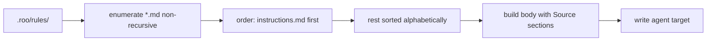

# Plan — `.roo/rules` auto-discovery in the init scripts

**Date:** 2026-10-22
**Scope:** [`scripts/init.ps1`](../../scripts/init.ps1:42), [`scripts/init.sh`](../../scripts/init.sh:36), [`scripts/README.md`](../../scripts/README.md:57)
**Requested by:** user — the hardcoded 3-file `$SourceFiles` array drops newly added rule files.

## Problem

Both init scripts carry a hardcoded list:

```powershell
$SourceFiles = @('instructions.md', 'general.coding-standards.md', 'project-context.md')
```

`.roo/rules/` now contains 5 files — `react.coding-standards.md` and
`ts.coding-standards.md` are silently missing from every generated instruction file
(`.github/copilot-instructions.md`, `.cursor/rules/project.mdc`, `CLAUDE.md`).
Every future rule file needs a code edit in two scripts, so drift is guaranteed.

## Target behaviour

1. Source set = **every `*.md` file directly under `.roo/rules/`** (non-recursive; `.roo/mcp.json` and any non-`.md` file are ignored).
2. Output order = `instructions.md` first (if present), then the remaining files **alphabetically** (case-insensitive, by basename).
3. Both scripts produce **byte-identical** content → paths in the generated header are normalised to forward slashes (`.roo/rules/foo.md`, no `\` on Windows).
4. Missing `instructions.md` → warning only, still generates. No `.md` at all → fatal (`exit 1`), unchanged.
5. Idempotency, `.bak` handling, `.gitignore` sync, interactive agent prompt and exit codes stay untouched.

Expected order today: `instructions.md`, `general.coding-standards.md`, `project-context.md`, `react.coding-standards.md`, `ts.coding-standards.md`.



## Steps

1. **`scripts/init.ps1` — constants.** Replace the `$SourceFiles` array with a discovery contract:
   `$RulesDir` unchanged, add `$PrimarySourceName = 'instructions.md'` and `$SourcePattern = '*.md'`; update the comment that says "Fixed list, in output order".
2. **`scripts/init.ps1` — discovery helper.** Rewrite [`Get-PresentSourceFiles()`](../../scripts/init.ps1:93) to enumerate `Get-ChildItem -LiteralPath $RulesDir -File -Filter $SourcePattern`, skip zero-byte / `~$*` temp names, sort by name, then move `instructions.md` to the front. Return `List[string]` of forward-slash normalised relative paths (`$RulesDir + '/' + $File.Name`) so the `## Source:` headers match the bash output. Keep the existing `Write-Info` per file and the "no source files" `Write-Err` + `return $null` path. Guard the `$RulesDir` not-exists case explicitly (previously implied by the fixed list).
3. **`scripts/init.sh` — same change.** Replace the `SOURCE_FILES` array in [`init.sh`](../../scripts/init.sh:36) with a `discover_source_files()` helper: glob `"${RULES_DIR}"/*.md`, keep only regular files, sort basenames with `LC_ALL=C sort`, prepend `instructions.md` when present, echo one path per line on **stdout** (logging stays on stderr — the caller reads stdout through `$(...)`). Update `check_source_files()` to consume it.
4. **Script headers/JSDoc.** Update the `.DESCRIPTION` / comment blocks in both scripts: source of truth is *every* `.md` in `.roo/rules/`, `instructions.md` first, rest alphabetical; adding a rule file needs no script edit.
5. **Docs.** Update the `init.sh` / `init.ps1` section of [`scripts/README.md`](../../scripts/README.md:57) with the discovery rule + ordering convention + "new rule file needs no code change". Root [`README.md`](../../README.md:1) only if it repeats the file list (check first; otherwise leave alone).
6. **Verification.**
   - `powershell -File scripts/test-syntax.ps1` → syntax OK.
   - `powershell -File scripts/init.ps1`, pick Copilot (and inspect `.bak` is created when content changed); confirm 5 `## Source:` sections in the expected order.
   - `bash scripts/init.sh`, pick Cursor; confirm the `## Source:` lines and body are identical to the PowerShell run apart from the format frontmatter.
   - Sanity: temporarily add `zz-test.md` to `.roo/rules/`, re-run, confirm it is picked up and lands last, then delete it.
7. **Docs trail.** Add `docs/history/<ts>-rules-auto-discovery.md` (change summary) and a short milestone `docs/milestones/<ts>-rules-auto-discovery.milestone.md` recording the ordering convention (a decision future contributors must know).

## Non-goals

- No sub-directory recursion in `.roo/rules/` (flat layout is the current convention; recursion can be added later behind the same helper if a `sub/` tree appears).
- No new CLI flags in `init.ps1` (it stays interactive).
- Generated agent files are gitignored — no repository artefacts change besides the two scripts and docs.

## Risks

- **Output ordering change** is intentional but changes all three generated files (they were missing two rule files anyway).
- PowerShell 5.1 vs 7 `Get-ChildItem` differences are limited to `-File`, which exists in 5.1 — no compat shim needed.
- Bash `sort` locale: pin `LC_ALL=C` so ordering does not drift between machines.
