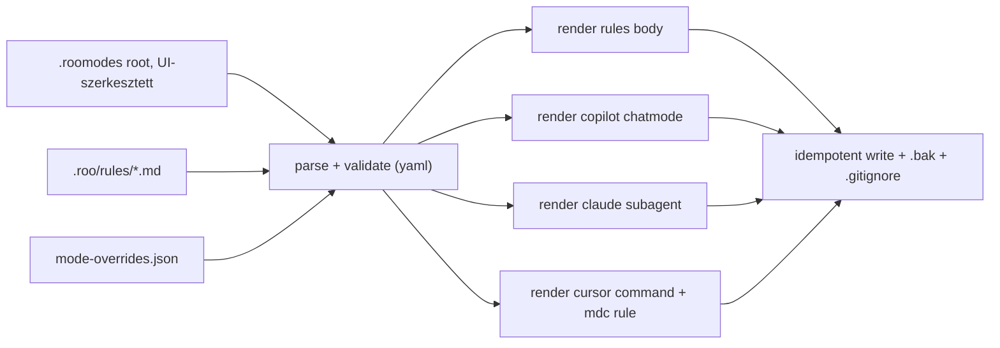

# Plan (v2) — `.roomodes` mint forrás: mode-ok átvezetése Copilot / Claude / Cursor agentekbe

**Dátum:** 2026-10-22 · **v2:** a mód már projekt-szinten van (a felhasználó elvégezte), a YAML-parse Node + `yaml` csomaggal megy.
**Érintett:** [`.roomodes`](../../.roomodes:1), új `scripts/lib/agent-artifacts/`, [`scripts/init.ps1`](../../scripts/init.ps1:1), [`scripts/init.sh`](../../scripts/init.sh:1), [`package.json`](../../package.json:24), [`scripts/README.md`](../../scripts/README.md:57)

## 1. Kiindulás (ellenőrizve)

| Tény                             | Részlet                                                                                                                  |
| -------------------------------- | ------------------------------------------------------------------------------------------------------------------------ |
| A mód projekt-szintű             | [`.roomodes`](../../.roomodes:1) a repo gyökerében, `source: project`, 1 mode: `jira-ticket-writer`                      |
| Mode mezők                       | `slug`, `name`, `description`, `roleDefinition`, `whenToUse`, `customInstructions`, `groups: [read, edit, command, mcp]` |
| Globális példány                 | még él a JetBrains Zoo Code state-ben → slug-ütközés, törölni kell (P2)                                                  |
| `.roo/rules-jira-ticket-writer/` | nem létezik (nem kötelező)                                                                                               |
| Root dev deps                    | `@sonar/scan`, `concurrently`, `prettier` — `yaml` **nincs**, be kell tenni                                              |
| Meglévő Node-script minta        | `scripts/sonar/*.mjs` + `node --test` (ezt követjük)                                                                     |

## 2. Döntés

- **Forrás:** a gyökér `.roomodes` (a Zoo Code UI-ban szerkeszted; a script soha nem írja).
- **Parse:** Node + `yaml` csomag, egyetlen implementáció.
- **Generálás:** minden agent-artefakt egy Node CLI-ből jön; az `init.ps1` / `init.sh` innentől **vékony wrapperek** (interaktív választás + a CLI hívása) — ez megszünteti a PS/bash közötti duplikált renderelést, ami eddig a byte-identitás karbantartását igényelte.
- **Felülbírálások** (tool-lista, emit) nem a `.roomodes`-ba, hanem egy sidecar fájlba kerülnek, mert a Zoo Code UI a `.roomodes`-t újraírhatja és az ismeretlen kulcsokat eldobhatja.
- **Kötelező**: minden legenerált fájl (`+ .bak` párja) bekerül a `.gitignore`-ba, ugyanabba az „AI agent instruction files (autogenerated by scripts/init.*)" szekcióba, ahol a mai generált fájlok vannak — a script automatikusan hozzáadja, idempotensen (nincs duplikált sor), és commitba csak a kézzel írt források (`.roomodes`, `scripts/lib/agent-artifacts/**`) kerülnek.



## 3. Fájltérkép

```text
scripts/lib/agent-artifacts/
├── generate.mjs           # CLI: --agent copilot|cursor|claude [--check] [--dry-run]
├── roomodes.mjs           # .roomodes betöltés + validáció (yaml)
├── rules.mjs              # .roo/rules/*.md discovery + összefűzés (meglévő kontraktus)
├── overrides.mjs          # mode-overrides.json betöltés/merge
├── tools.mjs              # Zoo groups -> copilot/claude tool-idk
├── render-copilot.mjs     # .github/chatmodes/<slug>.chatmode.md
├── render-claude.mjs      # .claude/agents/<slug>.md
├── render-cursor.mjs      # .cursor/commands/<slug>.md + .cursor/rules/<slug>.mdc
├── writer.mjs             # UTF-8 no BOM, LF, 1 záró newline, idempotencia, .bak, .gitignore
├── mode-overrides.json    # kézi felülbírálások (slug -> copilotTools/claudeTools/emit)
└── *.test.mjs             # node --test
```

## 4. Lépések

### P1 — Dependency + parse + validáció

1. `pnpm add -D yaml -w` (root), és jegyezd fel a [`scripts/README.md`](../../scripts/README.md:1)-ben.
2. `roomodes.mjs`: `.roomodes` beolvasása `yaml.parse`-szal; kötelező mezők ellenőrzése (`slug`, `name`, `description`, `roleDefinition`, `whenToUse`), `groups` alapértelmezés `[read]`; hiba → beszédes `Error` + nem-nulla exit kód. Duplikált `slug` → hiba.
3. `pnpm test:agents` script a root `package.json`-ba: `node --test "scripts/lib/agent-artifacts/*.test.mjs"`.

### P2 — A globális példány törlése (kézi, te végzed)

1. Zoo Code → Modes → Edit modes → `Jira Ticket Writer` → **Delete**.
2. Fallback: WebStorm zárt állapotában a `zoo-code-extension-storage.xml` `WeCode-AI.zoo-code` entry JSON-jéből kiveszed a `jira-ticket-writer`-t (előtte `.bak`).
3. Ellenőrzés: a mode-választóban **egyszer** szerepel; ha a `.roomodes`-t ideiglenesen átnevezed, eltűnik.

### P3 — Rendererek

Közös body (minden célra ugyanaz a tartalom, agent-specifikus burokkal):

```text
## Role
<roleDefinition>

## When to use
<whenToUse>

## Workflow
<customInstructions>
```

| Cél               | Fájl                                     | Frontmatter                                        |
| ----------------- | ---------------------------------------- | -------------------------------------------------- |
| Copilot chat mode | `.github/chatmodes/<slug>.chatmode.md`   | `description: <description>`, `tools: [...]`       |
| Claude subagent   | `.claude/agents/<slug>.md`               | `name`, `description`, `tools: [...]`              |
| Cursor command    | `.cursor/commands/<slug>.md`             | nincs (plain prompt, a body + „Act as …" nyitósor) |
| Cursor rule       | `.cursor/rules/<slug>.mdc`               | `description`, `globs:` üres, `alwaysApply: false` |
| Zoo Code          | — (a `.roomodes` a forrás, nem generált) | —                                                  |

Tool-mapping (`tools.mjs`), kezdeti tábla — **implementálás előtt ellenőrizni az adott agent dokumentációjában**, mert a tool-idk verziófüggők:

| Zoo group | Copilot `tools`                            | Claude `tools`                                             |
| --------- | ------------------------------------------ | ---------------------------------------------------------- |
| `read`    | `codebase`, `search`, `usages`, `problems` | `Read`, `Grep`, `Glob`                                     |
| `edit`    | `editFiles`                                | `Edit`, `Write`                                            |
| `command` | `runCommands`, `runTasks`                  | `Bash`                                                     |
| `browser` | `fetch`                                    | `WebFetch`, `WebSearch`                                    |
| `mcp`     | `mcpServers`                               | `mcp__<server>__*` (a konkrét szerverek a felülbírálásban) |

Felülbírálás: `mode-overrides.json`

```json
{
  "jira-ticket-writer": {
    "emit": [
      "copilot-chatmode",
      "claude-agent",
      "cursor-command",
      "cursor-rule"
    ],
    "copilotTools": ["codebase", "editFiles", "runCommands", "mcpServers"],
    "claudeTools": ["Read", "Grep", "Glob", "Edit", "Write", "Bash"]
  }
}
```

Ismeretlen `emit` érték → hiba; hiányzó override → a `groups`-ból számolt default.

### P4 — Írás + wrapperek

1. `writer.mjs`: célfájl tartalom-összehasonlítás → ha azonos, „naprakész"; ha eltér, `.bak` majd UTF-8 (BOM nélkül) + LF + egy záró newline kiírás; `.gitignore` szinkron (CRLF-toleráns egyezés, LF/no-BOM írás) a generált agent-fájlokra.
2. `generate.mjs` CLI: `--agent` (kötelező), `--dry-run`, `--check` (csak eltérést jelez, nem ír; CI-hoz). Exit kódok: `0` ok, `1` hiba, `2` `--check` esetén elavult fájl.
3. [`scripts/init.ps1`](../../scripts/init.ps1:1) / [`scripts/init.sh`](../../scripts/init.sh:1): a meglévő interaktív prompt marad; a tartalom-előállítás és írás **átkerül a CLI-be** (`node scripts/lib/agent-artifacts/generate.mjs --agent <választott>`). A `.roo/rules/*.md` összefűzés is a CLI-be kerül (`rules.mjs`), így a shell-oldali duplikált renderelés (EM_DASH, trailing newline, CRLF-trükkök) törölhető. Az átállás addig nem törli a régi kódot, amíg a CLI paritás nincs bizonyítva.
4. `.gitignore` — **a script minden legenerált fájlt magától hozzáad**, futásonként, idempotensen:
   - a meglévő marker-szekcióba (`# --- AI agent instruction files (autogenerated by scripts/init.*) ---`) kerülnek az alábbi sorok, a már meglévő bejegyzések után, duplikáció nélkül (CRLF-toleráns egyezés, LF/no-BOM írás):
     - `.github/chatmodes/<slug>.chatmode.md` és `.github/chatmodes/<slug>.chatmode.md.bak`
     - `.claude/agents/<slug>.md` és `.claude/agents/<slug>.md.bak`
     - `.cursor/commands/<slug>.md` és `.cursor/commands/<slug>.md.bak`
     - `.cursor/rules/<slug>.mdc` és `.cursor/rules/<slug>.mdc.bak`
     - a választott agenthez tartozó fő instruction fájl (`.github/copilot-instructions.md`, `.cursor/rules/project.mdc`, `CLAUDE.md`) — ez már ma is így működik
   - ha a marker-szekció nem létezik, létrehozza (a mai viselkedés szerint);
   - ha a `.gitignore` nem létezik → figyelmeztetés, nem hiba (a mai viselkedés szerint);
   - **`.roomodes` soha nem kerül a `.gitignore`-ba** (ez a forrás, committed marad).

### P5 — Tesztek

1. `node --test` suite-ok: `.roomodes` parse/validáció (kötelező mező hiány, duplikált slug), groups→tools mapping, mind a négy renderer kimenete (golden string), idempotencia, `--check` exit kód 2.
2. `bash -n scripts/init.sh`, `powershell -File scripts/test-syntax.ps1`.
3. Kézi füst teszt: `printf '1\n' | bash scripts/init.sh` (Copilot) → `.github/chatmodes/jira-ticket-writer.chatmode.md` létrejön; `2` → Cursor fájlok; `3` → Claude subagent. Második futás → „naprakész".
4. `.gitignore` ellenőrzés minden futás után: `git status --porcelain` csak a kézzel írt forrásokat mutassa (`.roomodes`, `scripts/lib/agent-artifacts/**`), a generált fájlok **ne** jelenjenek meg; `git check-ignore -v .github/chatmodes/jira-ticket-writer.chatmode.md` adjon találatot; duplikált `.gitignore` sor ne legyen (`grep -c` a bejegyzésre == 1).
5. A régi byte-identitás ellenőrzés (PS vs bash) a CLI bevezetése után **értelmét veszti** — helyette a CLI egyszer fut, mindkét shellből.

### P6 — Dokumentáció

1. [`scripts/README.md`](../../scripts/README.md:57): a `scripts/lib/agent-artifacts/` bekerül a layoutba + a mode-pipeline leírása + `yaml` dependency.
2. Új spec: `docs/Specs/AI-Agent-Artifacts.md` — forrás/generált térkép, tool-mapping tábla, `.roomodes` (kézzel szerkesztett) vs generált fájlok, „ne szerkeszd kézzel" szabályok, `--check` használat CI-ban.
3. `docs/history/<ts>-agent-modes-from-roomodes.md` + `docs/milestones/<ts>-agent-modes-from-roomodes.milestone.md` (a globális → projekt migráció lépései és visszaállítása is).

## 5. Kockázatok

- **Tool-id verziófüggés** (Copilot `tools`, Claude `tools`): hibás id esetén az agent figyelmen kívül hagyja a frontmattert vagy elutasítja a fájlt → implementálás előtt dokumentáció-ellenőrzés, utána kézi betöltés-teszt.
- **Refactor kockázat**: ha a CLI átveszi a rules-összefűzést, a jelenleg működő 5-fájlos kimenetnek bitre egyeznie kell a régivel (összehasonlítás a régi kimenettel, mielőtt a shell-kódot töröljük).
- **Node jelenléte**: a scriptek eddig nem igényeltek Node-ot; most igen. Ha ez nem kívánatos, a fallback a mini-YAML-parser PowerShell-ban és bash-ben (kétszer), de az a duplikáció visszahozása.
- **UI vs script**: ha a Zoo Code UI a `.roomodes`-be ír, az nekünk jó (az a forrás); viszont ha valaki kézzel a generált artefaktot szerkeszti, a következő futás felülírja — ezt a specben ki kell mondani.

## 6. Scope-on kívül

- A mode tartalmának átírása/fejlesztése (1:1 átvezetés).
- További agentek (Gemini CLI, Codex, …).
- `.roo/rules-jira-ticket-writer/` létrehozása.
- CI workflow bekötése a `--check` módhoz (opcionális következő kör).
