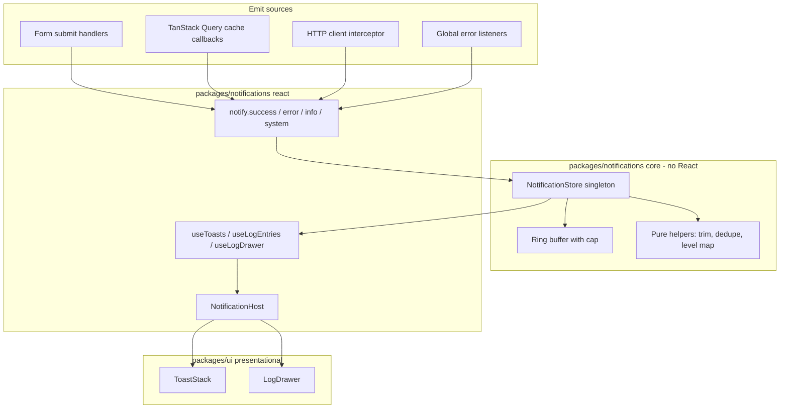

# Frontend notification + live log system — implementation plan

**Created:** 2026-10-22 15:40 (Europe/Budapest)
**Status:** FINAL — all decisions (N1–N7) agreed in the planning discussion of 2026-10-22.
**Scope:** `apps/admin`, `packages/ui`, new `packages/notifications`; `apps/web` is a follow-up.

---

## 1. Goal

One notification/log subsystem for every page of every React app, with three hard properties:

1. **UI-independent core.** An internal store holds every notification and system message
   (log). The UI is a *subscriber*, not the owner. Calling it must work from a service,
   a query hook, a router guard or plain TS — with no React mounted.
2. **Toast layer.** A new message appears bottom-right; new toasts stack above the old ones;
   old toasts disappear after a while.
3. **Live log panel.** Collapsed by default, announced only by a small arrow/tab on the page
   edge. Clicking it slides in a panel that shows the log (last N entries), with a button to
   load older entries. Everything ever emitted in the session is reachable.

---

## 2. What exists today (facts, not assumptions)

| Area | State | File |
|---|---|---|
| Design tokens | Tailwind v4 `@theme`, graphite + teal, `--ease-neu`, `--duration-fast/base`, `shadow-neu-*` | [`theme.css`](../../packages/ui/src/styles/theme.css:22) |
| Primitives | `Button`, `Input`, `Textarea`, `Card`, `Table*`, `Badge`, `Alert`, `cn()` — explicit exports only | [`index.ts`](../../packages/ui/src/index.ts:6) |
| Admin app shell | No `src/app/`; `App.tsx` holds routes + `ProtectedLayout`, `main.tsx` holds `QueryClientProvider` | [`App.tsx`](../../apps/admin/src/App.tsx:7) |
| Error mapping | Single pure `toErrorMessage(error)` in `lib/error-message.ts` | [`error-message.ts`](../../apps/admin/src/lib/error-message.ts:53) |
| Form feedback today | Per-form `Alert` + page-level error state; success via `mutation.isSuccess` | [`ApiKeyForm.tsx`](../../apps/admin/src/pages/api-keys/ui/ApiKeyForm.tsx:36) |
| Server state | TanStack Query v5, one service instance injected in the composition root | [`api-client.ts`](../../apps/admin/src/services/api-client.ts:42) |
| Toast library | **none installed** (no sonner, react-hot-toast, react-toastify) | `apps/*/package.json` |
| `zustand` | **not installed** ("planned" row in the dependency table) | [`UI-Architecture.md`](../../docs/Specs/UI-Architecture.md:201) |
| `apps/web` | Not migrated to tokens (raw `slate-*`), no api-client, no react-query, no tests | [`App.tsx`](../../apps/web/src/App.tsx:8) |

Consequence: `apps/web` cannot host a token-styled drawer today without breaking the
"no palette utilities" rule — see open question **Q4**.

---

## 3. Options researched

Researched with Brave search, sources at the end of the section.

### Option A — In-house core store + in-house toasts (recommended)

- `packages/notifications`: `createNotificationStore()` (observer/`subscribe` + immutable
  snapshot), pure helpers, `useSyncExternalStore` bindings.
- `packages/ui`: presentational `Toast`, `ToastStack`, `LogDrawer`, `LogEntryRow` built from
  existing tokens and CVA recipes.
- Zero new runtime dependency.

Pros: the log store *must* exist anyway; one single source of truth; no second copy of toast
state inside a library; full token compliance; testable without React (pure store) and with
React (vitest); works in both apps and in non-React code; no CSS import, no theme fight.

Cons: we own the animation math (stack offset, `scale`, enter/exit transitions), the timer
pausing, and the swipe-to-dismiss niceties — realistically the *simple* subset of Sonner.

Precedent: Sonner itself is a ~500-line observer store + `toast()` free function + one
`<Toaster />` subscriber ([Emil Kowalski, "Building a toast component"](https://emilkowal.ski/ui/building-a-toast-component)).
The "framework-agnostic store + React subscriber" is the documented React pattern
([`useSyncExternalStore`](https://react.dev/reference/react/useSyncExternalStore),
[zustand vanilla store + `useStore`](https://zustand.docs.pmnd.rs/reference/hooks/use-store)).

### Option B — Sonner as the toast renderer, our store as the source

- Our store stays authoritative; a thin subscriber mirrors new entries into `toast.custom()`.

Pros: best-in-class stacking animation, accessibility, hover-to-expand, pause on inactive tab.
(~11 KB, ~1.8M weekly downloads, shadcn default.)

Cons: two states to keep in sync (our entries ↔ Sonner's internal toasts) — dismiss/undo must
be reconciled in both directions; Sonner's container is styled by `classNames`/`toastOptions`,
so tokens leak in as overrides rather than recipes; the log drawer is still ours; adds a
dependency plus a deviation from "primitives live in `packages/ui`".

Sources: [PkgPulse comparison](https://www.pkgpulse.com/guides/react-hot-toast-vs-react-toastify-vs-sonner-2026),
[Knock: top notification libraries](https://knock.app/blog/the-top-notification-libraries-for-react).

### Option C — `react-hot-toast` as headless renderer

- Tiny (~4–5 KB), `toast.custom()` gives 100% markup control, promise API.

Cons: still a second store; linear (non-stacked) layout by default; we would write the stack
CSS anyway — at which point Option A is smaller in total complexity.

### Option D — `react-toastify`

- Largest feature surface (progress bar, drag, 6 positions), but ~42 KB, mandatory CSS import,
  dated visuals, palette-driven defaults that would have to be overridden wholesale.

Verdict: rejected for this repo.

### Comparison

| Criterion | A in-house | B Sonner | C hot-toast | D toastify |
|---|---|---|---|---|
| Single source of truth (log ↔ toast) | yes | no (mirrored) | no (mirrored) | no |
| Token compliance | full | overrides | overrides | CSS theme override |
| New dependency | none | ~11 KB | ~5 KB | ~42 KB |
| Stack animation out of the box | we build (simple) | excellent | no | no |
| Log panel | ours in every option | ours | ours | ours |
| Works from non-React code | yes | yes (`toast()` is free) | yes | yes |
| Test story | pure store + RTL | wrapping a lib | wrapping a lib | wrapping a lib |

**Recommendation: Option A.** The store + log panel are ~70 % of the feature and are required
regardless; a library would only save the stack animation while introducing a second state.

---

## 4. Proposed architecture



Layering keeps the rules intact: `packages/notifications` (core) has no React and no tokens;
its React bindings render only `packages/ui` primitives; apps mount one `<NotificationHost />`
in the layout shell and call `notify.*` from forms/hooks.

### 4.1 Entry model

```ts
export type NotificationLevel = 'success' | 'error' | 'warning' | 'info' | 'system';

export type NotificationSource = 'form' | 'api' | 'router' | 'runtime' | 'manual';

export interface NotificationEntry {
  readonly id: string;
  readonly level: NotificationLevel;
  readonly message: string;
  readonly detail?: string;      // stack trace / HTTP status / request url
  readonly source: NotificationSource;
  readonly createdAt: number;    // epoch ms
  readonly read: boolean;        // drives the "unseen" badge on the drawer tab
  readonly toast: boolean;       // false for pure log entries (system noise)
}
```

### 4.2 Store contract

```ts
export interface NotificationStore {
  emit(input: EmitInput): NotificationEntry;
  dismiss(id: string): void;          // toast only
  markAllRead(): void;                // drawer opened
  clear(): void;                      // drawer "clear" button
  subscribe(listener: () => void): () => void;
  getSnapshot(): NotificationState;   // immutable, referentially stable when unchanged
  getServerSnapshot(): NotificationState; // useSyncExternalStore SSR guard
}
```

`NotificationState` = `{ entries: readonly NotificationEntry[]; toasts: readonly string[] }`.
Cap: `MAX_ENTRIES = 500` (ring buffer, oldest dropped); `MAX_VISIBLE_TOASTS = 3`.

### 4.3 Behaviour spec

Toasts
- bottom-right fixed viewport, column-reverse stack; new toast on top.
- `success`/`info` auto-dismiss after 4 s, `warning` 6 s, `error` **sticky** until dismissed.
- hover pauses the timer (`pointerenter`/`pointerleave`), `document.hidden` pauses as well.
- toast body: level icon + message + optional dismiss `button` (`aria-label="Bezárás"`).
- container: `role="region" aria-live="polite" aria-atomic="false"`; `error` entries additionally
  announced assertively via `role="alert"` on the item (mirrors the existing `Alert` convention).
- duplicate suppression: identical `level` + `message` within 2 s bumps a counter instead of
  adding a toast.

Log drawer
- collapsed: 40 px wide edge tab at mid-right with a `ChevronLeft` glyph and an unseen-count
  `Badge`; `aria-expanded`, `aria-controls`.
- expanded: 360–420 px panel sliding in from the right (`transition-transform duration-base
  ease-neu`, `bg-surface-overlay`, `shadow-neu-raised`), non-modal — no focus trap, page stays
  scrollable.
- initial render: last `LOG_INITIAL_PAGE = 20` entries, newest first.
- footer button **"Korábbiak betöltése"** appends the next 50 (`onLoadMore`), disabled when the
  buffer is exhausted; a header shows the total count.
- header actions: level filter chips (`Mind` / `Hiba` / `Figyelmeztetés` / `Info` / `Rendszer`),
  **"Törlés"**, close (`Escape` closes as well).
- panel is `role="log"` + `aria-live="off"` while open (live region noise is on toasts only).
- empty state: "Még nincs bejegyzés."
- timestamps via the existing [`lib/date.ts`](../../apps/admin/src/lib/date.ts:1) formatter.

Persistence (P2 — decided)
- `sessionStorage` mirror under the key `aisztens.notifications.v1`; envelope
  `{ version: 1, entries: NotificationEntry[] }`, cap **200** entries (oldest dropped).
- **Only `entries` are persisted.** `toasts` and their timers never are — a reload must not
  resurrect toasts that already expired.
- Restore happens once, synchronously, in a lazy `useState` initialiser of the provider, so the
  first render already shows the restored log (no loading flash).
- Writes are coalesced (at most one per animation frame) and wrapped in `try/catch`: a full or
  disabled storage degrades to memory-only and never breaks the app.
- Unknown `version`, malformed JSON or a failing `safeParse` → the key is removed and the store
  starts empty. No migration code in phase 1.
- Storage is **injected** (`StorageLike`), so the adapter is testable without a DOM.

### 4.4 Where messages come from (full automatic capture — decided)

| Source | Mechanism | Notes |
|---|---|---|
| Forms | explicit `notify.success(...)` / `notify.error(...)` in the submit handler | the human-readable message; replaces the inline success `Alert` in `ApiKeyForm`; field-level errors stay in `setError` |
| TanStack Query | global `QueryCache` / `MutationCache` callbacks on the `QueryClient` in `main.tsx` | catches every current and future form for free; text through the existing `toErrorMessage`; `mutationKey` becomes the entry's `detail` |
| HTTP layer | new optional `onEvent?: (event: HttpEvent) => void` on `HttpClientConfig`, injected in [`api-client.ts`](../../apps/admin/src/services/api-client.ts:42) | no React import in `packages/api-client`; 2xx → `system` entry with `toast: false`, 4xx/5xx/network → toast + log |
| Global | `window` `error` + `unhandledrejection` listeners registered by the provider | `level: 'error'`, `source: 'runtime'` |
| Router | navigation logging at `system` level, `toast: false` | **disabled by default** (`logNavigation: false`) — pure noise until someone asks for it |

The three automatic channels are additive: a failed mutation produces one `notify` entry from the
mutation callback and one `system` entry from the HTTP hook, which is exactly what the log panel is
for. Duplicate toast suppression (§4.3) keeps the visual layer calm.

### 4.6 Storage schema and adapter

```ts
export interface StorageLike {
  getItem(key: string): string | null;
  setItem(key: string, value: string): void;
  removeItem(key: string): void;
}

export interface PersistedNotificationLog {
  readonly version: 1;
  readonly entries: readonly NotificationEntry[];
}

export interface NotificationStorage {
  load(): readonly NotificationEntry[];
  save(entries: readonly NotificationEntry[]): void;
  clear(): void;
}
```

`createNotificationStorage({ storage, key, cap })` composes two pure functions from
`notification-storage.logic.ts` — `toPersistedEnvelope(entries, cap)` and
`fromPersistedEnvelope(raw)` — so every branch (empty, corrupt, wrong version, cap overflow) is
unit-testable without a browser.

### 4.7 Redaction rules (non-negotiable)

- The HTTP event carries method, **query-stripped** URL, status, duration and a message. Never
  headers, never a request or response body.
- A pure `redactValue(key, value)` replaces the values of `authorization`, `token`, `password`,
  `apiKey`, `secret` with `<redacted>` on every emitter path — including `detail` strings.
- Runtime errors log `name` + `message`; the stack is attached only when the app passes
  `includeDetails: import.meta.env.DEV` to the provider (no `import.meta` inside the package).

### 4.5 File map

```text
packages/notifications/
  package.json                     jest/vitest config, react as peer, @callback/ui as dep
  src/index.ts                     explicit exports
  src/core/notification.interface.ts
  src/core/notification.const.ts
  src/core/notification.logic.ts        trimming, dedupe, level->variant, paging, redaction
  src/core/notification.store.ts        createNotificationStore (observer, no React)
  src/core/notification.storage.interface.ts  StorageLike / PersistedNotificationLog / NotificationStorage
  src/core/notification.storage.logic.ts      toPersistedEnvelope / fromPersistedEnvelope
  src/core/notification.storage.ts            createNotificationStorage (injected StorageLike)
  src/core/notification-event.const.ts  message catalogs for api/mutation events
  src/react/notification.context.tsx    NotificationProvider + context
  src/react/use-notifications.ts        useToasts / useLogEntries / useLogDrawer
  src/react/notification.facade.ts      notify.* bound to the active store
  src/react/NotificationHost.tsx        composes ToastStack + LogDrawer
  test/…

packages/ui/src/components/toast/
  Toast.tsx  ToastStack.tsx  toast.interface.ts  toast.variants.ts
packages/ui/src/components/log-drawer/
  LogDrawer.tsx  LogEntryRow.tsx  log-drawer.interface.ts  log-drawer.variants.ts

apps/admin/src/app/providers/NotificationRoot.tsx   (or src/components/ if src/app stays absent)
apps/admin/src/main.tsx                              + <NotificationProvider> + QueryCache callbacks
apps/admin/src/App.tsx                               + <NotificationHost /> inside ProtectedLayout
```

---

## 5. Decisions

| # | Decision | State |
|---|---|---|
| N1 | Build the core + UI in-house instead of adopting Sonner/react-hot-toast | **AGREED (2026-10-22)** — Option A |
| N2 | New workspace package `packages/notifications` holds the core **and** the React bindings; `packages/ui` keeps only presentational `Toast` / `ToastStack` / `LogDrawer` / `LogEntryRow` | **AGREED (2026-10-22)** |
| N3 | Toast rules: 3 visible, 4 s / 6 s / sticky error, hover + tab-hidden pause, 2 s dedupe | **AGREED (2026-10-22)** |
| N4 | Drawer: 20 initial + 50 per load-more, right edge, non-modal, filters + clear | **AGREED (2026-10-22)** |
| N5 | Scope: admin only in this change; `packages/notifications` stays app-agnostic and `apps/web` adopts it in a follow-up after its token migration | **AGREED (2026-10-22)** |
| N6 | Persistence: `sessionStorage` mirror, cap 200, restored at provider mount, toasts never persisted | **AGREED (2026-10-22)** |
| N7 | Full automatic capture — `QueryCache`/`MutationCache`, HTTP `onEvent`, global `error`/`unhandledrejection` — in addition to explicit `notify.*` | **AGREED (2026-10-22)** |

### 5.1 Why in-house won (Q1) and what it costs

- Sonner / react-hot-toast would still leave the log store to us; the library would add a second
  authoritative list of visible toasts that must be reconciled on dismiss / undo / clear.
- Sonner is itself an observer store plus one subscriber component, so the pattern we need is the
  pattern it uses; the only difference is animation polish.
- Accepted cost: we implement the stack offset/scale transition, the per-toast timer with
  hover/tab-hidden pausing and the close affordance ourselves. No momentum swipe in phase 1.

### 5.2 Why a separate package won (Q2)

- The store must be importable from non-React code (`packages/api-client` consumers, router
  wrappers, tests) without dragging React into the bundle graph.
- `packages/ui` stays "tokens + presentational primitives only", so its contract in
  [`UI-Architecture.md`](../../docs/Specs/UI-Architecture.md:130) needs no exception.
- The React bindings live in `packages/notifications/src/react` with React as a **peer**
  dependency, so `apps/admin` and later `apps/web` mount the same provider instead of
  duplicating it.

### 5.3 Package boundary contract

| Package | May import | Must never import |
|---|---|---|
| `packages/notifications` (core) | nothing (plain TS) | React, `@callback/ui`, zod |
| `packages/notifications` (react) | `react`, `@callback/ui`, its own core | apps, `@callback/api-client` |
| `packages/ui` | `clsx`, `tailwind-merge`, `cva` | `@callback/notifications`, apps |
| `apps/*` | all of the above | — |

---

## 6. Work breakdown

1. **Package skeleton** — `packages/notifications` (package.json, tsconfig, `vitest.config.ts`,
   `src/index.ts` + `src/react/index.ts`), full interfaces, type-check green with no behaviour.
2. **Core store** — `createNotificationStore`, ring buffer, dedupe, paging, `markAllRead`,
   `clear`, `redactValue`; pure logic in `.logic.ts`; unit tests for every branch and boundary
   (cap overflow, dedupe window edge, empty snapshot identity, redaction).
3. **Persistence adapter** — injected `StorageLike`, pure envelope serialise/parse, debounced
   writes, silent degradation; tests for empty / corrupt JSON / wrong version / quota error /
   disabled storage.
4. **UI primitives** — `Toast`, `ToastStack`, `LogDrawer`, `LogEntryRow` in `packages/ui` with CVA
   variants and tokens only; vitest tests (variants, ARIA attributes, Escape, load-more callback).
5. **React bindings** — provider (restores from storage in the lazy initialiser), hooks,
   `notify` facade, automatic `error`/`unhandledrejection` listeners, `NotificationHost`.
6. **Admin wiring** — provider in `main.tsx` with `includeDetails: import.meta.env.DEV`,
   `QueryCache`/`MutationCache` callbacks, `<NotificationHost />` in `ProtectedLayout`,
   `onEvent` injected into the `httpClient` composition root, `HttpEvent` type added to
   `packages/api-client`.
7. **Migrate the first form** — `ApiKeyForm` emits toasts instead of the inline success `Alert`;
   update its test; keep the `setError('identifier')` 409 path unchanged.
8. **Docs** — this plan → final; `docs/Specs/UI-Architecture.md` (primitive rows, dependency
   table, state plan rows, new notification subsection); `docs/history/` entry; milestone doc.

Out of scope for this change (follow-up, tracked in the milestone's "Follow-ups"): mounting the
provider in `apps/web`, which first needs that app migrated to `@callback/ui` tokens
(currently every class is `slate-*`) and a real form that emits messages.

---

## 7. Verification

```bash
pnpm --filter @callback/notifications test
pnpm --filter @callback/ui test
pnpm --filter @callback/admin test
pnpm --filter @callback/admin lint
pnpm --filter @callback/admin build
# palette check must stay empty
rg "#[0-9a-fA-F]{3,8}|(bg|text|border|ring|from|to|via)-(slate|gray|zinc|neutral|stone|indigo|red|amber|green|emerald|blue)-[0-9]{2,3}" apps/admin/src
```

Manual checks

1. Submit `ApiKeyForm` twice (one success, one 409) → two stacked toasts bottom-right, the error
   one sticky, the success one gone after 4 s.
2. Hover a toast → its timer stops; switch tabs and back → no toast expired while hidden.
3. Open the edge tab → the log lists both entries newest-first; the unseen badge resets.
4. Emit 60+ entries → the drawer shows 20, "Korábbiak betöltése" reveals 50 more, then disables.
5. Reload the page → the log is restored from `sessionStorage` (≤200 entries) and **no** toasts
   reappear.
6. Trigger a 500 from the API → an `error` toast plus an `api` log entry with status, URL and
   duration, and no headers or body in the entry.

---

## 8. Discussion log (all questions resolved)

| Q | Question asked in the chat | Answer |
|---|---|---|
| Q1 | In-house vs Sonner vs react-hot-toast | **In-house** — the log store is required anyway and a library would add a second state |
| Q2 | New package vs everything inside `packages/ui` | **New `packages/notifications`** (core + React bindings); `packages/ui` stays presentational |
| Q3 | Toast / drawer numbers | **3 visible, 4 s / 6 s / sticky error, 2 s dedupe, 20 initial + 50 per load-more** |
| Q4 | Scope | **Admin only**; `apps/web` after its token migration |
| Q5 | Capture + persistence | **Full automatic capture + `sessionStorage` mirror (cap 200)** |

Researched sources: [Building a toast component](https://emilkowal.ski/ui/building-a-toast-component) ·
[Toast library comparison 2026](https://www.pkgpulse.com/guides/react-hot-toast-vs-react-toastify-vs-sonner-2026) ·
[Top React notification libraries](https://knock.app/blog/the-top-notification-libraries-for-react) ·
[`useSyncExternalStore`](https://react.dev/reference/react/useSyncExternalStore) ·
[zustand vanilla store + `useStore`](https://zustand.docs.pmnd.rs/reference/hooks/use-store).

---

## 9. Acceptance criteria

- [ ] `notify.*` works with no React tree mounted (unit test in the core package).
- [ ] Every form submit produces exactly one toast and one log entry, with no per-form wiring
      beyond the explicit `notify.*` call.
- [ ] 4xx/5xx/network failures create both a toast and an `api` log entry; 2xx creates a log entry
      only.
- [ ] Toasts stack bottom-right, cap at 3, pause on hover, disappear on schedule, errors stay.
- [ ] The drawer is collapsed by default, opens from the edge tab, loads 20 then 50 at a time,
      filters by level, clears, and closes on `Escape`.
- [ ] `sessionStorage` restores the log after a reload (≤200) without restoring toasts; a corrupt
      or foreign payload is discarded silently.
- [ ] No secret is ever logged or persisted (`redactValue` tests).
- [ ] `packages/ui` has no dependency on `packages/notifications`; the core has no React import.
- [ ] Palette check, lint, type-check and all test suites pass; `docs/Specs/UI-Architecture.md`
      updated in the same change.
