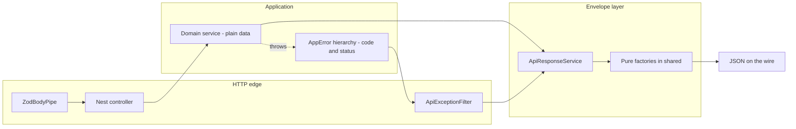
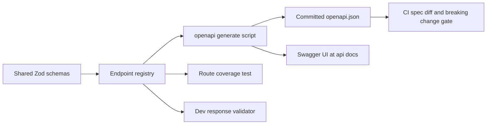

# Egységes API szerződés és válasz-boríték (envelope) — implementációs terv

**Készült:** 2026-10-26 17:21 (Europe/Budapest)
**Állapot:** TERVEZET — jóváhagyásra vár.
**Hatályon kívül helyezi:** `2026-10-26--15-29-00-unified-api-convention-plan.md` (csupasz payload változat).
**Meghozott döntés:** egységes boríték minden válaszon — siker: `{ data, meta }`, hiba: `{ error }`. Breaking változás, de a jelenlegi felület kicsi (`api-keys`), ezért most olcsó.
**Érintett scope:** `packages/shared` (szerződés), `apps/api` (boríték előállítás), `packages/api-client` (boríték felbontás), `apps/admin` (hibamegelenítés), új `docs/Specs/API-Convention.md`.

---

## 1. Cél

Egyetlen leírt és kikényszerített szabályrendszer minden szerver↔kliens kommunikációra:

1. **Kérés** — mindig JSON, az opcionális mezőket elhagyjuk (soha nem `null`, soha nem `''`).
2. **Válasz** — mindig JSON borítékban; az üres gyűjtemény `[]` a `data`-n belül.
3. **Hiba** — egyetlen forma minden hibára, egyetlen szerviz állítja elő, stabil gépi `code` alapján dönt.
4. **Üres / nulla találat** — típusonként egy szabály, nincs kétértelműség a `null`, `[]`, `0` és a hiányzó kulcs között.
5. **Egy igazságforrás** — a szerződés egyszer van definiálva a `@callback/shared`-ben (Zod); a szerver ezzel validál, a kliens ezzel parse-ol. Nincs második, kézzel írt alak.
6. **Szerverhibák a kliensen** — négy fix felület (mező, oldal-figyelmeztetés, app banner, log panel), és soha nem nyers szerver szöveg a felhasználói copy helyén.

---

## 2. Jelenlegi állapot (kódból ellenőrizve)

| Terület                      | Állapot                                                                               | Fájl                                                                                                                                                                                                                                               |
| ---------------------------- | ------------------------------------------------------------------------------------- | -------------------------------------------------------------------------------------------------------------------------------------------------------------------------------------------------------------------------------------------------- |
| Válasz alak                  | csupasz payload a controllerből, boríték nélkül                                       | [`api-keys.controller.ts`](../../apps/api/src/api-keys/api-keys.controller.ts:37)                                                                                                                                                                  |
| Hiba alak                    | Nest default `{ statusCode, message, error }` — nincs filter, nincs kód               | nincs `APP_FILTER` sehol az `apps/api/src`-ben                                                                                                                                                                                                     |
| Szerződés duplikáció         | szerver: class-validator DTO + saját interface; shared: ugyanazok a szabályok Zod-ban | [`create-api-key.dto.ts`](../../apps/api/src/api-keys/dto/create-api-key.dto.ts:35), [`api-keys.interface.ts`](../../apps/api/src/api-keys/api-keys.interface.ts:1), [`api-key.schema.ts`](../../packages/shared/src/schemas/api-key.schema.ts:50) |
| `@callback/shared` az apiban | szerepel az `apps/api/package.json`-ban, de **a `src`-ben soha nincs importálva**     | [`package.json`](../../apps/api/package.json:27)                                                                                                                                                                                                   |
| Kliens transzport            | egyetlen HTTP hely, minden hiba `ApiError` lesz, a `details` a `body.message`-ből jön | [`http-client.ts`](../../packages/api-client/src/http-client.ts:135), [`api-error.ts`](../../packages/api-client/src/api-error.ts:47)                                                                                                              |
| Hiba → szöveg                | döntés `status` alapján, soha nem üzenetszöveg alapján                                | [`error-message.ts`](../../apps/admin/src/lib/error-message.ts:53)                                                                                                                                                                                 |
| Notification rendszer        | tervezett (store + toast + log panel), **még nem épült meg**                          | [`notification plan`](2026-10-22--15-40-00-frontend-notification-and-log-system-plan.md:1)                                                                                                                                                         |

Következmény: a boríték pontosan **3 controllert** (`api-keys`, `healthz`, `vapi-webhooks`) és **1 kliens csomagot** érint — a breaking változás _most_ olcsó, a második feature után már drága.

---

## 3. Döntések

### D1 — Transzport

`application/json; charset=utf-8` be és ki, `Accept: application/json`. A JSON kulcsnevek **camelCase**-ek. Nincs form-encoded, nincs XML, nincs top-level csupasz skalár.

### D2 — Siker boríték (mindig)

```jsonc
{
  "data": { /* objektum */ } | [ /* tömb */ ] | null,
  "meta": {
    "requestId": "0192f3c4-...",
    "timestamp": "2026-10-26T15:21:48.752Z",
    "pagination": { "page": 1, "limit": 20, "total": 42, "totalPages": 3 } // csak lapozott listán
  }
}
```

- A `data` **mindig jelen van**; lista esetén `[]`, ha nincs találat; „nincs mit visszaadni" siker (pl. `DELETE`) esetén `data: null` és **200** — soha nem `204`, hogy a kliens mindig ugyanazt az alakot parse-olja.
- A `meta` **mindig jelen van** (legalább `requestId` + `timestamp`) → minden válasz visszakövethető egy szerver log sorhoz.

### D3 — Hiba boríték (mindig)

```jsonc
{
  "error": {
    "code": "API_KEY_IDENTIFIER_CONFLICT",
    "status": 409,
    "message": "identifier already exists",
    "details": [{ "path": "identifier", "message": "already taken" }],
    "requestId": "0192f3c4-...",
    "timestamp": "2026-10-26T15:21:48.752Z",
    "path": "/api/api-keys",
  },
}
```

- `code` — stabil, nyelvfüggetlen, közös enum-ból. **A kliens ezen dönt.**
- `message` — angol, fejlesztőnek/logba. **Soha nem kerül a felhasználói copy helyére.**
- `details` — mező szintű hibák form-hoz rendeléshez (`path` dot path, `''` a teljes payload hibájára).
- 5xx: a `message` fix generikus szöveg; stack trace, SQL szöveg, constraint név, driver hiba csak a szerver logban marad, `requestId`-vel korrelálva.

### D4 — Üres / nulla találat szabályok (típusonként egy)

| Eset                      | Wire                       | Soha                             |
| ------------------------- | -------------------------- | -------------------------------- |
| Lista, nincs találat      | `"data": []` (200)         | `null`, `404`, hiányzó kulcs     |
| Egy erőforrás nem létezik | `404` + hiba boríték       | `200` `data: null`-lal           |
| Opcionális skalár nincs   | `null`-ként jelen van      | hiányzó kulcs, `undefined`, `''` |
| Számláló                  | `0` számként               | `"0"`, `null`                    |
| Beágyazott objektum nincs | `{}` jelen van             | hiányzó kulcs                    |
| Siker, nincs visszaadandó | `"data": null`, 200        | `204`                            |
| Duplikáció                | `409` + `code: *_CONFLICT` | csendes felülírás                |
| Validáció                 | `400`/`422` + `details[]`  | egy összefűzött string           |

### D5 — Status kódok (egyetlen táblázat, mindkét oldalon kikényszerítve)

`200` olvasás/frissítés/törlés · `201` létrehozás · `400` rossz formátum/alak · `401` nincs hitelesítés · `403` tiltott · `404` nincs ilyen · `409` konfliktus · `413` túl nagy payload · `422` szemantikai validáció · `429` rate limit · `500` belső hiba · `503` függőség kiesett.

### D6 — Egy igazságforrás (contract-first, Zod)

A szerződés **kizárólag** a `@callback/shared`-ben él:

```text
packages/shared/src/contract/
  envelope.schema.ts       toSuccessEnvelope() + successEnvelopeSchema(dataSchema)
  error-envelope.ts        toErrorEnvelope() + apiErrorEnvelopeSchema
  error-code.const.ts      API_ERROR_CODE — egy enum, szerver és kliens is használja
  envelope.interface.ts    ApiEnvelope<T>, ApiErrorEnvelope, ApiErrorDetail, ResponseMeta
  http-status.const.ts     HTTP_STATUS (közös; az api-client újraexportálja)
  <resource>/<resource>.schema.ts    request + response Zod sémák
  <resource>/<resource>.contract.ts  endpoint registry: method, path, request?, response
```

Ebből az egy definícióból három artefaktum származik:

| Artefaktum        | Hogyan                                                                                                 |
| ----------------- | ------------------------------------------------------------------------------------------------------ |
| TS típusok        | `z.infer<typeof schema>`, újraexportálva a `<resource>.interface.ts`-ből                               |
| Szerver validáció | `ZodBodyPipe(schema)` / `ZodQueryPipe(schema)` a controllerben — **a class-validator DTO-k törlődnek** |
| Kliens parse      | `client.get(path, <resource>Schema)` — a mechanizmus változatlan, most a `data`-t bontja ki            |

Az endpoint registry ma opcionális, de ez a magja a későbbi OpenAPI generálásnak (`zod-to-json-schema`) — így soha nem íródik le második leírás.

### D7 — Szerver oldali rétegek: adat-szerviz + boríték-szerviz + hiba filter

Ez a kérés lényege: **az egyik szerviz előállítja az adatot, a másik becsomagolja.**



- **`ApiResponseService`** (injectable, `apps/api/src/common/http/`) — _vékony_: nincs benne üzleti logika, csak a `@callback/shared` tiszta factory-jeit hívja. Két metódus: `ok(data, meta?)`, `fail(appError, context)`.
- **A controllerek soha nem adnak vissza domain adatot közvetlenül.** Meghívják a domain szervizt, majd `return this.responses.ok(result)`. Végpontonként egyetlen csomagolási pont, explicit, greppelhető.
- **A hibák soha nem Nest exception-ként szöknek ki.** A domain szervizek `AppError` leszármazottakat dobnak (`code` + `status`); a globális `ApiExceptionFilter` (`APP_FILTER`) **bármilyen** dobott értéket (Nest `HttpException`, `ZodError`, ismeretlen `Error`) normalizál a hiba borítékba, ugyanazon `ApiResponseService`-en keresztül.
- Miért nem siker-interceptor: implicit módon csomagolna, elrejtené a döntést a kódból, és szervizből nem használható. Interceptor csak később, **dev-only assertion**-ként kerül be, hogy boríték nélküli body ne hagyhassa el a processzt.
- A health check és a VAPI webhookok **kivételek** (lásd D9), ott marad a mai nyers body.

### D8 — Hibakód katalógus

```ts
export const API_ERROR_CODE = {
  VALIDATION_FAILED: 'VALIDATION_FAILED',
  UNAUTHENTICATED: 'UNAUTHENTICATED',
  FORBIDDEN: 'FORBIDDEN',
  NOT_FOUND: 'NOT_FOUND',
  CONFLICT: 'CONFLICT',
  PAYLOAD_TOO_LARGE: 'PAYLOAD_TOO_LARGE',
  RATE_LIMITED: 'RATE_LIMITED',
  INTERNAL_ERROR: 'INTERNAL_ERROR',
  SERVICE_UNAVAILABLE: 'SERVICE_UNAVAILABLE',
  API_KEY_IDENTIFIER_CONFLICT: 'API_KEY_IDENTIFIER_CONFLICT', // domain-specifikus
} as const;
```

A generikus kódok 1:1-ben a statusból képződnek a filterben; egy feature szerviz adhat specifikusabb kódot ugyanazzal a statusszal. A kliens **code → magyar felhasználói szöveg** leképezést használ; ismeretlen kód esetén status alapú szövegre esik vissza, így egy új szerver kód nem töri el a régi bundle-t.

### D9 — Kivételek (le kell írni, különben el fognak törni)

| Route                                                                                                           | Miért nem borítékolt                                                     |
| --------------------------------------------------------------------------------------------------------------- | ------------------------------------------------------------------------ |
| `GET /healthz`                                                                                                  | a Docker healthcheck és a monitor watchdog csupasz `{status}`-t parse-ol |
| `POST /api/vapi/webhooks`                                                                                       | szolgáltatói szerződés; a VAPI a saját body-ját várja                    |
| Megvalósítás: `@SkipEnvelope()` metadata dekorátor + `Reflector` ellenőrzés a filterben és a dev assertion-ben. |

### D10 — Kérés korreláció

`X-Request-Id` bejövő fejléc elfogadása (vagy Fastify `genReqId` generálás), visszaírva a `meta.requestId` / `error.requestId` mezőbe és válasz fejlécbe. A kliens továbbadja a notification store-nak, így a log panel bejegyzés mindig hordozza a szerver oldali trace azonosítót.

### D11 — Hol legyen látható a szerverhiba (a nyitott kérdésre a válasz)

Négy szint, mindegyiknek pontosan egy feladata. Nincs popup ablak, nincs külön alsó sáv.

| Szint        | Komponens                                                                                    | Mire                                                             |
| ------------ | -------------------------------------------------------------------------------------------- | ---------------------------------------------------------------- |
| 1. Mező      | inline hibaüzenet az input alatt, RHF `setError(path)` a `details[]`-ből                     | `400`/`422`                                                      |
| 2. Oldal     | `Alert` az oldal tartalmi területén + újrapróbálás gomb (feature query/mutation error state) | `403`, `404`, `409`, `500` az oldal fő adatán                    |
| 3. App       | egy lebegő, bezárható felső banner a layout shellben (session store + notification store)    | `401` (login CTA), `status === null` offline, `503` karbantartás |
| 4. Log panel | system bejegyzések, `toast: false`, `code`, `status`, `requestId`, copy gombbal              | minden `5xx`, séma-drift payload hiba                            |

Szabály: **a toast egy felhasználói művelet eredménye; a banner állandó állapot; az alert az oldal adatának elérhetetlensége; a mező hiba a bemenet hibája; a log a diagnosztika.** A szerver `message` az 1–3. szinten soha nem jelenik meg.

### D12 — Kliens oldali kibontás

- A `http-client` a `successEnvelopeSchema(callerSchema)`-val parse-ol és a `.data`-t adja vissza — a szervizek szignatúrája változatlan, a hívók semmit nem vesznek észre.
- Az `ApiError` új mezői: `code: string | null`, `requestId: string | null`, `issues: readonly ApiErrorDetail[]`; a meglévő `details: readonly string[]` **megmarad** (megjeleníthető sorok), így a [`toErrorMessage()`](../../apps/admin/src/lib/error-message.ts:53) és tesztjei továbbra is működnek.
- A nem-JSON hiba body-k (Caddy `502`, nginx `504`) továbbra is status alapú szövegre esnek vissza — a toleráns út marad.

### D13 — Validációs detail alak

`details: [{ path, message }]` dot path-ekkel (`name`, `lines.2.quantity`). Az admin ezeket react-hook-form mezőkre képezi le; a le nem képzett path-ek az oldal alertbe kerülnek. Ez teszi válaszolhatóvá, hogy „melyik mező a hibás", string parse nélkül.

### D14 — Verziózás és deprecation

Az additív mezők biztonságosak (a kliens eldobja az ismeretlen kulcsokat). Breaking átalakítás `/api/v2` alá megy; a v1 ekkor dokumentált sunset-et kap. Maga a boríték az első naptól stabil, így a legtöbb jövőbeli változás additív.

---

## 4. Amit még meg kell tervezni (checklist)

| #   | Téma                            | Leírandó szabály                                                                                                          |
| --- | ------------------------------- | ------------------------------------------------------------------------------------------------------------------------- |
| 1   | **Titkok**                      | a `GET /api/api-keys` `apiKey` értékei szivárgási kockázat — maszkolás / egyszeri megjelenítés tervezendő az auth előtt   |
| 2   | **5xx tisztítás**               | a filter a teljes hibát logolja, csak `INTERNAL_ERROR` + `requestId` megy ki                                              |
| 3   | **Body méret / timeout**        | Fastify `bodyLimit` + request timeout, mindkettő borítékkal (`413`, `503`)                                                |
| 4   | **Dátumok**                     | ISO 8601 UTC `Z`-vel a wire-en, `Date` az appon belül, soha nem lokális string                                            |
| 5   | **Számok**                      | pénz stringként vagy minor-unit integerként; bigint stringként; soha nem float pénzre                                     |
| 6   | **Enum forward-compat**         | a kliens az ismeretlen enum értéket fallback variánsra képezi, nem dob                                                    |
| 7   | **Lapozás szerződés**           | `page`/`limit` be, `meta.pagination` ki; default + max limit egy helyen deklarálva                                        |
| 8   | **Törlés/frissítés szemantika** | `200` + `data: null`; constraint hiba `409`, soha nem `500`                                                               |
| 9   | **Bulk műveletek**              | `data: { succeeded: [], failed: [{ id, code, message }] }` + `200`, nem részleges `500`                                   |
| 10  | **CORS / proxy**                | a Caddy/nginx hibaoldalak nem JSON-ok — a kliens toleráns útja marad; dokumentálni                                        |
| 11  | **i18n politika**               | szerver angol fejlesztői üzenetek, kliens magyar UI copy egyetlen `code → message` mapben                                 |
| 12  | **Logok**                       | strukturált szerver log `requestId`, route, status, duration mezőkkel; nincs PII, nincs token                             |
| 13  | **Teszt kapuk**                 | shared contract tesztek, e2e a borítékra minden route-on, contract-drift fixture teszt, `api-client` tesztek              |
| 14  | **Dokumentáció**                | `docs/Specs/API-Convention.md` (élő) + ADR + `docs/history` + milestone bejegyzés                                         |
| 15  | **Függőségek**                  | a `zod` közvetlen függősége lesz az `apps/api`-nak; a `class-validator`/`class-transformer` kikerül, ha a DTO-k elfogytak |

---

## 5. Fájltérkép (új / változó)

```text
packages/shared/src/contract/
  envelope.schema.ts            ÚJ   toSuccessEnvelope + successEnvelopeSchema
  error-envelope.ts             ÚJ   toErrorEnvelope + apiErrorEnvelopeSchema
  error-code.const.ts           ÚJ   API_ERROR_CODE enum
  envelope.interface.ts         ÚJ   ApiEnvelope, ApiErrorEnvelope, ApiErrorDetail, ResponseMeta
  http-status.const.ts          ÚJ   HTTP_STATUS, közös az api-clienttel
  api-keys/api-keys.schema.ts   MOZGAT request+response sémák ide

apps/api/src/common/http/
  api-response.service.ts       ÚJ   ok() / fail() a shared factory-k felett
  api-exception.filter.ts       ÚJ   globális APP_FILTER, minden throwable -> boríték
  app-error.ts / app-error.*.ts ÚJ   AppError alap + ValidationAppError, ConflictAppError, NotFoundAppError
  zod-body.pipe.ts              ÚJ   ZodBodyPipe, ZodQueryPipe
  request-context.ts            ÚJ   requestId feloldás + @ReqCtx()
  skip-envelope.decorator.ts    ÚJ   healthz / webhook opt-out

apps/api/src/api-keys/
  api-keys.controller.ts        VÁLTOZIK  boríték + Zod pipe
  api-keys.interface.ts         VÁLTOZIK  típusok újraexportálása a @callback/shared-ből
  dto/create-api-key.dto.ts     TÖRLŐDIK  (helyette a közös Zod séma)
  api-keys.service.ts           VÁLTOZIK  Nest exception helyett AppError leszármazottak

packages/api-client/src/
  http-client.ts                VÁLTOZIK  boríték kibontás, toleráns nem-JSON út marad
  api-error.ts                  VÁLTOZIK  code, requestId, issues; details megmarad
  api-error.interface.ts        VÁLTOZIK  ApiErrorDetail
  api-error.const.ts            VÁLTOZIK  HTTP_STATUS + API_ERROR_CODE újraexport a shared-ből
  api-keys/api-keys.service.ts  VÁLTOZIK  szignatúra változatlan, boríték-tudatos transzport

apps/admin/src/
  lib/error-message.ts          VÁLTOZIK  code-first leképezés, status fallback
  lib/error-message.const.ts    VÁLTOZIK  magyar copy kódonként
  features/api-keys/*           VÁLTOZIK  mező hibák a details[]-ből, oldal alert állapot
  components/layout             VÁLTOZIK  app banner mount (a notification tervvel együtt)

apps/api/src/common/openapi/
  openapi.module.ts              ÚJ   registry -> /api/openapi.json + /api/docs, skip-envelope
  zod-openapi.ts                 ÚJ   envelopeOf() helper + közös hiba válaszok, egyszer regisztrálva
  response-assert.interceptor.ts ÚJ   dev-only: a kimenő body ellenőrzése a route sémája ellen

scripts/openapi/
  generate.mjs                   ÚJ   registry -> docs/Specs/openapi.json
  check.mjs                      ÚJ   route lefedettség + breaking-change diff a committolt baseline-hoz

docs/Specs/openapi.json          ÚJ   committolt baseline, minden PR diffben látszik
docs/Specs/API-Convention.md     ÚJ   az élő konvenció dokumentum
```

---

## 6. Migrációs sorrend

1. Shared szerződés: boríték sémák + hibakódok + factory-k, tesztekkel.
2. Szerver plumbing: `AppError`, `ZodBodyPipe`, `ApiResponseService`, `ApiExceptionFilter`, `requestId`, `@SkipEnvelope`.
3. Az `api-keys` backend átállítása a borítékra; a class-validator DTO törlése.
4. Kliens: boríték kibontás + gazdagabb `ApiError`; szervizek és tesztjeik frissítése.
5. Admin: code-first hiba copy, mező szintű leképezés, oldal alert, banner mount.
6. Kivételek ellenőrzése (`healthz`, VAPI webhookok változatlanok) és e2e-vel védése.
7. Contract-drift teszt + CI ellenőrzés, hogy egy controller se adjon vissza csupasz body-t.
8. OpenAPI: registry -> generátor -> committolt `docs/Specs/openapi.json`, Swagger UI, route-lefedettség teszt, dev response validator, CI spec-diff kapu (lásd 8. pont).
9. Dokumentáció: `API-Convention.md`, history bejegyzés, milestone.

---

## 7. Ellenőrzés

1. `GET /api/api-keys` üres táblán `{ data: [], meta: { requestId, timestamp } }`-t ad.
2. `POST /api/api-keys` duplikátum → `409`, `code: API_KEY_IDENTIFIER_CONFLICT`, `details[0].path === 'identifier'`.
3. `POST` túl rövid `name`-mel → `400`, `code: VALIDATION_FAILED`, legalább egy `details[]` elem.
4. `GET /healthz` és a VAPI webhook válaszok bájtra azonosak a korábbival.
5. Egy injektált `Error('boom')` a szervizben `500` + `INTERNAL_ERROR` + `requestId`, és a stack **csak** a szerver logban jelenik meg.
6. `api-client` tesztek: siker boríték kibontás, hiba boríték → `ApiError.code`, nem-JSON 502 → status alapú hiba.
7. Admin: duplikált létrehozásnál az `identifier` mező kap fókusz/kiemelést; a lista `500`-ja oldal alertet ad copyolható request id-del, toast spam nélkül.
8. `pnpm lint`, `pnpm test`, `pnpm build` zöld minden workspace-ben.

---

## 8. OpenAPI / Swagger — hogyan legyen hasznos

A Swagger bekerül a tervbe, de **kizárólag a szerződés generált nézeteként** — és öt konkrét feladattal,
hogy ne díszdokumentáció legyen:

1. élő, kattintható referencia `Try it out`-tal annak, aki az admin/web-et építi;
2. **committolt baseline**, ami minden pull requestben megmutatja az API diffet;
3. **dev idejű válasz-validátor**: a szerver a saját kimenetét ellenőrzi a generált séma ellen;
4. **route-lefedettség teszt**: nem létezhet végpont dokumentált szerződés nélkül;
5. **géppel olvasható szerződés** agenteknek, Postman/Insomnia-nak és a jövőbeli CRM/VAPI integrációknak.

### 8.1 Alapelv: egyetlen irány

`@callback/shared` Zod sémák → endpoint registry → generált OpenAPI → Swagger UI. A spec **artefaktum**.
Soha nem az a hely, ahol végpontot tervezünk (az visszahozná a D6 által kiváltott driftséget).

### 8.2 Miért nem `@nestjs/swagger`

Az alakokat dekorátorokkal írja le (`@ApiProperty`, `@ApiResponse`) DTO osztályokon — második, független
leírása ugyanazoknak az adatoknak, ráadásul azokra a class-validator DTO-kra épül, amiket a 3. lépés
töröl. A borítékot is csak route-onkénti dekorátorokkal tudja kifejezni. **Elsődleges mechanizmusként
elvetve**, csak fallback marad, ha a Zod generálás elakad.

### 8.3 Eszköztár

| Elem              | Választás                                                            | Miért                                                          |
| ----------------- | -------------------------------------------------------------------- | -------------------------------------------------------------- |
| Spec generálás    | `@asteasolutions/zod-to-openapi`                                     | ugyanazokat a Zod sémákat fogyasztja; nincs második leírás     |
| Doksi kiszolgálás | `@fastify/swagger` (openapi mód) + `@fastify/swagger-ui`             | az app már Fastify-n fut; nem kell Express adapter             |
| Boríték a specben | egy `envelopeOf(schema)` helper + `components.schemas.ApiEnvelope`   | a boríték egyszer van dokumentálva, minden route újrahasználja |
| Hiba válaszok     | a hiba boríték egyszer regisztrálva `400/401/403/404/409/422/500`-ra | egy új végpont örökli a dokumentált hibákat                    |
| Példák            | a contract registry-ből, nem kézzel írva                             | a UI tartalmas lesz második leírás nélkül                      |

### 8.4 Az öt feladat, konkrétan

| #   | Feladat                        | Mechanizmus                                                                                                                                                                                   | Hol él                              |
| --- | ------------------------------ | --------------------------------------------------------------------------------------------------------------------------------------------------------------------------------------------- | ----------------------------------- |
| 1   | Kattintható referencia         | az app szolgálja ki a Swagger UI-t, `Try it out` dev/staging ellen, bearer séma előre bekötve                                                                                                 | `/api/docs`                         |
| 2   | Reviewable API diff            | `pnpm openapi:generate` újraírja a baseline-t; a CI újragenerál és elbukik, ha a fájl elavult                                                                                                 | `scripts/openapi/generate.mjs`      |
| 3   | Breaking-change kapu           | a CI diffeli a baseline-t a generálttal: törölt mező, szűkített enum, változott status vagy boríték -> bukás, kivéve ha a PR `contract-change` labelt kap                                     | `scripts/openapi/check.mjs`         |
| 4   | Válasz önellenőrzés            | dev/staging-only interceptor ellenőrzi a kimenő body-t a route response sémája ellen; egy elfelejtett `responses.ok()` vagy egy extra mapper mező azonnal elbukik, nem a böngészőben derül ki | `response-assert.interceptor.ts`    |
| 5   | Lefedettség + külső fogyasztók | teszt végigmegy a regisztrált controllereken, ellenőrzi a contract bejegyzést és a specben való szereplést; a `/api/openapi.json` táplálja az agenteket, a Postmant és a jövőbeli partnereket | `apps/api/test/openapi.e2e-spec.ts` |

A 4. feladat az, ami a Swaggert dokumentációból szerver oldali kikényszerítéssé teszi: a kliens a saját
_bemenetét_ validálja (D12), ez a szerver _kimenetét_.

### 8.5 A folyamat



### 8.6 Garanciák és kitettség

- A `/api/openapi.json` és a `/api/docs` a `@SkipEnvelope` allow-listán van, soha nem kap borítékot.
- Swagger UI: csak dev/staging, vagy prod-ban Caddy basic-auth mögött. Az `openapi.json` minden környezetben elérhető marad.
- A generált fájl committolva van, így az API változás látható sor a diffben — a reviewer frontend-only PR-ban is észreveszi.
- Az `operationId` stabil és namespaced (`apiKeys.list`), így a generált tooling nem churn-öl.
- A Swagger UI harmadik féltől származó HTML: nem megy át a `packages/ui`-n, és nem érinti a token szabályokat.

### 8.7 Amit szándékosan NEM teszünk

| Ne                                             | Miért                                                                                                                        |
| ---------------------------------------------- | ---------------------------------------------------------------------------------------------------------------------------- |
| ne a specben tervezzünk végpontot (spec-first) | a Zod szerződés a forrás; a spec-first egy második szinkron lépést igényel, és pont ott él a drift                           |
| ne a specből generáljunk kliens típusokat      | azok már `z.infer`-ei ugyanazoknak a sémáknak — egy második származtatás rosszabb hibákat és lehetséges második igazságot ad |
| ne dekoráljunk DTO-kat `@ApiProperty`-vel      | pontosan a 8.2-ben elvetett `@nestjs/swagger` duplikáció                                                                     |
| ne tegyük ki az UI-t prod-ban alapból          | ingyen odaadja az admin felület térképét                                                                                     |

### 8.8 Költség/haszon, őszintén

Költség: két függőség, nagyjából 150 sor registry/generálás kód, egy CI job. Haszon: a szerződés kilép a
szóbeli hagyományból — kattintható, diffelhető, géppel olvasható és önellenőrző lesz, az első külső
fogyasztó (VAPI/CRM/publikus visszahívás API) pedig plusz munka nélkül jön, mert minden a szerződésből származik.

---

## 9. Nyitott kérdések

| #   | Kérdés                                                            | Javasolt default                                                                               |
| --- | ----------------------------------------------------------------- | ---------------------------------------------------------------------------------------------- |
| Q1  | Maradjon-e `meta` minden válaszon, vagy csak ahol értéket ad?     | minden válaszon — egységes parse, ingyen korreláció                                            |
| Q2  | `204` a `DELETE`-re, vagy `200` + `data: null`?                   | `200` + `data: null`                                                                           |
| Q3  | Bevezessük-e most az endpoint registry-t és a generált OpenAPI-t? | a registry alakját most, az OpenAPI-t + Swagger UI-t közvetlenül a boríték után (lásd 8. pont) |
| Q4  | A domain szervizek csomagoljanak, vagy csak a controllerek?       | csak a controllerek — a szervizek maradjanak HTTP-függetlenek                                  |
| Q5  | Hordozzon-e a boríték `deprecation` / `sunset` jelzést?           | halasztva                                                                                      |
| Q6  | Az API-key maszkolás ide tartozik, vagy külön security task?      | külön task, follow-upként dokumentálva                                                         |
