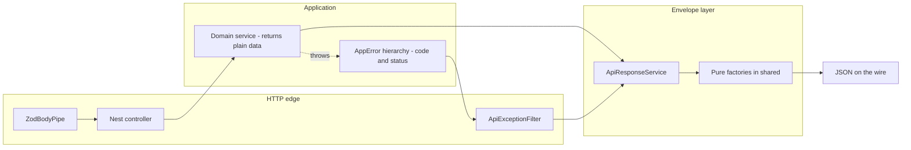
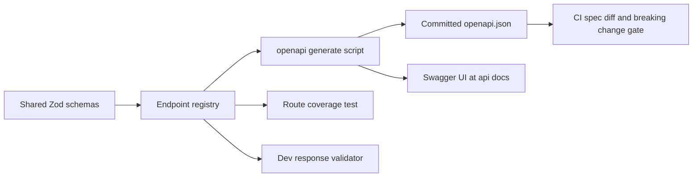

# Unified API contract + response envelope — implementation plan

**Created:** 2026-10-26 17:21 (Europe/Budapest)
**Status:** DRAFT — awaiting review.
**Supersedes:** `2026-10-26--15-29-00-unified-api-convention-plan.md` (bare-payload option).
**Decision taken:** uniform envelope for every response — success `{ data, meta }`, failure `{ error }`. Breaking change accepted for the small current surface (`api-keys`).
**Scope:** `packages/shared` (contract), `apps/api` (envelope production), `packages/api-client` (envelope consumption), `apps/admin` (error surfacing), new `docs/Specs/API-Convention.md`.

---

## 1. Goal

One written, enforced convention for every server↔client exchange:

1. **Request** — always JSON, optional fields omitted (never `null`, never `''`).
2. **Response** — always JSON with an envelope; empty collections are `[]` inside `data`.
3. **Error** — one shape for every failure, produced by one service, decided by a stable machine `code`.
4. **Empty / zero-result** — one rule per type, no ambiguity between `null`, `[]`, `0`, missing key.
5. **Single source of truth** — the contract is defined once in `@callback/shared` (Zod); server validates with it, client parses with it. No second hand-written shape.
6. **Server errors on the client** — four fixed surfaces (field, page alert, app banner, log drawer), never a raw server message as user copy.

---

## 2. Facts today (verified in code)

| Area                      | State                                                                             | File                                                                                                                                                                                                                                               |
| ------------------------- | --------------------------------------------------------------------------------- | -------------------------------------------------------------------------------------------------------------------------------------------------------------------------------------------------------------------------------------------------- |
| Response shape            | Bare payload straight from the controller, no envelope                            | [`api-keys.controller.ts`](../../apps/api/src/api-keys/api-keys.controller.ts:37)                                                                                                                                                                  |
| Error shape               | Nest default `{ statusCode, message, error }` — no filter, no code                | no `APP_FILTER` anywhere in `apps/api/src`                                                                                                                                                                                                         |
| Contract duplication      | server: class-validator DTO + own interface; shared: same rules in Zod            | [`create-api-key.dto.ts`](../../apps/api/src/api-keys/dto/create-api-key.dto.ts:35), [`api-keys.interface.ts`](../../apps/api/src/api-keys/api-keys.interface.ts:1), [`api-key.schema.ts`](../../packages/shared/src/schemas/api-key.schema.ts:50) |
| `@callback/shared` in api | listed in `apps/api/package.json`, **never imported in `src`**                    | [`package.json`](../../apps/api/package.json:27)                                                                                                                                                                                                   |
| Client transport          | one HTTP place, everything becomes `ApiError`, `details` read from `body.message` | [`http-client.ts`](../../packages/api-client/src/http-client.ts:135), [`api-error.ts`](../../packages/api-client/src/api-error.ts:47)                                                                                                              |
| Error → copy              | decision by `status`, never by message text                                       | [`error-message.ts`](../../apps/admin/src/lib/error-message.ts:53)                                                                                                                                                                                 |
| Notification system       | planned (store + toasts + log drawer), **not built**                              | [`notification plan`](2026-10-22--15-40-00-frontend-notification-and-log-system-plan.md:1)                                                                                                                                                         |

Consequence: the envelope touches exactly **3 controllers** (`api-keys`, `healthz`, `vapi-webhooks`) and **1 client package** — a breaking change is cheap _now_ and expensive after the second feature.

---

## 3. Decisions

### D1 — Transport

`application/json; charset=utf-8` in and out, `Accept: application/json`. JSON property names are **camelCase**. No form-encoded, no XML, no top-level bare scalars.

### D2 — Success envelope (always)

```jsonc
{
  "data": { /* object */ } | [ /* array */ ] | null,
  "meta": {
    "requestId": "0192f3c4-...",
    "timestamp": "2026-10-26T15:21:48.752Z",
    "pagination": { "page": 1, "limit": 20, "total": 42, "totalPages": 3 } // only on paginated lists
  }
}
```

- `data` **always present**; a list is `[]` when nothing matches; a "nothing to return" success (e.g. `DELETE`) is `data: null` with **200** — never `204`, so the client always parses one shape.
- `meta` **always present** (at minimum `requestId` + `timestamp`) → every response is traceable to a server log line.

### D3 — Error envelope (always)

```jsonc
{
  "error": {
    "code": "API_KEY_IDENTIFIER_CONFLICT",
    "status": 409,
    "message": "identifier already exists",
    "details": [{ "path": "identifier", "message": "already taken" }],
    "requestId": "0192f3c4-...",
    "timestamp": "2026-10-26T15:21:48.752Z",
    "path": "/api/api-keys",
  },
}
```

- `code` — stable, locale-independent, from a shared enum. **This is the decision key on the client.**
- `message` — English, for developers/logs. **Never rendered as user copy.**
- `details` — field-level issues for form mapping (`path` is a dot path, `''` for whole-payload errors).
- 5xx: `message` is a fixed generic string; stack traces, SQL text, constraint names, driver errors stay in the server log only, correlated by `requestId`.

### D4 — Empty / zero-result rules (one rule per type)

| Situation                      | Wire                       | Never                          |
| ------------------------------ | -------------------------- | ------------------------------ |
| List with no matches           | `"data": []` (200)         | `null`, `404`, omitted key     |
| Single resource missing        | `404` + error envelope     | `200` with `data: null`        |
| Optional scalar absent         | present as `null`          | missing key, `undefined`, `''` |
| Counter                        | `0` as number              | `"0"`, `null`                  |
| Nested object absent           | `{}` present               | omitted key                    |
| Success with nothing to return | `"data": null`, 200        | `204`                          |
| Duplicate                      | `409` + `code: *_CONFLICT` | silent overwrite               |
| Validation                     | `400`/`422` + `details[]`  | one concatenated string        |

### D5 — Status codes (single table, enforced on both sides)

`200` read/update/delete · `201` create · `400` malformed/shape · `401` unauthenticated · `403` forbidden · `404` missing · `409` conflict · `413` payload too large · `422` semantic validation · `429` rate limited · `500` internal · `503` dependency down.

### D6 — Single source of truth (contract-first, Zod)

The contract lives **only** in `@callback/shared`:

```text
packages/shared/src/contract/
  envelope.schema.ts       toSuccessEnvelope() + successEnvelopeSchema(dataSchema)
  error-envelope.ts        toErrorEnvelope() + apiErrorEnvelopeSchema
  error-code.const.ts      API_ERROR_CODE — one enum used by server and client
  envelope.interface.ts    ApiEnvelope<T>, ApiErrorEnvelope, ApiErrorDetail, ResponseMeta
  http-status.const.ts     HTTP_STATUS (shared; api-client re-exports)
  <resource>/<resource>.schema.ts    request + response Zod schemas
  <resource>/<resource>.contract.ts  endpoint registry: method, path, request?, response
```

Three artefacts derive from that one definition:

| Artefact          | How                                                                                                     |
| ----------------- | ------------------------------------------------------------------------------------------------------- |
| TS types          | `z.infer<typeof schema>` re-exported from `<resource>.interface.ts`                                     |
| Server validation | `ZodBodyPipe(schema)` / `ZodQueryPipe(schema)` in the controller — **class-validator DTOs are removed** |
| Client parsing    | `client.get(path, <resource>Schema)` — unchanged mechanism, now unwrapping `data`                       |

The endpoint registry is optional today but is the seed for OpenAPI generation later (`zod-to-json-schema`) — no second description ever gets written.

### D7 — Server layering: data service + envelope service + error filter

This is the core of the request: **a service produces the data, another service wraps it.**



- **`ApiResponseService`** (injectable, `apps/api/src/common/http/`) — _thin_: no business logic, only calls the pure factories in `@callback/shared`. Two methods: `ok(data, meta?)`, `fail(appError, context)`.
- **Controllers never return domain data directly.** They call the domain service, then `return this.responses.ok(result)`. One wrap point per endpoint, explicit, greppable.
- **Errors never escape as Nest exceptions.** Domain services throw `AppError` subclasses carrying `code` + `status`; the global `ApiExceptionFilter` (`APP_FILTER`) normalises **any** throwable (Nest `HttpException`, `ZodError`, unknown `Error`) into the error envelope through the same `ApiResponseService`.
- Why not a success interceptor: it would wrap implicitly, hide the shape decision from the code, and cannot be used from a service. An interceptor is only added later as a **dev-only assertion** that a non-enveloped body never leaves the process.
- Health check and VAPI webhooks are **exempt** (see D9) and must keep their current raw bodies.

### D8 — Error code catalogue

```ts
export const API_ERROR_CODE = {
  VALIDATION_FAILED: 'VALIDATION_FAILED',
  UNAUTHENTICATED: 'UNAUTHENTICATED',
  FORBIDDEN: 'FORBIDDEN',
  NOT_FOUND: 'NOT_FOUND',
  CONFLICT: 'CONFLICT',
  PAYLOAD_TOO_LARGE: 'PAYLOAD_TOO_LARGE',
  RATE_LIMITED: 'RATE_LIMITED',
  INTERNAL_ERROR: 'INTERNAL_ERROR',
  SERVICE_UNAVAILABLE: 'SERVICE_UNAVAILABLE',
  API_KEY_IDENTIFIER_CONFLICT: 'API_KEY_IDENTIFIER_CONFLICT', // domain-specific
} as const;
```

Generic codes map 1:1 from status in the filter; feature services may emit a more specific code with the same status. The client maps **code → Hungarian user copy**; unknown code falls back to status copy, so a new server code never breaks an old bundle.

### D9 — Exemptions (must be written down, or they will be broken)

| Route                                                                                                           | Why unwrapped                                                 |
| --------------------------------------------------------------------------------------------------------------- | ------------------------------------------------------------- |
| `GET /healthz`                                                                                                  | Docker healthcheck + monitor watchdog parse a bare `{status}` |
| `POST /api/vapi/webhooks`                                                                                       | provider-owned contract; VAPI expects its own body            |
| Implementation: a `@SkipEnvelope()` metadata decorator + `Reflector` check in the filter and the dev assertion. |

### D10 — Request correlation

`X-Request-Id` accepted inbound (or generated by Fastify `genReqId`), echoed in `meta.requestId` / `error.requestId` and returned as a response header. The client forwards it into the notification store so a log-drawer entry always carries the server-side trace id.

### D11 — Where a server error becomes visible (answer to the open question)

Four tiers, each with exactly one job. No popup window, no separate bottom bar.

| Tier          | Component                                                                                     | Applies to                                                      |
| ------------- | --------------------------------------------------------------------------------------------- | --------------------------------------------------------------- |
| 1. Field      | inline message under the input, via RHF `setError(path)` from `details[]`                     | `400`/`422`                                                     |
| 2. Page       | `Alert` inside the page content region + retry button (`features` mutation/query error state) | `403`, `404`, `409`, `500` on the page's main data              |
| 3. App        | one dismissible top banner in the layout shell (session store + notification store)           | `401` (login CTA), `status === null` offline, `503` maintenance |
| 4. Log drawer | system entries, `toast: false`, with `code`, `status`, `requestId`, copy button               | all `5xx`, schema-drift payload errors                          |

Rule: **toast = the outcome of an action the user just performed; banner = a persistent condition; alert = the page's data is unavailable; field error = the input is wrong; log = diagnostics.** Server `message` is never shown at tiers 1–3.

### D12 — Client unpacking

- `http-client` parses `successEnvelopeSchema(callerSchema)` and returns `.data` — services keep their current signatures, callers see no change.
- `ApiError` gains `code: string | null`, `requestId: string | null`, `issues: readonly ApiErrorDetail[]`; the existing `details: readonly string[]` is **kept** (rendered lines) so [`toErrorMessage()`](../../apps/admin/src/lib/error-message.ts:53) and its tests keep working.
- Non-JSON error bodies (Caddy `502`, nginx `504`) still degrade to status-based copy — keep the existing tolerant path.

### D13 — Validation detail shape

`details: [{ path, message }]` with dot paths (`name`, `lines.2.quantity`). The admin maps them onto react-hook-form fields; unmapped paths go to the page alert. This is what makes "which field is wrong" answerable without string parsing.

### D14 — Versioning & deprecation

Additive fields are safe (client strips unknown keys). A breaking reshape goes to `/api/v2`; v1 then gets a documented sunset. The envelope itself is stable from day one, so most future changes are additive.

---

## 4. Things that must also be designed (checklist)

| #   | Topic                       | Rule to write down                                                                                                    |
| --- | --------------------------- | --------------------------------------------------------------------------------------------------------------------- |
| 1   | **Secrets**                 | `apiKey` values in `GET /api/api-keys` are a leak risk — plan masking/one-time reveal before auth lands               |
| 2   | **5xx sanitation**          | filter logs the full error, sends only `INTERNAL_ERROR` + `requestId`                                                 |
| 3   | **Body size / timeout**     | Fastify `bodyLimit` + request timeout, both answered with the envelope (`413`, `503`)                                 |
| 4   | **Dates**                   | ISO 8601 UTC with `Z` on the wire, `Date` object inside the app, never a local string                                 |
| 5   | **Numbers**                 | money as string or minor-unit integer; bigint as string; never a float for currency                                   |
| 6   | **Enums forward-compat**    | client maps unknown enum values to a fallback variant instead of throwing                                             |
| 7   | **Pagination contract**     | `page`/`limit` in, `meta.pagination` out; default + max limit declared once                                           |
| 8   | **Delete/update semantics** | `200` + `data: null`; `409` for constraint violations, never `500`                                                    |
| 9   | **Bulk operations**         | `data: { succeeded: [], failed: [{ id, code, message }] }` + `200`, not a partial `500`                               |
| 10  | **CORS / proxy**            | Caddy/nginx error pages are not JSON — client must keep the tolerant path; document it                                |
| 11  | **i18n policy**             | server English developer messages, client Hungarian UI copy in one `code → message` map                               |
| 12  | **Logs**                    | structured server logs carry `requestId`, route, status, duration; no PII, no tokens                                  |
| 13  | **Testing gates**           | shared contract tests, e2e asserting the envelope for every route, contract-drift fixture test, `api-client` tests    |
| 14  | **Docs**                    | `docs/Specs/API-Convention.md` (living) + ADR + `docs/history` + milestone entry                                      |
| 15  | **Dependencies**            | `zod` becomes a direct dependency of `apps/api`; `class-validator`/`class-transformer` removed once the DTOs are gone |

---

## 5. File map (new / changed)

```text
packages/shared/src/contract/
  envelope.schema.ts            NEW  toSuccessEnvelope + successEnvelopeSchema
  error-envelope.ts             NEW  toErrorEnvelope + apiErrorEnvelopeSchema
  error-code.const.ts           NEW  API_ERROR_CODE enum
  envelope.interface.ts         NEW  ApiEnvelope, ApiErrorEnvelope, ApiErrorDetail, ResponseMeta
  http-status.const.ts          NEW  HTTP_STATUS shared with api-client
  api-keys/api-keys.schema.ts   MOVE request+response schemas here

apps/api/src/common/http/
  api-response.service.ts       NEW  ok() / fail() over the shared factories
  api-exception.filter.ts       NEW  global APP_FILTER, all throwables -> envelope
  app-error.ts / app-error.*.ts NEW  AppError base + ValidationAppError, ConflictAppError, NotFoundAppError
  zod-body.pipe.ts              NEW  ZodBodyPipe, ZodQueryPipe
  request-context.ts            NEW  requestId resolution + @ReqCtx()
  skip-envelope.decorator.ts    NEW  healthz / webhook opt-out

apps/api/src/api-keys/
  api-keys.controller.ts        CHANGE  envelope + Zod pipe
  api-keys.interface.ts         CHANGE  re-export types from @callback/shared
  dto/create-api-key.dto.ts     DELETE  (replaced by shared Zod schema)
  api-keys.service.ts           CHANGE  throw AppError subclasses instead of Nest exceptions

packages/api-client/src/
  http-client.ts                CHANGE  unwrap envelope, keep tolerant non-JSON path
  api-error.ts                  CHANGE  code, requestId, issues; keep details
  api-error.interface.ts        CHANGE  ApiErrorDetail
  api-error.const.ts            CHANGE  re-export HTTP_STATUS + API_ERROR_CODE from shared
  api-keys/api-keys.service.ts  CHANGE  unchanged signature, envelope-aware transport

apps/admin/src/
  lib/error-message.ts          CHANGE  code-first mapping, status fallback
  lib/error-message.const.ts    CHANGE  Hungarian copy per code
  features/api-keys/*           CHANGE  field errors from details[], page alert state
  components/layout             CHANGE  app banner mount (with the notification plan)

apps/api/src/common/openapi/
  openapi.module.ts              NEW  registry -> /api/openapi.json + /api/docs, skip-envelope
  zod-openapi.ts                 NEW  envelopeOf() helper + shared error responses, registered once
  response-assert.interceptor.ts NEW  dev-only: validate the outgoing body against the route schema

scripts/openapi/
  generate.mjs                   NEW  registry -> docs/Specs/openapi.json
  check.mjs                      NEW  route coverage + breaking-change diff vs the committed baseline

docs/Specs/openapi.json          NEW  committed baseline, visible in every PR diff
docs/Specs/API-Convention.md     NEW  the living convention document
```

---

## 6. Migration order

1. Shared contract: envelope schemas + error codes + factories, with tests.
2. Server plumbing: `AppError`, `ZodBodyPipe`, `ApiResponseService`, `ApiExceptionFilter`, `requestId`, `@SkipEnvelope`.
3. Migrate `api-keys` backend to the envelope; delete the class-validator DTO.
4. Client: envelope unwrapping + richer `ApiError`; update services and their tests.
5. Admin: code-first error copy, field-level mapping, page alert, banner mount.
6. Exemptions verified (`healthz`, VAPI webhooks unchanged) and guarded by e2e.
7. Contract-drift test + CI check that no controller returns a bare body.
8. OpenAPI: registry -> generator -> committed `docs/Specs/openapi.json`, Swagger UI, route-coverage test, dev response validator, CI spec-diff gate (see §8).
9. Docs: `API-Convention.md`, history entry, milestone.

---

## 7. Verification

1. `GET /api/api-keys` returns `{ data: [], meta: { requestId, timestamp } }` on an empty table.
2. `POST /api/api-keys` duplicate → `409` with `code: API_KEY_IDENTIFIER_CONFLICT`, `details[0].path === 'identifier'`.
3. `POST` with a too-short `name` → `400`, `code: VALIDATION_FAILED`, at least one `details[]` entry.
4. `GET /healthz` and the VAPI webhook responses are byte-identical to before.
5. An injected `Error('boom')` in a service yields `500` + `INTERNAL_ERROR` + a `requestId`, and the stack appears **only** in the server log.
6. `api-client` tests: envelope success unwrap, envelope error → `ApiError.code`, non-JSON 502 → status-only error.
7. Admin: a duplicate create highlights the `identifier` field; a `500` on the list renders a page alert with a copyable request id and no toast spam.
8. `pnpm lint`, `pnpm test`, `pnpm build` green in all workspaces.

---

## 8. OpenAPI / Swagger — how it earns its place

Swagger is part of the plan, but **only as a generated view of the contract** — and with five concrete
jobs, so it is not decorative documentation:

1. a live, clickable reference with `Try it out` for whoever builds admin/web;
2. a **committed baseline** that shows the API diff in every pull request;
3. a **dev-time response validator**: the server asserts its own output against the generated schema;
4. a **route-coverage test**: no endpoint can exist without a documented contract;
5. a **machine-readable contract** for agents, Postman/Insomnia and future CRM/VAPI integrations.

### 8.1 Principle: one direction only

`@callback/shared` Zod schemas → endpoint registry → generated OpenAPI → Swagger UI. The spec is an
**artefact**. It is never the place where an endpoint gets designed (that would reintroduce the drift D6 removes).

### 8.2 Why not `@nestjs/swagger`

It describes shapes with decorators (`@ApiProperty`, `@ApiResponse`) on DTO classes — a second,
independent description of the same data, built on the class-validator DTOs that step 3 deletes. It can
only express the envelope with per-route decorators. **Rejected as the primary mechanism**, kept as a
fallback if Zod generation stalls.

### 8.3 Toolchain

| Piece                | Choice                                                             | Why                                                    |
| -------------------- | ------------------------------------------------------------------ | ------------------------------------------------------ |
| Spec generation      | `@asteasolutions/zod-to-openapi`                                   | consumes the _same_ Zod schemas; no second description |
| Doc serving          | `@fastify/swagger` (openapi mode) + `@fastify/swagger-ui`          | the app already runs Fastify; no Express adapter       |
| Envelope in the spec | one `envelopeOf(schema)` helper + `components.schemas.ApiEnvelope` | the envelope is documented once, reused by every route |
| Error responses      | register the error envelope once for `400/401/403/404/409/422/500` | a new endpoint inherits the documented failures        |
| Examples             | taken from the contract registry, not hand-written                 | the UI is meaningful without a second description      |

### 8.4 The five jobs, concretely

| #   | Job                           | Mechanism                                                                                                                                                                                      | Where it lives                      |
| --- | ----------------------------- | ---------------------------------------------------------------------------------------------------------------------------------------------------------------------------------------------- | ----------------------------------- |
| 1   | Clickable reference           | Swagger UI served by the app, `Try it out` against dev/staging, bearer scheme pre-wired                                                                                                        | `/api/docs`                         |
| 2   | Reviewable API diff           | `pnpm openapi:generate` rewrites the baseline; CI regenerates and fails if the file is stale                                                                                                   | `scripts/openapi/generate.mjs`      |
| 3   | Breaking-change gate          | CI diffs baseline vs generated: removed field, narrowed enum, changed status or envelope shape -> fail unless the PR is labelled `contract-change`                                             | `scripts/openapi/check.mjs`         |
| 4   | Self-check of responses       | dev/staging-only interceptor validates the outgoing body against the route's response schema; a forgotten `responses.ok()` or an extra mapper field fails fast instead of reaching the browser | `response-assert.interceptor.ts`    |
| 5   | Coverage + external consumers | test walks the registered controllers, asserts a contract entry and presence in the spec; `/api/openapi.json` feeds agents, Postman and future partners                                        | `apps/api/test/openapi.e2e-spec.ts` |

Job 4 is what turns Swagger from documentation into server-side enforcement: the client validates its
_input_ (D12), this validates the server's _output_.

### 8.5 The pipeline



### 8.6 Guardrails and exposure

- `/api/openapi.json` and `/api/docs` are on the `@SkipEnvelope` allow-list and are never wrapped.
- Swagger UI: dev/staging only, or behind Caddy basic-auth in prod. `openapi.json` stays reachable in every env.
- The generated file is committed, so an API change is a visible line in the diff — reviewers see it even in a frontend-only PR.
- `operationId` is stable and namespaced (`apiKeys.list`), so generated tooling does not churn.
- Swagger UI is third-party HTML: it does not go through `packages/ui` and does not affect the token rules.

### 8.7 What we deliberately do NOT do

| Do not                                    | Because                                                                                                             |
| ----------------------------------------- | ------------------------------------------------------------------------------------------------------------------- |
| design endpoints in the spec (spec-first) | the Zod contract is the source; spec-first needs a second sync step, which is where drift lives                     |
| generate client types from the spec       | they are already `z.infer` of the same schemas — a second derivation means worse errors and a possible second truth |
| annotate DTOs with `@ApiProperty`         | that is exactly the `@nestjs/swagger` duplication rejected in 8.2                                                   |
| expose the UI in prod by default          | it hands out the admin surface map for free                                                                         |

### 8.8 Cost/benefit, honestly

Cost: two dependencies, roughly 150 lines of registry/generation code, one CI job. Payoff: the contract
stops being an oral tradition — it is clickable, diffable, machine-readable and self-checking, and the
first external consumer (VAPI/CRM/public call-back API) needs no extra work because everything is derived.

---

## 9. Open questions

| #   | Question                                                            | Recommended default                                                          |
| --- | ------------------------------------------------------------------- | ---------------------------------------------------------------------------- |
| Q1  | Does `meta` stay on every response or only where it adds value?     | every response — uniform parsing, free correlation                           |
| Q2  | `204` for `DELETE`, or `200` + `data: null`?                        | `200` + `data: null`                                                         |
| Q3  | Do we ship the endpoint registry and the generated OpenAPI now?     | registry shape now, OpenAPI + Swagger UI right after the envelope lands (§8) |
| Q4  | Do domain services wrap, or only controllers?                       | only controllers — services stay HTTP-agnostic                               |
| Q5  | Should the envelope carry `deprecation` / `sunset` hints?           | defer                                                                        |
| Q6  | Is API-key value masking in scope here or a separate security task? | separate task, documented as a follow-up                                     |
