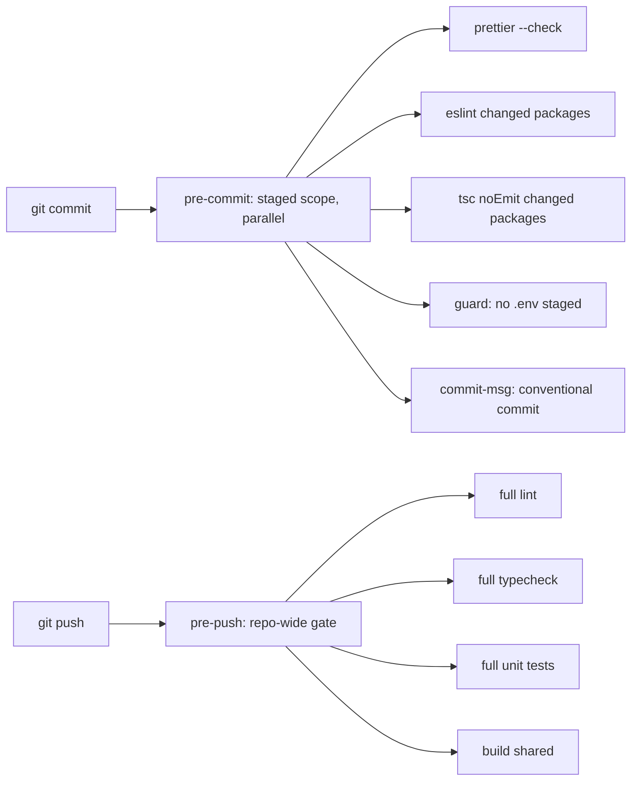

# Git Hooks Quality Gate — Lint + Tests on Commit/Push

**Status:** planned
**Scope:** repo-wide tooling (root + all workspace packages), CI parity, docs

## 1. Current state (audited)

| Area                                                    | Reality                                                                                                 |
| ------------------------------------------------------- | ------------------------------------------------------------------------------------------------------- |
| Hook tooling                                            | none — no husky, no lefthook, no `.githooks`, no `prepare` script in [`package.json`](package.json:1)   |
| Root `lint`                                             | `pnpm -r lint` — runs **only** where a `lint` script exists                                             |
| `@callback/api` lint                                    | `eslint ... --fix` → mutates files, never fails on style drift                                          |
| `@callback/web` lint                                    | `echo "no eslint config yet" && exit 0` → silent no-op                                                  |
| `@callback/web` test                                    | `echo "no unit tests yet" && exit 0` → silent no-op                                                     |
| `packages/shared`, `packages/api-client`, `packages/ui` | **no `lint` script at all** → skipped by `pnpm -r lint`                                                 |
| Typecheck                                               | no dedicated script; only inside `build` (`tsc --noEmit` for web/admin/ui, `tsc` for shared/api-client) |
| CI [`ci.yml`](.github/workflows/ci.yml:1)               | runs only `@callback/api` tests, not the other 4 suites, no typecheck step                              |
| `test` (root)                                           | 5 jest/vitest projects sequentially → too slow for pre-commit                                           |

**Conclusion:** "run lint + tests on commit" cannot be implemented on the current scripts — the aggregate
scripts first have to become trustworthy, otherwise the hook would report green while skipping 4/6 packages.

## 2. Target design

Gate runner: **lefthook** (single YAML, parallel jobs, `{staged_files}`, good Windows support, no JS hook wrapper).

## 3. What should run where

### pre-commit (fast, staged scope, parallel, auto-fix)

1. `prettier --check` on staged `*.{ts,tsx,js,mjs,json,md,yml,yaml}` (auto-fix variant: `--write` + `stage_fixed`).
2. `eslint` on staged files **per package** (`apps/api`, `apps/admin`, plus `packages/*` once configs exist) — no `--fix` in hook mode, use a `lint:check` script.
3. `tsc --noEmit` per changed package (typecheck of the touched package only).
4. **Secret/env guard**: reject staged `*.env`, `*.env.local`, `deploy/.env.*`, `sonar.env` (repo already treats these as never-commit, [`.gitignore`](.gitignore:47)). Cheap insurance against `git add -f`.
5. Block `node_modules/`, `dist/`, `coverage/` accidentally staged.

### commit-msg

6. Conventional-commit format check (`feat:`, `fix:`, `chore:`, `docs:`, `refactor:`, `test:`, `build:`, `ci:`), max subject length. Enables release notes later; costs milliseconds.

### pre-push (repo-wide gate, skip-able by env)

7. `pnpm lint` (all packages, no `--fix`).
8. `pnpm typecheck` (new aggregate script).
9. `pnpm test` (all 5 suites).
10. `pnpm --filter @callback/shared build` first (api/web/admin consume `dist`).
11. Optional-but-valuable: `gitleaks`/`secretlint` over the pushed range — deferred (extra binary), noted as follow-up.

### Deliberately NOT in hooks (needs infrastructure, keep in CI/manual)

- `pnpm test:e2e` and `test:stack` — need Postgres + docker stack ([`scripts/test`](scripts/README.md:1)).
- `pnpm sonar` — long, needs SonarQube instance.
- `docker build` / image publish — [`images.yml`](.github/workflows/images.yml:1).
- `pnpm build` for web/admin in pre-commit — covered by typecheck; full build belongs to CI.

### Recommended (not required to unblock): CI parity

[`ci.yml`](.github/workflows/ci.yml:1) currently runs `pnpm -r lint` + api tests only.
Recommend extending it to `pnpm lint:check`, `pnpm typecheck`, `pnpm test` so local hooks and CI enforce the same contract.

## 4. Script changes required (prerequisite)

| Package                                                 | Change                                                                                                                                |
| ------------------------------------------------------- | ------------------------------------------------------------------------------------------------------------------------------------- |
| root                                                    | add `lint`, `lint:check`, `typecheck`, `check:staged`, `prepare` (`lefthook install`), devDep `lefthook`                              |
| `@callback/api`                                         | add `lint:check` (`eslint ... ` without `--fix`); keep `lint` as fix-mode for devs; add `typecheck` (`tsc --noEmit -p tsconfig.json`) |
| `@callback/admin`                                       | add `typecheck`; `lint:check` alias                                                                                                   |
| `@callback/web`                                         | **real** `eslint` config + `lint:check`; remove `echo` no-op test or keep explicit skip                                               |
| `packages/shared`, `packages/api-client`, `packages/ui` | add `lint:check` (flat config) — otherwise `pnpm -r lint` keeps skipping them                                                         |
| root                                                    | `typecheck` = `pnpm -r typecheck`                                                                                                     |

> Alternative if adding 3 new eslint configs is out of scope: make the hook run lint only on packages that
> currently have a working config (api, admin) and record the gap. Not recommended — silent skips are exactly
> the failure mode we are fixing.

## 5. Files to create/modify

- `lefthook.yml` (new) — hook definitions.
- [`package.json`](package.json:6) — scripts + devDependency + `prepare`.
- [`apps/api/package.json`](apps/api/package.json:9), [`apps/admin/package.json`](apps/admin/package.json:6), [`apps/web/package.json`](apps/web/package.json:6) — scripts.
- `apps/web/eslint.config.js`, `packages/shared/eslint.config.js`, `packages/api-client/eslint.config.js`, `packages/ui/eslint.config.js` (new).
- [`ci.yml`](.github/workflows/ci.yml:1) — parity steps.
- [`docs/Specs/Local-Development.md`](docs/Specs/Local-Development.md:1) — new section "Git hooks".
- `docs/history/`, `docs/milestones/` entries after implementation.
- [`.roo/rules/general.coding-standards.md`](.roo/rules/general.coding-standards.md:1) — note the hook contract (optional).

## 6. Acceptance criteria

1. Fresh clone + `pnpm install` installs the hooks automatically.
2. A commit with a lint error or a type error **fails locally** with a readable message.
3. A commit touching only `docs/*.md` runs only prettier (fast path, < 5 s).
4. A commit with a staged `infra/.env.local` is rejected.
5. `git push` with a failing unit test is rejected.
6. `LEFTHOOK_EXCLUDE=<job>` documented as the escape hatch; `--no-verify` documented as last resort.
7. `pnpm lint`, `pnpm typecheck`, `pnpm test` all green on `main` before enabling `pre-push` (otherwise the hook is permanently bypassed).

## 7. Rollout order (why)

1. Fix scripts + missing eslint configs → aggregate commands become truthful.
2. Get `main` green with the new aggregate commands.
3. Install lefthook with **pre-commit only**; let the team live with it briefly.
4. Add `commit-msg`, then `pre-push`.
5. Turn on CI parity.

Skipping step 2 makes step 4 hostile: a gate that is red on day one gets disabled by everyone.
