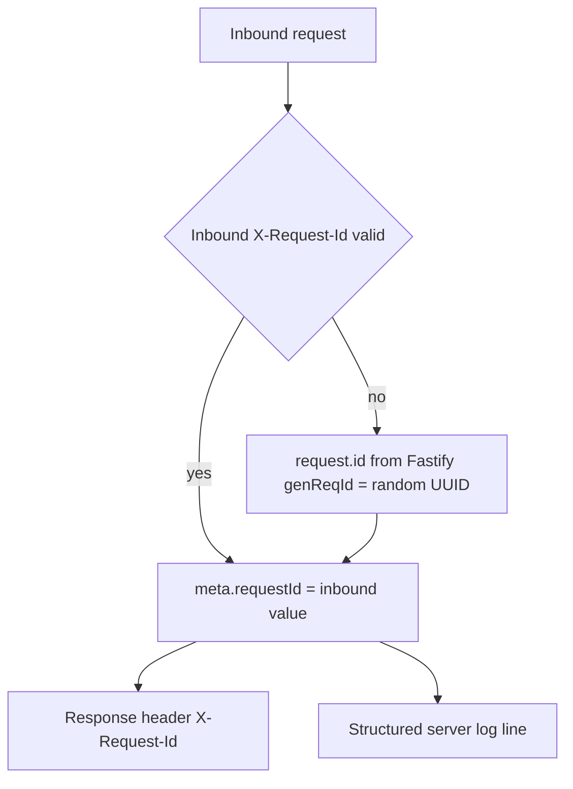

# AIS-92 — requestId correlation: state check and remaining work

**Status: implemented (2026-10-28).** Delivery notes, including two exception-filter bugs this
work uncovered (every 4xx answered as a Fastify `500`; guard rejections lost the
`@SkipEnvelope()` exemption), are in
`docs/history/2026-10-28--17-51-00-ais-92-request-id-correlation.md` and
`docs/milestones/2026-10-28--17-51-00-ais-92-request-id-and-filter-host-crash.milestone.md`.

Ticket: <https://zakzag.atlassian.net/browse/AIS-92> (subtask of AIS-87)
Parent plan: `docs/plans/2026-10-26--17-21-00-unified-api-contract-and-envelope-plan.md` §D9, §D10, §8.6

## 1. Already delivered

| Ticket item | Evidence |
|---|---|
| `RequestContext` type | [`request-context.interface.ts`](../../apps/api/src/common/http/request-context.interface.ts:44) |
| `readRequestId` / `resolveRequestId` / `toRequestContext` | [`request-context.ts`](../../apps/api/src/common/http/request-context.ts:32) |
| `@ReqCtx()` param decorator | [`request-context.ts`](../../apps/api/src/common/http/request-context.ts:99) |
| `@SkipEnvelope()` + `SKIP_ENVELOPE_KEY` | [`skip-envelope.decorator.ts`](../../apps/api/src/common/http/skip-envelope.decorator.ts:25), [`skip-envelope.const.ts`](../../apps/api/src/common/http/skip-envelope.const.ts:12) |
| Response header echo | [`request-id.interceptor.ts`](../../apps/api/src/common/http/request-id.interceptor.ts:29) |
| Global wiring | [`http.module.ts`](../../apps/api/src/common/http/http.module.ts:22), [`app.module.ts`](../../apps/api/src/app.module.ts:49) |
| Decorator applied to exempt routes | [`health.controller.ts`](../../apps/api/src/health/health.controller.ts:28), [`vapi-webhooks.controller.ts`](../../apps/api/src/vapi-webhooks/vapi-webhooks.controller.ts:39) |
| `@ReqCtx()` used in a controller | [`api-keys.controller.ts`](../../apps/api/src/api-keys/api-keys.controller.ts:44) |
| Exemption list in shared registry | [`endpoint.registry.ts`](../../packages/shared/src/contract/endpoint.registry.ts:31) |
| Header names as constants | [`api-messages.const.ts`](../../apps/api/src/common/http/api-messages.const.ts:21) |

## 2. Remaining gaps

| # | Gap | Why it matters |
|---|---|---|
| G1 | No Fastify `genReqId`; Fastify default `req-1`, `req-2`… is used | id is not unique across restarts / instances, so a `meta.requestId` is not a usable trace id |
| G2 | Inbound `X-Request-Id` is accepted without length/character validation | arbitrary log injection and header-injection surface, ticket decision #1 unfulfilled |
| G3 | `@ReqCtx()` lives inside `request-context.ts` next to pure functions | violates one-responsibility / file-naming rule; ticket lists `request-context.decorator.ts` |
| G4 | No spec for `@SkipEnvelope` metadata; no `SkipEnvelope` ↔ `ENVELOPE_EXEMPTIONS` consistency test | a route can be exempt without the decorator, or vice versa, silently |
| G5 | No e2e assertion for the `X-Request-Id` response header, inbound pass-through, or invalid inbound id | the DoD items are unverified |
| G6 | `/api/openapi.json` + `/api/docs` exemption not implemented | blocked by AIS-98 — must stay a documented TODO, not a silent hole |

## 3. Resolution flow after the change

## 4. Steps

1. **Extract the decorator** — move `ReqCtx` into `request-context.decorator.ts`, keep `request-context.ts` pure, update the single consumer import in `api-keys.controller.ts`.
2. **Validate the inbound id** — add `request-id.const.ts` (`REQUEST_ID_MAX_LENGTH`, allowed `^[A-Za-z0-9._:-]+$`), add pure `isValidRequestId`, make `readRequestId` return `undefined` for an invalid value so resolution falls back to `request.id` → `randomUUID`.
3. **Explicit Fastify id generation** — add `create-fastify-adapter.ts` exporting `createFastifyAdapter()` with `genReqId: () => randomUUID()`; use it in `main.ts` and in every e2e bootstrap so tests exercise the production adapter.
4. **Unit tests** — `request-context.spec.ts`: too long, forbidden chars, whitespace, empty, repeated header, valid UUID, invalid → fallback; `request-context.decorator.spec.ts` with an `ExecutionContext` mock (mock goes to `common/http/test/mocks/`); `create-fastify-adapter.spec.ts` (ids are unique UUIDs); `skip-envelope.decorator.spec.ts` (metadata set on class and method, absent → `undefined`, `getAllAndOverride` precedence).
5. **Consistency test** — `apps/api/test/envelope-exemptions.e2e-spec.ts`: enumerate controller routes via `DiscoveryService` + `MetadataScanner`, assert every route is either in `API_ENDPOINTS` or in `ENVELOPE_EXEMPTIONS`, and that the decorator flag equals the exemption entry in both directions (self-skip on Node < 24.9 like the existing suites).
6. **E2E assertions** — `api-keys.e2e-spec.ts`: header equals `meta.requestId`, inbound `test-123` survives into header and meta, error path header equals `error.requestId`; `health.e2e-spec.ts`: body unchanged, `X-Request-Id` present and UUID-shaped; `vapi-webhooks.e2e-spec.ts`: raw body unchanged, header present; invalid 200-char inbound id replaced by a generated UUID.
7. **Documentation** — update `docs/Specs/API-Convention.md` (validation rule, UUID `genReqId`, explicit AIS-98 TODO for `/api/openapi.json` + `/api/docs`); add `docs/history/<timestamp>-ais-92-request-id-correlation.md`; add a milestone entry because the change touches server bootstrap and the deploy-verified healthcheck contract.

## 5. Definition of done

- Enveloped responses carry `meta.requestId`; the same value is on the `X-Request-Id` response header.
- A valid inbound `X-Request-Id` is preserved; an invalid one is replaced, never echoed.
- `/healthz` and VAPI webhook bodies stay byte-identical (existing e2e specs stay green).
- `@SkipEnvelope()` and `ENVELOPE_EXEMPTIONS` provably agree.
- `pnpm --filter @callback/api test`, `test:e2e`, `lint`, `build` green.
