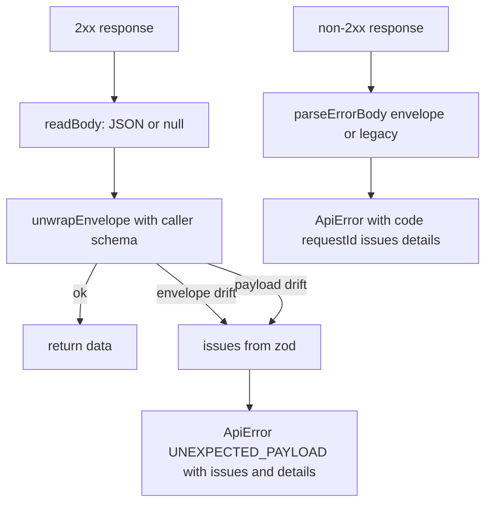

# AIS-94 — api-client envelope unwrap + ApiError enrichment: state check and remaining work

Ticket: <https://zakzag.atlassian.net/browse/AIS-94> (subtask of AIS-87)
Parent plan: `docs/plans/2026-10-26--17-21-00-unified-api-contract-and-envelope-plan.md` §D12, §D3, §6 step 4
Delivery already recorded in: `docs/history/2026-10-27--17-01-00-unified-api-envelope-ais-87.md`

## 1. Already delivered (do not redo)

| Ticket item | Evidence |
|---|---|
| Transport unwraps `{ data, meta }`, services untouched | [`parsePayload()`](../../packages/api-client/src/http-client.ts:138) |
| Tolerant non-JSON path kept (Caddy `502` → status only) | [`readBody()`](../../packages/api-client/src/http-client.ts:83), test at [`http-client.test.ts`](../../packages/api-client/test/http-client.test.ts:341) |
| `ApiError` gained `code`, `requestId`, `issues[]`, kept `details: string[]` | [`ApiError`](../../packages/api-client/src/api-error.ts:27) |
| Untrusted error-body parsing, envelope + legacy Nest fallback | [`parseErrorBody()`](../../packages/api-client/src/api-error.ts:169) |
| Path comes from the shared registry, not a literal | [`api-keys.const.ts`](../../packages/api-client/src/api-keys/api-keys.const.ts:13) |
| Enveloped test doubles | [`fetch.mock.ts`](../../packages/api-client/test/mocks/fetch.mock.ts:72) |

## 2. Remaining gaps

| # | Gap | Why it matters |
|---|---|---|
| G1 | Unwrap lives as private functions inside [`http-client.ts`](../../packages/api-client/src/http-client.ts:126); no `envelope.logic.ts` / `envelope.logic.test.ts` as the ticket's scope requires | the ticket's pure-function cases (extra `meta`, non-object body, `data: null`) can only be exercised through a `Response` double today |
| G2 | Schema drift fills `details` but **not** `issues` — [`toPayloadError()`](../../packages/api-client/src/http-client.ts:111) never passes `issues` | DoD item “séma-eltérés → `UNEXPECTED_PAYLOAD` + `issues`” is unmet; the admin form maps fields from `issues[]`, so a drift renders as a page-level error with no field highlight |
| G3 | [`api-error.const.ts`](../../packages/api-client/src/api-error.const.ts:14) re-exports `HTTP_STATUS` only | ticket asks for `API_ERROR_CODE` too, otherwise consumers re-type codes as raw strings |
| G4 | `api-error.ts` has no dedicated spec (`parseErrorBody`, `extractErrorDetails`, `is*` guards) | the ticket lists `parseErrorEnvelope` unit cases (`details` not an array, `null` body, code-only body) that only travel indirectly through transport tests |
| G5 | [`createCodedError()`](../../apps/admin/src/test/mocks/api-error.mock.ts:23) cannot express `issues` | the admin field-mapping tests would hand-craft errors, against the mocks-in-one-place rule |

No behaviour change is needed for G1/G3/G4 beyond extraction + tests. G2 is the only functional fix.

## 3. Unwrap flow after the change

## 4. Steps

1. **Pure module** — add [`packages/api-client/src/envelope.logic.ts`](../../packages/api-client/src/envelope.logic.ts) with `toIssueDetails(zodError): readonly ApiErrorDetail[]` and `unwrapEnvelope(schema, body)` returning a discriminated result (`{ ok: true, data }` / `{ ok: false, issues }`); no `Response`, no `fetch`, no env read.
2. **Transport uses it** — [`parsePayload()`](../../packages/api-client/src/http-client.ts:138) keeps reading the body but delegates both parses to `unwrapEnvelope`; `toPayloadError` passes `issues: result.issues` as well as the rendered `details` (G2).
3. **Constants** — [`api-error.const.ts`](../../packages/api-client/src/api-error.const.ts:14) re-exports `API_ERROR_CODE` and the `ApiErrorCode` type from `@callback/shared`; add both to [`index.ts`](../../packages/api-client/src/index.ts:1).
4. **Interfaces** — declare the unwrap result type in a new `envelope.logic.interface.ts` (named type, no inline shape).
5. **Tests** —
   - `test/envelope.logic.test.ts`: valid envelope, missing `data`, `data: null` with a nullable schema, extra `meta` fields, pagination `meta` passthrough, non-object body (`null`, string, array), payload field mismatch → `issues` with dot path.
   - `test/api-error.test.ts`: full envelope, message only, code only, `details` not an array, `details` entries malformed, legacy Nest string and string[] bodies, `null` body, `details`/`issues` length consistency, the four `is*` guards.
   - extend [`http-client.test.ts`](../../packages/api-client/test/http-client.test.ts:436): drift error exposes `issues` with a `path`.
6. **Admin mock parity** — add an optional `issues` field to [`createCodedError()`](../../apps/admin/src/test/mocks/api-error.mock.ts:23) and use it in `createValidationError()`.
7. **Docs** — `docs/Specs/API-Convention.md` §client: drift carries `issues[]` and the pure module is the single unwrap point; add `docs/history/<timestamp>-ais-94-api-client-envelope-unwrap.md`. No milestone: extraction plus one narrow fix, no production incident, no deploy surface.
8. **Jira** — comment the evidence (test names, files) on AIS-94 and transition it to Done once green.

## 5. Definition of done

- `client.get(path, apiKeyListSchema)` returns the array out of `{ data, meta }`; service signatures unchanged.
- Error envelope → `ApiError` with `status`, `code`, `requestId`, `issues[]`, `details[]`.
- Drift (missing `data`, missing `meta`, wrong payload) → `UNEXPECTED_PAYLOAD` **with non-empty `issues`**, never `undefined`.
- Non-JSON `502` → `ApiError` with `status: 502`, `code: null`, readable message.
- All unwrap/parse logic reachable from one pure module with its own spec.
- `pnpm --filter @callback/api-client test`, `pnpm --filter @callback/api-client build`, `pnpm --filter @callback/admin test`, `pnpm lint` green.
