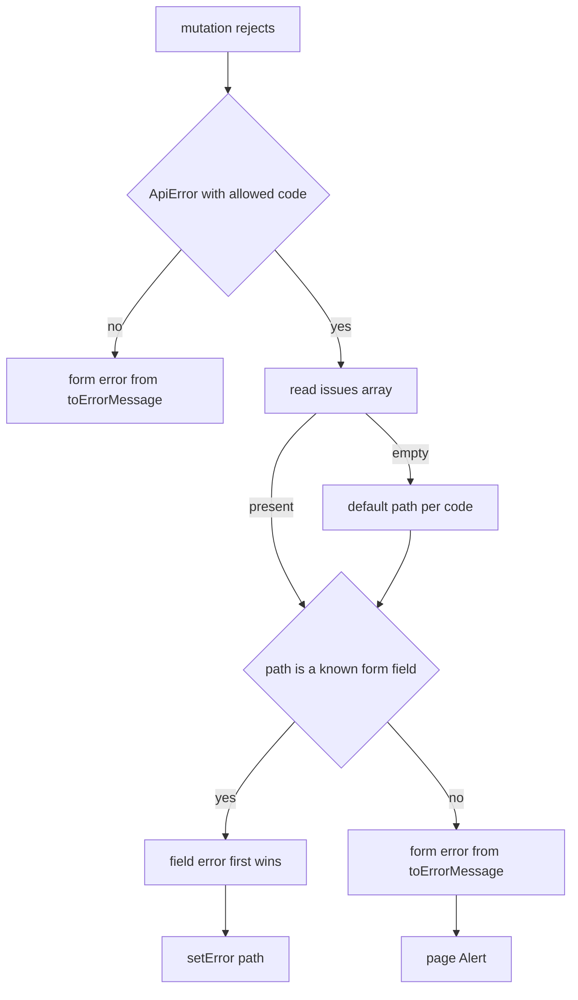

# AIS-95 — admin: code-first error mapping + `details[].path` → react-hook-form field errors

Ticket: <https://zakzag.atlassian.net/browse/AIS-95> (subtask of AIS-87)
Parent plan: `docs/plans/2026-10-26--17-21-00-unified-api-contract-and-envelope-plan.md` §D8, §D11 (tier 1), §D13
Related: `docs/plans/2026-10-28--18-50-00-ais-94-api-client-envelope-unwrap-remaining-plan.md` (produces `issues[]` paths)

## 1. Goal in one sentence

A rejected create must render **where the mistake is**: `error.code` decides the copy, `error.issues[].path`
decides the input, and the server's own `message` never becomes user text.

## 2. Already delivered — do not redo

| Ticket item                                                                              | Evidence                                                                                                                                                    |
| ---------------------------------------------------------------------------------------- | ----------------------------------------------------------------------------------------------------------------------------------------------------------- |
| Decision order `code` → `status` → generic                                               | [`toErrorMessage()`](../../apps/admin/src/lib/error-message.ts:77)                                                                                          |
| `code → magyar szöveg` map covering every `API_ERROR_CODE`                               | [`ERROR_CODE_MESSAGE`](../../apps/admin/src/lib/error-message.const.ts:67)                                                                                  |
| `VALIDATION_FAILED` and `API_KEY_IDENTIFIER_CONFLICT` have their own copy                | [`error-message.const.ts`](../../apps/admin/src/lib/error-message.const.ts:40)                                                                              |
| Unknown code degrades to the status copy (forward compatibility)                         | test `falls back to the status copy for an unknown code`, [`error-message.test.ts`](../../apps/admin/src/lib/error-message.test.ts:68)                      |
| `ApiError` carries `code` / `requestId` / `issues[]`; details paths are payload-relative | [`ApiError`](../../packages/api-client/src/api-error.ts:27)                                                                                                 |
| Server actually sends `path` for both cases                                              | [`api-keys.service.ts`](../../apps/api/src/api-keys/api-keys.service.ts:86), [`zod-error.mapper.ts`](../../apps/api/src/common/http/zod-error.mapper.ts:17) |
| `Input` renders `aria-invalid` + message from the `error` prop                           | [`Input`](../../packages/ui/src/components/input/Input.tsx:22)                                                                                              |

Remaining work is therefore **only the path → field mapping** and the copy source of truth.

## 3. Gaps

| #   | Gap                                                                                                                                                                                                | Why it matters                                                               |
| --- | -------------------------------------------------------------------------------------------------------------------------------------------------------------------------------------------------- | ---------------------------------------------------------------------------- |
| G1  | [`toIdentifierFieldError()`](../../apps/admin/src/features/api-keys/api-keys.logic.ts:31) keys off `status === 409`, so **any** 409 lands on `identifier`, and `issues[].path` is ignored entirely | a 409 that is not about `identifier` blames the wrong input                  |
| G2  | No `toFieldErrors()` pure function, no `_form` channel: a `400` with three bad fields can only produce one page `Alert`                                                                            | D11 tier 1 is unimplemented; every validation error is a page-level dead end |
| G3  | [`createConflictError()`](../../apps/admin/src/test/mocks/api-error.mock.ts:48) builds no `issues[]`, and there is no multi-field factory                                                          | a path-driven implementation cannot be tested without hand-crafted errors    |
| G4  | [`ApiKeyForm.test.tsx`](../../apps/admin/src/pages/api-keys/ui/ApiKeyForm.test.tsx:171) only asserts “409 → identifier, no page alert”                                                             | multi-field, `_form`, and “server text never leaks” cases are unproven       |

## 4. Decisions

| #   | Decision                                                                                                                                                                                                                                                                                                                |
| --- | ----------------------------------------------------------------------------------------------------------------------------------------------------------------------------------------------------------------------------------------------------------------------------------------------------------------------- |
| D1  | **Strict code gate.** Only `VALIDATION_FAILED` and `API_KEY_IDENTIFIER_CONFLICT` may feed field errors. Every other code stays a page `Alert`, even if it carries paths.                                                                                                                                                |
| D2  | **Default path per code** when an allowed code arrives with `issues: []`: `API_KEY_IDENTIFIER_CONFLICT` → `identifier` (keeps today's behaviour without a status check); `VALIDATION_FAILED` → no field, `_form` only.                                                                                                  |
| D3  | **Duplicate path → first issue wins** (server order is validator order, so it is deterministic); later duplicates are dropped.                                                                                                                                                                                          |
| D4  | **Text is client-owned.** `issue.message` is never rendered; a mapped field gets [`API_KEY_IDENTIFIER_FIELD_MESSAGE`](../../apps/admin/src/lib/error-message.const.ts:40) or a new generic `FIELD_INVALID_MESSAGE`. All Hungarian copy stays in `lib/error-message.const.ts`; the feature constant becomes a re-export. |
| D5  | Unmappable or absent paths produce **one** form-level message via `toErrorMessage(error)`; when every path mapped, the page `Alert` stays empty.                                                                                                                                                                        |
| D6  | `toErrorMessage`'s signature does not change (the notification-capture story builds on it). `details: string[]` stays untouched — `issues[]` is the mapping source.                                                                                                                                                     |
| D7  | `ApiKeyFormFieldName` lives in `features/api-keys/api-keys.interface.ts`; the page derives [`ApiKeyFormValues`](../../apps/admin/src/pages/api-keys/api-keys.interface.ts:19) from it, so features never import a page.                                                                                                 |

## 5. Mapping flow

## 6. Steps

1. **Copy** — add `FIELD_INVALID_MESSAGE` to [`error-message.const.ts`](../../apps/admin/src/lib/error-message.const.ts:40) and move the field-level conflict sentence there as `API_KEY_IDENTIFIER_FIELD_MESSAGE`; make [`API_KEY_IDENTIFIER_CONFLICT_MESSAGE`](../../apps/admin/src/features/api-keys/api-keys.const.ts:29) a re-export so the rendered wording and existing tests do not change.
2. **Constants** — in [`features/api-keys/api-keys.const.ts`](../../apps/admin/src/features/api-keys/api-keys.const.ts:1): `API_KEY_FIELD_PATHS` (`name`, `identifier`, `description`, `apiKey`, `expiresAt`), `FIELD_ERROR_FORM_KEY = '_form'`, `FIELD_ERROR_CODES` (the D1 allow-list), `DEFAULT_FIELD_PATH_BY_CODE`.
3. **Interface** — in [`features/api-keys/api-keys.interface.ts`](../../apps/admin/src/features/api-keys/api-keys.interface.ts:1): `ApiKeyFormFieldName` union and `ApiKeyFieldErrors` (`{ fields: Partial<Record<ApiKeyFormFieldName, string>>; form: string | null }`).
4. **Pure logic** — in [`api-keys.logic.ts`](../../apps/admin/src/features/api-keys/api-keys.logic.ts:1): `toFieldErrors(error: unknown): ApiKeyFieldErrors`, built from three small helpers (code gate, issue→field reduce, form fallback). Delete `toIdentifierFieldError`; delete `isIdentifierConflict` if it has no other caller (verify with a grep first).
5. **Mock parity** — [`createConflictError()`](../../apps/admin/src/test/mocks/api-error.mock.ts:48) gains `issues: [{ path: 'identifier', message: CONFLICT_DETAIL }]`; add `createMultiFieldValidationError()` (two paths) and `createLegacyConflictError()` (409, allowed code, no issues).
6. **Form** — in [`ApiKeyForm.tsx`](../../apps/admin/src/pages/api-keys/ui/ApiKeyForm.tsx:67): replace the `toIdentifierFieldError` branch with `toFieldErrors`, `setError` per mapped field (`shouldFocus` on the first), and `setPageError(result.form)`; drop `pageError` writes that duplicate a field error.
7. **Page types** — [`ApiKeyFormValues`](../../apps/admin/src/pages/api-keys/api-keys.interface.ts:19) becomes `Record<ApiKeyFormFieldName, string>`; `API_KEY_FORM_FIELD_IDS` keys are checked against the union.
8. **Tests**
   - `api-keys.logic.test.ts`: every allowed code with one path; two paths at once; unknown path → `form`; duplicate path → first wins; allowed code with empty `issues` → default path; non-allowed code with paths → `form` only, `fields` empty; `new Error('Conflict: duplicate key')` → `form`; non-error values.
   - `error-message.test.ts`: keep as is; add a case proving an extreme server `message` never appears in the resolved copy.
   - `ApiKeyForm.test.tsx`: multi-field 400 renders both messages on their inputs and no page alert; a `_form`-only failure renders the alert and no `aria-invalid`; a legacy 409 without issues still marks `identifier`; submit re-enabled after every failure; extreme server text absent from the DOM.
9. **Docs** — `docs/Specs/API-Convention.md` (client section): tier-1 rules, strict code gate, first-wins, `_form` sentinel; `docs/history/<YYYY-MM-DD--HH-ii-ss>-ais-95-admin-field-error-mapping.md`; milestone `docs/milestones/<timestamp>-ais-95-field-level-error-mapping.milestone.md` (D11 tier 1 is a durable UX contract).
10. **Jira** — comment the evidence (test names) on AIS-95 and transition to Done once green.

## 7. Definition of done

- Duplicate `identifier` create → error on the `identifier` input (`aria-invalid` + message below it), page `Alert` empty.
- Several bad fields → each on its own input; unmappable paths → one form-level `Alert`.
- A 409 or 500 whose code is outside the allow-list → page `Alert` only, no field marked.
- Server `message` / `details` text never appears in the DOM.
- `toErrorMessage(error: unknown): string` unchanged; existing admin tests green.
- `pnpm --filter @callback/admin test`, `pnpm --filter @callback/admin lint`, `pnpm --filter @callback/admin build` green.
