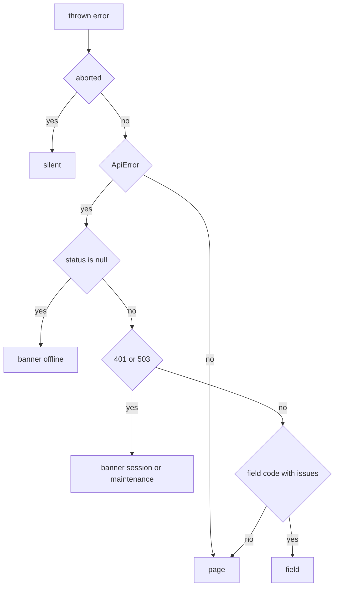

# AIS-96 — admin error display tiers: page-level Alert + retry, app-level banner (401 / offline / 503), `toErrorSurface`

**Ticket:** <https://zakzag.atlassian.net/browse/AIS-96> (subtask of AIS-87)
**Base design:** [`2026-10-26--17-21-00-unified-api-contract-and-envelope-plan.md`](./2026-10-26--17-21-00-unified-api-contract-and-envelope-plan.md) §D11 tiers 2–3
**Predecessor:** AIS-95 (field tier, done — [`history`](../history/2026-10-28--23-18-00-ais-95-admin-field-error-mapping.md:1))
**Follow-up (out of scope):** AIS-86 — toast + log drawer (tier 4). This ticket only guarantees the error object keeps its `requestId`.

---

## 1. What exists today

| Piece                                                                            | State                                                                                       |
| -------------------------------------------------------------------------------- | ------------------------------------------------------------------------------------------- |
| `ApiError`                                                                       | carries `status`, `code`, `requestId`, `issues[]`, `details[]` (AIS-94)                     |
| [`toErrorMessage()`](../../apps/admin/src/lib/error-message.ts:77)               | `code → hu` with status fallback; `status === null` → offline copy                          |
| [`useApiKeysQuery()`](../../apps/admin/src/features/api-keys/use-api-keys.ts:31) | flattens the error to a **string**, drops `code`/`status`/`requestId`                       |
| [`ApiKeysTable`](../../apps/admin/src/pages/api-keys/ui/ApiKeysTable.tsx:47)     | renders `Alert` + retry **inside the list card** — indistinguishable from a generic failure |
| `AuthContext`                                                                    | `isAuthenticated` derived from the stored token; no reaction to a `401`                     |
| Banner / online status                                                           | **do not exist** — offline is only text, `401` is silent                                    |

## 2. Scope boundary

In: `Banner` primitive, `toErrorSurface` classifier, page-level `PageErrorState`, app-level `AppErrorBanner`, `useOnlineStatus`, raw-error exposure through the api-keys query hook.
Out: toast, notification/log store, log drawer, requestId rendering (AIS-86).

---

## 3. Decisions

### D1 — One classifier, four surfaces

`toErrorSurface(error: unknown): ErrorSurface` (`'banner' | 'page' | 'field' | 'silent'`) in `apps/admin/src/lib/error-surface.logic.ts` — pure, no React, no I/O. Every tier decision goes through it; no component inspects `status`/`code`.

| First matching condition                                     | Surface  |
| ------------------------------------------------------------ | -------- |
| abort / cancel (`name === 'AbortError' \| 'CancelledError'`) | `silent` |
| not an `ApiError`                                            | `page`   |
| `status === null` (no response: offline, DNS, CORS)          | `banner` |
| `401`                                                        | `banner` |
| `503`                                                        | `banner` |
| `code ∈ FIELD_SURFACE_CODES` **and** `issues.length > 0`     | `field`  |
| everything else (`400`, `403`, `404`, `409`, `422`, `5xx`)   | `page`   |

### D2 — Banner state has no store

Source of truth stays external: TanStack Query cache errors + `navigator.onLine` + `online`/`offline` events. `features/error-surface/use-app-error-banner.ts` derives the model with `useSyncExternalStore` over `queryClient.getQueryCache()`; nothing is copied into Zustand.

### D3 — Banner precedence and dismissal

Pure `toBannerModel({ isOnline, error, dismissedKey })`:

1. `isOnline === false` → offline banner,
2. else highest-priority cached query error whose surface is `banner` (`401` before `503`),
3. else `null`.

Dismissal is `useState` in the hook, keyed by the condition (`offline` / `401` / `503`) or the `requestId` when present — a _different_ failure re-shows the banner. No 5-second auto-hide (no SWR behaviour).

### D4 — Banner is non-modal and never navigates by itself

`Banner` = one-line, full-width, dismissible, `role="alert"` for `danger` and `role="status"` otherwise. The `401` banner renders a _Bejelentkezés_ CTA; clicking it calls `logout()` (token cleared → `ProtectedLayout` already renders `LoginPage`). The classifier never redirects.

### D5 — One error, one surface per region

`useApiKeysQuery` exposes the **raw** error plus the derived surface, so the page can suppress its own alert when the banner owns the failure:

```ts
interface UseApiKeysQueryResult {
  readonly apiKeys: readonly ApiKey[];
  readonly isLoading: boolean;
  readonly isFetching: boolean; // drives PageErrorState retry-disabled state
  readonly error: ApiError | null; // raw — keeps requestId for AIS-86
  readonly errorMessage: string | null; // toErrorMessage()
  readonly errorSurface: ErrorSurface | null; // toErrorSurface()
  readonly refetch: () => void;
}
```

Page rule: `errorSurface === 'page'` → `PageErrorState`; `'banner'` / `'field'` / `'silent'` → page renders nothing extra (banner already speaks). Field tier for the **create** mutation stays in `ApiKeyForm` (unchanged).

### D6 — `PageErrorState` is mandatory, props-driven

`{ title, message, onRetry, isRetrying }` → `Alert variant="danger"` + retry `Button` (disabled while `isRetrying`, label switches to _Próbálkozás…_). `onRetry` is the query's `refetch` — the component performs no request itself.

### D7 — Copy stays in one client-owned file

New `apps/admin/src/lib/error-surface.const.ts` (banner titles/CTAs, dismiss `aria-label`, page alert title, retry labels). Server `message` is still never rendered. `FIELD_SURFACE_CODES` lives there as the single source; `features/api-keys/api-keys.const.ts` re-exports it as `FIELD_ERROR_CODES` (pattern already used for `API_KEY_IDENTIFIER_CONFLICT_MESSAGE`).

### D8 — Tokens only

`Banner` is built from [`theme.css`](../../packages/ui/src/styles/theme.css:1) tokens + `cn()`, no palette utilities, no colour literals; exported explicitly from [`packages/ui/src/index.ts`](../../packages/ui/src/index.ts:45).



---

## 4. Work items

| #   | File                                                                  | Change                                                                                            |
| --- | --------------------------------------------------------------------- | ------------------------------------------------------------------------------------------------- |
| 1   | `packages/ui/src/components/banner/banner.variants.ts`                | NEW — CVA recipe (`info/warning/danger`), token borders, `shadow-neu-raised`, sticky top          |
| 2   | `packages/ui/src/components/banner/banner.interface.ts`               | NEW — `BannerProps { variant?, title?, action?, onDismiss?, dismissLabel?, children }`            |
| 3   | `packages/ui/src/components/banner/Banner.tsx`                        | NEW — one-line shell, dismiss `Button` (`variant="ghost"`, `aria-label`), `role` from variant     |
| 4   | `packages/ui/src/index.ts`                                            | CHANGE — export `Banner`, `bannerVariants`, `BannerProps`, `BannerVariants`                       |
| 5   | `packages/ui/test/banner.test.tsx`                                    | NEW — variants, roles, dismiss callback, action slot, no dismiss button without handler           |
| 6   | `apps/admin/src/lib/error-surface.interface.ts`                       | NEW — `ErrorSurface`, `BannerCondition`, `BannerModel`, `ToBannerModelInput`                      |
| 7   | `apps/admin/src/lib/error-surface.const.ts`                           | NEW — offline / 401 / 503 copy + CTA and retry labels, `FIELD_SURFACE_CODES`, dismiss label       |
| 8   | `apps/admin/src/lib/error-surface.logic.ts`                           | NEW — `isAbortLike()`, `toErrorSurface()`, `toBannerModel()`                                      |
| 9   | `apps/admin/src/lib/error-surface.logic.test.ts`                      | NEW — full surface matrix + precedence + dismissal reset                                          |
| 10  | `apps/admin/src/features/error-surface/use-online-status.ts`          | NEW — `useSyncExternalStore` over `online`/`offline`                                              |
| 11  | `apps/admin/src/features/error-surface/use-app-error-banner.ts`       | NEW — query-cache snapshot + dismissal state → `BannerModel \| null`                              |
| 12  | `apps/admin/src/features/error-surface/use-app-error-banner.test.tsx` | NEW — offline → model, `online` event clears, 401 from cache → CTA model, 500 → `null`            |
| 13  | `apps/admin/src/components/error/AppErrorBanner.tsx`                  | NEW — thin container: model → `Banner`, `onLogin` injected, `null` when no model                  |
| 14  | `apps/admin/src/components/error/AppErrorBanner.test.tsx`             | NEW — offline render, 401 CTA visible + fires `onLogin`, dismiss hides                            |
| 15  | `apps/admin/src/components/error/PageErrorState.tsx`                  | NEW — `Alert` + retry button                                                                      |
| 16  | `apps/admin/src/components/error/PageErrorState.test.tsx`             | NEW — retry callback, `isRetrying` disables                                                       |
| 17  | `apps/admin/src/App.tsx`                                              | CHANGE — mount `<AppErrorBanner onLogin={logout} />` in the layout shell above `header`           |
| 18  | `apps/admin/src/features/api-keys/api-keys.interface.ts`              | CHANGE — new query result shape (D5)                                                              |
| 19  | `apps/admin/src/features/api-keys/use-api-keys.ts`                    | CHANGE — expose raw error, `errorMessage`, `errorSurface`, `isFetching`                           |
| 20  | `apps/admin/src/features/api-keys/use-api-keys.test.tsx`              | CHANGE — assert the new fields per error class                                                    |
| 21  | `apps/admin/src/pages/api-keys/ApiKeysPage.tsx`                       | CHANGE — render `PageErrorState` when `errorSurface === 'page'`                                   |
| 22  | `apps/admin/src/pages/api-keys/ui/ApiKeysTable.tsx`                   | CHANGE — drop `error`/`onRetry`; keep loading/empty/success only                                  |
| 23  | `apps/admin/src/pages/api-keys/ui/ApiKeysTable.test.tsx`              | CHANGE — remove the error-state case (moved to `PageErrorState`)                                  |
| 24  | `apps/admin/src/pages/api-keys/ApiKeysPage.test.tsx`                  | NEW (optional) — page renders retry on `500`, nothing on `401`                                    |
| 25  | `apps/admin/src/test/mocks/online-status.mock.ts`                     | NEW — `setOnline()` helper + event dispatch, reused by both hook tests                            |
| 26  | `docs/Specs/UI-Architecture.md`                                       | CHANGE — primitive list (`Banner`), error-surface layer note, page state table row for `api-keys` |
| 27  | `docs/history/<ts>-ais-96-admin-error-surfaces.md`                    | NEW — implementation narrative                                                                    |
| 28  | `docs/milestones/<ts>-admin-error-surfaces.milestone.md`              | NEW — decision-grade summary (multi-file feature)                                                 |

## 5. Tests to write

- **Unit (`toErrorSurface`)** — abort → `silent`; non-`ApiError` → `page`; `status === null` → `banner`; `401` → `banner` (with and without code); `503` → `banner`; `VALIDATION_FAILED` + issues → `field`; `VALIDATION_FAILED` without issues → `page`; `403`/`404`/`409`/`500`/unknown `5xx` → `page`.
- **Unit (`toBannerModel`)** — offline wins over a cached `401`; `401` wins over `503`; dismissed condition → `null`; dismissed `503` then a `401` shows again.
- **Primitive (`Banner`)** — `danger` → `role="alert"`, others → `role="status"`; `onDismiss` renders a labelled close button; no button without `onDismiss`; action slot rendered.
- **Component (`PageErrorState`)** — retry calls the callback once; `isRetrying` disables the button and shows the pending label; the message prop is the only copy rendered.
- **Component (`AppErrorBanner`)** — `navigator.onLine = false` → offline banner; `online` event → banner disappears; cached `401` → session copy + CTA that calls `onLogin`; no banner on a `500`.
- **Hook (`useApiKeysQuery`)** — `500` → `errorSurface === 'page'` + mapped message; `401` → `'banner'`; `error.requestId` preserved.
- **Manual** — DevTools offline + mocked `500` back-to-back: two different surfaces, no duplicated sentence.

## 6. Verification

```
pnpm --filter @callback/ui test
pnpm --filter @callback/admin test
pnpm --filter @callback/admin lint
pnpm --filter @callback/admin build
rg "#[0-9a-fA-F]{3,8}|(bg|text|border|ring|from|to|via)-(slate|gray|zinc|neutral|stone|indigo|red|amber|green|emerald|blue)-[0-9]{2,3}" apps/admin/src packages/ui/src
```

The palette check must return nothing; all four commands must be green.

## 7. Risks / notes

- `useSyncExternalStore` over the query cache must return a **stable** snapshot (select + memo the model), otherwise React loops — the selector lives in `error-surface.logic.ts` so it is directly testable.
- Banner copy for `offline` and `status === null` overlap by design (same user condition); the classifier routes both to `banner` so only one message can be on screen.
- AIS-86 will add the log tier: it consumes `error.requestId` from the same query-cache errors — no API change needed here.
