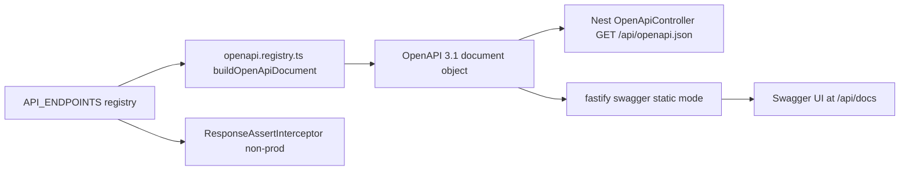

# AIS-98 — generated `/api/openapi.json` + Swagger UI (`/api/docs`) + dev response validator

**Created:** 2026-10-29 00:10 (Europe/Budapest)
**Ticket:** AIS-98 (subtask of AIS-87)
**Source of truth plan:** [`2026-10-26--17-21-00-unified-api-contract-and-envelope-plan.md`](2026-10-26--17-21-00-unified-api-contract-and-envelope-plan.md:327) §8.3, §8.4 (jobs 1 + 4), §8.5, §8.6
**Status:** DRAFT — awaiting approval

---

## 1. Scope of this ticket (and what is _not_ here)

| In scope (AIS-98)                                                               | Out of scope                                                                                              |
| ------------------------------------------------------------------------------- | --------------------------------------------------------------------------------------------------------- |
| Document generation from the shared registry (`@asteasolutions/zod-to-openapi`) | Committed baseline `docs/Specs/openapi.json` + `openapi:generate` / `openapi:check` CI gates → **AIS-99** |
| `GET /api/openapi.json` in every env                                            | Envelope/contract e2e suite + bare-body audit → **AIS-97**                                                |
| Swagger UI at `/api/docs`, local/dev only                                       | Full `API-Convention.md` pass → **AIS-100**                                                               |
| Dev/staging **response-assert interceptor** (job 4)                             | Any `apps/web` / `apps/admin` / `packages/ui` change                                                      |

Prerequisite already on `main`: [`API_ENDPOINTS`](packages/shared/src/contract/endpoint.registry.ts:14), [`ApiEndpointContract`](packages/shared/src/contract/endpoint.interface.ts:31), [`successEnvelopeSchema()`](packages/shared/src/contract/envelope.schema.ts:56), [`apiErrorEnvelopeSchema`](packages/shared/src/contract/error-envelope.ts:46), [`resolveApiErrorStatus()`](packages/shared/src/contract/error-envelope.ts:61), [`@SkipEnvelope()`](apps/api/src/common/http/skip-envelope.decorator.ts:25).

---

## 2. Decisions

**D1 — one direction.** Registry Zod schemas → generated OpenAPI → UI. No decorators, no `@nestjs/swagger`, no spec-first authoring.

**D2 — the envelope is described once.** `envelopeOf(dataSchema)` returns
`{ allOf: [ { $ref: '#/components/schemas/ApiEnvelope' }, { type: 'object', properties: { data: <converted data schema> } } ] }`.
`ApiEnvelope` / `ResponseMeta` / `ApiErrorEnvelope` are registered as components exactly once, so no endpoint restates the envelope.

**D3 — errors are inherited, not repeated.** `registerErrorResponses()` registers the canonical responses (`400/401/403/404/409/413/422/429/500/503`) as `components.responses` pointing at `ApiErrorEnvelope`; every operation references the subset implied by its `errors[]` (plus `500`/`503` from `COMMON_ERRORS`), mapped to status via `resolveApiErrorStatus()`.

**D4 — serving split (chosen so e2e can test it).**

| Route                   | Mechanism                                                                                                                                           | Envelope                                                         |
| ----------------------- | --------------------------------------------------------------------------------------------------------------------------------------------------- | ---------------------------------------------------------------- |
| `GET /api/openapi.json` | Nest controller `OpenApiController`, returns the frozen document                                                                                    | `@SkipEnvelope()` + `ENVELOPE_EXEMPTIONS` entry                  |
| `GET /api/docs`         | `@fastify/swagger` **static mode** (document pre-built) + `@fastify/swagger-ui`, registered from `OpenApiModule.onModuleInit` via `HttpAdapterHost` | never reaches the Nest filter → **not** in `ENVELOPE_EXEMPTIONS` |

The UI is _not_ added to `ENVELOPE_EXEMPTIONS` because [`envelope-exemptions.spec.ts`](apps/api/src/common/http/envelope-exemptions.spec.ts:52) compares that list against **Nest controller routes** only; the plugin route would make the two-way check fail. Only `/api/openapi.json` is added, with a written reason.

**D5 — prod exposure is a pure predicate.** `isOpenApiDocsEnabled(env)` (UI) and `isResponseAssertEnabled(env)` (validator) live in `openapi.config.ts`, both `env !== 'prod'`; unit-tested for `local`/`dev`/`prod`. Per ticket answer: **Swagger UI is not mounted in prod** — no Caddy/deploy change.

**D6 — the validator is an interceptor, not middleware.** `ResponseAssertInterceptor`:

1. reads method + `request.routeOptions.url` (Fastify gives the `/api/api-keys/:identifier` pattern);
2. matches it against `API_ENDPOINTS` (segment-wise; `:param` matches one segment);
3. no match → `next.handle()` untouched (exempt/unregistered routes, plugin assets);
4. match → `successEnvelopeSchema(entry.dataSchema).safeParse(body)` (or `entry.dataSchema` when `envelope === false`);
5. mismatch → throw `ContractViolationError` (custom `AppError`) with the Zod issue paths; the existing filter turns it into `500 INTERNAL_ERROR`. Fail fast in dev only — prod has no interceptor at all.

**D7 — examples come from the registry.** Optional additive field `example?: unknown` on `ApiEndpointContract`, emitted as the OpenAPI `example`; sample payloads move from [`endpoint-registry.test.ts`](packages/shared/test/endpoint-registry.test.ts:33) into a shared fixture module so the test and the spec read one value.

---

## 3. Pipeline



---

## 4. Files

### New — `apps/api/src/common/openapi/`

| File                             | Content                                                                                                                                                                                                                                                                                                                                                |
| -------------------------------- | ------------------------------------------------------------------------------------------------------------------------------------------------------------------------------------------------------------------------------------------------------------------------------------------------------------------------------------------------------ |
| `openapi.config.ts`              | `OPENAPI_TITLE`, `OPENAPI_VERSION`, `OPENAPI_SERVERS`, `OPENAPI_TAGS`, `OPENAPI_SECURITY_SCHEMES` (bearer, prepared but unused), `isOpenApiDocsEnabled()`, `isResponseAssertEnabled()`, `SWAGGER_UI_ROUTE = '/api/docs'`, `OPENAPI_JSON_PATH = '/api/openapi.json'` — no `process.env` reads except via [`APP_ENV`](apps/api/src/config/app-env.ts:73) |
| `zod-openapi.ts`                 | `extendZodWithOpenApi(z)` bootstrap + `registerEnvelopeComponents(registry)`, `envelopeOf(dataSchema)`, `registerErrorResponses(registry)`, `toOpenApiPath('/api/api-keys/:identifier' → '/api/api-keys/{identifier}')`                                                                                                                                |
| `openapi.registry.ts`            | `buildOpenApiDocument(): OpenApiDocumentV31` — pure, memoised, iterates `API_ENDPOINTS`, uses `OpenApiGeneratorV31`; no Nest, no I/O                                                                                                                                                                                                                   |
| `openapi.controller.ts`          | `@SkipEnvelope() @Controller()` + `@Get('openapi.json')` returning the document                                                                                                                                                                                                                                                                        |
| `openapi.module.ts`              | provides the document (useValue), controller, `onModuleInit` Fastify plugin registration (UI only when `isOpenApiDocsEnabled`), conditional `APP_INTERCEPTOR` for the validator                                                                                                                                                                        |
| `response-assert.interceptor.ts` | D6                                                                                                                                                                                                                                                                                                                                                     |
| `contract-violation.error.ts`    | `ContractViolationError extends AppError` (`INTERNAL_ERROR`, carries the issue paths)                                                                                                                                                                                                                                                                  |
| `*.spec.ts` (5)                  | see §6                                                                                                                                                                                                                                                                                                                                                 |

### Changed

| File                                                                                                                          | Change                                                                                                  |
| ----------------------------------------------------------------------------------------------------------------------------- | ------------------------------------------------------------------------------------------------------- |
| [`apps/api/src/app.module.ts`](apps/api/src/app.module.ts:36)                                                                 | import `OpenApiModule` after `HttpModule`                                                               |
| [`packages/shared/src/contract/endpoint.interface.ts`](packages/shared/src/contract/endpoint.interface.ts:31)                 | optional `example?: unknown`                                                                            |
| [`packages/shared/src/contract/api-keys/api-keys.contract.ts`](packages/shared/src/contract/api-keys/api-keys.contract.ts:34) | `example` per entry, from the shared fixture                                                            |
| `packages/shared/src/contract/api-keys/api-keys.fixture.ts`                                                                   | NEW: `VALID_API_KEY`, `VALID_API_KEY_LIST`                                                              |
| [`packages/shared/src/contract/endpoint.registry.ts`](packages/shared/src/contract/endpoint.registry.ts:31)                   | `ENVELOPE_EXEMPTIONS` += `/api/openapi.json` (reason: machine-readable spec, not an enveloped resource) |
| [`apps/api/src/common/http/envelope-exemptions.spec.ts`](apps/api/src/common/http/envelope-exemptions.spec.ts:29)             | `OpenApiController` in `ROUTE_CONTROLLERS`                                                              |
| [`packages/shared/test/endpoint-registry.test.ts`](packages/shared/test/endpoint-registry.test.ts:33)                         | consume the fixture instead of local literals                                                           |
| [`apps/api/package.json`](apps/api/package.json:26)                                                                           | `@asteasolutions/zod-to-openapi`, `@fastify/swagger`, `@fastify/swagger-ui`                             |
| [`docs/Specs/API-Convention.md`](docs/Specs/API-Convention.md:138)                                                            | replace the `TODO (AIS-98)` note with the actual mounts, bump `Utolsó frissítés` (full pass = AIS-100)  |

---

## 5. Execution order

1. `apps/api` dependencies + `zod-openapi.ts` (components, `envelopeOf`, error responses) with its spec.
2. `openapi.registry.ts` + `openapi.config.ts` + generator spec (paths, operationIds, `$ref` usage, securitySchemes).
3. `openapi.controller.ts` + `openapi.module.ts` (json route only) + module wired into `AppModule` + `/api/openapi.json` exemption entry + exemption-spec update.
4. Fastify static-mode + Swagger UI registration in `onModuleInit`, guarded by `isOpenApiDocsEnabled`.
5. `example` on the registry + shared fixture refactor.
6. `ContractViolationError` + `ResponseAssertInterceptor` + conditional `APP_INTERCEPTOR`.
7. e2e `apps/api/test/openapi.e2e-spec.ts`.
8. Docs: `API-Convention.md` note, `docs/history/`, `docs/milestones/`.

---

## 6. Tests

| Suite                                 | Asserts                                                                                                                                                                                                                                                                                                                          |
| ------------------------------------- | -------------------------------------------------------------------------------------------------------------------------------------------------------------------------------------------------------------------------------------------------------------------------------------------------------------------------------- |
| `zod-openapi.spec.ts`                 | `envelopeOf` emits `allOf` with `$ref: ApiEnvelope`; `meta` required; `:param` → `{param}`; every catalogue status has a registered response                                                                                                                                                                                     |
| `openapi.registry.spec.ts`            | one path + operation per `API_ENDPOINTS` entry; `openapi: '3.1.0'`; `operationId` equals the registry id; success response references `ApiEnvelope` (no inline envelope copy); `ApiErrorEnvelope` + bearer `securitySchemes` present; `example` present when the entry has one; output is deterministic (two calls → deep-equal) |
| `openapi.config.spec.ts`              | `isOpenApiDocsEnabled` / `isResponseAssertEnabled` for `local`/`dev`/`prod`                                                                                                                                                                                                                                                      |
| `openapi.controller.spec.ts`          | returns the memoised document, does not re-build per request                                                                                                                                                                                                                                                                     |
| `response-assert.interceptor.spec.ts` | valid enveloped body passes; missing field → `ContractViolationError`; extra field dropped without throwing; exempt/unmatched route untouched; nested invalid `data` reported with path                                                                                                                                          |
| `test/openapi.e2e-spec.ts`            | `/api/openapi.json` → 200, `openapi: '3.1.0'`, contains all three `apiKeys.*`; `/api/docs` → 200 in dev; healthz body unchanged (raw)                                                                                                                                                                                            |

Mocks/helpers: reuse [`execution-context.mock.ts`](apps/api/src/common/http/test/mocks/execution-context.mock.ts:1) and [`http-host.mock.ts`](apps/api/src/common/http/test/mocks/http-host.mock.ts:1); no network, no real timers.

---

## 7. Verification

```bash
pnpm --filter @callback/shared test
pnpm --filter @callback/api test
pnpm --filter @callback/api test:e2e
pnpm --filter @callback/api lint
pnpm --filter @callback/api build
```

Manual (dev): `pnpm start` → `curl -s localhost:3000/api/openapi.json | jq .openapi` → `3.1.0`; open `http://localhost:3000/api/docs` → `Try it out` on `GET /api/api-keys` → enveloped `data`.

Negative check for job 4: temporarily remove `responses.ok()` from one controller method → the dev request returns `500 INTERNAL_ERROR` with the contract-violation reason in the server log (revert afterwards).

---

## 8. Risks / pitfalls

| Risk                                                                                                                            | Mitigation                                                                                                         |
| ------------------------------------------------------------------------------------------------------------------------------- | ------------------------------------------------------------------------------------------------------------------ |
| `@fastify/swagger` / `swagger-ui` are CJS with a default export — `nodenext` ESM needs `import swagger from '@fastify/swagger'` | verify immediately in step 1; if the interop is broken, fall back to a `createRequire` shim in `openapi.module.ts` |
| Plugins registered in `onModuleInit` must be ready before `app.inject()` in e2e                                                 | `await app.getHttpAdapter().getInstance().ready()` in `onApplicationBootstrap` if `inject` 404s                    |
| Fastify registers the UI outside the `/api` prefix logic → path collisions with Nest routes                                     | `SWAGGER_UI_ROUTE` is a single constant, asserted by e2e                                                           |
| Adding `/api/docs` to `ENVELOPE_EXEMPTIONS` would break the two-way agreement test                                              | documented above (D4) — only `/api/openapi.json` is listed                                                         |
| zod `3.24` vs `zod-to-openapi`                                                                                                  | pin `@asteasolutions/zod-to-openapi@^7` (peer `zod ^3.20`)                                                         |
