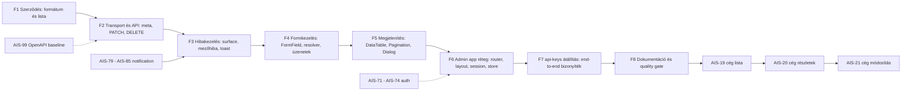

# Admin + API: egységes adatáramlás, validáció és UI-alap (terv)

**Dátum:** 2026-10-30 13:06 (Europe/Budapest)
**Státusz:** jóváhagyásra vár — döntések: §4, könyvtárak: §5, új ticketek: §7
**Érintett:** `apps/admin`, `apps/api`, `packages/shared`, `packages/api-client`, `packages/ui`
**Kapcsolódó:** [`API-Convention.md`](../Specs/API-Convention.md:1), [`UI-Architecture.md`](../Specs/UI-Architecture.md:1), [`2026-10-21--14-13-00-admin-api-db-foundation-tickets-plan.md`](2026-10-21--14-13-00-admin-api-db-foundation-tickets-plan.md:1)

---

## 1. TL;DR

A **vertikális slice** (api-keys) már majdnem teljes: egy Zod-szerződés vezérli a szervert, a klienst és az űrlapot, a boríték és a hibakódok egységesek. Ami hiányzik, az a **második fejlesztő számára szükséges horizontális alap**:

1. a lista/detail adatáramlás nem teljes (a transport eldobja a `meta`-t, nincs query-szerződés, nincs PATCH/DELETE),
2. a **formátum-validáció** (telefon, adószám, IBAN, e-mail, dátum) nincs központosítva, és magyar zod üzenet sincs,
3. a **form + mezőhiba + hook + lista-UI** minta feature-önként újraíródna, ha valaki nekikezd az AIS-19/20/21-nek,
4. a **state bucketek** (zustand, `src/app/`) és a **hiányzó primitívek** (Select, Dialog, Pagination, EmptyState) miatt minden új oldal saját megoldást találna ki.

Cél: **egy új admin oldal** (cég lista / detail / edit) megírható legyen úgy, hogy a fejlesztő csak a *saját* domainjét írja — a többit (kontraktus, transport, hook, mezőhiba, layout, primitívek, teszt-harness) készen kapja.

---

## 2. Mi van kész (bizonyíték)

| Terület | Állapot |
|---|---|
| Boríték + hiba-boríték Zod séma, `API_ERROR_CODE` katalógus, `HTTP_STATUS` | kész — [`envelope.schema.ts`](../../packages/shared/src/contract/envelope.schema.ts:56), [`error-code.const.ts`](../../packages/shared/src/contract/error-code.const.ts:1) |
| Endpoint registry (`operationId`, path, `dataSchema`, `requestSchema`, `errors`) | kész — [`api-keys.contract.ts`](../../packages/shared/src/contract/api-keys/api-keys.contract.ts:35) |
| Szerver: `AppError` hierarchia, `ZodBodyPipe`/`ZodQueryPipe`, `ApiResponseService`, `ApiExceptionFilter`, requestId korreláció, `@SkipEnvelope` | kész — [`zod.pipe.ts`](../../apps/api/src/common/http/zod.pipe.ts:32), [`request-id.interceptor.ts`](../../apps/api/src/common/http/request-id.interceptor.ts:1) |
| OpenAPI generálás (`/api/openapi.json`), Swagger UI (`/api/docs`), dev válasz-validátor | kész (AIS-98) — [`openapi.registry.ts`](../../apps/api/src/common/openapi/openapi.registry.ts:1) |
| Kliens: `ApiError` (`status`, `code`, `requestId`, `issues[]`, `details[]`), egy unwrap pont, delegált hibakód-katalógus | kész — [`envelope.logic.ts`](../../packages/api-client/src/envelope.logic.ts:71), [`api-error.ts`](../../packages/api-client/src/api-error.ts:1) |
| Admin: query hook minta, query key konstansok, code-first hibaüzenet, `toFieldErrors` (mező szint), 4 szintű hibafelület + `Banner` | kész (AIS-95, AIS-96) — [`use-api-keys.ts`](../../apps/admin/src/features/api-keys/use-api-keys.ts:32), [`error-surface.logic.ts`](../../apps/admin/src/lib/error-surface.logic.ts:75) |
| UI: token réteg (graphite + teal), `Button`, `Input`, `Textarea`, `Card`, `Table*`, `Badge`, `Alert`, `Banner`, `cn()` | kész — [`theme.css`](../../packages/ui/src/styles/theme.css:1), [`index.ts`](../../packages/ui/src/index.ts:6) |
| Teszt: jest (shared, api-client), vitest + RTL (ui, admin), e2e + envelope-contract kapu | kész — [`envelope-contract.e2e-spec.ts`](../../apps/api/test/envelope-contract.e2e-spec.ts:1) |

---

## 3. Mi hiányzik (gap lista)

| # | Gap | Bizonyíték | Következmény a második fejlesztőnek |
|---|---|---|---|
| G1 | A transport csak `GET`/`POST` | [`http-client.interface.ts:47`](../../packages/api-client/src/http-client.interface.ts:47) | cég módosítás (AIS-21) nem írható meg a szabályos rétegen |
| G2 | Az unwrap eldobja a `meta`-t (nem csak `data`-t ad vissza) | [`envelope.logic.ts:87`](../../packages/api-client/src/envelope.logic.ts:87) | paginált lista, `total`, `totalPages` **elérhetetlen** a UI-ból, noha a szerződés támogatja |
| G3 | Nincs közös lista query szerződés; az api-keys lista `z.array(...)` | [`api-keys.schema.ts:54`](../../packages/shared/src/contract/api-keys/api-keys.schema.ts:54) | minden lista saját page/limit/sort paramétert talál ki |
| G4 | Nincs update/delete végpont és kliens metódus; `findByIdentifier` a registryben van, a kliensben nincs | [`api-keys.controller.ts:19`](../../apps/api/src/api-keys/api-keys.controller.ts:19), [`api-keys.service.ts:26`](../../packages/api-client/src/api-keys/api-keys.service.ts:26) | CRUD oldal nem építhető konvenció szerint |
| G5 | Nincs közös formátum-validáció (telefon, adószám, IBAN, postai kód, dátum-only, URL) és nincs magyar zod üzenet | [`api-keys.schema.ts:33`](../../packages/shared/src/contract/api-keys/api-keys.schema.ts:33) (egyetlen mezőüzenet minta) | a "formátum-ellenőrzés" oldalanként, eltérő szigorral valósulna meg |
| G6 | A `toFieldErrors` feature-specifikus (`API_KEY_FIELD_PATHS` beégetve) | [`api-keys.logic.ts:109`](../../apps/admin/src/features/api-keys/api-keys.logic.ts:109) | a cég űrlap ezt másolná (duplikáció), vagy kihagyná |
| G7 | Nincs generikus hook réteg (list/detail/create/update) | [`use-api-keys.ts:32`](../../apps/admin/src/features/api-keys/use-api-keys.ts:32) | minden feature saját loading/error/refetch logikát ír |
| G8 | Nincs `src/app/` réteg, nincs Zustand, nincs session store; a router inline az `App.tsx`-ben | [`App.tsx:48`](../../apps/admin/src/App.tsx:48), [`UI-Architecture.md:228`](../Specs/UI-Architecture.md:228) | a három state bucket szabálya nem teljesíthető; nav/route minden oldalnál kézzel |
| G9 | Hiányzó primitívek: form-mező wrapper, `Select`, `Checkbox`, `Switch`, `RadioGroup`, `DatePicker`, `Dialog`, `Drawer`, `Tooltip`, `Pagination`, `DataTable`, `EmptyState`, `Skeleton`, `Spinner`, `DescriptionList` | [`index.ts`](../../packages/ui/src/index.ts:8) | a fejlesztő inline markupot ír → **nem lesz egységes a kinézet** |
| G10 | Nincs MSW-alapú teszt harness, nincs boundary lint, nincs runtime hibamonitoring | [`apps/admin/src/test/mocks`](../../apps/admin/src/test/mocks) | a hook-tesztek fetch-double-t barkácsolnak; a réteg-szabály nem kényszerített |
| G11 | A `company` domain contractja nem létezik (mezők, formátumok, enumok) | [`schema.ts:43`](../../apps/api/src/db/schema.ts:43) (csak `api_keys`) | AIS-16 (terv) és AIS-18 (impl) nem tud indulni |
| G12 | Auth nyitott: nincs guard, nincs cookie session, a token `sessionStorage`-ban | [`AIS-71 … AIS-74`](https://zakzag.atlassian.net/browse/AIS-73) (To Do) | a 401 banner kész, de a login flow nem; éles admin nem indulhat |

---

## 4. Döntések (javaslat)

| # | Döntés | Miért |
|---|---|---|
| D1 | **Egy séma mindenhol.** A `packages/shared` request-sémája három helyen fut: `ZodBodyPipe`, `api-client` parse, RHF resolver — ugyanaz az objektum | ma is ez a minta, csak az űrlap-séma külön másolat; egy forrás ⇒ nincs drift |
| D2 | **Típusgenerálás az OpenAPI-ból (`openapi-typescript`), generált hook-ok nélkül** | a Zod marad a runtime kapu; a generált típus kikényszeríti a registry ⇄ kliens egyezést (AIS-98 már ad gépi speket) |
| D3 | **`ApiResult<T> = { data: T; meta: ResponseMeta }`** a listákhoz, `T` a részletekhez | a `meta.pagination` és a `requestId` a UI-hoz is el kell jusson (G2) |
| D4 | **Lista query-szerződés**: `page`, `limit`, `sort`, `order`, `q` + resource-specifikus szűrők egy zod sémában; a lista állapota **URL search params** (nem store) | másolható link, vissza/előre működik, a store-tiszta marad a tranziens UI-nak |
| D5 | **`PATCH` + `updatedAt` alapú optimistic concurrency** (`If-Match`/`updatedAt`), `DELETE` soft-delete jelzővel | két admin egyidejű szerkesztése ma csendben felülírná egymást |
| D6 | **Radix primitívek** a komplex widgetekhez, **token-alapú CVA recipe** marad a vizuális réteg | focus trap, roving tabindex, aria ingyen; a Radix unstyled ⇒ nem töri a token-szabályt |
| D7 | **`@tanstack/react-table`** a listákhoz (headless) | sort/filter/page/virtualizáció, markup a miénk ⇒ `packages/ui` `DataTable` marad |
| D8 | **Értesítés: a meglévő in-house terv marad** (AIS-79…85), nem Sonner | egy state, token-kompatibilis; a toast csak a form submit siker/hiba visszajelzését adja |
| D9 | Minden új oldal a §9 checklist ellen megy | a "minél egységesebb" követelmény kényszeríthető, nem szokás kérdése |

---

## 5. Könyvtár-javaslatok

> Ebben a sessionben nem volt élő web-hozzáférés, ezért a lista **kandidátus + verdikt** formában készült; az implementáló ticket első lépése a választott csomag aktuális major verziójának és a Tailwind v4 / React 18 kompatibilitásának ellenőrzése.

| Cél | Jelölt | Verdikt | Indok |
|---|---|---|---|
| OpenAPI → TS típus | `openapi-typescript` | **bevezetjük** | zero runtime, a Zod marad a futásidejű kapu |
| OpenAPI → kliens + hook | `Orval`, `Kubb`, `openapi-fetch` | **most nem** | generált hook elfedné a boríték-kezelést és a 3 state bucketet; később újranézhető |
| Űrlap | `react-hook-form` + `@hookform/resolvers` | **marad** | már telepítve; `standardSchemaResolver`-re váltás a zod-verzióhoz kötött |
| Zod üzenetek | `zod-i18n-map` vagy saját `errorMap` | **bevezetjük** | magyar mezőüzenetek egy helyen, a szerver `message` továbbra sem user copy |
| Telefon | `libphonenumber-js` | **bevezetjük** | E.164 normalizálás + ország-szintű validáció |
| IBAN | `iban` (vagy saját mod-97) | **mérlegelendő** | csak ha a cég adatokban lesz bankadat |
| Táblázat | `@tanstack/react-table` | **bevezetjük** | headless, a markup a token-recipe-é marad |
| UI primitívek | `@radix-ui/react-*` | **bevezetjük** | a11y viselkedés ingyen, stílus a miénk |
| Komponens forrás | `shadcn/ui` | **csak minta** | a token-réteg és a "primitív a `packages/ui`-ban" szabály ütközik a beemelt CSS-változókkal |
| Toast | `sonner` / `react-hot-toast` | **nem** | AIS-79…85 in-house store már eldöntött; ne legyen két igazság |
| Ikon | `lucide-react` | **bevezetjük** | tree-shakeable, egységes stroke |
| Dátum | `date-fns` v4 + `hu` locale | **opcionális** | a meglévő `Intl` elég; naptár/relative time esetén kell |
| URL state | `nuqs` | **nem** | `react-router` `useSearchParams` elég (D4) |
| Teszt mock | `msw` v2 | **bevezetjük** | service-határ mockolása hálózat nélkül, egységesen |
| a11y teszt | `vitest-axe` | **bevezetjük** | primitív-regresszió CI-ben |
| e2e | `playwright` | **később** | admin flow-k (login → cég módosítás) |
| Réteg-kapu | `eslint-plugin-boundaries` | **bevezetjük** | `app → pages → features → entities → services → lib` kényszerítve |
| Halott kód | `knip` | **bevezetjük** | ne lehessen "planned" csomagra hivatkozni |
| Katalógus | `ladle` (könnyű) / `storybook` | **ajánlott** | az egységes kinézet bizonyítéka + vizuális regresszió |
| Hibamonitoring | `@sentry/react` / GlitchTip | **opcionális** | a 4. hibaszint (log drawer) után értelmes |

---

## 6. Sorrend és függőségek

**Alapszabály (döntés, 2026-10-30):** a cégadatok (AIS-19/20/21) **előtt** a teljes közös alap elkészül — közös adatáramlás, közös hibakezelés, közös formkezelés, közös megjelenítés. A mag DoD-ját **nem** egy új cég-oldal bizonyítja, hanem a **meglévő `api-keys` oldal átállítása** az új alapokra: nincs új domain, mégis end-to-end bizonyíték.

### 6.1 A négy kötelező pillér — konkrét szállítandó

| Pillér | Mit jelent pontosan | Ticket |
|---|---|---|
| **1. Közös adatáramlás és -feldolgozás** | egy `ApiResult<T>` (data + meta), lista query-szerződés, `PATCH`/`DELETE`, típusos request-body a registryből, paginált szerver-lista, mapper dto → view model | S1-2, S1-3, S1-4, S1-5, S1-6, S1-8 |
| **2. Közös hibakezelés** | `ApiError` → egy döntő `toErrorSurface`, generikus `toFieldErrors(fieldPaths)`, field/page/banner/log szintek, toast + log store | S1-8 + AIS-79…85 |
| **3. Közös formkezelés** | shared zod séma + RHF + `FormField` wrapper (label/hint/error/aria) + `FormActions` + submit/dirty/reset konvenció + magyar mezőüzenetek | S1-1, S1-8, S1-10 |
| **4. Közös megjelenítés** | `DataTable` + `Pagination` + `EmptyState` + `Skeleton` + `Spinner` + `DescriptionList` + `StatusBadge` + `Dialog`/`Drawer`, mind token-alapú | S1-11, S1-12 |

### 6.2 Végrehajtási sorrend

F1–F8 = a „kötelező alap”. A cégadatok (AIS-19/20/21) csak F7 zöld után indulnak: utána a fejlesztőnek már nem kell infrastruktúrát kitalálnia, csak a domaint leírnia.

### 6.3 Közbenső kapuk

| Kapu | Feltétel |
|---|---|
| F1 zöld | minden formátum-séma és a lista-szerződés tesztelt, shared build zöld |
| F2 zöld | e2e: `page/limit/sort/q` + `meta.pagination` + `PATCH`/`DELETE` + 409/422 ágak |
| F3 zöld | egyetlen hook/komponens sem ismeri a HTTP státuszt; minden hiba a 4 szint valamelyikén landol |
| F4 zöld | az `ApiKeyForm` a közös `FormField`-re állítva, mezőhiba a `details[].path`-ból |
| F5 zöld | lista/űrlap loading, empty, error, success mind a közös primitívekkel renderelődik |
| F6 zöld | `App.tsx` csak kompozíció; deep link curl-teszt és nav registry zöld |
| F7 zöld | api-keys lista paginált, űrlap toast-tal, tesztek MSW-vel, nincs duplikált mezőhiba-logika |

---

## 7. Új Jira ticketek (javaslat)

**Új Story:** `Admin + API: egységes adatáramlás, validáció és UI alap` (a második fejlesztő belépője)

| # | Subtask | Tartalom | DoD |
|---|---|---|---|
| S1-1 | shared: közös formátum-sémák + magyar zod üzenetek | `email`, `phone E.164`, `huTaxNumber`, `huPostalCode`, `iban`, `dateOnly`, `url`, `trimmedString`, `identifier`; egy `errorMap` | séma-tesztek minden ágra; a magyar üzenet a UI-ban jelenik meg |
| S1-2 | shared: lista-szerződés | `listQuerySchema`, `sortSchema`, `paginatedSchema(T)`, `ApiResult<T>`, `PageMeta` | registry-teszt zöld; a `meta.pagination` típusosan elérhető |
| S1-3 | api: generikus paginált lista | `ZodQueryPipe(listQuerySchema)` + repo `limit/offset/count` + `meta.pagination`; api-keys retrofit | e2e: `page/limit/sort/q` + `totalPages`; üres lista `[]`, nem 404 |
| S1-4 | api: update/delete konvenció | `PATCH /:id`, `DELETE /:id`, `updatedAt`/`If-Match`, soft delete; `SEMANTIC_VALIDATION_FAILED` (422) kód | e2e: 409 stale write, 422 szemantikus hiba, 404 törölt sorra |
| S1-5 | api-client: teljes transport | `PUT/PATCH/DELETE`, query-string builder, `ApiResult` visszaadás, típusos body a registry `requestSchema`-jéből | transport-teszt minden metódusra + query kódolás |
| S1-6 | api-client: operation-lefedettség | `apiKeys.findByIdentifier` bekötése + új resource sablon (service + interfész + const) | registry ⇄ service lefedettség teszt (nincs kihagyott operation) |
| S1-7 | admin: `src/app/` réteg | providers, router modul, layout shell, nav registry, session store, error boundary | `App.tsx` csak kompozíció; deep link curl-teszt zöld |
| S1-8 | admin: generikus hook + mezőhiba | `useApiList/useApiDetail/useApiMutation` + `toFieldErrors(error, fieldPaths)` közös lib | a feature-logika tesztek közösek; `api-keys` átáll a közösre |
| S1-9 | admin: lista UI state | zustand page-store factory + szűrők/sort/page az URL-ben + referencia lista | vissza/előre + másolható link; store nem tart szerver adatot |
| S1-10 | ui: form primitívek | `FormField`, `FormActions`, `Select`, `Checkbox`, `Switch`, `RadioGroup`, `Combobox`, `DatePicker` | RTL + a11y teszt minden variánsra |
| S1-11 | ui: data-display | `DataTable`, `Pagination`, `EmptyState`, `Skeleton`, `Spinner`, `DescriptionList`, `StatusBadge` | loading/empty/error minden primitíven bemutatva |
| S1-12 | ui: overlay | `Dialog`, `ConfirmDialog`, `Drawer`, `Tooltip`, `DropdownMenu` (Radix) | focus trap + Esc + aria teszt |
| S1-13 | admin: teszt harness | MSW handlers + render helper + fixture-ek `src/test/mocks` alatt | nincs fetch-double a tesztfájlokban |
| S1-14 | quality gate | `eslint-plugin-boundaries`, `knip`, paletta-check + mezőhiba-check CI-ben | CI piros, ha réteg- vagy token-szabály sérül |
| S1-15 | docs | `UI-Architecture.md` frissítés + új `Admin-Data-Flow.md` + `Forms-and-Validation.md` | élő dokumentum, a §9 checklist-el |
| S1-16 | opcionális: Ladle katalógus | `packages/ui` vizuális katalógus | a primitívek egy helyen áttekinthetők |
| S1-17 | opcionális: frontend hibamonitoring | Sentry/GlitchTip bekötés | 5xx/drift esemény `requestId`-vel |
| S1-18 | company contract | `company` séma: mezők, formátumok, enumok, list/detail/edit sémák | shared teszt + fixture (AIS-16/18 előfeltétel) |

**Fázis-megfeleltetés:** F1 = S1-1 + S1-2 · F2 = S1-3 + S1-4 + S1-5 + S1-6 · F3 = S1-8 (hibarész) + AIS-79…85 · F4 = S1-10 + S1-8 (hook/hiba rész) · F5 = S1-11 + S1-12 · F6 = S1-7 + S1-9 + S1-13 · F7 = api-keys átállítás · F8 = S1-14 + S1-15. Az S1-18 csak F8 után.

---

## 8. Meglévő ticketek — szükséges módosítások

| Ticket | Akció |
|---|---|
| AIS-19 (cég lista) | **blokkolva F7-ig** (a közös alap zöld); utána függőség S1-5, S1-8, S1-9, S1-11-re; DoD: paginált lista, URL state, `EmptyState` |
| AIS-20 (cég detail) | **blokkolva F7-ig**; utána S1-6 + S1-11; DoD: `DescriptionList` + loading/empty/error/404 |
| AIS-21 (cég módosítás) | **blokkolva F7-ig**; utána S1-4, S1-5, S1-8, S1-10; DoD: `PATCH` + mezőhiba `issues[].path`-ból + toast |
| AIS-22 (email feldolgozás gomb) | **blokkolva F7-ig**; utána S1-8 + AIS-85; DoD: mutation + megerősítő `Dialog` + toast |
| AIS-16 / AIS-18 | S1-18 a contract-előfeltétel, csak F8 után; a mezőformátumok a shared sémákból jönnek |
| AIS-79…AIS-85 (notification) | F3 része (F6 után mountolható host); AIS-85 átfedésben van S1-8-cal |
| AIS-99 (OpenAPI baseline + CI kapu) | **előrehozandó** — S1-2/S1-5 típusgenerálás alapja |
| AIS-100 (API-Convention doksi) | összevonható S1-15-tel |
| AIS-71…AIS-74 (audience/auth) | párhuzamos backend sáv; AIS-74 érinti a session store-t (S1-7) |
| AIS-101 (commit konvenció) | gyors győzelem, bármikor |

---

## 9. Definition of Done — egy új admin oldal (a második fejlesztőnek)

1. `packages/shared/contract/<resource>/` — `<resource>.schema.ts`, `.contract.ts`, `.fixture.ts`; request `.strict()`.
2. Registry bejegyzés `operationId: '<resource>.<action>'`, `errors` a katalógusból.
3. `apps/api/<feature>/` — service plain adat + `AppError`, controller `responses.ok(data, ctx)`, pipe a shared sémával.
4. `packages/api-client/<resource>/` — service + interfész, path `clientPathOf(...)`, nincs literal.
5. `apps/admin/src/features/<use-case>/` — generikus hook + `*.logic.ts` (mezőhiba, szűrők), query key `.const.ts`.
6. `apps/admin/src/entities/<entity>/` — mapper dto → view model, **nincs** mező a UI-ban mapper nélkül.
7. `apps/admin/src/pages/<page>/` — kompozíció + `ui/` részek + típusos szűrők az URL-ben.
8. Minden állapot: loading (`Skeleton`), empty (`EmptyState`), error (page `Alert` vagy `PageErrorState`), success.
9. Űrlap: RHF + közös séma + `FormField` + mezőhiba a `details[].path`-ból + submit közben disabled.
10. Tesztek: logika, store, hook (MSW), primitív; `pnpm --filter @callback/admin test` + `lint`.
11. `UI-Architecture.md` state-tábla + új `Admin-Data-Flow.md` sor frissítve.

---

## 10. Kockázatok

| Kockázat | Kezelés |
|---|---|
| A mag munka elhúzódik, a cégadatok csúsznak | F1…F6 párhuzamosítható (contract/API vs. UI); a cégadatok tudatosan F7 után indulnak — ez a döntés, nem csúszás |
| `ApiResult` bevezetése breaking a meglévő `api-keys` hookra | S1-5 + S1-8 együtt, egy PR-ban, a meglévő tesztek átírásával |
| Zod v3 → v4 / resolver csere | `zod-i18n-map` és `standardSchemaResolver` verzió-ellenőrzés az első lépés; külön ticket, ha töri a shared sémákat |
| Radix overhead bundle-ben | csak a használt komponensek importja; bundle-méret check a `build` során |
| Túl sok új dependency egyszerre | §5 verdikt lista: egy ticket = egy csomag + dokumentált indok a `UI-Architecture.md` táblában |

---

## 11. Out of scope

- `apps/web` (publikus oldal) átállítása a token/api-client rétegre.
- Auth implementáció (AIS-71…74) — csak a session store helye van kijelölve.
- E-mail modul és profilépítő engine.
- DB migrációs pipeline (AIS-43…55) — csak az S1-3/S1-4 érinti a repository réteget.
