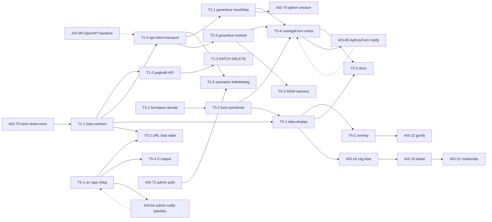

# Admin közös alap — témák szerinti Jira bontás, meglévő ticketek újrahasznosításával

**Dátum:** 2026-10-30 13:40 (Europe/Budapest)
**Státusz:** jóváhagyásra vár
**Előzmény:** [`2026-10-30--13-26-00-admin-foundation-jira-ticket-breakdown-plan.md`](2026-10-30--13-26-00-admin-foundation-jira-ticket-breakdown-plan.md:1) — **ezt a dokumentumot váltja fel** (az ott javasolt S1-16 önálló ticket megszűnik, beolvad az AIS-85-be; a Toast/LogDrawer/notification ticketek nem jönnek létre, mert már léteznek).
**Alap-terv:** [`2026-10-30--13-06-00-admin-unified-data-flow-and-ui-foundation-plan.md`](2026-10-30--13-06-00-admin-unified-data-flow-and-ui-foundation-plan.md:1)

---

## 1. Alapelv

1. **Semmi nem duplikálódik.** Ami már le van írva egy ticketben, azt nem hozom létre újra — csak függőséget vagy kiegészítést kap.
2. **Téma szerinti Story.** Minden Story egy önállóan leszállítható téma (adatáramlás, hibakezelés, form, megjelenítés, app-alap, cégadatok).
3. **Meglévő Story-t bővítek, ha van rá.** Az `AIS-87` (API szerződés) és az `AIS-86` (notification) nyitott Story — ezek alá veszem fel az új subtaskokat.
4. **Üres ticketet tartalommal töltök.** Az `AIS-16…AIS-22` cím-only ticketek (nincs leírásuk) — ezek kapják meg a konkrét feladatot, nem hozok új cég-ticketet.

---

## 2. Mit találtam a meglévő, nem implementált ticketekben

| Ticket | Állapot | Mi van már leírva | Mit teszek vele |
|---|---|---|---|
| **AIS-79** | To Do | `packages/notifications` core store (observer, ring buffer 500, dedupe 2 s, redaction, store factory) — teljes hatókörrel | **nem érintem**, ez a hibakezelés-téma alapja |
| **AIS-80** | To Do | sessionStorage perzisztencia (cap 200, verziózott envelope, injektált `StorageLike`) | nem érintem |
| **AIS-81** | To Do | `Toast` + `ToastStack` primitívek CVA-val, a11y, max 3 látható | nem érintem — **ezért nem hozok létre Toast ticketet** |
| **AIS-82** | To Do | `LogDrawer` + `LogEntryRow` (oldalszéli fül, szűrők, lapozás) | nem érintem |
| **AIS-83** | To Do | React bindings, `useSyncExternalStore` hookok, `notify` facade, `NotificationHost` + timerek | nem érintem |
| **AIS-84** | To Do | Admin bekötés: `QueryCache`/`MutationCache` callbackek, **`HttpEvent` + `onEvent` a `http-client.interface.ts`-ben**, runtime hibafigyelők, `apps/admin/src/app/notifications/*` | **kiegészítem**: függőség a `src/app/` rétegre (T5-1) + egyeztetés a transport-ticketel (T1-4) |
| **AIS-85** | To Do | `ApiKeyForm` átállítás `notify`-ra + `UI-Architecture.md` + history + milestone + acceptance checklist | **kiegészítem**: az űrlap a közös `FormField`/`useAppForm` mintára áll át, a mezőhiba a generikus leképezésből jön — így nincs külön „api-keys retrofit” ticket |
| **AIS-71** | To Do | `@Audience()` dekorátor + fail-closed `AudienceGuard` | nem érintem |
| **AIS-72** | To Do | `/api/api-keys` → `/api/admin/api-keys` (kliens const + e2e + docs) | **koordináció**: ugyanazt a `packages/api-client` path-constot írja, mint a T1-4/T1-5 |
| **AIS-73** | To Do | `platform.admin_users`, httpOnly cookie session, `AdminSessionGuard` + `RolesGuard` | nem érintem |
| **AIS-74** | To Do | Admin SPA cookie session; **`features/auth/*` hookok + `auth.logic.ts` hiba→mezőhiba mapping**, LoginPage RHF űrlap, `session-token.ts` törlés | **koordináció**: a generikus mezőhiba-leképezés (T2-1) előbb készüljön el, az AIS-74 arra építsen; a session store a T5-1-ben jön létre |
| **AIS-75** | To Do | API-kulcs hash + show-once; **`apiKeySchema` read alak változik + új `createdApiKeySchema`** | **koordináció**: ugyanazokat a sémafájlokat írja, mint a T1-1 (lista contract) — sorrend kötelező |
| **AIS-76** | To Do | Public API namespace + `X-API-Key` guard + rate limit + `createPublicClient` | nem érintem |
| **AIS-99** | To Do | OpenAPI baseline + `openapi:generate`/`openapi:check` CI kapu | **előrehozandó** — a T1 típusgenerálás alapja |
| **AIS-100** | To Do | `docs/Specs/API-Convention.md` élő konvenció + history + milestone | **nem vonom össze**: ez az API oldal doksija; a T5-5 a UI/form oldalé |
| **AIS-101** | To Do | Commit-cím konvenció a `.roo/rules/instructions.md`-ben | nem érintem |
| **AIS-14 / AIS-16 / AIS-17 / AIS-18 / AIS-19 / AIS-20 / AIS-21 / AIS-22** | To Do | **nincs leírás** (csak cím) | **ezek kapják meg a tartalmat** (§5) |

Következmény: a korábbi bontás 18 új subtaskja **13-ra csökken**, és 8 üres ticket tartalommal telik meg.

---

## 3. Az új struktúra — 3 új Story + 2 meglévő Story bővítése

| Téma | Story | Státusz | Új subtask |
|---|---|---|---|
| **T1 Adatáramlás és API szerződés** | **AIS-87** (meglévő) | In Progress | 5 |
| **T2 Hibakezelés és értesítés** | **AIS-86** (meglévő) | In Progress | 1 (+ AIS-79…85 meglévő) |
| **T3 Form és validáció** | **új Story** | — | 4 |
| **T4 Megjelenítés (UI kit)** | **új Story** | — | 2 |
| **T5 Admin alkalmazás-alap és minőségkapu** | **új Story** | — | 4 |
| **T6 Cégadatok** | **AIS-14 / AIS-15** (meglévő, üres) | To Do | 0 új (7 üres ticket feltöltése) |

---

## 4. Témák részletesen

### T1 — Adatáramlás és API szerződés (parent: **AIS-87**)

Miért ide: az AIS-87 már az „egységes API szerződés + boríték” Story, a DoD-ja pedig a teljes láncra (séma → szerver → kliens) szól. A lista/detail CRUD hiány az ő hiánya.

#### T1-1 — `Közös lista- és paginációs szerződés (ApiResult, listQuerySchema, paginatedSchema)`
**Labels:** `shared`, `contract`, `architecture` · **Priority:** Highest · **Dependencies:** AIS-75 (ugyanazt a sémát írja)

- `listQuery.schema.ts`: `page` (min 1, default 1), `limit` (1..100, default 20), `sort` (allow-list), `order` (`asc|desc`), `q` (max 200, trim) + `mergeListQuery()` resource-szűrőkhöz.
- `paginated.schema.ts`: `paginatedSchema(itemSchema)` — a tömb + `meta.pagination` egy típusban.
- `api-result.interface.ts`: `ApiResult<T> = { data: T; meta: ResponseMeta }`.
- Az `apiKeyListSchema` átállítása `paginatedSchema(apiKeySchema)`-re (breaking — egy kiadásban a T1-4-gyel és AIS-85-tel).

**DoD:** a registry-teszt zöld; a `meta.pagination` típusosan elérhető kliens oldalon; üres lista `data: []` + `total: 0` szerződés-teszt; a query séma elutasítja a `limit > 100`-at.

#### T1-2 — `apps/api: generikus paginált lista (ZodQueryPipe + repo limit/offset/count + meta.pagination)`
**Labels:** `api`, `backend`, `contract` · **Priority:** Highest · **Dependencies:** T1-1

- `@Query(new ZodQueryPipe(listQuerySchema))` használati minta + `ListQuery` típus a service-nek.
- Repository: `limit/offset` + `count()`, determinisztikus `orderBy` (default `createdAt desc, id`).
- `ApiResponseService.ok(data, ctx, pagination)` kiterjesztése.
- `api-keys` lista retrofittálva (a „minden sor” viselkedés megszűnik).

**DoD:** e2e `?page=2&limit=10&sort=name&order=asc&q=abc` → helyes szelet + `meta.pagination`; üres találat `200` + `[]`; érvénytelen `limit` → `400` + `details[].path = "limit"`.

#### T1-3 — `apps/api: update/delete konvenció (PATCH, DELETE, stale write 409, 422 szemantikus kód)`
**Labels:** `api`, `backend`, `contract` · **Priority:** High · **Dependencies:** T1-2

- `PATCH /api/<resource>/:id` részleges frissítés `.strict()` sémával; `DELETE /api/<resource>/:id`.
- Optimistic concurrency: `updatedAt` (vagy `If-Match`) → eltéréskor `409 STALE_WRITE`.
- Új kódok: `STALE_WRITE` (409), `SEMANTIC_VALIDATION_FAILED` (422) a katalógusban.
- Soft delete döntés dokumentálva (a törölt sor `404`).

**DoD:** e2e mind a négy ágra (siker, stale, szemantikus hiba, 404); az `API_ERROR_CODE` és az `API-Convention.md` kód-táblája együtt frissül.

#### T1-4 — `packages/api-client: teljes transport (PUT/PATCH/DELETE), query builder, ApiResult, típusos body`
**Labels:** `api-client`, `contract`, `frontend` · **Priority:** Highest · **Dependencies:** T1-1 · **Koordináció:** AIS-84 (`HttpEvent`/`onEvent` ugyanebben a fájlban), AIS-72 (path const)

- `HttpClient`: `put`, `patch`, `delete`, `getList` (az `ApiResult`-ot adja).
- `toQueryString(filters)` — tömb/`undefined`/üres string kihagyva, URL-kódolás.
- A body típusa a registry `requestSchema`-jéből (ne `unknown`).
- `unwrapEnvelope` bővítése `{ data, meta }` visszaadásra, a részlet-végpontok `data`-only viselkedése marad.

**DoD:** transport-teszt minden metódusra, query-kódolásra, `meta`-ra és hibaágra; nincs `fetch` a csomagon kívül; az `onEvent` (AIS-84) opcionális marad és a meglévő tesztek változatlanul zöldek.

#### T1-5 — `packages/api-client: operation-lefedettség (findByIdentifier) + új resource sablon`
**Labels:** `api-client`, `contract`, `tooling` · **Priority:** High · **Dependencies:** T1-4, AIS-72

- `apiKeys.findByIdentifier` bekötése (a registry-ben már van, a kliensben nincs).
- Teszt: minden registry `operationId`-hoz létezik service-metódus.
- Sablon dokumentálva az új resource-hoz (service + interfész + const, `clientPathOf`).

**DoD:** lefedettség-teszt piros hiányzó operation esetén; 200 + 404 ág tesztelt.

---

### T2 — Hibakezelés és értesítés (parent: **AIS-86**)

Miért ide: az AIS-86 Story a frontend notification + log rendszer, az AIS-95/96 pedig már leszállította a 4 hibaszintet. Ami hiányzik, az egyetlen ticket: a **generikus** mezőhiba-leképezés.

#### T2-1 — `admin: generikus mezőhiba-leképezés (toFieldErrors mezőlistával) + a feature-ök átállítása`
**Labels:** `admin`, `contract`, `frontend` · **Priority:** Highest · **Dependencies:** T1-4 (issues a transportból) · **Hatás:** AIS-74, AIS-85 erre épül

- `apps/admin/src/lib/field-errors.logic.ts`: `toFieldErrors(error, fieldPaths)` — kód-kapu, `issues[].path` → mező, default path kód szerint, első nyertes, kliens-owned üzenet.
- A mostani feature-specifikus [`api-keys.logic.ts:109`](../../apps/admin/src/features/api-keys/api-keys.logic.ts:109) logika áthelyezése és általánosítása; a feature csak a mezőlistát adja át.
- A `toErrorSurface` (`apps/admin/src/lib/error-surface.logic.ts:75`) változatlan döntési sorrendje mellé a mezőhiba-leképezés kerül — egy helyen dől el minden.

**DoD:** tesztek a kód-kapura, ismeretlen path-ra, default path-ra, duplikált path-ra, nem-`ApiError`-ra; nincs komponens, amely `status`-t vagy `code`-ot vizsgál.

---

### T3 — Form és validáció (**új Story**)

**Story:** `Admin: közös formkezelés és adatellenőrzés (validációs sémák, form primitívek, form-minta)`
**Story DoD:** egy új űrlap megírásához nem kell új validációs logika, új mező-primitív vagy saját hibakezelés — a fejlesztő a shared sémát és a `useAppForm` mintát használja.

#### T3-1 — `shared/contract: közös formátum-sémák + magyar zod üzenetek`
**Labels:** `shared`, `contract`, `validation` · **Priority:** Highest
- `common/` mappa: `email`, `phone` (E.164, `libphonenumber-js`), `huTaxNumber` (8+1+2 + ellenőrző összeg), `huPostalCode`, `iban`, `dateOnly`, `url`, `trimmedString`, `identifier`.
- Egy `errorMap` + `zod-i18n-map` (vagy saját) → magyar mezőüzenet a UI-ban.
- Fixture-ök a tesztekhez; a séma a szerver pipe-ban, a kliens parse-ban és a RHF resolverben **ugyanaz az objektum**.

**DoD:** minden séma tesztelve (érvényes/határ/érvénytelen/üres); magyar üzenet egy helyen; `pnpm --filter @callback/shared test` zöld.

#### T3-2 — `packages/ui: form primitívek (FormField, FormActions, Select, Checkbox, Switch, RadioGroup, Combobox, DatePicker)`
**Labels:** `ui`, `frontend`, `forms` · **Priority:** Highest
- `FormField` (label + hint + error + `aria-describedby`/`aria-invalid` egy helyen), `FormActions`, `FormSection`.
- Új mezők: `Select`, `Checkbox`, `Switch`, `RadioGroup`, `Combobox`, `DatePicker`, `NumberInput`.
- Mind CVA + token, ref-forward (RHF), explicit export.

**DoD:** RTL + `vitest-axe` teszt minden variánsra; a meglévő `Input`/`Textarea` a `FormField`-re épül; nincs szín-literal.

#### T3-3 — `admin: generikus hook réteg (useApiList, useApiDetail, useApiMutation)`
**Labels:** `admin`, `frontend` · **Priority:** Highest · **Dependencies:** T1-4, AIS-84
- Egységes visszatérés: `{ data, isLoading, isFetching, error, errorMessage, errorSurface, refetch }`; mutation: `{ isPending, error, mutateAsync, reset }` + `meta.successMessage` támogatás (az AIS-84 notifikációjához).
- Query key factory konvenció (`*.const.ts`), invalidálás egy helyen.

**DoD:** hook-teszt MSW-vel (loading/success/empty/error); a mutáció `meta` jelölője együttműködik a globális notify capture-rel.

#### T3-4 — `admin: közös form-minta (useAppForm + submit/mezőhiba/toast egy helyen)`
**Labels:** `admin`, `frontend`, `forms` · **Priority:** High · **Dependencies:** T2-1, T3-2, T3-3
- `useAppForm({ schema, defaultValues, fieldPaths })` — RHF + `zodResolver` + `toFieldErrors` + `notify` egybefogva.
- Submit-konvenció: pending → gomb disabled, siker → `reset` + toast, hiba → mezőhiba/oldalszint.
- Első fogyasztó: az `ApiKeyForm` (ez az **AIS-85-tel együtt** megy, nem külön ticket).

**DoD:** az `ApiKeyForm` a mintát használja; nincs `pageError` state a formokban; a minta dokumentálva a T5-5 specben.

---

### T4 — Megjelenítés / UI kit (**új Story**)

**Story:** `Admin: egységes megjelenítés (táblázat, lapozás, állapotok, overlay-ek)`
**Story DoD:** minden lista/detail/űrlap-oldal a közös primitívekből épül; nincs inline táblázat- vagy dialógus-markup.

#### T4-1 — `packages/ui: data-display primitívek (DataTable, Pagination, EmptyState, Skeleton, Spinner, DescriptionList, StatusBadge)`
**Labels:** `ui`, `frontend` · **Priority:** Highest · **Dependencies:** T3-2, T1-1
- `DataTable` a `@tanstack/react-table` fölött (oszlopdefiníció, `aria-sort`, sor-akciók, üres slot), `Pagination`, `EmptyState`, `Skeleton`, `Spinner`, `DescriptionList`, `StatusBadge`.
- Loading / empty / error / success mindegyikre.

**DoD:** az `api-keys` lista átáll `DataTable` + `Pagination` + URL state mintára (**ez az end-to-end bizonyíték**, nincs külön „retrofit” ticket); RTL teszt minden állapotra.

#### T4-2 — `packages/ui: overlay primitívek (Dialog, ConfirmDialog, Drawer, Tooltip, DropdownMenu) Radix alapon`
**Labels:** `ui`, `frontend`, `a11y` · **Priority:** High
- Radix csak viselkedés (focus trap, Esc, aria), a vizuális réteg token-alapú CVA.
- `ConfirmDialog` a veszélyes műveletekhez (AIS-22 gomb, törlés).

**DoD:** focus trap + Esc + fókusz-visszaállítás teszt; csak a használt Radix csomagok importálva.

---

### T5 — Admin alkalmazás-alap és minőségkapu (**új Story**)

**Story:** `Admin: alkalmazás-alap (src/app réteg, útvonal-registry, lista UI state, teszt harness, CI kapuk, doksik)`
**Story DoD:** `App.tsx` kompozíció csak; új route = egy registry-bejegyzés; a réteg- és token-szabály CI-ben kényszerített.

#### T5-1 — `admin: src/app réteg (providers, router registry, layout, nav, session store, error boundary)`
**Labels:** `admin`, `frontend`, `architecture` · **Priority:** Highest · **Hatás:** **AIS-84 előfeltétele** (az `apps/admin/src/app/notifications/*` már ezt a réteget feltételezi), AIS-74 session store itt jön létre

- `app/providers/` (QueryClient, Notification, Session), `app/router/` (route registry), `app/layout/` (header, szekciók, breadcrumb), komponens-hiba boundary.
- A nav a registry-ből generálódik.

**DoD:** `App.tsx` nem tartalmaz route-markupot; deep link curl-teszt zöld; a session store a meglévő `session-token.ts` fölött (az AIS-74 váltja cookie-ra).

#### T5-2 — `admin: lista UI state URL search params-ban + zustand page-store factory`
**Labels:** `admin`, `frontend` · **Priority:** High · **Dependencies:** T1-1, T5-1
- `useListParams(schema)` — parse/serialize a `listQuerySchema`-val, defaultok kihagyva az URL-ből.
- Zustand page-store factory minta a tranziens UI állapotra; szerver adat soha nem kerül store-ba.

**DoD:** vissza/előre + másolható link ugyanazt a listát adja; érvénytelen param → default; store-teszt minden actionre.

#### T5-3 — `admin: MSW alapú teszt harness + fixture-ök`
**Labels:** `admin`, `testing` · **Priority:** High · **Dependencies:** T1-4, T3-3
- `msw` v2 handlerek (sikeres lista, üres, 400, 409, 500, hálózati hiba), render helper, fixture-ök a shared fixture-ökből.
- A fetch-double eltűnik a tesztfájlokból.

**DoD:** nincs `vi.fn()` fetch-double tesztben; valós hálózat nincs; `pnpm --filter @callback/admin test` zöld.

#### T5-4 — `quality: réteg- és token-kapu a CI-ben (eslint-boundaries, knip, paletta- és mezőhiba-check)`
**Labels:** `ci`, `tooling`, `quality` · **Priority:** High · **Dependencies:** T5-1
- `eslint-plugin-boundaries`: `app → pages → features → entities → services → lib`, page→page és feature→feature tilos.
- `knip` a halott exportokra/dependency-kre.
- A meglévő paletta-check + új mezőhiba-check (nincs `code ===` komponensben) beemelve a CI-be.

**DoD:** negatív fixture bizonyítja, hogy a kapu pirosodik; a szabály a `react.coding-standards.md`-ra mutat.

#### T5-5 — `docs: Admin-Data-Flow + Forms-and-Validation spec + UI-Architecture frissítés`
**Labels:** `documentation`, `ui`, `contract` · **Priority:** Medium · **Koordináció:** AIS-85 (UI-Architecture + milestone), AIS-100 (API-Convention)

- Új `docs/Specs/Admin-Data-Flow.md` (szerződés → transport → hook → mapper → komponens, `ApiResult`, hibaszintek).
- Új `docs/Specs/Forms-and-Validation.md` (shared séma, `FormField`, `useAppForm`, mezőhiba, magyar üzenetek).
- `UI-Architecture.md` primitív- és dependency-táblájának frissítése (a notification sorokkal együtt, AIS-85-tel egyeztetve).
- „Új admin oldal” checklist a doksiban.

**DoD:** a két új spec létezik friss dátummal; az „új oldal” recept végigvihető a cég oldalon; history + milestone a projekt szabályai szerint.

---

### T6 — Cégadatok (parent: **AIS-14** / **AIS-15**, feltöltendő)

Ezek a ticketek **már léteznek, csak üresek**. A tartalmat a T1–T5 adja; itt csak a hivatkozásokat és a DoD-t kell beírni.

| Ticket | Feltöltendő tartalom |
|---|---|
| **AIS-14** (Story, cég adatbázis) | A `companies` séma a shared contractból; a story DoD-ja: a cég CRUD végpontok a T1 konvencióval (paginált lista, `PATCH`, stale write) működnek |
| **AIS-16** (terv: cég adatok) | Mezőkészlet + formátumok a T3-1 sémáival (adószám, telefon, IBAN, postai kód); list/detail/edit sémák; mi kötelező, mi opcionális; mi a `null` vs. hiányzó szabály (API-Convention §4) |
| **AIS-17** (terv: admin oldal lista, részletek) | Képernyőterv a T4-1 primitívekkel (DataTable oszlopok, szűrők, lapozás), detail `DescriptionList`-tel, edit `useAppForm`-mal; mit mutat a lista, mit a detail |
| **AIS-18** (impl: DB táblák) | Drizzle séma + migráció a `platform` mintára (named unique constraint, `updated_at` `$onUpdate`), a shared sémával egyeztetve |
| **AIS-19** (impl: céglista) | Paginált lista URL state-tel, `EmptyState`, loading `Skeleton`, hiba `PageErrorState`; a query a `listQuerySchema`-t használja |
| **AIS-20** (impl: detail megjelenítés) | `DescriptionList` + `StatusBadge`, loading/empty/error/404 ág |
| **AIS-21** (impl: detail módosítás) | `PATCH` + `updatedAt` (stale write → 409 oldalszintű hiba), mezőhiba `details[].path`-ból, siker toast |
| **AIS-22** (impl: email feldolgozás gomb) | `ConfirmDialog` + mutation + toast + log bejegyzés (AIS-84 capture) |

---

## 5. Függőségi gráf

---

## 6. Meglévő ticketek — bemásolható módosítások

| Ticket | Módosítás |
|---|---|
| **AIS-84** | „Előfeltétel: T5-1 (`apps/admin/src/app/` réteg). Az `onEvent` a T1-4 transport-ticket teljes metóduskészletére épül — egy kiadásban kell menniük, hogy a `http-client.interface.ts`-t ne írja két PR.” |
| **AIS-85** | „Az űrlap a T3-4 `useAppForm` mintára és a T3-2 `FormField` primitívre áll át; a mezőhiba a T2-1 generikus leképezésből jön. Külön api-keys retrofit ticket nincs, ez a ticket az end-to-end bizonyíték (paginált lista a T4-1-gyel).” |
| **AIS-74** | „A `features/auth/auth.logic.ts` mezőhiba-mappingje a T2-1 `toFieldErrors`-re épül (ne legyen második implementáció). A session store helye a T5-1 `src/app/` réteg.” |
| **AIS-72** | „A `packages/api-client` path-konstans és a transport a T1-4/T1-5-tel közös fájl — sorrend: T1-4 → AIS-72 → T1-5.” |
| **AIS-75** | „Az `apiKeySchema` read alakja a T1-1 lista-contracttal közös fájl — sorrend: AIS-75 → T1-1, egy kiadásban.” |
| **AIS-99** | Prioritás `Highest`; ütemezés a T1-4 elé (a típusgenerálás alapja). |
| **AIS-86** | Story description kiegészítés: „a hibakezelés teljes képéhez a T2-1 generikus mezőhiba-leképezés is ide tartozik”. |
| **AIS-87** | Story description kiegészítés: „a lista/pagináció és az update/delete konvenció (T1-1…T1-5) ennek a Story-nak a folytatása”. |
| **AIS-14 / 15 / 16 / 17 / 18 / 19 / 20 / 21 / 22** | Leírás feltöltése a §4 T6 táblázata szerint. |

---

## 7. Amit NEM hozok létre (és miért)

| Felmerült | Miért nem |
|---|---|
| Toast / ToastStack primitív | **AIS-81** már pontosan ezt írja le |
| LogDrawer / LogEntryRow | **AIS-82** |
| Notification store + perzisztencia | **AIS-79 / AIS-80** |
| NotificationHost + provider | **AIS-83** |
| Admin notification bekötés, `HttpEvent` | **AIS-84** |
| ApiKeyForm notify-ra állítás | **AIS-85** |
| Külön „api-keys retrofit” ticket | beolvad **AIS-85**-be + T4-1 DoD-jába |
| Külön „hibakezelés szintek” ticket | **AIS-95 / AIS-96** kész; csak a generikus mezőhiba maradt (T2-1) |
| Külön „api-client csomag” ticket | **AIS-57 / AIS-94** kész |
| Külön „UI kit alap” ticket | **AIS-61** kész |
| Külön „OpenAPI baseline” ticket | **AIS-99** |
| Külön „API-Convention doksi” ticket | **AIS-100** |

---

## 8. Létrehozás utáni ellenőrzés

1. `parent = AIS-87` → 5 új subtask; `parent = AIS-86` → 1 új subtask.
2. A 3 új Story (T3, T4, T5) `To Do` állapotban, a subtaskjaikkal.
3. Az `AIS-16…AIS-22` leírása kitöltve, a T-hivatkozásokkal.
4. Az AIS-84/85/74/72/75/99/86/87 kommentje vagy leírása tartalmazza a fenti függőség-mondatokat.
5. Nincs létrehozott ticket olyan feladatra, ami már létező ticketben le van írva (§7).
6. Egyetlen ticket sem `In Progress`, amit nem kezdtünk el.
