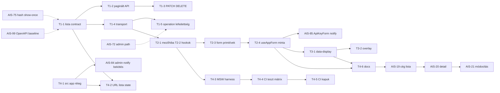

# Review — a témák szerinti Jira bontás ellenőrzése

**Dátum:** 2026-10-30 13:50 (Europe/Budapest)
**Reviewed:** [`2026-10-30--13-40-00-admin-foundation-jira-themes-ticket-plan.md`](2026-10-30--13-40-00-admin-foundation-jira-themes-ticket-plan.md:1)
**Források:** a teljes AIS backlog (AIS-1…AIS-101) a leírásokkal, a `packages/`, `apps/api/`, `apps/admin/` kód, a CI workflow-ok, a `docs/Specs/` élő dokumentumok

---

## 1. Összegző értékelés

| Szempont                     | Értékelés                                                                                              |
| ---------------------------- | ------------------------------------------------------------------------------------------------------ |
| Témák szerinti felbontás     | **jó** — a hat téma valódi, önállóan leszállítható egység                                              |
| Meglévő ticketek felismerése | **részleges** — a notification és auth sorok jól felismertek, de a legfontosabb Story-konfliktusok nem |
| Parent-story választás       | **hibás** — két helyen is konfliktus van a cél-story explicit kizárásával                              |
| Sorrend (függőségek)         | **jól átgondolt**, de 4 helyen javítandó                                                               |
| Kód-alapú ellenőrzés         | **3 valós hiány** fedezhető fel a bontásban, ami korábban kimaradt                                     |
| Összesítve                   | **átstrukturálás szükséges**, a téma-szétválasztás megmarad                                            |

---

## 2. Kritikus hibák (BLOCKER)

### B1 — Az AIS-87 explicit kizárja a lapozást és a CRUD-ot

Az AIS-87 leírásának „Nem része ennek a storynak" szekciója kimondja:

> „Bulk műveletek, idempotency-kulcs, `ETag`/`If-Match`, **lapozás implementálása** — a szerződés helyet ad nekik (D4, `meta.pagination`), a viselkedés **külön story**."

A bontás a T1-1…T1-5 subtaskokat (lista contract, paginált API, `PATCH`/`DELETE`) **az AIS-87 alá** tette. Ez közvetlenül ütközik a Story saját hatókör-kijelentésével: vagy a Story DoD-ja kerül veszélybe (13 subtask mind Done kell legyen, és a lapozás akkor sem része), vagy a hatókör szándékosan ellentmondásossá válik.

**Javítás:** a T1 legyen **új Story**, ne az AIS-87 bővítése. Az AIS-87 csak a „szerződés fenntartása" maradjon, és a lapajegyzet legyen benne, hogy a lapozás a T1-ben van.

### B2 — Az AIS-86 szintén zárja ki a form/hook réteget

Az AIS-86 „Nem része" szekciója az `apps/web`-et, a navigációs logot és a swipe-toastot zárja ki — de a magja explicit módon a **notification store** (core + React bindings + UI primitívek + bekötés). A T2-1 (generikus mezőhiba-leképezés) nem notification-elem, hanem **hibamegjelenítési logika**: az AIS-87 D11 döntése szerint a négy szint _együtt_ egy konvenció, és a mezőszint a legfontosabb (RHF `setError`).

**Javítás:** a T2-1 legyen az **új T3 (Form és validáció) Story** része, ne az AIS-86 alatt. Az AIS-86 marad a notification store story (AIS-79…85), és a DoD-jából kikerül a „form submit pontosan egy toast" állítás — ezt az AIS-85 birtokolja, és az ottani form-minta lesz a referencia.

### B3 — Az AIS-85 és a T4-1 ugyanazt a fájlt írja

Az AIS-85 hatóköre: `apps/admin/src/pages/api-keys/ui/ApiKeyForm.tsx` + `api-keys.const.ts` + `UI-Architecture.md` + history + milestone. A T4-1 DoD-ja szerint az „api-keys lista átáll `DataTable` + `Pagination` + URL state mintára", ami az `ApiKeysPage.tsx` + `ApiKeysTable.tsx` + `features/api-keys/` fájlokat érinti. A T3-4 DoD-ja szerint az `ApiKeyForm` a `useAppForm` mintát használja → ez **pontosan az AIS-85 fájlja**.

Három ticket ugyanazt a fájlt módosítja, és az AIS-85 ráadásul a `UI-Architecture.md`-t is. Konfliktus-kockázat, nem tiszta felelősség.

**Javítás:** legyen **egy** ticket, amely az `ApiKeyForm`-ot átállítja: az AIS-85 bővüljön a `useAppForm`/`FormField` mintával (ez a notification story természetes lezárása), és a T3-4 ne legyen külön ticket — hanem a **T3 Story DoD-jának része** („az `ApiKeyForm` a referencia-implementáció, az AIS-85-tel együtt").

### B4 — A T4-1 „end-to-end bizonyíték" nem bizonyít semmit új

A T4-1 DoD-ja szerint az api-keys lista átállása a „mag end-to-end bizonyítéka". Ez nem igaz: az api-keys lista átállása **nem** bizonyítja a T5-1 `src/app/` réteget, a T3-3 hook réteget vagy a T5-3 MSW harness-t — ezek külön, későbbi fázisok.

**Javítás:** a bizonyíték-szerep legyen a legutolsó fázis terméke. Két lehetőség:

- (a) a T5 Story kap egy záró subtaskot („`api-keys` oldal teljes átállítása az összes alapra"), **vagy**
- (b) a T6 (cégadatok) első ticketje legyen a bizonyíték — de akkor a cégadatok korábbi szabadul fel.

**Javaslat:** (a) — a cégadatok marad a termékoldal, de a mag bizonyítéka nem várja meg a cégadatokat.

---

## 3. Sorrendi hibák

### S1 — A T5-1 (`src/app/`) nem lehet az AIS-84 előfeltétele, mert az AIS-84 maga hozza létre az `app/` alapot

Az AIS-84 hatóköre: `apps/admin/src/app/notifications/notification.store.ts` + `notification-events.logic.ts` + `main.tsx` + `App.tsx`. Vagyis az AIS-84 **az `src/app/` réteget maga alapítja meg** (a notification store ott lakik).

A bontás „T5-1 az AIS-84 előfeltétele" megállapítása tehát **hamis**. Valójában: az AIS-84 létrehozza az `app/` réteg **első szeletét** (a notifications store-ot), és a T5-1 ezt _rendezi_ — a layout/router/nav/session store-t — utólag.

**Javítás:** a T5-1 nem előfeltétele, hanem **utólagos tisztázás** az AIS-84 után, vagy — jobb — a T5-1 kerüljön **előre**, és az AIS-84 csak a `notifications/` alkalmazást hozza létre a már létező rétegben. A tisztább út: **T5-1 előbb**, és az AIS-84 módosítása a megadott útvonalra. Ezt a Jira-konvenció (`AIS-84` már le van írva a régi útvonalakkal) nem bontja meg, csak a leírás frissül.

### S2 — Az AIS-99 nem előfeltétele, hanem párhuzamos

Az AIS-99 (`openapi:generate` + `openapi:check`) a generált spec baseline-ja. A T1-1 (lista contract) módosítja a registryt → ez azonnal elavulttá teszi a baseline-t, tehát **az AIS-99-nek a T1-1 után kell futnia**, nem előtte.

**Javítás:** az AIS-99 legyen a T1-1 **utáni** kapu (a T1 minden szerződés-változtatása után), és ne legyen a T1-4 „előfeltétele". A típusgenerálás (amit az alap-terv javasolt) **sem** az AIS-99-től függ: a `z.infer` típusok már most is adottak, a generált spec csak a dokumentumot szolgáltatja.

### S3 — Az AIS-75 → T1-1 sorrend nem az egyetlen írásható fájl

Az AIS-75 a `packages/shared/src/schemas/api-key.schema.ts`-t írja (a jelenlegi útvonal a `contract/api-keys/api-keys.schema.ts`, tehát a ticket **elavult útvonalat** említ) — ezt tisztázni kell. Mindkét ticket ugyanazt a sémát módosítja → a sorrend valóban fontos, de a megoldás inkább **egy közös változás**, nem két sorozati ticket.

**Javítás:** az AIS-75 és a T1-1 **egy kiadásban** menjen, vagy a T1-1 legyen a nagyobb egység, és az AIS-75 csak a `createdApiKeySchema`-t adja hozzá hozzá.

### S4 — Több ticket ugyanazt a `packages/api-client/src/http-client.interface.ts`-t írja

- T1-4 (transport, `PUT`/`PATCH`/`DELETE`, `ApiResult`)
- AIS-84 (`HttpEvent` + `onEvent` a configban)
- AIS-72 (path const)
- AIS-76 (`createPublicClient`)

Ez négy ticket ugyanazon a fájl körül. Jelenleg nincs konfliktus, mert az AIS-84 még nincs implementálva — de **egyiket sem szabad elkezdeni anélkül, hogy a másik három hatókör-tisztázása megvan**.

**Javítás:** a T1-4 legyen a **transport tulajdonosa**; az AIS-84/72/76 csak a `HttpClient` _interfész_ bővítését kapja meg a T1-4-ben kialakított formában. Rögzítsük ezt a T1-4 leírásában szó szerint.

### S5 — A T3-3 függősége az AIS-84-re nézve túl szoros

A T3-3 (`meta.successMessage` támogatás a mutation hookban) az AIS-84-re épül, de a hook maga nem igényel semmilyen notification-t — a `meta` egy opcionális mező. A T3-3 **elkészülhet** az AIS-84 előtt; csak a `meta.successMessage` _feldolgozása_ kell hozzá.

**Javítás:** a T3-3 függősége legyen AIS-84 csak a `meta.successMessage` részére, a hook magya független.

---

## 4. A kód alapján feltárt, a bontásból hiányzó tételek

### K1 — A CI nem futtatja az admin, shared és api-client teszteket

A [`ci.yml`](../../.github/workflows/ci.yml:76) csak `pnpm --filter @callback/api test`-et futtat a unit jobban. A root `pnpm test` a shared/api-client/ui/admin teszteket is futtatja, de **a CI ezt nem hívja** — csak az api unit + az api e2e fut.

**Kockázat:** az összes admin-oldali teszt (amit a T3–T5 épít) **nem fut a CI-ban**, tehát a „minőségkapu" állítás hamis lenne.

**Javaslat: új subtask** a T5 Story-ben: „CI: a teljes `pnpm test` (shared, api-client, ui, admin) + `pnpm -r lint` a PR-on". Ez a T5-4 előfeltétele.

### K2 — A `ZodQueryPipe` már létezik és tesztelt, de egyetlen controller sem használja

A [`zod.pipe.ts:60`](../../apps/api/src/common/http/zod.pipe.ts:60) definiálja a `ZodQueryPipe`-et, a pipe-spec 4 ágat tesztel, de a `rg "ZodQueryPipe|@Query\("` keresés **egyetlen `@Query(...)` használatot sem talált** az `apps/api/src`-ben.

**Javaslat:** a T1-2 ne „pipet vezessen be", hanem **az meglévő, tesztelt pipe első éles használatát** adja. A ticket leírása pontosítsa: „a `ZodQueryPipe` már létezik (AIS-90), a T1-2 az első controller, ami használja". Előny: kisebb a kockázat, és a DoD-ban a query-validáció bizonyítéka konkrét.

### K3 — A `findAll` nem limitál, és a repository interfész `findAll(): Promise<ApiKeyRow[]>`

A [`api-keys.repository.ts:60`](../../apps/api/src/api-keys/api-keys.repository.ts:60) `select()` + `orderBy` — nincs `limit`. A service [`list()`](../../apps/api/src/api-keys/api-keys.service.ts:46) mindent visszaad.

**Kockázat:** a T1-2-ben a repository interfészt **törni kell** (`findAll` → `findPage(query): { rows, total }`), ami a service-t, a mockot és a 4 repository-specet is érinti. Ez a legnagyobb egységnyi változás a T1-ben, és a bontás nem emeli ki.

**Javaslat:** a T1-2 DoD-jába kerüljön: „a `ApiKeysRepository` interfész breaking módon változik (`findAll` → `findPage`), a service, a mock és minden repository/service/controller spec frissül".

### K4 — A `db:migrate` a `dist/migrate.js`-t futtatja → a `dist` build nélkül elhasal

A [`apps/api/package.json:12`](../../apps/api/package.json:12): `"db:migrate": "node dist/migrate.js"`. A CI e2e jobban a `db:migrate` **a `pnpm --filter @callback/api build` után** fut (a workflow 134–138. sora), tehát ott rendben van. De a **lokális** fejlesztői flow-ban (`pnpm db:migrate` a rooton) a `dist/` hiányzik, ha nem buildeltél.

Ez nem az admin alap témája, de a **cégadatok** (T6, AIS-18) DB-tábláinak migrációja érintett — és a migráció-deploy pipeline (AIS-43…46) külön, nyitott story.

**Javaslat:** a T6/AIS-18 leírásába kerüljön a migrációs előfeltétel: „a `db:migrate` a `dist/migrate.js`-t futtatja → előbb `pnpm --filter @callback/api build`". És az AIS-18 DoD-jába: „a migráció lokálisan és a CI e2e jobban is lefut".

### K5 — Nincs `zustand` a repóban — a T5-2 új dependency-t vezet be

A `rg "zustand|useSearchParams|createStore"` keresés az `apps/admin/src`-ben **nulla találatot** adott. A `UI-Architecture.md` a Zustandot „planned" sorként kezeli (AIS-57 döntés: „added with the first page that needs UI state").

**Javaslat:** a T5-2 ne a Zustandra épüljön elsődlegesen. A lista UI state (szűrő/sort/page) **URL-ben** él → ehhez a React Router `useSearchParams` kell, nem Zustand. A Zustand csak a _tranziens_ UI state-re (nyitott drawer, kijelölt sor) kell, és az opcionális. A ticket legyen: „URL search params (typed) mint elsődleges + Zustand store factory minta opcionális" — így a T5-2 **nem** igényel új dependency-t, csak a page-store factory (S1-9 mintája) készül el, ha kell.

### K6 — A `toErrorMessage` és a `toErrorSurface` kód-kulcs táblája kétszer van

A [`error-message.const.ts:87`](../../apps/admin/src/lib/error-message.const.ts:87) `ERROR_CODE_MESSAGE` kézi térkép, a [`error-surface.const.ts`](../../apps/admin/src/lib/error-surface.const.ts:1) `FIELD_SURFACE_CODES` szintén kézi. A T2-1 ezt „egy helyen dől el minden"-ként írja le, de a ticket nem mondja meg, **melyik fájl lesz a közös forrás**.

**Javaslat:** a T2-1-ben legyen explicit: az `API_ERROR_CODE` katalógus a single source; a kliensoldali táblázatok (`ERROR_CODE_MESSAGE`, `FIELD_SURFACE_CODES`) generált vagy kézi, de **egy** helyen legyen, és a `packages/shared` katalógusából legyen **teszt** (minden kódnak van magyar copy, minden kód vagy elutasított).

### K7 — A `packages/shared` jelenleg nincs benne a CI unit tesztben → a shared séma-teszt zöld sem bizonyít

A [`ci.yml`](../../.github/workflows/ci.yml:76) csak az api unit teszteket futtatja. A shared csomag jest-tesztjei (`packages/shared/test/*.test.ts`) **lokálisan** futnak, CI-ban nem.

**Ez a legnagyobb egyszerű győzelem a teljes listán:** egyetlen sor a CI-ba (`pnpm --filter @callback/shared test && pnpm --filter @callback/api-client test && pnpm --filter @callback/ui test && pnpm --filter @callback/admin test`), és az összes admin-oldali regresszió futni kezd.

---

## 5. A bontás hibái a kód alapján (a ticket-leírások pontosítása)

| Hely | A bontás állítása                                                                        | A kód valósága                                                                                                                                                           | Javítás                                                                                                                                                                       |
| ---- | ---------------------------------------------------------------------------------------- | ------------------------------------------------------------------------------------------------------------------------------------------------------------------------ | ----------------------------------------------------------------------------------------------------------------------------------------------------------------------------- |
| T1-1 | „`apiKeyListSchema` átállítása `paginatedSchema(apiKeySchema)`-re"                       | A `successEnvelopeSchema` **már** tartalmazza a `meta.pagination`-t; a `data` tömb marad tömb. Tehát **nincs breaking** a sémán, csak a `meta.pagination` kitöltése kell | A DoD pontosítsa: „a `data` tömb **marad** tömb; a `meta.pagination` a válaszban jelenik meg; a `paginatedSchema` a **kliensoldali** típust adja"                             |
| T1-2 | „`ApiResponseService.ok(data, ctx, pagination)`"                                         | A `toSuccessEnvelope` a `meta`-t paraméterként kapja → a service-t nem kell bővíteni, csak a `pagination`-t átadni                                                       | A DoD: „a controller a `ctx`-hez pagination-t ad; a `ApiResponseService` változatlan"                                                                                         |
| T3-1 | „a séma a szerver pipe-ban, a kliens parse-ban és a RHF resolverben ugyanaz az objektum" | A meglévő `createApiKeySchema` a **request** séma; a form a `apiKeyFormSchema`-t használja, ami **külön** példány (`pages/api-keys/api-keys.logic.ts`)                   | Pontosítás: „a form-séma a shared request-sémából **származik** (`createApiKeySchema.pick/omit/extend`), nem újrafogalmazott másolat"                                         |
| T3-2 | „a meglévő `Input`/`Textarea` a `FormField`-re épül"                                     | Az `Input`/`Textarea` ma **önálló** komponens label+error props-szal                                                                                                     | A ticket legyen: „a `FormField` **visszafelé kompatibilis** wrapper: a régi `Input`/`Textarea` használata működik, de új oldalon a `FormField` kötelező" — így nincs breaking |
| T4-1 | „`DataTable` a `@tanstack/react-table` fölött"                                           | A csomag nincs telepítve; a meglévő `Table` natív (`TableHead`/`TableRow`)                                                                                               | A ticket döntse el: vagy a meglévő `Table` bővül (`sortable`, `sticky`, `rowActions`), vagy új `@tanstack/react-table`. **Két tábla implementáció nem maradjon**              |
| T5-1 | „session store a meglévő `session-token.ts` fölött"                                      | Az AIS-74 **törli** a `session-token.ts`-t és a teljes `AuthContext`-et                                                                                                  | A T5-1 ne építsen session store-t: **az AIS-74 hozza létre**, a T5-1 csak a helyét nevezi meg                                                                                 |

---

## 6. Javított bontás (a review után)

| #      | Téma                                          | Story                             | Új subtask           | Változás a review után                                              |
| ------ | --------------------------------------------- | --------------------------------- | -------------------- | ------------------------------------------------------------------- |
| **T1** | Adatáramlás és API szerződés                  | **új Story** (nem az AIS-87)      | 5                    | AIS-87-ből kivéve; + K3 repo-breaking, K2 pipe-megjegyzés           |
| **T2** | Form és validáció                             | **új Story**                      | 4 + 1                | a T2-1 (mezőhiba) ide kerül az AIS-86-ból; T3/T4 összevonva         |
| **T3** | Megjelenítés (UI kit)                         | **új Story**                      | 2                    | + a `Table` vs `@tanstack/react-table` döntés                       |
| **T4** | Admin alkalmazás-alap és minőségkapu          | **új Story**                      | 5                    | + K1 CI-teszt-futtatás, + T5-1 nem épít session store-t             |
| **T5** | Notification és élő log                       | **AIS-86** (meglévő, változatlan) | 0 (AIS-79…85)        | az AIS-85 bővül a `useAppForm` mintával                             |
| **T6** | Cégadatok                                     | **AIS-14 / AIS-15**               | 0 (8 üres feltöltve) | + K4 migrációs előfeltétel                                          |
| **T0** | Gyors győzelmek (külön Story vagy a T4 része) | —                                 | 3                    | K1 (CI tesztek), K5 (Zustand opcionális), K6 (kód-táblázat egysége) |

**Összesen: 4 új Story + 16 új subtask**, a korábbi 13 helyett — a különbség a K1 és a Story-újrakalibrálás.

### Újonnan felvett subtaskok (a review során találtak)

| ID        | Tartalom                                                                                                    | Miért                                           |
| --------- | ----------------------------------------------------------------------------------------------------------- | ----------------------------------------------- |
| **T4-0**  | `CI: a teljes teszt-mátrix futtatása (shared, api-client, ui, admin) a PR-on`                               | K1/K7 — ma ezek a tesztek **nem futnak** CI-ban |
| **T4-1**  | `admin: hibakód-táblázatok egysége (ERROR_CODE_MESSAGE + FIELD_SURFACE_CODES a shared katalógusból, teszt)` | K6                                              |
| **T1-2a** | (a T1-2 DoD bővítése) `Az ApiKeysRepository interfész breaking: findAll → findPage`                         | K3                                              |
| **T4-3**  | `admin: session store csak az AIS-74-ben` (a T4 leírás pontosítása, nem új ticket)                          | a bontás 5. sor                                 |

---

## 7. Végleges függőségi sorrend

**Kritikus útvonal:** T1-1 → T1-4 → T2-1 → T2-3 → T2-4 → AIS-85 (a form-minta), illetve T4-1 → AIS-84 (a notification bekötés). A T1 és a T2/T3/T4 **párhuzamosítható**, mert a T1 a szerződés, a többi a kliens oldal.

---

## 8. Ajánlott javítási műveletek a bontás dokumentumon

1. A §3 táblázat T1/T2 sorai: „AIS-87" / „AIS-86" → **„új Story"**, és a §2 táblázatból a „kiegészítem" oszlop átírása.
2. A §4 T1-1 és T1-2 DoD pontosítása a kód alapján (K2, K3, §5).
3. A §4 T2-1 → az új T2 Story-ba, az AIS-86-ból kivéve.
4. A §4 T3-4 törlése (a T2-4-be olvad, az AIS-85-tel együtt).
5. A §4 T4-1-ből a „bizonyíték" megfogalmazás kikerül → helyette a T4 záró subtaskja (vagy a T6 első ticketje) a bizonyíték.
6. A §4 T5-1-ből a „session store" kikerül (az AIS-74-é).
7. A §4 T5-2-ből a Zustand-kötelezettség kikerül → URL-first, Zustand opcionális.
8. A §5 függőségi gráf újrajzolása a §7 szerint.
9. Új subtask: **T4-0 CI teszt-mátrix** (a legkisebb ráfordítású, legnagyobb hasznú változás).
10. A §7 „amit NEM hozok létre" táblázat kiegészítése: `ZodQueryPipe` (meglévő), `ApiResponseService` (nem kell bővíteni), `session store` (az AIS-74-é).

---

## 9. Összegző döntési javaslat

A bontás **témái jók, a parent-story választás rossz**. Két Story-t (AIS-87, AIS-86) bővítettem volna oda, ahol a saját leírásuk ezt kifejezetten tiltja. A helyes lépés:

- **4 új Story** (T1 adatáramlás, T2 form+validáció, T3 megjelenítés, T4 app-alap+minőség) — mindegyik önállóan leszállítható;
- **AIS-86 és AIS-87 változatlan** (a notification és a boríték story lezárható a saját scope-jában);
- **16 új subtask**, a review során talált **7 kód-alapú hiánnyal** (K1–K7) kiegészítve;
- a **CI teszt-mátrix** (K1/K7) külön, azonnal megcsinálható subtask — ma az admin összes tesztje halott kód a CI szempontjából.
