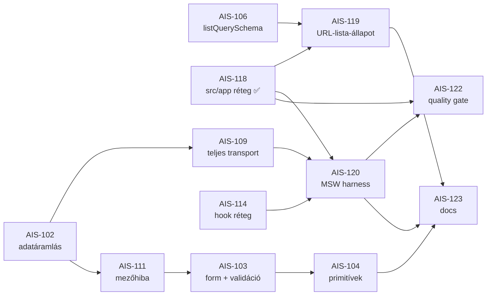

# AIS-105 — az admin alkalmazás-alap és minőségkapu: subtask-összefoglaló

**Dátum:** 2026-10-30 18:30 (Europe/Budapest)
**Ticket:** AIS-105 (Story, Highest) — „Admin alkalmazás-alap és minőségkapu: `src/app` réteg, URL-alapú lista-állapot, MSW harness, CI teszt-mátrix és réteg-kapuk"
**Státusz:** **In Progress** — 2 subtask kész és lezárva (AIS-118, AIS-121), 4 hátra
**Alap-terv:** [`2026-10-30--13-06-00-admin-unified-data-flow-and-ui-foundation-plan.md`](2026-10-30--13-06-00-admin-unified-data-flow-and-ui-foundation-plan.md:1)
**Bontás + review:** [`…13-40-00…themes-ticket-plan.md`](2026-10-30--13-40-00-admin-foundation-jira-themes-ticket-plan.md:1) · [`…13-50-00…themes-review-plan.md`](2026-10-30--13-50-00-admin-foundation-jira-themes-review-plan.md:1)

---

## 1. Mi ez a story

Az admin SPA közös alapja: az alkalmazáshéj (a `src/app/` réteg), a lista-állapot kezelése, a
teszt-infrastruktúra és a minőségkapuk. **Nincs termékfunkció** — az a cél, hogy a következő
admin-oldal (a cégadatok, AIS-14/15) már a közös alapra épüljön, ne mindent újra.

A story **6 subtaskból** áll. Az alábbi táblázat a lényeget foglalja össze; a részletek a Jira
leírásban vannak.

---

## 2. A subtask-ok lényege

| Ticket      | Prioritás | Státusz     | Egy mondatban                                                                            |
| ----------- | --------- | ----------- | ---------------------------------------------------------------------------------------- |
| **AIS-118** | Highest   | ✅ **Done** | Az `src/app/` réteg: route registry, layout, provider-lánc, session hely, error boundary |
| **AIS-119** | High      | ⬜ To Do    | A lista szűrője/rendezése/oldalja **az URL-ben** él (`useListParams`)                    |
| **AIS-120** | High      | ⬜ To Do    | **MSW** teszt harness — a service-határ a mock pont, nem a `fetch`                       |
| **AIS-121** | Highest   | ✅ **Done** | A CI a **teljes** unit-mátrixot futtatja a PR-on (nem csak az API unitot)                |
| **AIS-122** | High      | ⬜ To Do    | Minőségkapuk: réteg-lint, knip, paletta- és mezőhiba-check a CI-ben                      |
| **AIS-123** | Medium    | ⬜ To Do    | Két új élő spec + az „új admin oldal" checklist                                          |

### AIS-118 — `src/app/` réteg ✅ Done

A route-ok mostantól **egyetlen** helyen élnek (a route registry), és **ebből** származik a
`<Routes>` markup **és** a navigáció is. Új oldal = **egy** registry-bejegyzés.

**Mért eredmény:** az `App.tsx` **68 → 35 sor**, a route-definíciók **két listáról egyre** váltak,
az admin suite **14 → 20 fájl / 145 → 173 teszt**, **új npm dependency: 0**.

**Commit:** `5e70c39` · **Terv:** [`…17-25-00-ais-118-admin-app-layer-plan.md`](2026-10-30--17-25-00-ais-118-admin-app-layer-plan.md:1)

### AIS-119 — URL-alapú lista-állapot ⬜ To Do

A szűrő, a rendezés és az oldal a URL-ben él, hogy a link másolható legyen, a vissza/előre gomb
működjön, és a böngésző előre-hátra navigálása ne veszítse el a szűrést.

- `useListParams(schema)` → `{ params, setParam, resetParams }`
- az érvénytelen paraméter **defaultra esik** (nem dob, nem üríti az oldalt)
- a default értékek **nem kerülnek** az URL-be (`?page=1` nem látszik)
- **nem vezet be új dependency-t** — a `zustand` csak akkor kell, ha egy oldal valóban igényli

**Előfeltétel:** AIS-106 (a `listQuerySchema`), AIS-118 (a route registry) — **két Ready subtask**.

### AIS-120 — MSW teszt harness ⬜ To Do

A tesztek a **szolgáltatás-határnál** mockoljanak, ne a `fetch` belsőjénél — így egy hook- vagy
service-változás nem töri a teszteket, és a boríték-kibontás is tesztelve van.

- `msw` v2 a devDependency-k közé; `onUnhandledRequest: 'error'` (nincs valós hálózat)
- közös handlerek: sikeres lista, üres lista, `400 VALIDATION_FAILED`, `409`, `500`, hálózati hiba
- a fixture-ök a `packages/shared`-ből jönnek (egy helyen definiált adat)

**Előfeltétel:** AIS-109 (a transport), AIS-114 (a hook réteg).

### AIS-121 — CI teszt-mátrix ✅ Done

A CI ma csak az API unit teszteket futtatta — a `shared`, `api-client`, `ui` és `admin` suite
**halott kód** volt a CI szempontjából. Mostantól a root `pnpm test` fut (a kanonikus belépési
pont), és a job **Node 24**-en fut.

**A mérés megváltoztatta a ticket D3-ét:** a D3 azt állította, hogy a Node 22 nem akadály — de az
`api` unit suite egyik tesztje (a valódi `ApiKeysModule` DI-graph compile-ja) Node ≥ 24.9-et kér,
és Node 22-n **némán kihagyódott**. Ezért a job Node 24-re emelődött.

**Hátralévő:** a **negatív bizonyíték** (szándékosan elrontott admin-teszttel a CI piros, a
visszaállítás után zöld) — ehhez nyílt PR kell.

**Commit:** `096f6de` · **Terv:** [`…15-15-00-ais-121-ci-full-test-matrix-plan.md`](2026-10-30--15-15-00-ais-121-ci-full-test-matrix-plan.md:1)

### AIS-122 — minőségkapuk ⬜ To Do

A réteg-szabály és a token-szabály **kényszerített** legyen, ne csak dokumentált.

| Kapu          | Eszköz                                            | Szabály                                                                                                       |
| ------------- | ------------------------------------------------- | ------------------------------------------------------------------------------------------------------------- |
| Réteg-lint    | `eslint-plugin-boundaries` / `dependency-cruiser` | `app → pages → features → entities → services → lib`; tilos a page→page és a feature→feature import           |
| Halott kód    | `knip`                                            | a nem használt export/fájl/dependency kiszűrődik                                                              |
| Token/paletta | a meglévő `rg` szabály a CI-be emelve             | nincs hex literal és nincs Tailwind paletta-utility                                                           |
| Hibakezelés   | `rg` szabály                                      | komponensben nincs `error.code ===` vizsgálat — a döntés a `toErrorSurface`/`toFieldErrors` függvényekben van |

**Előfeltétel:** AIS-120, AIS-118 — **mindkettő megvan vagy készül**; a réteg-definíció nem állhat
nem létező réteg fölé.

### AIS-123 — a docs ⬜ To Do

Két új élő spec (`Admin-Data-Flow.md`, `Forms-and-Validation.md`), a `UI-Architecture.md` és az
`API-Convention.md` frissítése, és egy számozott **„új admin oldal" checklist** — hogy a következő
fejlesztő (vagy AI) ne a régi mintát kövesse.

**A legutolsó subtask:** a doksi a **megvalósult** állapotot írja le, tehát minden más után jön.

---

## 3. A függőségi sorrend

**Két megjegyzés a sorrendhez:**

1. **Az AIS-105 önmagában nem járhat végig.** Az AIS-106, AIS-109, AIS-111 és AIS-114 az
   **AIS-102 story** subtaskjai, és mindegyik **To Do**. Az AIS-119 és az AIS-120 ezekre vár.
2. **Az AIS-118 és az AIS-121 függetlenek** mindentől — ezért készülhettek meg elsőként.

---

## 4. A megvalósult állapot (2026-10-30)

| Mérőszám            | Érték                                                             |
| ------------------- | ----------------------------------------------------------------- |
| Teljes unit-mátrix  | **800 teszt / 77 fájl, 0 bukás** (`pnpm test`, Node 24.22.2)      |
| admin suite         | 20 fájl / 173 teszt                                               |
| `App.tsx`           | 35 sor (route markup és nav-lista nélkül)                         |
| `src/app/` réteg    | létezik: `router/`, `layout/`, `providers/`, `session/`, `error/` |
| Új npm dependency   | 0 (a `zustand` sem kellett)                                       |
| `pnpm -r lint`      | 0 error (1 pre-existing warning egy nem érintett fájlban)         |
| `pnpm -r build`     | OK                                                                |
| `pnpm format:check` | tiszta (a `d355100` commit után)                                  |
| `drizzle-kit check` | „Everything's fine"                                               |

### A commitok

| Commit    | Tartalom                                                                                                                                           |
| --------- | -------------------------------------------------------------------------------------------------------------------------------------------------- |
| `56dd93e` | `docs: plan the admin foundation and break it down into Jira tickets` — a 4 terv, amiből a breakdown készült                                       |
| `096f6de` | `AIS-121: ci(ci): run the full unit matrix on the PR`                                                                                              |
| `674cae5` | a negatív bizonyíték PR-je (a szándékos törés + a revert, mergelve)                                                                                |
| `3edcb16` | `docs: record the AIS-121 negative-proof evidence`                                                                                                 |
| `5e70c39` | `AIS-118: feat(admin): add the src/app layer with a single route registry`                                                                         |
| `d355100` | `style: format the whole repo with prettier and add a format:check gate` — a teljes repó formázása + a `.prettierignore` + a `format:check` script |

---

## 5. Amit a megvalósítás során tanultunk (a döntések, amiket nem lehet a ticketből kiolvasni)

### 5.1 A függőségi sorrend megfordult a review után

Az AIS-118 eredeti leírása szerint az AIS-74 (session) és az AIS-84 (notification) **erre épül**.
A 2026-10-30-i review **kommentben megfordította**: mindkettő szerint az AIS-118 **előbb** kell.

**A megoldás: a szerkezet és a viselkedés szétválasztása.** Az AIS-118 létrehozza a session
**helyét** (`useRequireSession`); az AIS-74 írja a **logikát** (cookie session). Így a
`LoginPage.tsx`-t egy ticket írja át, és a cookie-sessionre váltás egy fájl módosítása.

### 5.2 A ticket D3-e téves volt (AIS-121)

A „Node 22 a unit tesztekhez nem akadály" állítás hamis volt: egy DI-regressziós teszt Node ≥ 24.9-et
kér, és Node 22-n néma skipként hagyta zöldnek a CI-t. **A „dokumentált, de nem mért" feltételezés
fogta meg** — a terv nem a ticketre hagyatkozott, hanem megmérte.

### 5.3 A dev proxy már helyes volt

A deep-link DoD pont (`/api-keys` → `200 text/html`) **ma már teljesült** — a Vite proxy a `^/api/`
**regexzt** használja, nem a `/api` prefixet. Az AIS-118 csak egy **registry-tesztet** tett hozzá,
ami tiltja, hogy bármely route `/api/`-vel kezdődjön.

### 5.4 A repó sosem volt formázva

A `format` script létezett, de soha nem futott: **388 fájl** nem felelt meg a `.prettierrc`-nek.
Mivel nincs `.prettierignore`, a `pnpm format` a drizzle generált snapshotokat is átírta volna — ezért
a `d355100` commit **új `.prettierignore`-ot** és egy **`format:check` scriptet** adott hozzá. Ez a
git-hooks quality gate (a `prettier --check` lépés) előfeltétele.

---

## 6. Mi a legközelebbi lépés

**Két út futhat párhuzamosan:**

### Út A — az AIS-102 story (a blokkoló)

Az AIS-106, AIS-109, AIS-111 és AIS-114 **egyetlen** subtaskja sem kész. Ezek nélkül az AIS-119 és
az AIS-120 nem indulhat.

**Javasolt sorrend:** AIS-106 → AIS-109 → AIS-114 (ez adja a `useApiList`-ot és a transportot) →
AIS-111 → AIS-103 (form) → AIS-104 (primitívek).

### Út B — az AIS-105 maradék

1. **AIS-119** — az AIS-106 és az AIS-118 után (mindkettő kész vagy készül).
2. **AIS-120** — az AIS-109 és az AIS-114 után.
3. **AIS-122** — az AIS-120 és az AIS-118 után; a **réteg-lint** végre egy létező réteget tud
   ellenőrizni.
4. **AIS-123** — a legutolsó, mert a doksi a megvalósult állapotot írja le.

**A legkisebb ráfordítású következő lépés:** az **AIS-119** (URL-alapú lista-állapot) — a
route registry már megvan (AIS-118), és a `listQuerySchema` (AIS-106) az AIS-102 story
előfeltétele.

---

## 7. Hivatkozások

- Tervek: [`…13-06-00…unified-data-flow…`](2026-10-30--13-06-00-admin-unified-data-flow-and-ui-foundation-plan.md:1) ·
  [`…13-40-00…themes-ticket…`](2026-10-30--13-40-00-admin-foundation-jira-themes-ticket-plan.md:1) ·
  [`…13-50-00…themes-review…`](2026-10-30--13-50-00-admin-foundation-jira-themes-review-plan.md:1) ·
  [`…15-15-00…ais-121…`](2026-10-30--15-15-00-ais-121-ci-full-test-matrix-plan.md:1) ·
  [`…17-25-00…ais-118…`](2026-10-30--17-25-00-ais-118-admin-app-layer-plan.md:1)
- Élő spec: [`docs/Specs/UI-Architecture.md`](../Specs/UI-Architecture.md:1) (§4.1 az `app/` réteg, §4.2 a route-felvétel)
- Kapcsolódó story-k: AIS-102 (adatáramlás), AIS-103 (form), AIS-104 (megjelenítés), AIS-86 (notification), AIS-70/74 (session), AIS-78 (SonarQube)
