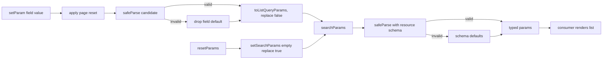

# AIS-119 — typed `useListParams` (URL-owned list state)

**Ticket:** [AIS-119](https://zakzag.atlassian.net/browse/AIS-119) · parent AIS-105 · status: To Do
**Scope confirmed with the user:** **standalone hook only** — no page change, no query-key change, no service change, no zustand.
**Prerequisite handoff:** [`2026-10-31--00-30-00-ais-119-handoff-for-ai.md`](2026-10-31--00-30-00-ais-119-handoff-for-ai.md:1)

## 1. Goal

`useListParams(schema) → { params, setParam, resetParams }`: reads the typed list query
out of the URL and writes changes back, so the link is copyable, back/forward works, and an
invalid parameter silently falls back to its default.

## 2. What already exists (reuse, do not rewrite)

| Piece                          | Where                                                                                                       |
| ------------------------------ | ----------------------------------------------------------------------------------------------------------- |
| `listQuerySchema` / factory    | [`list-query.schema.ts`](../../packages/shared/src/contract/list-query.schema.ts:78)                        |
| `toListQueryParams` (defaults omitted) | [`list-query.helper.ts`](../../packages/shared/src/contract/list-query.helper.ts:83)                |
| Router context for tests       | [`app-router.mock.tsx`](../../apps/admin/src/test/mocks/app-router.mock.tsx:42) (`MemoryRouter`, `initialEntries`) |
| Layer rules                    | [`.roo/rules/react.coding-standards.md`](../../.roo/rules/react.coding-standards.md:1)                      |

`react-router-dom` is `^6.28.0`; `zustand` is **not** installed and stays out (ticket forbids new deps).

## 3. Files to create (`apps/admin/src/features/api/` — new folder)

| File                            | Content                                                                                                 |
| ------------------------------- | ------------------------------------------------------------------------------------------------------- |
| `use-list-params.interface.ts`  | `ListParamsSchema<TQuery>`, `UseListParamsResult<TQuery>` (`params`, `setParam`, `resetParams`)          |
| `use-list-params.const.ts`      | `LIST_PARAMS_PAGE_FIELD = 'page'`, default-query cache key, exported typed literal names only            |
| `use-list-params.logic.ts`      | pure functions: `parseListParams`, `toDefaultParams`, `applyPageReset`, `toListParamsUrlSearchParams`    |
| `use-list-params.ts`            | the hook: `useSearchParams` + memo on `searchParams.toString()` + `setSearchParams`                      |
| `use-list-params.logic.test.ts` | pure-logic tests (no router)                                                                             |
| `use-list-params.test.tsx`      | hook tests through `MemoryRouter`                                                                        |

Test-only addition: a hook wrapper helper (`renderHookWithRouter`) in
[`app-router.mock.tsx`](../../apps/admin/src/test/mocks/app-router.mock.tsx:1) — mocks live in
`test/mocks`, never inside test files.

## 4. Technical decisions

| # | Decision | Reason |
| - | -------- | ------ |
| D1 | Parse with `schema.safeParse(Object.fromEntries(searchParams))`; on failure parse `{}` so the schema's own `default()` wins | DoD: `?limit=999` → 20, `?page=abc` → 1, no throw, no empty page |
| D2 | Defaults derived from the schema (`safeParse({})`), not hardcoded, and passed to `toListQueryParams` | One source of truth; `?page=1` / default `sort` never reach the URL |
| D3 | `setParam<K extends keyof TQuery>(name: K, value: TQuery[K])` writes synchronously via `setSearchParams` with `replace: false` | Back/forward keeps each user change; no extra render where URL and state disagree |
| D4 | Any field other than `page` resets `page` to `1`; `q` included | A changed filter means the first page |
| D5 | An invalid `setParam` value is dropped (that field returns to its schema default) instead of throwing | Same philosophy as the parse fallback |
| D6 | `resetParams()` → `setSearchParams({}, { replace: true })` | Clearing filters must not add a forward-history entry |
| D7 | `params` memoised on `searchParams.toString()` | Stable identity, otherwise a `queryKey` containing it refetches forever |
| D8 | The hook is generic over `z.ZodType<TQuery, ZodTypeDef, unknown>` and takes the schema as a parameter | Works with `listQuerySchema` and each resource's `createListQuerySchema([...])` |
| D9 | Custom error class in `use-list-params.logic.ts` (or reuse an existing one) only for the impossible case where even the defaults fail to parse | No silent swallow of a programming error |
| D10 | No page, no `API_KEYS_QUERY_KEYS`, no service edit | `useApiList` (AIS-114) and the parametrised service (AIS-109) are separate tickets |

## 5. Tests (must all be green)

| Test | Asserts |
| ---- | ------- |
| parse valid URL | `/api-keys?page=3&limit=50&order=asc&q=abc` → `{ page: 3, limit: 50, order: 'asc', q: 'abc' }` |
| parse invalid | `?limit=999` → `limit: 20`; `?page=abc` → `page: 1`; no throw |
| parse empty `q` | `?q=` → `q: undefined` (shared transform) |
| defaults omitted | `setParam('order', 'desc')` leaves the URL without `order`; `page=1` never appears |
| page reset | page 3 then `setParam('q', 'x')` → URL without `page`, `q=x` |
| reset | after `resetParams` the URL has no search params |
| back/forward | remount with a different `initialEntries` → the new values are read |
| invalid setParam | `setParam('limit', 999)` → `limit` default, no throw |
| `sort` support | hook built with `createListQuerySchema(['name','createdAt'], 'createdAt')` keeps a non-default `sort` in the URL and drops the default one |

## 6. Definition of Done — evidence

| DoD item | Proof |
| -------- | ----- |
| URL-owned filter/sort/page | hook tests with `initialEntries` |
| default values not in the URL | assertions on `searchParams.toString()` |
| back/forward yields the same list | remount/re-render test |
| invalid parameter → default, no error, no empty page | parse + `setParam` fallback tests |
| no new npm dependency | `package.json` files unchanged |
| `pnpm --filter @callback/admin test` + `lint` green | command output in the Jira comment |

## 7. Workflow / deliverables

1. Implement the six files above (`prettier --write` on each).
2. `pnpm --filter @callback/admin test` · `lint` · `build` · `pnpm test`.
3. `docs/history/2026-10-31--<hh-mm-ss>-ais-119-list-params.md`.
4. `docs/milestones/2026-10-31--<hh-mm-ss>-ais-119-url-owned-list-state.milestone.md` (English, ≤1 page, the 6 mandatory sections).
5. Update [`docs/Specs/UI-Architecture.md`](../../docs/Specs/UI-Architecture.md:205): §5 note that list state lives in the URL (not in a store) and that `zustand` stays uninstalled; §7 dependency table row unchanged.
6. Commit: `AIS-119: feat(admin): own the list query in the URL with a typed useListParams hook`.
7. Jira: evidence comment, DoD ticked, status **In Review**.

## 8. Out of scope

`useApiList` (AIS-114) · parametrised service (AIS-109) · filter/sort/pager UI (AIS-104 primitives) · any zustand store factory · `packages/shared` changes.
