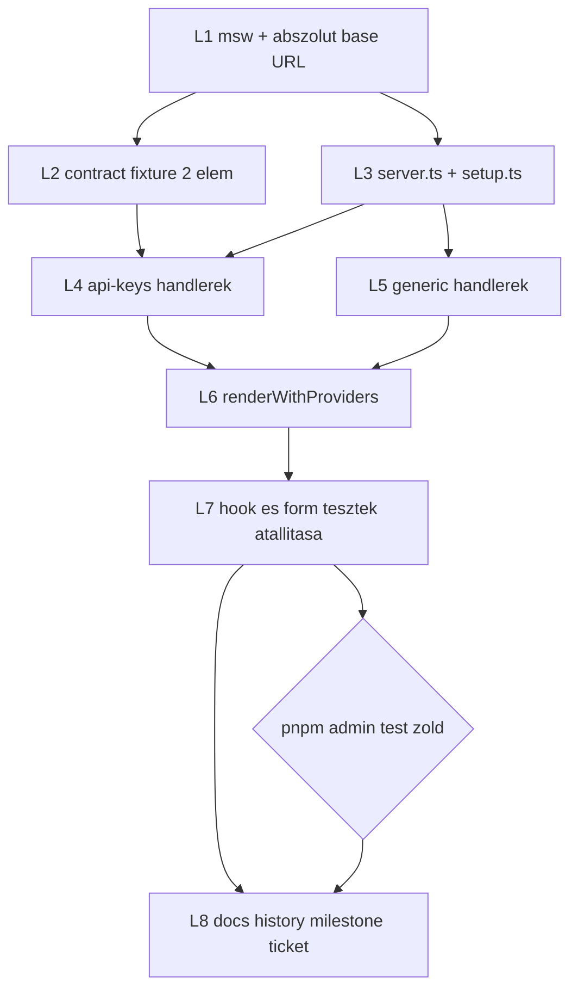
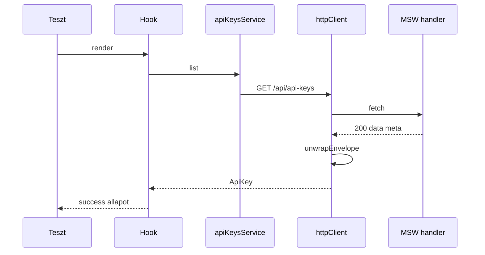

# AIS-120 — MSW alapú teszt harness (implementációs terv)

**Ticket:** [AIS-120](https://zakzag.atlassian.net/browse/AIS-120) — _admin: MSW alapú teszt harness (szolgáltatás-határ mockolása, handlerek, render helper)_
**Szülő:** AIS-105 · **Prioritás:** High · **Státusz most:** To Do
**Előfeltétel:** AIS-109 (transport) **To Do**, AIS-114 (hook réteg) **To Do**

---

## 1. Kiinduló állapot (ellenőrzött tények)

| Tény                                                   | Bizonyíték                                                                                                                                                                         |
| ------------------------------------------------------ | ---------------------------------------------------------------------------------------------------------------------------------------------------------------------------------- |
| `msw` nincs telepítve egyetlen package-ben sem         | repo-szintű keresés: 0 találat                                                                                                                                                     |
| A globális setup nem indít szervert                    | [`setup.ts`](../../apps/admin/src/test/setup.ts:1) — csak jest-dom + `cleanup()` + TZ                                                                                              |
| `handlers/` és `render-with-providers.tsx` nem létezik | `apps/admin/src/test/mocks/` tartalma                                                                                                                                              |
| A hook-tesztek a **service modult** mockolják          | [`use-api-keys.test.tsx`](../../apps/admin/src/features/api-keys/use-api-keys.test.tsx:50), [`ApiKeyForm.test.tsx`](../../apps/admin/src/pages/api-keys/ui/ApiKeyForm.test.tsx:49) |
| A transport relatív URL-t hív                          | [`http-client.ts`](../../packages/api-client/src/http-client.ts:188) → `joinUrl('/api', '/api-keys')` = `/api/api-keys`                                                            |
| Fixture-ök már a contract alatt élnek                  | [`api-keys.fixture.ts`](../../packages/shared/src/contract/api-keys/api-keys.fixture.ts:1) — `VALID_API_KEY`, `VALID_API_KEY_LIST` (1 elem)                                        |
| Vitest config kész, `restoreMocks`/`clearMocks` be     | [`vitest.config.ts`](../../apps/admin/vitest.config.ts:12)                                                                                                                         |

**Következmény:** a mai hook-teszt a `httpClient`-et, a boríték-kibontást ([`envelope.logic.ts`](../../packages/api-client/src/envelope.logic.ts:71)) és az `ApiError`-képzést **teljesen megkerüli** — pont ez az, amit a ticket megszüntet.

---

## 2. Kulcsdöntések

- **D1 — a mock pont a hálózat, nem a service.** A hook a valódi [`apiKeysService`](../../apps/admin/src/services/api-client.ts:48)-t hívja, ami a valódi `httpClient`-et használja; csak a `fetch` van helyettesítve. Így a boríték- és `ApiError`-logika is tesztelődik.
- **D2 — nincs `vi.mock('services/api-client')` hook-tesztben.** A [`api-keys.mock.ts`](../../apps/admin/src/test/mocks/api-keys.mock.ts:1) service-double megszűnik; a fixture-ök helye a `@callback/shared` contract.
- **D3 — nincs valós hálózat.** `setupServer(...)` + `onUnhandledRequest: 'error'`, `afterEach` → `resetHandlers()`.
- **D4 — abszolút bázis-URL a tesztben.** A transport relatív URL-t ad a `fetch`-nek, amit Node/jsdom nem tud feloldani. Ezért a teszt-környezetben `VITE_API_BASE_URL` **abszolút** értéket kap (`http://localhost:3000/api`), a handlerek pedig ehhez az originhoz kötődnek. _Ez az egyetlen valódi technikai kockázat — az 1. lépés empirikusan igazolja._
- **D5 — nincs service-worker.** `setupServer` (Node integráció) → `public/mockServiceWorker.js` nem kell, nincs `msw init`.
- **D6 — a fixture marad egy helyen.** A 2 elemű listához a contract-fixture bővül (additív), nem az adminban lesz második példány.
- **D7 — „retry" = felhasználó által indított `refetch`.** A teszt query client szándékosan `retry: false` ([`query-client.mock.tsx`](../../apps/admin/src/test/mocks/query-client.mock.tsx:17)); automatikus újrapróbálkozást nem tesztelünk.

---

## 3. Lépések

### L1 — `msw` v2 + abszolút teszt bázis-URL (spike)

1. `msw@^2` felvétele az [`apps/admin/package.json`](../../apps/admin/package.json:31) `devDependencies`-be.
2. [`vitest.config.ts`](../../apps/admin/vitest.config.ts:12): `test.env.VITE_API_BASE_URL = 'http://localhost:3000/api'` (fallback, ha a `import.meta.env` nem veszi át: `define: { 'import.meta.env.VITE_API_BASE_URL': JSON.stringify(...) }`).
3. Bizonyíték-teszt: egy eldobható `it` assertálja, hogy a `httpClient` kérése eljut a handlerig (nem `Failed to parse URL`). Ha nem megy, D4-et `define`-ra váltjuk — a lépés addig nem zárható.

**Kimenet:** a harness alapja zölden fut.

### L2 — Contract-fixture bővítése

[`api-keys.fixture.ts`](../../packages/shared/src/contract/api-keys/api-keys.fixture.ts:1): `SECOND_API_KEY` + `VALID_API_KEY_PAIR` (2 elem). Additív, a meglévő `VALID_API_KEY_LIST` (OpenAPI example) érintetlen. Export a [`contract/index.ts`](../../packages/shared/src/contract/index.ts:110) és [`src/index.ts`](../../packages/shared/src/index.ts:115) explicit listáján.

### L3 — szerver + globális setup

- `apps/admin/src/test/mocks/server.ts`: `setupServer(...ALL_HANDLERS)`.
- [`setup.ts`](../../apps/admin/src/test/setup.ts:1): `beforeAll(server.listen({ onUnhandledRequest: 'error' }))`, `afterEach(() => server.resetHandlers())`, `afterAll(server.close())`.

### L4 — `handlers/api-keys.handlers.ts`

Exportált handlerek a `GET /api/api-keys` és `POST /api/api-keys` végpontra (a path a registry-ből: `clientPathOf('apiKeys.list')` → `/api-keys`, base URL-lel `/api/api-keys`):

| Handler                       | Válasz                                           |
| ----------------------------- | ------------------------------------------------ |
| `apiKeysListSuccess`          | 200 + `{ data: VALID_API_KEY_PAIR, meta }`       |
| `apiKeysListEmpty`            | 200 + `{ data: [], meta }`                       |
| `apiKeysListValidationFailed` | 400 `VALIDATION_FAILED` + `issues[]`             |
| `apiKeysListConflict`         | 409 `API_KEY_IDENTIFIER_CONFLICT` + `issues[]`   |
| `apiKeysListServerError`      | 500 `INTERNAL_ERROR`                             |
| `apiKeysListNetworkError`     | `HttpResponse.error()` → `status: null`          |
| `apiKeysListMalformedPayload` | 200, boríték nélküli body → `UNEXPECTED_PAYLOAD` |
| `apiKeysCreateSuccess`        | 201 + létrehozott kulcs                          |

Segéd: `errorEnvelope(code, status, issues)` a `meta.requestId`/`timestamp` és a `details[]` egységes kitöltéséhez — egy helyen, hogy a 9 handler ne írjon 9 féle borítékot. Az envelope konstansok a `@callback/shared`-ből jönnek ([`error-code.const.ts`](../../packages/shared/src/contract/error-code.const.ts:21), [`envelope.schema.ts`](../../packages/shared/src/contract/envelope.schema.ts:28)).

### L5 — `handlers/generic.handlers.ts`

Erőforrás-független sablonok: `anyUrlServerError` (bármely `*/api/*` → 500), `anyUrlNetworkError`, `anyUrlDelayed(ms)` (loading állapot bizonyításához). Új feature ezekkel handlert írás nélkül kap hibás választ.

### L6 — `render-with-providers.tsx`

`QueryClientProvider` (izolált `createTestQueryClient()`), `MemoryRouter` `initialEntries`-vel (a `useListParams` URL-state-hez), notification provider, opcionális `SessionProvider`. Visszaadja a `client`-et és a `user`-t, hogy a hívó assertálhasson.

### L7 — Tesztek átállítása MSW-re

1. [`use-api-keys.test.tsx`](../../apps/admin/src/features/api-keys/use-api-keys.test.tsx:1): `vi.mock` törlése; `server.use(...)` esetek: loading, success (2 elem), success (üres), 500, offline, `refetch` 500 → 200.
2. [`ApiKeyForm.test.tsx`](../../apps/admin/src/pages/api-keys/ui/ApiKeyForm.test.tsx:49): `vi.mock` törlése; 409 → `identifier` mezőhiba (`apiKeysCreateConflict`), 500 → form-szintű hiba, success → invalidálás.
3. Új: `apps/admin/src/features/api-keys/use-api-keys.envelope.test.tsx` — `apiKeysListMalformedPayload` → `ApiError.code === 'UNEXPECTED_PAYLOAD'` (DoD 2. pont, a boríték-kibontás tényleg lefut).
4. Törlés: `test/mocks/api-keys.mock.ts` service-double-je; a `api-error.mock.ts` csak ott marad, ahol még kézi hibát kell injektálni (nem service-határon).

### L8 — Doksi + artefaktok

- [`docs/Specs/UI-Architecture.md`](../../docs/Specs/UI-Architecture.md:1): a teszt-mock stratégiát leíró szakasz frissítése (MSW, `handlers/`, `renderWithProviders`).
- `docs/history/<ts>-ais-120-msw-test-harness.md` — változás-narratíva.
- `docs/milestones/<ts>-ais-120-msw-test-harness.milestone.md` — döntés-szintű összefoglaló (D1–D7).
- Ticket: DoD check, `msw` verzió, commit hash.

---

## 4. Folyamat

A hurok a lényeg: a teszt nem a service-t, hanem a **hálózatot** helyettesíti.

---

## 5. DoD leképezés

| Ticket DoD                                                   | Teljesül                             |
| ------------------------------------------------------------ | ------------------------------------ |
| Hook-teszt: loading / success / üres / 500 / offline / retry | L4 + L7.1                            |
| Service-teszt: hibás payload → `UNEXPECTED_PAYLOAD`          | L4 + L7.3                            |
| Nincs `vi.fn()` fetch-double a tesztfájlokban                | L7 (az `api-keys.mock.ts` megszűnik) |
| Nincs valós hálózat (`onUnhandledRequest: 'error'`)          | L3                                   |
| `pnpm --filter @callback/admin test` zöld                    | L7 vége                              |

---

## 6. Kockázatok

| Kockázat                                                                  | Kezelés                                                                                         |
| ------------------------------------------------------------------------- | ----------------------------------------------------------------------------------------------- |
| Relatív URL miatt a `fetch` URL-parse hibát dob jsdomban                  | L1 spike; `test.env` → `define` fallback                                                        |
| A `import.meta.env` a transform idején még olvasódik                      | L1 bizonyítja, `define` a biztos út                                                             |
| `restoreMocks/clearMocks` levágja a handler-regisztrációt                 | a handlerek konstansok, nem mockok; `resetHandlers` elég                                        |
| Hiányzó `meta` a handlerekben → `UNEXPECTED_PAYLOAD` a „sikeres" tesztben | `errorEnvelope`/`successEnvelope` segédfüggvény kötelező minden válaszra                        |
| AIS-109/AIS-114 még nem kész                                              | L1–L6 és L7.3 független tőlük; L7.1–L7.2 csak a hook-stabilizálás után, ütközés esetén újraírás |

**Sorrend-fenntartás:** ha a hook-réteg (AIS-114) menet közben változik, az L7.1/L7.2 írása tolódik — a harness (L1–L6) akkor is leszállítható és önmagában is értékes.

---

## 7. Scope-on kívül

- `apps/api` oldali teszt-változás, `packages/api-client` saját suite-ja.
- `page-error-state` / `error-surface` tesztek átállítása (nem service-határon mockolnak).
- MSW a `packages/ui`-ban (nincs hálózat).
- AIS-122 quality gate és a CI mátrix — az erre épül, de külön ticket.
