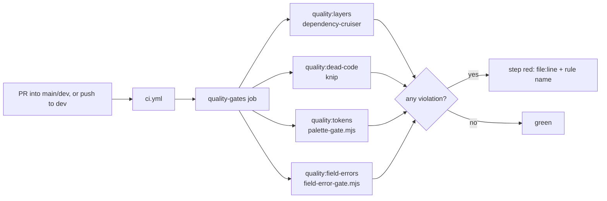

# AIS-122 — Quality gates: layer lint, knip, palette and field-error checks enforced in CI

**Ticket:** [AIS-122](https://zakzag.atlassian.net/browse/AIS-122) — subtask of [AIS-105](https://zakzag.atlassian.net/browse/AIS-105) · High · `ci`, `quality`, `tooling`
**Prerequisites:** AIS-118 (done — `apps/admin/src/app/` exists), AIS-120 (done — MSW harness + test matrix), AIS-121 (done — CI test matrix)
**Touches:** root [`package.json`](../../package.json:1), [`ci.yml`](../../.github/workflows/ci.yml:1), new `.dependency-cruiser*.cjs`, new `knip.json`, new `scripts/quality/**`, [`apps/web/src`](../../apps/web/src/App.tsx:1), [`docs/Specs/UI-Architecture.md`](../Specs/UI-Architecture.md:1)
**Status:** implemented on 2026-11-02 — closed out by [`2026-11-04--18-40-00-ais-122-quality-gates-close-out-plan.md`](2026-11-04--18-40-00-ais-122-quality-gates-close-out-plan.md:1)

---

## 1. Goal

[`react.coding-standards.md`](../../.roo/rules/react.coding-standards.md:1) declares the layer map (§0.6, §1, §2) and the
token rules (§7) as non-negotiable, and [`UI-Architecture.md`](../Specs/UI-Architecture.md:107) restates them — but **no
tooling enforces any of them**. A PR that imports another page's store, that writes `bg-slate-800`, or that branches on
`error.code` in JSX merges green today.

This ticket turns four rules into machine gates:

| Gate         | Tool                   | Rule enforced                                                                                                 |
| ------------ | ---------------------- | ------------------------------------------------------------------------------------------------------------- |
| Layers       | `dependency-cruiser`   | `app → pages → features → entities → services → lib`; no page→page, no feature→feature                        |
| Dead code    | `knip`                 | unused exports / files / dependencies are visible instead of silently rotting                                 |
| Palette      | repo-local Node script | no colour literal, no Tailwind palette utility, no arbitrary colour value in `apps/*/src` + `packages/ui/src` |
| Field errors | repo-local Node script | no `error.status ===` / `error.code ===` / `instanceof ApiError` outside the pure decision functions          |

### Out of scope (deliberately)

- **git hooks** (lefthook pre-commit / pre-push) — separate plan [`2026-10-27--11-41-38-git-hooks-quality-gate-plan.md`](2026-10-27--11-41-38-git-hooks-quality-gate-plan.md:1), no ticket yet.
- **`pnpm typecheck` aggregate** — the git-hooks plan owns it; CI already gets `tsc --noEmit` for both SPAs through `pnpm -r build` (`apps/*/build` = `tsc --noEmit -p tsconfig.json && vite build`).
- **`apps/api` dead-code triage** — see D7.
- Refactoring [`AppErrorBanner.tsx`](../../apps/admin/src/components/error/AppErrorBanner.tsx:1) or moving `auth/` into `app/session` (that is **AIS-74**).
- New UI primitives, e2e, SonarQube wiring.

---

## 2. Measured current state (2026-11-02)

| Area                                   | Today                                                                                                                                                                                                                                                                                                                                                                                                                                                                                                              | Evidence                                                                                                                                                                                                                                                                                        |
| -------------------------------------- | ------------------------------------------------------------------------------------------------------------------------------------------------------------------------------------------------------------------------------------------------------------------------------------------------------------------------------------------------------------------------------------------------------------------------------------------------------------------------------------------------------------------ | ----------------------------------------------------------------------------------------------------------------------------------------------------------------------------------------------------------------------------------------------------------------------------------------------- |
| Layer enforcement                      | **none**                                                                                                                                                                                                                                                                                                                                                                                                                                                                                                           | no `dependency-cruiser`, no `eslint-plugin-boundaries`, no `knip` in any `package.json`                                                                                                                                                                                                         |
| Root scripts                           | `build`, `lint`, `format`, `test`, `test:e2e`, `test:agents`, `test:stack*`, `sonar*` — **no `quality*`, no `typecheck`**                                                                                                                                                                                                                                                                                                                                                                                          | [`package.json`](../../package.json:6)                                                                                                                                                                                                                                                          |
| CI jobs                                | `build-test` (install → build shared → `pnpm -r build` → `pnpm -r lint` → `pnpm test`) and `api-e2e`                                                                                                                                                                                                                                                                                                                                                                                                               | [`ci.yml`](../../.github/workflows/ci.yml:35)                                                                                                                                                                                                                                                   |
| `pnpm -r lint` real coverage           | only `apps/api` (`eslint --fix`), `apps/admin` (`eslint .`) and `apps/web` (**`echo … exit 0`**). `packages/*` have **no `lint` script**, so they are skipped                                                                                                                                                                                                                                                                                                                                                      | [`apps/web/package.json`](../../apps/web/package.json:15), [`packages/ui/package.json`](../../packages/ui/package.json:10)                                                                                                                                                                      |
| `apps/admin/src` palette               | **already clean** — 0 hits                                                                                                                                                                                                                                                                                                                                                                                                                                                                                         | `rg` for hex + palette utilities over `apps/admin/src/**/*.{ts,tsx,css}`                                                                                                                                                                                                                        |
| `packages/ui/src` palette              | **already clean** — 0 hits; `theme.css` owns the `oklch(…)` literals                                                                                                                                                                                                                                                                                                                                                                                                                                               | `rg` over `packages/ui/src`                                                                                                                                                                                                                                                                     |
| `apps/web/src` palette                 | **9 hits in 5 files** — `bg-slate-900/950`, `ring-slate-800`, `border-slate-800`, `text-white/slate-200/400/500/100`, `@apply bg-slate-950 text-slate-100`                                                                                                                                                                                                                                                                                                                                                         | [`App.tsx`](../../apps/web/src/App.tsx:8), [`index.css`](../../apps/web/src/index.css:4), [`HomePage.tsx`](../../apps/web/src/pages/HomePage.tsx:6), [`LegalPage.tsx`](../../apps/web/src/pages/LegalPage.tsx:3), [`BuildInfoFooter.tsx`](../../apps/web/src/components/BuildInfoFooter.tsx:27) |
| `apps/admin/src` field-error           | **already clean** — every `error.status ===` / `error.code ===` / `instanceof ApiError` occurrence sits in a pure decision file: [`lib/error-surface.logic.ts`](../../apps/admin/src/lib/error-surface.logic.ts:49), [`lib/error-message.ts`](../../apps/admin/src/lib/error-message.ts:78), [`features/api-keys/api-keys.logic.ts`](../../apps/admin/src/features/api-keys/api-keys.logic.ts:49)                                                                                                                  | `rg 'error\.(status                                                                                                                                                                                                                                                                             | code)\s*=== | instanceof ApiError | \.code\s*==='` |
| Layer graph reality (`apps/admin/src`) | `app → pages/*` ([`route-registry.tsx`](../../apps/admin/src/app/router/route-registry.tsx:1), [`ProtectedRoute.tsx`](../../apps/admin/src/app/router/ProtectedRoute.tsx:2)); `pages → features(own) + entities + components + lib`; `features → services + lib`; `entities → lib`; **two cross-cutting edges that are not in the rule file**: `components/error/AppErrorBanner.tsx → features/error-surface` and `pages/LoginPage.tsx` / `services/api-client.ts` / `app/providers/session-provider.tsx → auth/*` | `rg '^import .*(features\|pages\|entities\|services\|lib\|auth)/'` over `apps/admin/src`                                                                                                                                                                                                        |
| `apps/web` layers                      | none — flat `App.tsx` + `pages/*` + `components/*`, not token-migrated                                                                                                                                                                                                                                                                                                                                                                                                                                             | [`UI-Architecture.md`](../Specs/UI-Architecture.md:46)                                                                                                                                                                                                                                          |

Net effect: **three of the four gates can go green on `main` immediately**, and only the palette gate needs a real code
change — `apps/web` (5 files). That is the whole reason this ticket is cheap if scoped honestly.

---

## 3. Decisions

| #       | Decision                                                                                                                                                                                                                                                                                                                                                           | Why                                                                                                                                                                                                                                                              |
| ------- | ------------------------------------------------------------------------------------------------------------------------------------------------------------------------------------------------------------------------------------------------------------------------------------------------------------------------------------------------------------------ | ---------------------------------------------------------------------------------------------------------------------------------------------------------------------------------------------------------------------------------------------------------------- |
| **D1**  | **`dependency-cruiser`**, one root config, run as `pnpm quality:layers` over `apps/admin/src`                                                                                                                                                                                                                                                                      | `apps/web` has no ESLint config at all, so an ESLint rule could not cover it without inventing a config for an app that has **no layers yet**; `dependency-cruiser` needs no per-package wiring, resolves TS/ESM specifiers, and also reports circulars for free |
| **D2**  | The **rules are one module**: `.dependency-cruiser.rules.cjs` is imported by `.dependency-cruiser.cjs` (real tree) and `.dependency-cruiser.fixtures.cjs` (proof tree)                                                                                                                                                                                             | the ticket demands both a real gate and a negative proof; two hand-maintained rule lists would drift on day one                                                                                                                                                  |
| **D3**  | Element model: `app`, `page-<name>` (folder **and** flat `pages/X.tsx`), `feature-<name>`, `entity`, `service`, **`auth`**, `components`, `lib`; `test/**` excluded                                                                                                                                                                                                | matches the folder layout that actually exists; `auth` is declared as a shared infra element (same rank as `services`) because three existing files legitimately import it — the alternative is a red gate on `main`                                             |
| **D4**  | **Two documented grandfathers**, no refactor in this ticket: `components → features/error-surface` (deliberate AIS-96 thin container) and `auth` staying outside `app/session` (AIS-74)                                                                                                                                                                            | the gate must be green on `main` on day one; both allowances live in one visible list, each with a one-line reason and the ticket that will remove it                                                                                                            |
| **D5**  | The palette and field-error gates are **dependency-free Node ESM scripts** in `scripts/quality/`, tested with `node --test` + fixtures                                                                                                                                                                                                                             | `rg` is not guaranteed on a Windows dev box or on a runner; the repo already tests `.mjs` gates exactly this way ([`scripts/sonar/*.test.mjs`](../../scripts/sonar/scan.test.mjs:1)), so no new test framework is introduced                                     |
| **D6**  | Palette rule set = 3 rules over `apps/*/src` **and** `packages/ui/src`: (a) colour literal `#…`/`rgb(`/`rgba(`/`hsl(`/`hsla(`/`oklch(`/`lab(`/`lch(`/`color(` — **`packages/ui/src/styles/theme.css` exempt from rule (a) only**; (b) Tailwind palette utility incl. `text-white`/`bg-black` and `/opacity` modifiers; (c) arbitrary colour value (`bg-[#101010]`) | (a)+(b)+(c) is exactly §7 of the rule file; the exemption is narrow (one file, one rule) so a palette utility inside `theme.css` still fails                                                                                                                     |
| **D7**  | **`apps/web` is migrated to tokens in this ticket** (D6 would otherwise need a permanent exemption)                                                                                                                                                                                                                                                                | 5 files, class-only swap onto existing tokens + `Card`; the alternative is an exemption that nobody ever removes                                                                                                                                                 |
| **D8**  | `knip` scope = `apps/admin`, `apps/web`, `packages/{ui,api-client,shared}`. **`apps/api` excluded in this ticket** with the reason written into `knip.json` and `UI-Architecture.md` §9                                                                                                                                                                            | Nest DI resolves providers at runtime and `apps/api/drizzle/**` is generated; triaging those false positives is its own ticket. A gate that cries wolf gets switched off — that is the ticket's D4 concern, applied                                              |
| **D9**  | Field-error gate scope = `apps/*/src`, excluding `*.test.ts(x)`, `test/**`, and an explicit **allowlist**: `lib/error-surface.logic.ts`, `lib/error-message.ts`, `**/*.logic.ts`                                                                                                                                                                                   | the allowlist **is** the rule: the decision belongs in a pure function, and the list is small enough to review                                                                                                                                                   |
| **D10** | New **separate** CI job `quality-gates`, one step per gate                                                                                                                                                                                                                                                                                                         | the existing triggers (PR into `main`/`dev`, push to `dev`) are reused unchanged, so the ticket's "runs on the PR" requirement is met without touching the test jobs; one step per gate means the red step names the failing gate                                |
| **D11** | Gates are **sequential in the root script but separate in CI** (`quality` chains all four; CI lists four steps)                                                                                                                                                                                                                                                    | a developer runs one command; CI shows which gate failed without reading logs                                                                                                                                                                                    |



---

## 4. Work packages

### W1 — Root tooling and scripts

Files: [`package.json`](../../package.json:1), `pnpm-lock.yaml` (install).

- devDeps: `dependency-cruiser` (^16), `knip` (^5).
- scripts:
  - `"quality:layers": "depcruise apps/admin/src --config .dependency-cruiser.cjs --output-type err"`
  - `"quality:dead-code": "knip"`
  - `"quality:tokens": "node scripts/quality/palette-gate.mjs"`
  - `"quality:field-errors": "node scripts/quality/field-error-gate.mjs"`
  - `"quality": "pnpm quality:layers && pnpm quality:dead-code && pnpm quality:tokens && pnpm quality:field-errors"`
  - `"test:quality": "node --test scripts/quality/"`

### W2 — Shared gate infrastructure (`scripts/quality/`)

| File                                                                                             | Responsibility                                                                                                                                      |
| ------------------------------------------------------------------------------------------------ | --------------------------------------------------------------------------------------------------------------------------------------------------- |
| `walk-sources.mjs`                                                                               | pure-ish walker: `(roots, extensions, ignore) → SourceFile[]` (`{ file, text }`), posix-normalised paths so Windows and Linux print the same output |
| `report.mjs`                                                                                     | `formatViolations(violations) → string[]` as `file:line: [rule] snippet`; `exitWith(violations)` → exit 1 on any hit                                |
| `palette-gate.const.mjs`                                                                         | roots, extensions, `COLOUR_LITERAL` / `PALETTE_UTILITY` / `ARBITRARY_COLOUR` regexes, `EXEMPT_LITERAL_FILES`                                        |
| `palette-gate.logic.mjs`                                                                         | `checkPalette(files) → Violation[]` — **pure**, no I/O                                                                                              |
| `palette-gate.mjs`                                                                               | CLI: walk → `checkPalette` → report → exit code (guarded `import.meta.url` entry point)                                                             |
| `field-error-gate.const.mjs`                                                                     | patterns, allowlist globs, excluded globs                                                                                                           |
| `field-error-gate.logic.mjs`                                                                     | `checkFieldErrors(files) → Violation[]` — **pure**                                                                                                  |
| `field-error-gate.mjs`                                                                           | CLI, same shape as the palette gate                                                                                                                 |
| `fixtures/`                                                                                      | `palette/{negative,positive}/…`, `field-errors/{negative,positive}/…`, `layers/{negative,positive}/…`                                               |
| `palette-gate.test.mjs`, `field-error-gate.test.mjs`, `report.test.mjs`, `walk-sources.test.mjs` | behaviour tests; every rule has a negative case **and** a positive case (no false positive)                                                         |
| `layers.test.mjs`                                                                                | spawns `depcruise` **twice** against the fixture tree: negative → exit ≠ 0 **and** stdout contains the expected rule name; positive → exit 0        |

Design constraints (from the repo's own rules): logic files are pure and exported; constants live in `*.const.mjs`;
errors are explicit (`throw new Error` only for broken fixtures/paths, never swallowed); no `any`-style escaping.

### W3 — Layer gate

Files: `.dependency-cruiser.rules.cjs`, `.dependency-cruiser.cjs`, `.dependency-cruiser.fixtures.cjs`.

Element definitions (`apps/admin/src`):

| Element          | Pattern                                                                                                  |
| ---------------- | -------------------------------------------------------------------------------------------------------- |
| `app`            | `^src/app/`                                                                                              |
| `page-<name>`    | `^src/pages/([^/]+)/` **and** `^src/pages/([^/]+)\.tsx?$` (catch `LoginPage.tsx`, `PlaceholderPage.tsx`) |
| `feature-<name>` | `^src/features/([^/]+)/`                                                                                 |
| `entity`         | `^src/entities/`                                                                                         |
| `service`        | `^src/services/`                                                                                         |
| `auth`           | `^src/auth/`                                                                                             |
| `components`     | `^src/components/`                                                                                       |
| `lib`            | `^src/lib/`                                                                                              |

Rules in `.dependency-cruiser.rules.cjs`:

1. `no-upward-<layer>` per layer — `lib` → `lib` only; `entities` → `entities|lib`; `services` → `services|auth|lib`;
   `auth` → `auth|lib`; `features` → same feature | `entities` | `services` | `auth` | `lib`;
   `pages` → same page | own feature | `features/api` | `features/error-surface` | `entities` | `components` | `services` | `auth` | `lib`;
   `components` → `components|lib|entities` + the D4 grandfather; `app` → anything below.
2. `no-page-to-page` — `page-$1 → page-$2` where `$1 !== $2` (backreference).
3. `no-feature-to-feature` — `feature-$1 → feature-$2` where `$1 !== $2`, minus the shared infra features.
4. `no-circular` — enabled (cheap, catches a real class of bug).
5. `not-to-dev-dep` — off for now (the repo legitimately imports `@testing-library/*` in `*.test.tsx`); `no-orphans` **off** (noise).

`options`: `doNotFollow` = `node_modules|dist|coverage`; `exclude` = `**/*.test.ts(x)$|^src/test/`; `tsConfig` +
`enhanced-resolve` `extensionAlias` so the **explicit `.js` specifiers resolve to `.ts` sources**.

> **Spike first (30 min, blocks W3):** run the config over the current tree and confirm `.js`-suffixed imports resolve
> (`route-registry.tsx` → `../../pages/api-keys/ApiKeysPage.js`). If depcruise reports them as unresolvable, add
> `resolve: { extensions: ['.ts', '.tsx', '.js'], extensionAlias: { '.js': ['.ts', '.tsx', '.js'] } }` — do **not** start
> rewriting imports.

`--output-type err` prints `file:line` + the violated rule name, which is what a reviewer needs.

### W4 — Palette gate (after W2)

- **W4a** implement `palette-gate.*` per W2, roots `apps/admin/src`, `apps/web/src`, `packages/ui/src`, extensions
  `.ts .tsx .css`, `EXEMPT_LITERAL_FILES = ['packages/ui/src/styles/theme.css']` (rule (a) only).
- **W4b** run it: `apps/web` fails with the 9 known hits — expected, fixed by W6. `apps/admin` + `packages/ui` must be clean.

### W5 — Field-error gate (after W2)

- Patterns: `\berror\.status\s*(===|!==)`, `\berror\.code\s*(===|!==)`, `\binstanceof\s+ApiError\b`, `\.code\s*===` .
- Allowed: `apps/*/src/lib/error-surface.logic.ts`, `apps/*/src/lib/error-message.ts`, `apps/*/src/**/*.logic.ts`.
- Excluded: `*.test.ts(x)`, `apps/*/src/test/**`.
- First run **must be empty**; if it is not, the finding is either moved into a `*.logic.ts` (the correct fix) or added to
  the allowlist **with a reason in `field-error-gate.const.mjs`**.

### W6 — `apps/web` token migration (makes W4 green)

| File                                                                                                                    | Change                                                                                                                                                                                                                                                                    |
| ----------------------------------------------------------------------------------------------------------------------- | ------------------------------------------------------------------------------------------------------------------------------------------------------------------------------------------------------------------------------------------------------------------------- |
| [`apps/web/package.json`](../../apps/web/package.json:17)                                                               | add `"@callback/ui": "workspace:*"`                                                                                                                                                                                                                                       |
| [`apps/web/src/index.css`](../../apps/web/src/index.css:1)                                                              | mirror [`apps/admin/src/index.css`](../../apps/admin/src/index.css:11): `@import "tailwindcss";` + `@import "../../../packages/ui/src/styles/theme.css";` + `@source "../../../packages/ui/src";`; `body` becomes `@apply bg-surface-base text-text-primary antialiased;` |
| [`App.tsx`](../../apps/web/src/App.tsx:8)                                                                               | header/footer → `border-hairline border-border-hairline bg-surface-raised`; brand link `text-text-primary`; nav links `text-text-secondary hover:text-text-primary`; footer meta `text-text-muted`                                                                        |
| [`HomePage.tsx`](../../apps/web/src/pages/HomePage.tsx:6) / [`LegalPage.tsx`](../../apps/web/src/pages/LegalPage.tsx:3) | the panels become the `Card` primitive; body copy `text-text-secondary`                                                                                                                                                                                                   |
| [`BuildInfoFooter.tsx`](../../apps/web/src/components/BuildInfoFooter.tsx:27)                                           | `text-text-muted`                                                                                                                                                                                                                                                         |

No behaviour change; class-only swap onto tokens that already exist (`--color-surface-*`, `--color-text-*`,
`--color-border-hairline` — see [`theme.css`](../../packages/ui/src/styles/theme.css:33)).

### W7 — Dead code (`knip.json`)

- Workspaces: `apps/admin`, `apps/web`, `packages/{ui,api-client,shared}`; `apps/api` **excluded** (D8, reason in a
  file comment).
- Entries: `apps/admin/src/main.tsx`, `apps/admin/src/test/setup.ts`, `apps/web/src/main.tsx`,
  `packages/*/src/index.ts`; `project`: `**/*.{ts,tsx,mjs}`; `ignore`: `dist/**`, `coverage/**`, `scripts/lib/agent-artifacts/**`
  (generated by `pnpm agents:generate`, referenced only from the generator).
- MSW handlers are reachable through `test/setup.ts` → `test/mocks/server.ts`, so **no** handler exception should be needed —
  if one is needed, that is a real finding, not an exception.
- Triage in its **own commit**: delete genuinely dead exports/files; for anything questionable use
  `ignoreExportsUsedInFile` / a per-file `ignore` **with a one-line reason**.
- `ignoreDependencies` only where the evidence is clear (e.g. `@types/*`, `tailwindcss` used only from CSS).

### W8 — CI job

[`ci.yml`](../../.github/workflows/ci.yml:35) — new job after `build-test`:

```yaml
quality-gates:
  name: Quality gates (layers, dead code, tokens, field errors)
  runs-on: ubuntu-latest
  timeout-minutes: 15
  steps:
    - checkout · pnpm/action-setup@v4 (10) · setup-node@v4 (24, cache pnpm)
    - run: pnpm install --frozen-lockfile
    - run: pnpm --filter @callback/shared build # knip + depcruise resolve workspace types
    - run: pnpm test:quality # the gates' own tests, incl. negative fixtures
    - run: pnpm quality:layers
    - run: pnpm quality:dead-code
    - run: pnpm quality:tokens
    - run: pnpm quality:field-errors
```

No new triggers — D3 of the ticket ("the gate runs on the PR") is satisfied by the existing `pull_request` block. The
workflow header comment is extended with the new job's contract.

### W9 — Documentation (mandatory, same PR)

- [`UI-Architecture.md`](../Specs/UI-Architecture.md:1):
  - new **§9 CI quality gates** — command → rule → exception list → **the negative-fixture evidence**;
  - §7 rows for `dependency-cruiser` and `knip`;
  - §3.3 DoD block now points at `pnpm quality:tokens` (it covers `packages/ui/src` too, which the `rg` one-liner did not);
  - §1 `apps/web` row no longer says "not yet migrated"; §2 keeps the note that `apps/web` has no layers **yet**;
  - header `**Utolsó frissítés:**` bumped to 2026-11-02 with the AIS-122 note.
- `docs/history/<ts>-ais-122-quality-gates.md` and `docs/milestones/<ts>-ais-122-quality-gates.milestone.md`
  (multi-file, decision-bearing change → milestone is mandatory per `.roo/rules/instructions.md`).
- **Optional:** if `.roo/rules/react.coding-standards.md` §13 is edited to call `pnpm quality:tokens` instead of the `rg`
  one-liner, regenerate the agent artifacts and keep `pnpm test:agents` green. Otherwise leave the rules file untouched.

### Suggested commit sequence

1. `chore(quality): add dependency-cruiser + knip and the gate scripts with their tests` (W1, W2)
2. `refactor(web): migrate apps/web to @callback/ui tokens` (W6) — palette gate green
3. `chore(quality): layer rules with negative fixture` (W3)
4. `chore(quality): field-error gate` (W5) · `chore(quality): knip config + dead-code triage` (W7)
5. `ci: add quality-gates job` (W8)
6. `docs: UI-Architecture §9 + history + milestone` (W9)

---

## 5. DoD mapping and proof

| Ticket DoD / decision                                  | Proof                                                                                                                                            |
| ------------------------------------------------------ | ------------------------------------------------------------------------------------------------------------------------------------------------ |
| Layer lint is **red** when a page imports another page | `scripts/quality/fixtures/layers/negative/` + `layers.test.mjs` asserts depcruise exit ≠ 0 **and** `no-page-to-page` in the output               |
| …and **green** on legal edges                          | `fixtures/layers/positive/` → exit 0 (guards against a blanket-fail gate)                                                                        |
| Palette check empty for `packages/ui/src`              | `pnpm quality:tokens` exits 0 on the branch; palette negative fixture (a `bg-slate-800` + a `#101010` file) exits 1                              |
| Palette check has no false positive                    | positive fixture with token classes (`bg-surface-raised`, `shadow-neu-raised`, `grid-cols-[2fr_1fr]`, `rounded-control`) exits 0                 |
| Field-error check red on `error.code` in a component   | negative fixture component + `field-error-gate.test.mjs`; allowlisted logic files are **not** flagged (positive case)                            |
| `knip` free of false positives, exceptions documented  | `pnpm quality:dead-code` exits 0 on the branch; every `ignore`/`ignoreDependencies` entry has a one-line reason in `knip.json` + is listed in §9 |
| `UI-Architecture.md` gains a CI gates section          | §9 merged in the same change as W8                                                                                                               |
| **D2** — every gate proven by a negative fixture       | 4 gates ⇒ 4 negative fixtures, 4 `node --test` cases, plus 4 positive cases                                                                      |
| **D3** — the gate runs on the PR                       | `ci.yml` `pull_request: [main, dev]` unchanged; the new job inherits it                                                                          |
| **D4** — no noisy gate                                 | `apps/api` out of `knip` scope (documented); `no-orphans` off; exceptions carry reasons                                                          |

## 6. Verification commands

```bash
pnpm install
pnpm --filter @callback/shared build

# the gates' own tests (negative + positive fixtures)
pnpm test:quality

# each gate on the real tree — all must exit 0
pnpm quality:layers
pnpm quality:dead-code
pnpm quality:tokens
pnpm quality:field-errors
pnpm quality          # all four, as a developer runs them

# nothing else may regress
pnpm test             # the 5-suite matrix from AIS-121
pnpm -r lint
pnpm -r build
pnpm --filter @callback/web build   # token utilities must appear in dist/assets/*.css
```

## 7. Risks

| Risk                                                                                    | Impact                                               | Mitigation                                                                                                                                                  |
| --------------------------------------------------------------------------------------- | ---------------------------------------------------- | ----------------------------------------------------------------------------------------------------------------------------------------------------------- |
| `dependency-cruiser` cannot resolve the repo's explicit `.js` specifiers to `.ts` files | gate reports every import as unresolvable → unusable | W3 spike; `enhanced-resolve` `extensionAlias` `{ '.js': ['.ts', '.tsx', '.js'] }`; verified by the **positive** fixture (legal edges must resolve and pass) |
| Element model misses a real edge and the gate is red on `main`                          | ticket becomes a refactor                            | run the gate **before** merging W3 and fix the model, not the code; `auth` and `components→features/error-surface` are pre-declared grandfathers            |
| `knip` red on day one over test-only exports                                            | noise, gate gets disabled                            | own commit, `ignoreExportsUsedInFile` first, real deletions only where certain; `apps/api` excluded                                                         |
| `apps/web` restyle changes the public look                                              | visible regression on the marketing site             | class-only swap onto **existing** tokens, panels become the existing `Card`; verify with `pnpm --filter @callback/web build` + local `pnpm dev`             |
| Gate runtime slows the PR                                                               | author frustration                                   | all four are static file walks + one depcruise run: no build, no tests; job timeout 15 min, expected < 2 min                                                |
| Two rule lists (real vs fixture) drift                                                  | negative proof becomes theatre                       | D2: one rules module, two configs that only differ in `baseDir`/roots                                                                                       |

## 8. Effort estimate

| Package                                                | Estimate  |
| ------------------------------------------------------ | --------- |
| W1 + W2 (tooling, walker/report, 2 gate logics, tests) | ~4 h      |
| W3 (depcruise rules + spike + fixtures)                | ~3 h      |
| W4 + W5 (gates green, fixtures)                        | ~1 h      |
| W6 (`apps/web` token migration)                        | ~1.5 h    |
| W7 (knip config + triage)                              | ~2 h      |
| W8 (CI job)                                            | ~0.5 h    |
| W9 (docs, history, milestone)                          | ~1 h      |
| **Total**                                              | **~13 h** |

## 9. Related documents

- Rule set (normative): [`react.coding-standards.md`](../../.roo/rules/react.coding-standards.md:1) §0, §1, §2, §7, §13
- Living UI spec (updated by this ticket): [`docs/Specs/UI-Architecture.md`](../Specs/UI-Architecture.md:1) §1, §2, §3.3, §7, §8, new §9
- Predecessors: [`2026-10-30--17-25-00-ais-118-admin-app-layer-plan.md`](2026-10-30--17-25-00-ais-118-admin-app-layer-plan.md:1) (layer exists), [`2026-11-02--14-36-00-ais-120-msw-test-harness-plan.md`](2026-11-02--14-36-00-ais-120-msw-test-harness-plan.md:1), [`2026-10-30--15-15-00-ais-121-ci-full-test-matrix-plan.md`](2026-10-30--15-15-00-ais-121-ci-full-test-matrix-plan.md:1)
- Follow-ups: git hooks (lefthook plan), `apps/api` knip triage, AIS-74 (`auth/` → `app/session`), AIS-123 (docs)
