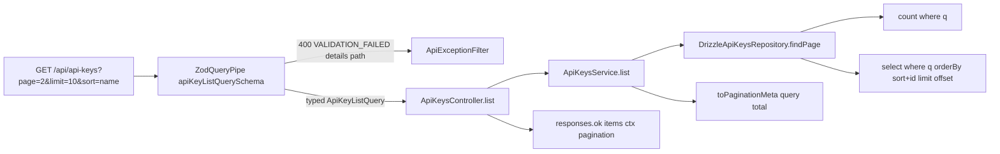

# AIS-107 — Paginated `GET /api/api-keys` (`ZodQueryPipe` first production use)

**Date:** 2026-11-02 19:50 (Europe/Budapest)
**Ticket:** AIS-107 (subtask of AIS-102 — „Adatáramlás: lista/pagináció konvenció, PATCH/DELETE végpontok és teljes kliens-transport")
**Depends on:** AIS-106 (implemented — `listQuerySchema`, `createListQuerySchema`, `ListQuery`)
**Status:** implemented (2026-11-02) — see [`docs/history/2026-11-02--20-10-00-ais-107-paginated-api-keys-list.md`](../history/2026-11-02--20-10-00-ais-107-paginated-api-keys-list.md:1) and [`docs/milestones/2026-11-02--20-10-00-ais-107-paginated-api-keys-list.milestone.md`](../milestones/2026-11-02--20-10-00-ais-107-paginated-api-keys-list.milestone.md:1)

---

## 1. Audited starting point

| Fact | Where | Consequence |
| --- | --- | --- |
| `ZodQueryPipe` exists and is tested, but **no controller uses it** (`@Query(` → 0 hits) | [`zod.pipe.ts:60`](../../apps/api/src/common/http/zod.pipe.ts:60) | This ticket is the first production use, not a new introduction |
| `ApiResponseService.ok(data, ctx, pagination?)` already emits `meta.pagination` | [`api-response.service.ts:36`](../../apps/api/src/common/http/api-response.service.ts:36) | The envelope layer needs **no change** |
| `paginationMetaSchema` = `page/limit/total/totalPages` (all ints, `totalPages` may be `0`) | [`envelope.schema.ts:15`](../../packages/shared/src/contract/envelope.schema.ts:15) | `total: 0` ⇒ `totalPages: 0` is legal |
| The shared list-query contract already exists (defaults filled by the schema, `page≥1`, `limit` 1..100, `q` trimmed/empty→`undefined`) | [`list-query.schema.ts:78`](../../packages/shared/src/contract/list-query.schema.ts:78) | Nothing about the *shape* of the query must be invented here |
| `createListQuerySchema` returns `z.ZodType<ListQuery & { sort: string }>` | [`list-query.schema.ts:100`](../../packages/shared/src/contract/list-query.schema.ts:100) | `sort` loses its literal type; see D5 |
| Repository exposes `findAll(): Promise<ApiKeyRow[]>` and its docblock explicitly says *“No pagination by design (plan D7)”* | [`api-keys.repository.interface.ts:34`](../../apps/api/src/api-keys/api-keys.repository.interface.ts:34) | Breaking interface change **and** a docblock to rewrite |
| The repository spec's `Database` mock models exactly 3 chains — no `offset()`, no `count()` | [`database.mock.ts:91`](../../apps/api/src/api-keys/test/mocks/database.mock.ts:91) | The mock must grow, otherwise `findPage` is untestable |
| The OpenAPI registry has **no query-parameter support** (`ApiEndpointContract` has `path`/`dataSchema`/`requestSchema` only) | [`endpoint.interface.ts:31`](../../packages/shared/src/contract/endpoint.interface.ts:31) | See D3 — this is the only genuinely new design decision |
| `apiKeys.list` documents `summary: 'List every stored API key, newest first'` and an example **without** `meta.pagination` | [`api-keys.contract.ts:36`](../../packages/shared/src/contract/api-keys/api-keys.contract.ts:36) | The spec would describe an endpoint that no longer exists |
| `packages/api-client` `list()` sends **no** query and does not read `meta.pagination` | [`api-keys.service.ts:28`](../../packages/api-client/src/api-keys/api-keys.service.ts:28) | Out of scope (AIS-109 owns the parametrised transport) |

---

## 2. Decisions

### D1 — The repository gets `findPage`, the interface breaks on purpose

```ts
export interface ApiKeyPage {
  readonly rows: readonly ApiKeyRow[];
  readonly total: number;
}

findPage(query: ApiKeyListQuery): Promise<ApiKeyPage>;
```

The service/repository contract is the only thing that changes; `findByIdentifier` and `create` stay untouched.

### D2 — `q` **must** filter; it is not a pass-through no-op

`listQuerySchema` already puts `q` into the parsed query, so ignoring it would be a silent lie. `q` is applied as
`ILIKE '%q%'` on `name` **OR** `identifier`, and it is what makes the two DoD rows testable at all:

- `total: 0` cannot be produced by `page=9999` (that yields `total > 0`);
- the shared dev/prod table has rows from other suites, so an unfiltered list is **not** deterministic.

No `GROUP BY`/`DISTINCT` interplay: a single `WHERE` expression, used by both the `count()` and the slice query.

### D3 — OpenAPI: document the query parameters in this ticket (**confirm**)

The list endpoint accepts `page/limit/sort/order/q`; leaving the spec silent is exactly the drift
[`API-Convention.md`](../Specs/API-Convention.md:1) forbids.

| Option | Mechanism | Cost |
| --- | --- | --- |
| **A (recommended)** | new optional `queryParameters: readonly ApiQueryParameterContract[]` on `ApiEndpointContract`; descriptors live in the shared list-query contract, generated from `LIST_QUERY_MAX_LIMIT` / defaults / `API_KEY_SORT_FIELDS` | small change in `endpoint.interface.ts`, `zod-openapi.ts`, `openapi.registry.ts` |
| B | pass the zod schema to `registerPath({ request: { query } })` | **not viable** — `q` is a `ZodEffects` (transform), which zod-to-openapi v7 cannot render for a parameter |
| C | defer to AIS-99 / a follow-up ticket | registry untouched, but the published spec is wrong for one release |

Option A is chosen because a hand-written descriptor list is *derived* from the same constants that validate the
request, and it is deterministic (no generator surprises). The `apiKeys.list` example also gains
`meta.pagination` so the published sample shows the paged body.

### D4 — The service owns the arithmetic, the controller stays a router

`ApiKeysService.list(query)` returns `{ items, pagination }`. `pagination` comes from the pure shared helper
`toPaginationMeta(query, total)` (`totalPages = total === 0 ? 0 : ceil(total / limit)`), so the controller only
calls `responses.ok(items, ctx, pagination)` — no arithmetic in the HTTP layer.

### D5 — `createListQuerySchema` becomes generic over the sort tuple

```ts
export function createListQuerySchema<TSort extends string>(
  sortBy: readonly [TSort, ...TSort[]],
  defaultSort: TSort = sortBy[0],
): z.ZodType<ListQuery & { readonly sort: TSort }, z.ZodTypeDef, unknown>;
```

Backward compatible (the AIS-119 admin call site keeps compiling), and it removes the need for a cast when the
api-keys schema wants `sort: ApiKeySortField`.

### D6 — Sortable allow-list and deterministic tie-breaker

`API_KEY_SORT_FIELDS = ['name', 'identifier', 'createdAt', 'updatedAt', 'expiresAt']`, default `createdAt`
(`order` default stays `desc`). Every `orderBy` is `[direction(sortColumn), asc(apiKeys.id)]` — without the
tie-breaker two rows with the same timestamp can swap between pages and a row would be skipped or duplicated.

### D7 — Where the new pieces live

| Piece | Location | Why |
| --- | --- | --- |
| `API_KEY_SORT_FIELDS`, `apiKeyListQuerySchema`, `ApiKeyListQuery` | new `packages/shared/src/contract/api-keys/api-keys.list-query.ts` | **new file on purpose** — AIS-75 also edits `api-keys.schema.ts`; this keeps the two tickets conflict-free |
| `toPaginationMeta` | existing `list-query.helper.ts` | pure, reusable by the client's pager |
| Drizzle column map `API_KEY_SORT_COLUMNS: Record<ApiKeySortField, PgColumn>` | `apps/api/src/api-keys/api-keys.const.ts` | a missing column becomes a compile error, not a `500` |
| `PaginatedApiKeys` view type | new `apps/api/src/api-keys/api-keys.interface.ts` | the feature has no interface file yet; the service must not export an inline type |

Both export indexes (`contract/index.ts` **and** `src/index.ts`) get the new symbols — the repo duplicates the
lists deliberately (AIS-106 D8).

### D8 — No new dependency, no DB migration

`count()`/`asc`/`ilike`/`or` all come from `drizzle-orm` (already a dependency); the table already has the
`created_at DESC` usage and a `pg_trgm`-free `ILIKE` is fine at this table size.

---

## 3. Request flow after the change



---

## 4. Work breakdown

### 4.1 `packages/shared` (contract)

1. `list-query.schema.ts` — make `createListQuerySchema` generic (D5).
2. `list-query.helper.ts` — add `toPaginationMeta(query, total): PaginationMeta` with JSDoc.
3. New `api-keys/api-keys.list-query.ts` — `API_KEY_SORT_FIELDS`, `API_KEY_DEFAULT_SORT`,
   `apiKeyListQuerySchema`, `ApiKeyListQuery`, and (if D3-A) `API_KEY_LIST_QUERY_PARAMETERS`.
4. `api-keys/api-keys.contract.ts` — `apiKeys.list`: `queryParameters`, paginated `exampleMeta`, summary wording
   (“…, paginated”).
5. `endpoint.interface.ts` — optional `queryParameters` (+ the `ApiQueryParameterContract` type).
6. `contract/index.ts` + `src/index.ts` — explicit exports.

### 4.2 `apps/api`

7. `api-keys/api-keys.const.ts` — `API_KEY_SORT_COLUMNS`.
8. `api-keys/api-keys.repository.interface.ts` — `findPage`, `ApiKeyPage`; rewrite the “no pagination by design”
   docblock.
9. `api-keys/api-keys.repository.ts` — `findPage` implementation (`q` WHERE, `count()`, `orderBy`, `limit`,
   `offset`); `findAll` is removed.
10. `api-keys/api-keys.interface.ts` (new) — `PaginatedApiKeys`.
11. `api-keys/api-keys.service.ts` — `list(query: ApiKeyListQuery): Promise<PaginatedApiKeys>`.
12. `api-keys/api-keys.controller.ts` — `@Query(new ZodQueryPipe(apiKeyListQuerySchema))`; pass
    `result.pagination` to `responses.ok`.
13. `api-keys/api-keys.module.ts` — verify only; no provider change expected.

### 4.3 OpenAPI (only if D3-A)

14. `common/openapi/zod-openapi.ts` — `queryParametersOf(entry)` builder (structural map to `OpenApiParameter`).
15. `common/openapi/openapi.registry.ts` — `parameters: [...pathParameters(entry.path), ...queryParametersOf(entry)]`.

---

## 5. Tests (every branch, mocks only, no network)

| File | Coverage |
| --- | --- |
| `packages/shared/test/list-query-helper.test.ts` | `toPaginationMeta`: `total 0` → `totalPages 0`; exact division; remainder; page past the end keeps `page` as requested |
| `packages/shared/test/list-query-factory.test.ts` | generic factory: `sort` inferred as the literal union; unknown `sort` still fails |
| `packages/shared/test/api-keys-list-query.test.ts` (new) | defaults (`page 1`, `limit 20`, `sort createdAt`, `order desc`), allowed + rejected `sort`, `q` empty → `undefined` |
| `apps/api/src/api-keys/api-keys.repository.spec.ts` | `findPage`: limit/offset passed, `orderBy` carries the sort column **and** the `id` tie-breaker, `q` omitted ⇒ no `where` on the slice, `q` present ⇒ `ILIKE` on `name`/`identifier`, `total` from the count query, empty result, count error propagated unchanged |
| `apps/api/src/api-keys/api-keys.service.spec.ts` | `list` forwards the query, maps rows, returns `pagination` from `toPaginationMeta`, empty page ⇒ `items: []` |
| `apps/api/src/api-keys/api-keys.controller.spec.ts` | `meta.pagination` present with the service's numbers; `meta` still carries `requestId`/`timestamp` |
| `apps/api/src/api-keys/test/mocks/database.mock.ts` | **extend**: `offset()`, and a count script (`countRows`) distinguished by `select({ ... })` receiving a field map |
| `apps/api/src/api-keys/test/mocks/api-keys.mock.ts` | `buildListQuery(overrides)` fixture (no inline literals in specs) |
| `apps/api/test/api-keys.e2e-spec.ts` | see below |

### e2e scenarios (real Postgres, self-cleaning)

Seed **12** rows named/identified `e2e-<uuid>-NN` in `beforeAll`, then:

| # | Request | Expectation |
| --- | --- | --- |
| 1 | `?q=<prefix>&limit=10&page=2&sort=name&order=asc` | 200, `data` = rows 11–12 of the name-ascending slice, `meta.pagination = { page: 2, limit: 10, total: 12, totalPages: 2 }` |
| 2 | `?q=<prefix-with-no-match>` | **200**, `data: []`, `total: 0`, `totalPages: 0` (not `404`, not `null`) |
| 3 | `?limit=101` | **400**, `code: VALIDATION_FAILED`, `details[0].path === 'limit'` |
| 4 | `?sort=does-not-exist` | **400** `VALIDATION_FAILED`, `details[0].path === 'sort'` (proves `ZodQueryPipe` + enum allow-list) |
| — | existing `GET /api/api-keys` test | reworked to `?limit=100` (or `?q=<identifier>`) so it is deterministic against a non-empty table; `meta.pagination` is asserted there too |

---

## 6. Documentation (required by the repo rules)

- [`docs/Specs/API-Convention.md`](../Specs/API-Convention.md:1) — living doc: mark `apiKeys.list` as paginated,
  record the api-keys allow-list and the `q` semantics, refresh `**Utolsó frissítés:**`.
- `docs/history/2026-11-02--HH-II-SS-ais-107-paginated-api-keys-list.md` — change summary.
- `docs/milestones/2026-11-02--HH-II-SS-ais-107-paginated-api-keys-list.milestone.md` — decision-grade record
  (breaking repo interface, OpenAPI query documentation, `q` semantics).

## 7. Verification

```bash
pnpm --filter @callback/shared test
pnpm --filter @callback/api test
pnpm --filter @callback/api test:e2e        # needs the dev stack Postgres
pnpm --filter @callback/api lint
pnpm --filter @callback/api build
pnpm --filter @callback/admin test          # guard: the shared factory change must not break AIS-119
pnpm knip                                   # new exports must be reachable
```

## 8. Out of scope (deliberately)

- `packages/api-client` parametrised list/transport and `useApiList` (AIS-109 / AIS-114).
- Admin pager / sort / search UI (AIS-104 primitives).
- The committed OpenAPI baseline regeneration (AIS-99) — it must be re-run **after** this change lands.
- Cursor-based pagination and `PATCH`/`DELETE` routes (other AIS-102 subtasks).

## 9. Known limitation to note in the history entry

The admin list keeps calling `list()` without a query, so it now receives **page 1 of 20** rows. Acceptable for the
current key count; the UI-side pager is AIS-114.
