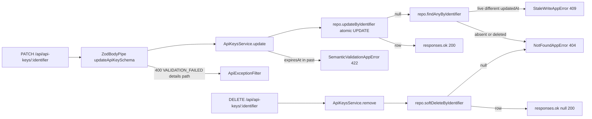

# AIS-108 — Update/delete convention (`PATCH`, `DELETE`, `STALE_WRITE` 409, `SEMANTIC_VALIDATION_FAILED` 422)

**Date:** 2026-11-02 20:30 (Europe/Budapest)
**Ticket:** AIS-108 (subtask of AIS-102 — „Adatáramlás: lista/pagináció konvenció, PATCH/DELETE végpontok és teljes kliens-transport")
**Depends on:** AIS-107 (implemented — `findPage`, `apiKeyListQuerySchema`, `toPaginationMeta`, first `ZodQueryPipe` use)
**Blocks:** AIS-109 (`packages/api-client` transport gains `patch`/`delete`), AIS-110
**Status:** planned

---

## 1. What it does, in one paragraph

The API currently knows only `GET`/`POST` for `api-keys`. This ticket adds the **two mutation verbs** and the
**two failure codes** the rest of the platform will reuse: `PATCH /api/api-keys/:identifier` (partial update guarded
by the client's last known `updatedAt` → `409 STALE_WRITE` when someone else already wrote) and
`DELETE /api/api-keys/:identifier` (soft delete; the row disappears from every read and answers `404`).
A semantically impossible payload (e.g. `expiresAt` in the past) is a `422 SEMANTIC_VALIDATION_FAILED`, distinct from
a shape error (`400`). Both codes enter the shared `API_ERROR_CODE` catalogue, so the server, the OpenAPI document and
the client decide from one table.

## 2. Audited starting point

| Fact                                                                                                                                | Where                                                                                                                                                                           | Consequence                                                  |
| ----------------------------------------------------------------------------------------------------------------------------------- | ------------------------------------------------------------------------------------------------------------------------------------------------------------------------------- | ------------------------------------------------------------ |
| No `PATCH`/`DELETE` route exists; controller has `@Get`, `@Get(':identifier')`, `@Post` only                                        | [`api-keys.controller.ts:59`](../../apps/api/src/api-keys/api-keys.controller.ts:59)                                                                                            | Two new handlers                                             |
| Catalogue has no `STALE_WRITE` / `SEMANTIC_VALIDATION_FAILED`; `422` is documented as "currently normalised to `VALIDATION_FAILED`" | [`error-code.const.ts:21`](../../packages/shared/src/contract/error-code.const.ts:21), [`API-Convention.md:184`](../Specs/API-Convention.md:184)                                | Catalogue + status map + living doc change                   |
| `HTTP_STATUS.UNPROCESSABLE_ENTITY` (422) already exists and `CANONICAL_ERROR_STATUSES` already documents 422 for every operation    | [`http-status.const.ts:30`](../../packages/shared/src/contract/http-status.const.ts:30), [`zod-openapi.ts:112`](../../apps/api/src/common/openapi/zod-openapi.ts:112)           | No OpenAPI status work                                       |
| `PATCH`/`DELETE` already exist in `ApiHttpMethod` and `VERB_BY_METHOD`                                                              | [`endpoint.interface.ts:23`](../../packages/shared/src/contract/endpoint.interface.ts:23), [`openapi.registry.ts:50`](../../apps/api/src/common/openapi/openapi.registry.ts:50) | Registry entries are enough                                  |
| `envelopeOf()` requires the `dataSchema` to be a **named** component (`PAYLOAD_COMPONENTS`)                                         | [`zod-openapi.ts:90`](../../apps/api/src/common/openapi/zod-openapi.ts:90)                                                                                                      | The `null` DELETE payload needs one new entry                |
| `platform.api_keys` has **no** `deleted_at` column; `updated_at` is maintained by Drizzle `$onUpdate`                               | [`schema.ts:43`](../../apps/api/src/db/schema.ts:43)                                                                                                                            | Migration 0003                                               |
| `findPage` filters only by `q`; `findByIdentifier` only by `identifier`                                                             | [`api-keys.repository.ts:66`](../../apps/api/src/api-keys/api-keys.repository.ts:66)                                                                                            | Both must gain `deleted_at IS NULL`                          |
| `AppError` hierarchy already derives status from the catalogue; `ConflictAppError` accepts a code                                   | [`app-error.ts:66`](../../apps/api/src/common/http/app-error.ts:66)                                                                                                             | New codes need only subclasses                               |
| `AppErrorStatus`-driven response is the only wrapping point (`responses.ok`)                                                        | [`api-response.service.ts`](../../apps/api/src/common/http/api-response.service.ts:1)                                                                                           | Controller stays a router                                    |
| The controller audit fails any enveloped route missing from `API_ENDPOINTS` (verb **and** path)                                     | [`controller-audit.ts:132`](../../apps/api/test/lib/controller-audit.ts:132)                                                                                                    | Both new routes must be registered or the e2e suite goes red |
| `Database` mock models `insert`/`select` chains only — no `update`                                                                  | [`database.mock.ts:140`](../../apps/api/src/api-keys/test/mocks/database.mock.ts:140)                                                                                           | Mock must grow an `update…set…where…returning` chain         |
| `ERROR_CODE_MESSAGE` is `Record<string, string>` (not exhaustive)                                                                   | [`error-message.const.ts:89`](../../apps/admin/src/lib/error-message.const.ts:89)                                                                                               | No admin compile break                                       |

---

## 3. Decisions

### D1 — Soft delete: `deleted_at` column + migration 0003

`deletedAt: timestamp('deleted_at', { withTimezone: true })` nullable, plus a partial-friendly index
`api_keys_deleted_at_idx`. Generated with `pnpm --filter @callback/api db:generate`, SQL + `meta/` snapshot committed.
The row stays, so an audit trail / undelete stays possible; a **deleted row answers `404`**, never `410`.

### D2 — Every read filters `deleted_at IS NULL`

`findPage`, `findByIdentifier`, `updateByIdentifier`, `softDeleteByIdentifier` all carry it. A pure helper
`apiKeyNotDeletedFilter()` (`isNull(apiKeys.deletedAt)`) lives in [`api-keys.filter.ts`](../../apps/api/src/api-keys/api-keys.filter.ts:1)
next to `apiKeySearchFilter`, and the repository composes them with `and(...)` — the count query and the page query
keep sharing one expression.

### D3 — The route parameter stays `:identifier`

The resource is already addressed by identifier (`GET /api/api-keys/:identifier`); `:id` is the ticket's generic
placeholder, not a rename request. `PATCH`/`DELETE` therefore target `:identifier` and the identifier is **not
patchable** (renaming the address = delete + create).

### D4 — `updateApiKeySchema` = partial body + **required** `updatedAt`

```ts
export const updateApiKeySchema = z
  .object({
    name: z.string().min(1).max(API_KEY_NAME_MAX_LENGTH).optional(),
    description: z
      .string()
      .max(API_KEY_DESCRIPTION_MAX_LENGTH)
      .nullable()
      .optional(),
    apiKey: z.string().min(1).max(API_KEY_VALUE_MAX_LENGTH).optional(),
    expiresAt: isoDateTimeSchema.nullable().optional(),
    updatedAt: isoDateTimeSchema, // the concurrency token, always required
  })
  .strict();
```

- `.nullable().optional()` on `description`/`expiresAt` makes “clear this field” expressible; `undefined` = “leave it”.
- `updatedAt` is required, so `{}` is a `400`, not a silently empty update.
- `.strict()` keeps the old `forbidNonWhitelisted` semantics: `identifier`, `id`, `createdAt` → `400`.
- Lives in a **new** `api-keys.update.ts`, not in `api-keys.schema.ts` (AIS-75 also edits that file).

### D5 — Optimistic concurrency is one atomic SQL guard, not read-then-write

```ts
UPDATE platform.api_keys
   SET <only the provided columns>, updated_at = now()
 WHERE identifier = $1 AND deleted_at IS NULL AND updated_at = $expected
RETURNING *;
```

`updateByIdentifier(...)` returns the row or `null`. A read-compare-write in the service would leave a window between
the check and the write — exactly the lost update the ticket exists to prevent. The service then classifies a `null`
result with one `findAnyByIdentifier` read (includes deleted rows):

| Classification read                     | Answer                                              |
| --------------------------------------- | --------------------------------------------------- |
| row is `null`                           | `404 NOT_FOUND`                                     |
| `deletedAt !== null`                    | `404 NOT_FOUND` (a deleted row is invisible)        |
| row exists, live, different `updatedAt` | `409 STALE_WRITE`, `details[{ path: 'updatedAt' }]` |

`updatedAt` on the wire comes from the DB (`$onUpdate`), never from the client — the client value is only compared.

### D6 — What `422` actually means here

`SEMANTIC_VALIDATION_FAILED` = shape is valid, content is impossible. The only rule this ticket ships is
**`expiresAt` must not be in the past** (pure `isPastDate(iso, now)` in a new `api-keys.logic.ts`; `now` is injected so
tests are fake-timer free). Boundary: `expiresAt === now` is allowed; anything strictly earlier is rejected. The check
runs **before** the concurrency guard — an impossible payload is a `422` regardless of version.

### D7 — `DELETE` answers `200 { data: null }`

`API_CONVENTION` §4: a success with nothing to return is `200` + `data: null`, never `204`. A single new shared schema
`noPayloadSchema = z.null()` (registered as component `NoPayload`) makes `envelopeOf()` able to describe it; the
alternative (returning the soft-deleted row) would change `apiKeySchema` for every consumer for no gain.

### D8 — Errors: two new `AppError` subclasses, no filter change

```ts
export class StaleWriteAppError extends AppError {
  /* code: STALE_WRITE, details: updatedAt */
}
export class SemanticValidationAppError extends AppError {
  /* code: SEMANTIC_VALIDATION_FAILED */
}
```

Both added to [`app-error.ts`](../../apps/api/src/common/http/app-error.ts:1); the status is derived from the
catalogue (`409`, `422`), so `ApiExceptionFilter` is untouched.

### D9 — Registry: two entries, one new payload component

| `operationId`    | Verb / path                        | `successStatus` | `dataSchema`      | `requestSchema`      | `errors`                                                                               |
| ---------------- | ---------------------------------- | --------------- | ----------------- | -------------------- | -------------------------------------------------------------------------------------- |
| `apiKeys.update` | `PATCH /api/api-keys/:identifier`  | `200`           | `apiKeySchema`    | `updateApiKeySchema` | `VALIDATION_FAILED`, `NOT_FOUND`, `STALE_WRITE`, `SEMANTIC_VALIDATION_FAILED` + common |
| `apiKeys.remove` | `DELETE /api/api-keys/:identifier` | `200`           | `noPayloadSchema` | —                    | `NOT_FOUND` + common                                                                   |

`PAYLOAD_COMPONENTS` gains `['UpdateApiKey', updateApiKeySchema]` and `['NoPayload', noPayloadSchema]`.

### D10 — No new dependency, no repository renames

`and`, `isNull`, `eq`, `sql` come from `drizzle-orm`; `findPage`/`create`/`findByIdentifier` signatures stay. Three new
repository members: `updateByIdentifier`, `softDeleteByIdentifier`, `findAnyByIdentifier`.

---

## 4. Request flow after the change



---

## 5. Work breakdown

### 5.1 `packages/shared`

1. `contract/error-code.const.ts` — add `STALE_WRITE` (→ `HTTP_STATUS.CONFLICT`) and `SEMANTIC_VALIDATION_FAILED` (→ `HTTP_STATUS.UNPROCESSABLE_ENTITY`) to `API_ERROR_CODE` **and** `API_ERROR_CODE_STATUS`.
2. `contract/no-payload.schema.ts` (new) — `noPayloadSchema = z.null()` with a docblock stating why `null` is the payload of a “nothing to return” call.
3. `contract/api-keys/api-keys.update.ts` (new) — `updateApiKeySchema`, `UpdateApiKeyInput`, and `API_KEY_UPDATE_FORBIDDEN_FIELDS` (documentation constant used by the schema test).
4. `contract/api-keys/api-keys.contract.ts` — `apiKeys.update` + `apiKeys.remove` entries (D9).
5. `contract/api-keys/api-keys.fixture.ts` — `VALID_UPDATE_API_KEY_REQUEST` (valid body incl. a fixed `updatedAt`).
6. `src/index.ts` — explicit exports for every new symbol.

### 5.2 `apps/api` — persistence

7. `db/schema.ts` — `deletedAt` column + index; refresh the contract notes in the file header.
8. `pnpm --filter @callback/api db:generate` → commit `drizzle/0003_*.sql` + `meta/`.
9. `api-keys/api-keys.filter.ts` — `apiKeyNotDeletedFilter()`.
10. `api-keys/api-keys.repository.interface.ts` — three new members with JSDoc (`updateByIdentifier`, `softDeleteByIdentifier`, `findAnyByIdentifier`); rewrite the `findByIdentifier` docblock (deleted ⇒ `null`).
11. `api-keys/api-keys.repository.ts` — implement them; `and(...)` the not-deleted filter into `findPage`/`findByIdentifier`; the update `set` carries only provided columns.

### 5.3 `apps/api` — domain + HTTP

12. `common/http/app-error.ts` — `StaleWriteAppError`, `SemanticValidationAppError` (D8).
13. `api-keys/api-keys.logic.ts` (new) — `isPastDate(iso, now)`.
14. `api-keys/api-keys.interface.ts` — `ApiKeyPatch` (the column subset the repository may write).
15. `api-keys/api-keys.mapper.ts` — `toApiKeyPatch(input: UpdateApiKeyInput): ApiKeyPatch` (pure, `undefined` ⇒ column untouched, explicit `null` ⇒ cleared).
16. `api-keys/api-keys.service.ts` — `update(identifier, input)` (422 → atomic update → 404/409 classification) and `remove(identifier)` (404 on `null`).
17. `api-keys/api-keys.controller.ts` — `@Patch(':identifier')` + `@Body(new ZodBodyPipe(updateApiKeySchema))` + `@HttpCode(HTTP_STATUS.OK)`; `@Delete(':identifier')` + `@HttpCode(HTTP_STATUS.OK)` returning `responses.ok(null, ctx)`; header route table updated.
18. `common/openapi/zod-openapi.ts` — two `PAYLOAD_COMPONENTS` entries (the only OpenAPI change).

### 5.4 Test doubles

19. `api-keys/test/mocks/database.mock.ts` — `update().set().where().returning()` chain + `deletedAt` aware fixtures.
20. `api-keys/test/mocks/api-keys.mock.ts` — `buildApiKeyRow({ deletedAt })`, `buildUpdateApiKeyInput(overrides)`.

---

## 6. Tests (mocks only, every branch)

| File                                                 | Coverage                                                                                                                                                                                                                                                                                                                                              |
| ---------------------------------------------------- | ----------------------------------------------------------------------------------------------------------------------------------------------------------------------------------------------------------------------------------------------------------------------------------------------------------------------------------------------------- |
| `packages/shared/test/error-code.test.ts` (new)      | both new codes resolve to `409` / `422`; every catalogue value has a status entry; unknown code → `500`                                                                                                                                                                                                                                               |
| `packages/shared/test/api-keys-update.test.ts` (new) | minimal valid body; missing `updatedAt` → 400; unknown field (`identifier`, `id`) → 400; `description: null` / `expiresAt: null` accepted; empty string name rejected; non-ISO `updatedAt` rejected                                                                                                                                                   |
| `packages/shared/test/endpoint-registry.test.ts`     | new ops registered, ids `<resource>.<action>`, sample payload for each `operationId`, `apiKeys.update` request schema parses the fixture, `apiKeys.remove` payload is `null`                                                                                                                                                                          |
| `apps/api/src/common/http/app-error.spec.ts`         | `StaleWriteAppError.status === 409` + detail path, `SemanticValidationAppError.status === 422`                                                                                                                                                                                                                                                        |
| `apps/api/src/api-keys/api-keys.logic.spec.ts` (new) | `isPastDate`: past, equal-to-now (allowed), future                                                                                                                                                                                                                                                                                                    |
| `apps/api/src/api-keys/api-keys.mapper.spec.ts`      | `toApiKeyPatch`: omitted keys stay absent, `null` clears, `expiresAt` string → `Date`, `updatedAt` never in the patch                                                                                                                                                                                                                                 |
| `apps/api/src/api-keys/api-keys.repository.spec.ts`  | `findPage`/`findByIdentifier` WHERE contains the not-deleted filter; `updateByIdentifier` WHERE carries identifier + not-deleted + `updatedAt` equality, `set` excludes `updatedAt`/`updatedAt`-from-body, `null` when no row; `softDeleteByIdentifier` sets `deleted_at`, filters not-deleted, `null` when no row; driver errors propagate unchanged |
| `apps/api/src/api-keys/api-keys.service.spec.ts`     | update success; 422 past `expiresAt` (and that the repository is **not** called); 409 when classification read shows a live row with another `updatedAt`; 404 when the read is `null`; 404 when the read shows `deletedAt`; remove success; remove 404                                                                                                |
| `apps/api/src/api-keys/api-keys.controller.spec.ts`  | PATCH returns the service payload inside the envelope with `meta.requestId`; DELETE returns `data: null` with `200`                                                                                                                                                                                                                                   |
| `apps/api/test/api-keys.e2e-spec.ts`                 | see below                                                                                                                                                                                                                                                                                                                                             |

### e2e scenarios (real Postgres, self-cleaning)

| #   | Request                                              | Expectation                                                                                                         |
| --- | ---------------------------------------------------- | ------------------------------------------------------------------------------------------------------------------- |
| 1   | `PATCH` with a fresh `updatedAt` + new `name`        | `200`, `data.name` updated, `data.updatedAt` > request `updatedAt`, `meta` present                                  |
| 2   | `PATCH` replayed with the **old** `updatedAt`        | `409`, `code: STALE_WRITE`, `details[0].path === 'updatedAt'`                                                       |
| 3   | `PATCH` with `expiresAt` in the past                 | `422`, `code: SEMANTIC_VALIDATION_FAILED`, `details[0].path === 'expiresAt'`                                        |
| 4   | `PATCH` with `{ "identifier": "x", "updatedAt": … }` | `400`, `code: VALIDATION_FAILED` (`.strict()`)                                                                      |
| 5   | `DELETE`, then `GET` and `PATCH`                     | `DELETE` → `200` + `data: null`; `GET` → `404`; `PATCH` → `404`                                                     |
| 6   | `DELETE` a second time                               | `404` (idempotency is `404`, not `204`)                                                                             |
| 7   | `GET /api/api-keys?q=<deleted prefix>`               | deleted row absent from `data` and from `total`                                                                     |
| —   | dev `ResponseAssertInterceptor`                      | DELETE body validates against `NoPayload`, PATCH against `ApiKey` (covered by the running dev stack, no extra test) |

---

## 7. Documentation (repo rules)

- [`docs/Specs/API-Convention.md`](../Specs/API-Convention.md:1) — error-code table gains `STALE_WRITE` (409) and `SEMANTIC_VALIDATION_FAILED` (422); §5 loses the “422 normalised to 400” note; new **§4.2 Mutation convention** (PATCH partial + `.strict()` + required `updatedAt`, atomic guard, soft delete ⇒ 404, `DELETE` ⇒ `data: null`); recipe §11 gains the mutation step; `**Utolsó frissítés:**` refreshed.
- [`docs/Specs/Database-Local.md`](../Specs/Database-Local.md:1) — `platform.api_keys.deleted_at` documented as the soft-delete marker.
- `docs/history/2026-11-02--HH-II-SS-ais-108-patch-delete-convention.md` — change summary.
- `docs/milestones/2026-11-02--HH-II-SS-ais-108-soft-delete-and-optimistic-concurrency.milestone.md` — decision-grade record (atomic guard, 404-for-deleted, 422 boundary).

## 8. Verification

```bash
pnpm --filter @callback/api db:generate && pnpm --filter @callback/api db:migrate
pnpm --filter @callback/shared test
pnpm --filter @callback/api test
pnpm --filter @callback/api test:e2e
pnpm --filter @callback/api lint && pnpm --filter @callback/api build
pnpm --filter @callback/admin test
pnpm knip
```

## 9. Out of scope (deliberate)

- `packages/api-client` `patch`/`delete` transport and the admin edit/delete UI (AIS-109 / later UI tickets).
- `ETag`/`If-Match` (the `updatedAt` token is the first step, per AIS-102 D-note), bulk mutations, idempotency keys.
- Undelete / restore endpoint and a hard-purge job for soft-deleted rows.
- Committed OpenAPI baseline regeneration (AIS-99) — must be re-run **after** this lands.
- `identifier` rename (`PATCH` cannot change the address).
