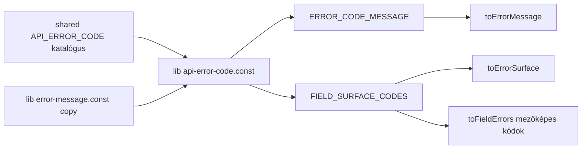

# AIS-111 — generikus mezőhiba-leképezés + egységes hibakód-copy táblázat

**Állapot:** jóváhagyásra váró terv
**Ticket:** AIS-111 (az AIS-103 sub-taskja) — `admin: generikus mezőhiba-leképezés (toFieldErrors mezőlistával) + egységes hibakód-copy táblázat`
**Előfeltételek:** AIS-109 (a transport továbbadja az `issues[]`-t) — **kész**; AIS-96 (hibaszintek) — **kész**
**Nincs a hatókörben:** AIS-115 (`useAppForm`), AIS-74 (auth), `packages/ui` form primitívek, bármilyen `apps/api` módosítás

---

## 1. A ticket pontosítása a kód alapján

| Ticket pont | Mai valóság | Teendő |
| --- | --- | --- |
| `toFieldErrors` kiemelése a feature-ből | [`api-keys.logic.ts:115`](apps/admin/src/features/api-keys/api-keys.logic.ts:115) feature-specifikus: `toFieldName` a `API_KEY_FIELD_PATHS`-hoz kötött, `toFieldMessage` egy kódhoz | **3. lépés** — általánosítás, a másolat törlése |
| `toFieldErrors(error, fieldPaths)` szignatúra | Elveszíti a ticket által is megkövetelt kód→default-path szabályt („`409` → `identifier`”), mert a generikus lib nem tudhatja, hogy az `identifier` az api-keys form mezője | **Eltérés** — a második paraméter egy target-objekt, lásd §3.1 |
| Egy kód→copy táblázat | **Két** kézi táblázat él egymás mellett: [`error-message.const.ts:89`](apps/admin/src/lib/error-message.const.ts:89) `ERROR_CODE_MESSAGE` és [`error-surface.const.ts:44`](apps/admin/src/lib/error-surface.const.ts:44) `FIELD_SURFACE_CODES`; plusz egy harmadik újra-exportálás a [`api-keys.const.ts:64`](apps/admin/src/features/api-keys/api-keys.const.ts:64)-ben | **2. lépés** |
| „Minden `API_ERROR_CODE`-hoz van magyar copy vagy explicit elutasított” | **Már ma sem igaz**: a katalógusban **13** kód van ([`error-code.const.ts:21`](packages/shared/src/contract/error-code.const.ts:21)), az `ERROR_CODE_MESSAGE`-ben **11**. Hiányzik: `STALE_WRITE` és `SEMANTIC_VALIDATION_FAILED` — mindkettőt az AIS-108 tette be, *miután* az admin táblázat elkészült. Egy `409 STALE_WRITE` ezért a `CONFLICT_MESSAGE`-t rendereli („ütközik egy már létező elemmel”), ami lost update-re téves copy | **2.3 lépés** — ez a konkrét hiba, amit a ticket DoD-ja felszínre hoz |
| „Nincs komponens, amely `error.status`-t vagy `error.code`-ot vizsgál” | A [`field-error-gate.const.mjs`](scripts/quality/field-error-gate.const.mjs:37) kényszeríti ki; az `apps/*/src/**/*.logic.ts` már allowlistelt, tehát új logic fájlhoz nem kell gate-módosítás | csak ellenőrzés (`pnpm quality`) |

Két viselkedés, amit a jelenlegi implementáció rosszul csinál, és ez a ticket mellékhatásként javít:

1. **A lemondott (cancelled) mutáció hibaként jelenik meg.** `toFieldErrors(new DOMException(..., 'AbortError'))` → `form: UNKNOWN_ERROR_MESSAGE`, miközben a `toErrorSurface` ugyanezt `silent`-nek sorolja be. Navigáció után a form „Váratlan hiba történt.” szöveget mutat.
2. **A `SEMANTIC_VALIDATION_FAILED` nem tud mezőre kerülni.** Az AIS-108 definíciója szerint „az alak jó, a tartalom nem, a `details[]` megnevezi a hibás mezőt” — ez pontosan mezőhiba —, mégsincs benne a `FIELD_SURFACE_CODES`-ban, így egy 422 (`expiresAt` a múltban) oldalszintű alertként jelenik meg a mező alatti üzenet helyett.

---

## 2. Egyetlen kód-katalógus — [`apps/admin/src/lib/`](apps/admin/src/lib:1)

### 2.1 Új `api-error-code.interface.ts`

```ts
export interface ApiErrorCodeCopy {
  /** Oldal/alert szintű mondat; mindig van. */
  readonly message: string;
  /** Mező szintű mondat, vagy `null`, ha a kód soha nem hibáztathat inputot. */
  readonly fieldMessage: string | null;
}
```

### 2.2 Új `api-error-code.const.ts`

Minden `API_ERROR_CODE`-hoz egy bejegyzés, totális record típusként, így **egy új kód a `packages/shared`-ben itt fordítási hibát okoz**:

```ts
export const ERROR_CODE_CATALOGUE: Readonly<Record<ApiErrorCode, ApiErrorCodeCopy>>
export const ERROR_CODE_MESSAGE: Readonly<Record<string, string>>   // derivált, a toErrorMessage érintetlen marad
export const FIELD_SURFACE_CODES: readonly string[]                 // derivált: fieldMessage !== null
```

| Kód | `fieldMessage` | Indok |
| --- | --- | --- |
| `VALIDATION_FAILED` | `FIELD_INVALID_MESSAGE` | alak-hiba `details[].path`-tal |
| `SEMANTIC_VALIDATION_FAILED` | `FIELD_INVALID_MESSAGE` | **új** — AIS-108 szerződés: a `details[]` megnevezi a mezőt |
| `API_KEY_IDENTIFIER_CONFLICT` | `API_KEY_IDENTIFIER_FIELD_MESSAGE` | foglalt identifier |
| `STALE_WRITE` | `null` | a hibáztatott path az `updatedAt`, egy rejtett konkurrencia-token, amit a user nem szerkeszthet — oldalszint, újratöltés CTA-val |
| minden más | `null` | nem input okozta |

### 2.3 Új copy (ez a ticket által bezárt rés)

| Konstans | Szöveg |
| --- | --- |
| `STALE_WRITE_MESSAGE` | `'Az adatot közben valaki más módosította. Töltsd újra az oldalt, majd próbáld újra.'` |
| `SEMANTIC_VALIDATION_FAILED_MESSAGE` | `'A megadott érték tartalmilag nem megfelelő. Ellenőrizd az adatokat.'` |

Mindkettő az [`error-message.const.ts`](apps/admin/src/lib/error-message.const.ts:1)-be kerül — az a fájl marad az **egyetlen** hely magyar szöveg-literálokkal; a katalógus csak kódot rendel szimbólumhoz.

### 2.4 Átkötendő fogyasztók (mechanikus)

| Fájl | Változás |
| --- | --- |
| [`error-message.const.ts`](apps/admin/src/lib/error-message.const.ts:89) | a kézi `ERROR_CODE_MESSAGE` törlése (most derivált) |
| [`error-message.ts`](apps/admin/src/lib/error-message.ts:24) | `ERROR_CODE_MESSAGE` importja `./api-error-code.const.js`-ből |
| [`error-surface.const.ts`](apps/admin/src/lib/error-surface.const.ts:44) | `FIELD_SURFACE_CODES` törlése |
| [`error-surface.logic.ts`](apps/admin/src/lib/error-surface.logic.ts:18) | `FIELD_SURFACE_CODES` importja `./api-error-code.const.js`-ből — **a döntési sorrend változatlan** (ticket D1) |
| [`api-keys.const.ts`](apps/admin/src/features/api-keys/api-keys.const.ts:64) | a `FIELD_ERROR_CODES` újra-exportálás törlése; a `DEFAULT_FIELD_PATH_BY_CODE` marad (a domain-tudás a feature-ben van) |



---

## 3. Generikus leképezés — `apps/admin/src/lib/field-errors.logic.ts`

### 3.1 Szignatúra

```ts
export interface FieldErrorTarget<F extends string> {
  /** Minden path, amit ez a form birtokol, vizuális sorrendben. */
  readonly fieldPaths: readonly F[];
  /** Kód → hibáztatandó path, amikor a boríték nem hoz issues-t. */
  readonly defaultPathByCode?: Readonly<Record<string, F>>;
}

export function toFieldErrors<F extends string>(
  error: unknown,
  target: FieldErrorTarget<F>,
): FieldErrorMapping<F>;
```

A `FieldErrorMapping<F>` a `field-errors.interface.ts`-ben él (`fields: Partial<Record<F, string>>`, `form: string | null`). Objektum-paraméter két pozicionális argumentum helyett: egy harmadik szabály (pl. kódonkénti message-felülírás) különben megint egy pozicionális paraméter lenne.

Az `ApiKeyFieldErrors` típus a [`api-keys.interface.ts`](apps/admin/src/features/api-keys/api-keys.interface.ts:33)-ból törlődik; a form a `FieldErrorMapping<ApiKeyFormFieldName>`-t használja.

### 3.2 Szabályok (rögzített sorrend)

| # | Feltétel | Eredmény |
| --- | --- | --- |
| 1 | `isAbortLike(error)` | `{ fields: {}, form: null }` — **új**, összhangban a `toErrorSurface` → `silent` besorolással |
| 2 | nem `ApiError`, vagy `code === null`, vagy a kódnak nincs `fieldMessage`-e | `{ fields: {}, form: toErrorMessage(error) }` |
| 3 | `issues.length > 0` | minden címezhető `issue.path` → `fieldMessage`; path-onként az első issue nyer; bármely nem címezhető path → `form: toErrorMessage(error)`, egyébként `null` |
| 4 | `issues` üres és a `defaultPathByCode[code]` benne van a `fieldPaths`-ban | az az egy mező kapja a `fieldMessage`-t, `form: null` |
| 5 | `issues` üres és nincs default path | `{ fields: {}, form: toErrorMessage(error) }` |

A szerver `issue.message`-e **soha** nem lesz copy (ticket: angol fejlesztői mondat).

## 4. Hívási helyek

| Fájl | Változás |
| --- | --- |
| [`ApiKeyForm.tsx:79`](apps/admin/src/pages/api-keys/ui/ApiKeyForm.tsx:79) | `toFieldErrors(error, { fieldPaths: API_KEY_FIELD_PATHS, defaultPathByCode: DEFAULT_FIELD_PATH_BY_CODE })`; import a `lib/`-ből |
| [`api-keys.logic.ts`](apps/admin/src/features/api-keys/api-keys.logic.ts:1) | a `toFieldErrors`, `toFieldName`, `isFieldError`, `toFieldMessage`, `collectFields` és a már nem használt importok törlése |

## 5. Tesztek

### 5.1 `lib/api-error-code.test.ts` (új)

1. `Object.keys(ERROR_CODE_CATALOGUE).sort()` egyenlő `Object.values(API_ERROR_CODE).sort()`-tal — ez a teljességi kapu; egy új shared kód ettől a teszttől elhasal.
2. Minden `message` nem üres string; a `fieldMessage` vagy `null`, vagy nem üres.
3. A `FIELD_SURFACE_CODES` pontosan ezeket tartalmazza: `VALIDATION_FAILED`, `SEMANTIC_VALIDATION_FAILED`, `API_KEY_IDENTIFIER_CONFLICT`.
4. Az `ERROR_CODE_MESSAGE`-nek minden katalógus-kódra van kulcsa, és a `STALE_WRITE` már nem a `CONFLICT_MESSAGE`-t adja vissza.

### 5.2 `lib/field-errors.logic.test.ts` (átmozgatva + bővítve)

Változatlanul átkerül az [`api-keys.logic.test.ts:37–170`](apps/admin/src/features/api-keys/api-keys.logic.test.ts:37) tartalma (ugyanaz a 13 állítás, ugyanazok a mockok a [`test/mocks/api-error.mock.ts`](apps/admin/src/test/mocks/api-error.mock.ts:1)-ből), plusz:

1. lemondás (`AbortError` / `CancelledError`) → `{ fields: {}, form: null }`;
2. olyan path, amit a target nem birtokol (`path: 'other'`) → oldalszint, engedélyezett kód mellett is;
3. egyedi `fieldPaths` lista (`['a','b']`) bizonyítja a generic voltot — nincs api-keys tudás a libben;
4. `SEMANTIC_VALIDATION_FAILED` `path: 'expiresAt'`-tel → mezőhiba;
5. `STALE_WRITE` `path: 'updatedAt'`-tel → `fields: {}`, oldalszintű copy: `STALE_WRITE_MESSAGE`;
6. a `defaultPathByCode` olyan path-ra mutat, ami **nincs** a `fieldPaths`-ban → figyelmen kívül marad, oldalszint.

### 5.3 Módosuló meglévő specek

| Fájl | Változás |
| --- | --- |
| [`api-keys.logic.test.ts`](apps/admin/src/features/api-keys/api-keys.logic.test.ts:1) | a négy `toFieldErrors` describe törlése (most a lib specben él); a form-séma tesztek maradnak |
| [`use-api-keys.test.tsx:279`](apps/admin/src/features/api-keys/use-api-keys.test.tsx:279) | a két állítás a lib függvényt hívja az api-keys targettel |

## 6. Végrehajtási sorrend

1. `lib/api-error-code.{interface,const}.ts` + a két új copy konstans; `error-message.ts`, `error-surface.{const,logic}.ts`, `api-keys.const.ts` átkötése.
2. `lib/field-errors.{interface,logic}.ts`; a feature-beli másolat törlése; `ApiKeyForm.tsx` + `api-keys.interface.ts` átírása.
3. Tesztek: új `api-error-code.test.ts`, új `field-errors.logic.test.ts`, `api-keys.logic.test.ts` szűkítése, `use-api-keys.test.tsx` javítása.
4. Dokumentáció: `docs/Specs/UI-Architecture.md` hiba-útvonal szakasz + fájltérkép + `Utolsó frissítés`; `docs/history/`; `docs/milestones/` (többfájlos design-változás, milestone-t érdemel).
5. Jira: bizonyíték komment, DoD pipálás, In Review.

## 7. Ellenőrzés

```powershell
pnpm --filter @callback/admin test
pnpm --filter @callback/admin lint
pnpm --filter @callback/admin build
pnpm quality
pnpm test
```

A D2 kézi bizonyítéka: ideiglenesen töröljük a `STALE_WRITE` bejegyzést az `ERROR_CODE_CATALOGUE`-ból → a `pnpm --filter @callback/admin build`-nek a totális record típus miatt el kell hasalnia, és az `api-error-code.test.ts`-nek a kulcshalmazon.

## 8. Kockázatok

| Kockázat | Mérséklés |
| --- | --- |
| A `FIELD_SURFACE_CODES` átmozgatása csendben megváltoztatja a `toErrorSurface` `field` szintjét | A `SEMANTIC_VALIDATION_FAILED` hozzáadása az **egyetlen** viselkedésváltozás, és az is *bővít* egy mezőszintet; a meglévő `error-surface.logic.test.ts` eseteknek zöldnek kell maradniuk, plusz egy új eset állítja, hogy a 422 kód `field` lesz |
| A `knip` megszűnt exportokat (`FIELD_ERROR_CODES`, `ApiKeyFieldErrors`) vagy az új derivált táblákat jelez | A 7. lépés `pnpm quality` lefuttatja a knip-et; a használaton kívüli exportokat ugyanabban a commitban töröljük, nem suppresselek |
| A generikus függvénynek kell a feature default pathja, amit a ticket szignatúrája nem hordoz | Objektum-paraméter (§3.1); a `DEFAULT_FIELD_PATH_BY_CODE` a feature-ben marad, így a `lib/`-ben nincs domain mezőnév |
| A táblázatból derivált `ERROR_CODE_MESSAGE` elveszítheti azt a `string` index-aláírást, ami az újabb szervert tolerálja | A derivált export típusa marad `Readonly<Record<string, string>>`, és a `toCodeMessage` `Object.hasOwn` őrje marad, így az ismeretlen kód továbbra is status-copyra esik vissza |
| Az `ApiKeyForm` oldalszintű alertet renderel olyan kódra, amit a katalógus most mezőre tesz | A 3./4. szabály `form: null`-t ad, ha minden issue elhelyezhető, így nincs duplikált alert (az átmozgatott tesztek állítják) |
