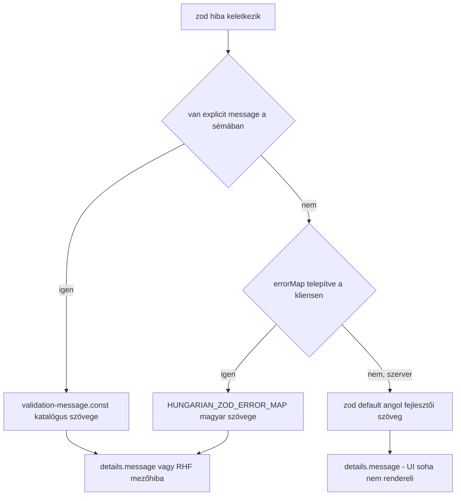

# AIS-112 — közös formátum-sémák + magyar zod hibaüzenetek

**Állapot:** jóváhagyásra váró terv
**Ticket:** AIS-112 (az AIS-103 sub-taskja) — `shared/contract: közös formátum-sémák (e-mail, telefon E.164, adószám, IBAN, postai kód, dátum) + magyar zod hibaüzenetek`
**Előfeltételek:** AIS-108 (hibakód-katalógus) — **kész**; AIS-111 (hibakód-copy tábla) — **In Review**, a terv nem írja át a fájljait
**Nincs a hatókörben:** `packages/ui` form primitívek (AIS-113), `useAppForm` (AIS-115), `apps/web` űrlapjai, `apps/api` kontroller/filter módosítás

---

## 1. A ticket pontosítása a kód alapján

| Ticket pont | Mai valóság | Teendő |
| --- | --- | --- |
| `packages/shared/src/contract/common/` létrehozandó | A mappa **nem létezik**; a közös sémák szórványosan a `contract/` gyökérben vannak ([`datetime.schema.ts`](packages/shared/src/contract/datetime.schema.ts:16)) | **2. lépés** — új `common/` mappa |
| `errorMap` + `z.setErrorMap` bekötés | **Veszélyes**: a `@callback/shared`-et a `apps/api` is importálja, egy modul-scope `setErrorMap` a szerver `details[].message`-ét is magyarra váltaná, ami ellentmond a [API-Convention §3](docs/Specs/API-Convention.md:83) szabálynak („`message` — English, for developers”) | **D2** — a map **exportált érték**, nem globális side effect |
| „`contract/index.ts` exportok frissültek” | Nincs `contract/index.ts`; a publikus felület a [`packages/shared/src/index.ts`](packages/shared/src/index.ts:1) | ott kell exportálni |
| Telefon: `libphonenumber-js` | A csomag **nincs** a repóban (`pnpm-lock.yaml`-ban nincs nyoma) | **D3** — új shared dependency |
| Adószám ellenőrző összeg | Nincs implementáció | **4.3** — a képletet valós, publikált adószámokkal kell hitelesíteni, nem fixture-höz igazítani |
| `dateOnly` konverzió „tiszta helper” | Ma admin-oldali: [`toExpiryIso`](apps/admin/src/lib/date.ts:45) lokális éjfélt képez, D6 döntés szerint | **D5** — a helper `shared/lib/`-be kerül, a lokális időzóna-szemantika **megmarad** |
| „Egy RHF mező teszt” | Csak úgy teljesíthető, ha a form-séma a shared sémából **származik** | **D1** — teljes D2 integráció a `api-keys` formon (jóváhagyott hatókör) |

Ma a forma a backend szabályait **újrafogalmazza**: [`apiKeyFormSchema`](apps/admin/src/pages/api-keys/api-keys.logic.ts:64) kézzel ismétli a limiteket és a pattern-t, a magyar szövegek pedig az [`API_KEY_FORM_VALIDATION_MESSAGES`](apps/admin/src/pages/api-keys/api-keys.const.ts:115)-ben élnek — ez a D2 által tiltott második igazság.

---

## 2. Kulcsdöntések

| # | Döntés | Indok / alternatíva |
| --- | --- | --- |
| **D1** | A `apiKeyFormSchema` a `createApiKeySchema`-ból **származik** (`.omit().extend()`), a kézi limitek és a `API_KEY_FORM_VALIDATION_MESSAGES` törlődnek | A story D2-je; a kliens így nem küldhet olyat, amit a szerver elutasít |
| **D2** | A copy **két nyelven** él egy katalógusban (`hu` + `en`), a szabály viszont **egy**: a sémák üzenet-függvényt használnak (`{ message: () => resolveMessage(KEY) }`), ami a **beállított locale**-t olvassa. A locale default `en`, és **csak** a kliens bootstrap állítja `hu`-ra | „UI magyar, belső hiba angol”: a `apps/api` processben a default angol marad (`details[].message` fejlesztői szöveg, [API-Convention §3](docs/Specs/API-Convention.md:83)), az admin bundle-ben a locale `hu`. Alternatíva (elvetve): két külön séma — az a D2 „második igazság” tiltását sértené |
| **D3** | Telefon: `libphonenumber-js` (a ticket szerint), HU default ország, `parsePhoneNumberFromString(...).isValid()` + `.number` (E.164) | Kézi E.164 normalizálás hibafarm; a bundle-költség csak akkor jelentkezik, ha egy oldal importálja a `phoneSchema`-t (ESM tree-shaking). Alternatíva (elvetve): HU-only regex helper |
| **D4** | IBAN: saját mod-97 implementáció (iteratív `(r*10+d) % 97`), nem `iban` csomag | ~30 sor, tesztelhető, nincs új dependency |
| **D5** | A naptári nap → instant konverzió `shared/lib/date-only.ts`-be kerül, **lokális éjfél** szemantikával; az admin [`lib/date.ts`](apps/admin/src/lib/date.ts:1) csak delegál + a megjelenítést tartja meg | A timezone-policy nem duplikálódhat; a meglévő D6-os viselkedés (és a `date.test.ts`) nem változhat |
| **D6** | A `createApiKeySchema` mezői `trimmedString`-re váltanak (a `'   '` név ma átmegy) | A DoD whitespace-esete csak így teljesül a shared szinten; **viselkedésváltozás** a szerveren: whitespace-only név `400`, nem `'   '` a DB-ben — ezt a API-Convention-ben rögzíteni kell |
| **D7** | A `zodResolver` második argumentuma (`{ errorMap: VALIDATION_ERROR_MAP }`) kapja a map-et; ha a `@hookform/resolvers@3.10.0` ezt nem továbbítja, fallback: `z.setErrorMap(VALIDATION_ERROR_MAP)` egyszer, az admin bootstrapban | A döntés **ellenőrzéssel** kezdődik (1. lépés), nem feltételezéssel |
| **D8** | A locale **szándékosan** modul-scope állapot (`let locale: 'en' \| 'hu' = 'en'`), explicit `configureValidationLocale('hu')` hívással az [`apps/admin/src/main.tsx`](apps/admin/src/main.tsx:1)-ben; a `resetValidationLocale()` a tesztekhez | Az i18n-nek konfigurált locale kell; a default `en` biztosítja, hogy a szerver soha ne kapjon magyar szöveget. Teszt bizonyítja: default `en` (szerver-biztonság) + `hu` kapcsoló hatásai |

### 2.1 Döntési fa (hibaüzenet forrása)



---

## 3. Sablon: a közös sémák felülete

Minden formátum-séma `z.ZodType` konstans, a limitek/patternek [`format.const.ts`](packages/shared/src/contract/common/format.const.ts:1)-ben:

| Séma | Fájl | Szabály |
| --- | --- | --- |
| `emailSchema` | `common/email.schema.ts` | `.trim().toLowerCase()` + `z.string().email()` + max hossz |
| `phoneSchema` | `common/phone.schema.ts` | `libphonenumber-js`, HU default; E.164-re transzformál |
| `normalizePhone` | `common/phone.helper.ts` | `string → string \| null` (submit előtti normalizálás, D4 a ticketben) |
| `huTaxNumberSchema` | `common/hu-tax-number.schema.ts` | `XXXXXXXX-Y-ZZ` + ellenőrző összeg |
| `huPostalCodeSchema` | `common/hu-postal-code.schema.ts` | pontosan 4 számjegy (tartomány-ellenőrzés tudatosan nincs) |
| `ibanSchema` | `common/iban.schema.ts` | szóköz nélkül, nagybetűsítve, mod-97 |
| `dateOnlySchema` | `common/date-only.schema.ts` | `ÉÉÉÉ-HH-NN` + valós naptári nap (`Date.UTC` round-trip) |
| `urlSchema` | `common/url.schema.ts` | `z.string().url()` + max hossz |
| `trimmedStringSchema({max})`, `nonEmptyTextSchema({max})`, `identifierSchema({pattern,max})` | `common/text.schema.ts` | trim → min → max; a `createApiKeySchema` ezekből épül |
| `dateOnlyToLocalIsoInstant`, `toLocalDateOnly` | `lib/date-only.ts` | naptári nap ⇄ ISO instant, lokális éjfél (D5) |

---

## 4. Üzenet- és hibaútvonal

### 4.1 `common/validation-message.const.ts`

Kulcsonként **két** szöveg (`en` = belső/fejlesztői, `hu` = UI): `REQUIRED`, `INVALID_TYPE`, `INVALID_FORMAT`, `EMAIL`, `URL`, `PHONE`, `TAX_NUMBER`, `TAX_NUMBER_CHECKSUM`, `IBAN`, `IBAN_CHECKSUM`, `POSTAL_CODE`, `DATE_ONLY`, `IDENTIFIER`, `TOO_SHORT_TEMPLATE`, `TOO_LONG_TEMPLATE`. A típus totális record, így egy új kulcs mindkét nyelvben fordítási hibát okoz, ha hiányzik.

### 4.2 `common/validation-message.helper.ts`

`resolveMessage(key)` (az aktuális locale-t olvassa), `configureValidationLocale(locale)`, `resetValidationLocale()`, valamint a `formatMessage(template, params)` interpoláció (`{min}` / `{max}`) — így a `.const.ts` tiszta konstans marad (D8).

### 4.3 `common/validation-error-map.const.ts`

`VALIDATION_ERROR_MAP: z.ZodErrorMap` — a zod **által generált** üzeneteit adja vissza az aktuális locale-en: `invalid_type`, `too_small`, `too_big`, `invalid_string` (`email`, `url`, `regex`), `invalid_date`, `invalid_enum_value`, `unrecognized_keys`, `custom`; ismeretlen kódra `{ message: ctx.defaultError }` (nem nyelvet váltunk csendben). Ugyanezt a map-et kapja a szerver default (`en`) locale mellett, tehát a `details[].message` angol marad.

### 4.4 Ellenőrző összegek

| Mező | Algoritmus | Hitelesítés |
| --- | --- | --- |
| HU adószám | 8 jegyű törzs; súlyok `[9,7,3,1,9,7,3]` az 1–7. jegyre, `check = (10 - (Σ mod 10)) mod 10`, a 8. jeggyel egyeznie kell; a `-Y-ZZ` utótag alak-ellenőrzés (`Y` 1–5, `ZZ` 01–44) | **merge előtt** legalább 3 publikált, valós adószámon kell zöldnek lennie; ha nem, a képletet javítjuk, nem a fixture-t |
| IBAN | szóköz törlés, uppercase, `^[A-Z]{2}\d{2}[A-Z0-9]{11,30}$`, első 4 karakter a végére, betű→szám (`A=10…Z=35`), iteratív mod 97, eredmény `1` | 3 valós IBAN (HU + nem HU) + 1 elrontott ellenőrző jegy |

---

## 5. Admin integráció (teljes D2)

| Fájl | Változás |
| --- | --- |
| [`pages/api-keys/api-keys.logic.ts:64`](apps/admin/src/pages/api-keys/api-keys.logic.ts:64) | `apiKeyFormSchema = createApiKeySchema.omit({ expiresAt: true }).extend({ expiresAt: dateOnlySchema.or(z.literal('')) })` — a `isExpiryInputAccepted` és a kézi `.min/.max/.regex` törlése |
| [`pages/api-keys/api-keys.const.ts:115`](apps/admin/src/pages/api-keys/api-keys.const.ts:115) | `API_KEY_FORM_VALIDATION_MESSAGES` **törlése** (a copy a shared katalógusból jön) |
| [`pages/api-keys/ui/ApiKeyForm.tsx:55`](apps/admin/src/pages/api-keys/ui/ApiKeyForm.tsx:55) | `zodResolver(apiKeyFormSchema, { errorMap: HUNGARIAN_ZOD_ERROR_MAP })` (D7 fallback szerint) |
| [`lib/date.ts:45`](apps/admin/src/lib/date.ts:45) | `toExpiryIso` a shared `dateOnlyToLocalIsoInstant`-re delegál; a `formatExpiry` marad |
| [`pages/api-keys/api-keys.logic.ts:110`](apps/admin/src/pages/api-keys/api-keys.logic.ts:110) | `toCreateApiKeyInput` a shared helperrel konvertál, a trim a sémában már megtörtént |

A `expiresAt` üres stringje **szándékos**: a `<input type="date">` üres értéke `''`, a wire-en viszont **hiányzó** kulcs (nem `null`) — ezt a meglévő `toCreateApiKeyInput` már így kezeli, a tesztje marad.

---

## 6. Dokumentáció (kötelező, ugyanabban a commitban)

| Fájl | Változás |
| --- | --- |
| [`docs/Specs/API-Convention.md`](docs/Specs/API-Convention.md:83) | §3 pontosítás: `details[].message` a shared **copy-katalógusból** jön (stabil magyar szöveg), a UI továbbra sem rendereli; új § „Közös formátum-sémák” a `common/` fájltérképpel + D6 trim-viselkedésváltozás; `Utolsó frissítés` dátum |
| [`docs/Specs/UI-Architecture.md`](docs/Specs/UI-Architecture.md:1) | a form-séma származtatás és a `HUNGARIAN_ZOD_ERROR_MAP` bekötés helye; `Utolsó frissítés` dátum |
| `docs/history/<ts>-ais-112-shared-format-schemas-and-hungarian-zod-messages.md` | változásnapló |
| `docs/milestones/<ts>-ais-112-shared-validation-schemas.milestone.md` | **kötelező** (többfájlos, több csomagot érintő design-döntés), angol nyelven, ≤1 oldal |

---

## 7. Tesztelés

### 7.1 `packages/shared` (jest) — új specek, minden sémára

| Spec | Esetek |
| --- | --- |
| `test/email.schema.test.ts` | érvényes; nagybetűs → lowercase; szóköz a széleken → trim; üres; csak whitespace; formátumhiba; max hossz fölött |
| `test/phone.schema.test.ts` | `+36301234567`, `+36 30 123 4567`, `06-30-123-4567`, `(06 30) 123 4567` → mind `+36301234567`; üres; betű; túl rövid; túl hosszú; nem létező HU körzetszám |
| `test/hu-tax-number.schema.test.ts` | 3 valós adószám elfogadva; hibás ellenőrző jegy elutasítva; hibás `Y` (0, 6); hibás `ZZ` (00, 45); formátumhiba (kötőjel nélkül, 9 jegyű törzs); üres |
| `test/hu-postal-code.schema.test.ts` | `1011`, `9985` elfogadva; `111`, `11111`, `abcd`, `1011 ` elutasítva; üres |
| `test/iban.schema.test.ts` | 3 valós IBAN; szóközös IBAN elfogadva; 1 karakter elrontva → ellenőrző összeg hiba; rossz ország-prefix; túl rövid; üres |
| `test/date-only.schema.test.ts` | `2026-11-04` ok; `2026-02-29` (nem szökőév) elutasítva; `2026-13-01`, `2026-1-1`, `2026.11.04`, `2026-11-04T00:00:00Z` elutasítva; üres; a két konverzió oda-vissza (idempotens) |
| `test/url.schema.test.ts` | `https://` ok; `http://` ok; `pelda.hu` elutasítva; `javascript:` elutasítva; max hossz |
| `test/text.schema.test.ts` | trim; `'   '` → REQUIRED; boundary max és max+1; `identifierSchema` egyedi pattern-nel (generic bizonyíték) |
| `test/validation-error-map.test.ts` | default locale **`en`** (szerver-biztonság: a `details[].message` nem lesz magyar); `configureValidationLocale('hu')` után minden érintett zod kód magyar szöveget ad; `too_small`/`too_big` interpolálja a limitet; ismeretlen kód → `ctx.defaultError`; a locale-váltás a séma explicit üzenetére is hat |
| `test/api-keys-request-trim.test.ts` | (frissítés) a `createApiKeySchema` whitespace-only `name`-et elutasít, a `'  kulcs  '` értéket trimelten adja vissza — a D6 viselkedés bizonyítéka |

Minden spec a **hibaüzenetre** is állít (nem csak `success === false`), mert a DoD a magyar copy-t kéri számon.

### 7.2 `apps/admin` (vitest)

| Fájl | Változás |
| --- | --- |
| [`pages/api-keys/api-keys.logic.test.ts:58`](apps/admin/src/pages/api-keys/api-keys.logic.test.ts:58) | a `API_KEY_FORM_VALIDATION_MESSAGES` hivatkozások lecserélése a shared katalógus szimbólumaira; **új** eset: a séma a shared `createApiKeySchema`-ból származik (a `name` limitje `API_KEY_NAME_MAX_LENGTH`-ból jön) |
| [`pages/api-keys/ui/ApiKeyForm.test.tsx:85`](apps/admin/src/pages/api-keys/ui/ApiKeyForm.test.tsx:85) | **DoD-eset**: üres `name` beküldése → a mező alatt magyar `REQUIRED` szöveg (RHF mező teszt); **új**: érvénytelen `identifier` → a magyar `IDENTIFIER` copy; **új**: `expiresAt` = `2026-02-29` → magyar `DATE_ONLY` copy, a kérés nem megy ki |
| [`lib/date.test.ts`](apps/admin/src/lib/date.test.ts:1) | változatlanul zöldnek kell maradnia (a D5 delegálás viselkedés-azonos) |

### 7.3 Nem-teszt ellenőrzések

`pnpm quality` (layers, knip, palette, field-errors gate) — a knip elvárt: az új exportok mind használtak legyenek; ha nem, **nem** suppress, hanem a fogyasztó hívja őket.

---

## 8. Végrehajtási sorrend

1. **Verifikáció (kód nélkül):** `@hookform/resolvers` `zodResolver` szignatúrájának ellenőrzése a `node_modules`-ban (D7); 3 valós adószám + 3 valós IBAN összegyűjtése; `git log --oneline -5` a commit-konvencióhoz.
2. `common/format.const.ts`, `common/text.schema.ts`, `common/email.schema.ts`, `common/url.schema.ts` + `validation-message.*` + `validation-error-map.const.ts`.
3. `common/phone.*` (a `libphonenumber-js` dependency hozzáadása a `packages/shared/package.json`-hoz, `pnpm install`).
4. `common/hu-tax-number.schema.ts`, `common/hu-postal-code.schema.ts`, `common/iban.schema.ts`, `common/date-only.schema.ts`, `lib/date-only.ts`.
5. `createApiKeySchema` átállítása `trimmedString`-re (D6); `configureValidationLocale('hu')` az [`apps/admin/src/main.tsx`](apps/admin/src/main.tsx:1)-ben (D8); exportok a [`packages/shared/src/index.ts`](packages/shared/src/index.ts:1)-ben.
6. Shared tesztek (7.1) — itt dől el az adószám/IBAN hitelesítés.
7. Admin integráció (5. pont) + admin tesztek (7.2).
8. Dokumentáció (6. pont).
9. Teljes ellenőrzés (9. pont) → git commit → Jira (10. pont).

---

## 9. Ellenőrzés (PowerShell, egyenként)

```powershell
pnpm --filter @callback/shared build
pnpm --filter @callback/shared test
pnpm --filter @callback/admin test
pnpm --filter @callback/admin lint
pnpm --filter @callback/admin build
pnpm --filter @callback/api test
pnpm quality
pnpm test
```

Manuális bizonyíték a D2-re: ideiglenesen töröljük a `TOO_LONG_TEMPLATE`-et → a `validation-error-map.test.ts`-nek és a `api-keys.logic.test.ts`-nek el kell hasalnia (a copy egy helyen él).

---

## 10. Git commit és Jira

### 10.1 Commit

Egy commit, a repó konvenciója szerint (ellenőrizni: `git log --oneline -10`), javasolt üzenet:

```
feat(shared): common format schemas with bilingual validation messages (AIS-112)
```

A commit testében a ticket-kulcs; a pre-commit hook (`pnpm quality`, lint, teszt) zölden fut, nem bypass-oljuk (`--no-verify` tilos).

### 10.2 Jira komment (bizonyíték)

A komment tartalma: mit vezettünk be (fájltérkép), a Döntések tábla D1–D7 egy soros összefoglalója, a **futtatott parancsok és eredményeik** (shared/admin teszt darabszám, `pnpm quality` zöld), a DoD pipálás, a D6 viselkedésváltozás említése, valamint a commit SHA.

### 10.3 DoD pipálás (a ticket listája szerint)

- [ ] minden séma unit tesztelve (érvényes / határérték / érvénytelen formátum / üres / whitespace)
- [ ] `huTaxNumber`: formátum **és** ellenőrző összeg
- [ ] `iban`: hibás ellenőrző összeg elhasal
- [ ] `phone`: HU `+36` formák (szóköz, kötőjel, zárójel) elfogadva és E.164-re normalizálva
- [ ] magyar hibaüzenet a UI-ban (RHF mező teszt)
- [ ] `pnpm --filter @callback/shared test` zöld, az exportok frissültek

### 10.4 Státusz

`To Do` → **In Progress** a munka indulásakor, majd a komment és a zöld pipeline után → **In Review** (ugyanaz a folyamat, mint az AIS-111-nél). A tranzíciós ID-ket futtatás előtt `listJiraIssueTransitions`-szel kell kiolvasni, nem tippelni.

---

## 11. Kockázatok

| Kockázat | Mérséklés |
| --- | --- |
| A locale-állapot (D8) vagy a `z.setErrorMap` a szerverre is átterjed | A locale default `en`, és a szerver sehol nem hívja a `configureValidationLocale`-t; a `z.setErrorMap` csak az admin bootstrapban fut (a `apps/api` soha nem importálja az admin kódját). Őr teszt: default locale mellett a `details[].message` angol |
| A `libphonenumber-js` megnöveli az admin bundle-t | A `phoneSchema`-t ma egy oldal sem importálja; tree-shaking miatt csak használatkor kerül a bundle-be. Ha ez mégis probléma, `libphonenumber-js/min` import |
| Az adószám-képlet rossz | Valós adószámokon való hitelesítés a merge feltétele (4.3); a hibás jegyű pár bizonyítja, hogy nem „midnen elfogadó” |
| A D6 trim-viselkedésváltás szerver-oldali tesztet tör | `pnpm --filter @callback/api test` a 9. pontban; e2e-ben csak ott lehet, ahol whitespace-only payloadot küld (ma nincs ilyen) |
| A `createApiKeySchema.omit().extend()` a `.strict()`-séget elveszti | A zod `extend`/`omit` megtartja az `unknownKeys` policy-t; **külön teszt** állítja, hogy a form-séma továbbra is elutasít egy ismeretlen kulcsot |
| A `expiresAt` `'' \| dateOnly` unió a `toCreateApiKeyInput`-ban kétértelmű | Az unió szűkítése a meglévő `toExpiryIso` (most shared helper) felelőssége marad: üres → `undefined` → a kulcs kimarad |
| Az AIS-111 In Review fájljainak ütközése | A terv nem nyúl az `api-error-code.*`, `field-errors.*`, `error-message.const.ts` fájlokhoz; a `ApiKeyForm`-ban csak a resolver-hívás sora változik |
| A `docs/Specs/API-Convention.md:83` („message — English”) sérül | Nem sérül: a szerver default locale `en`, a magyar szöveg csak a böngésző bundle-ben jelenik meg; a specs csak annyival egészül ki, hogy a `message`/`details[].message` a shared **katalógusból** jön, nem ad-hoc stringekből |
