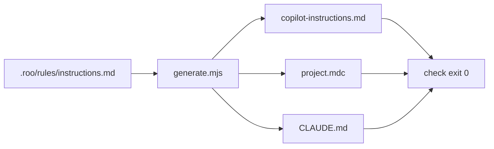

# AIS-101 — Git commit title convention in the AI instructions (plan)

**Ticket:** [AIS-101](https://zakzag.atlassian.net/browse/AIS-101) — `Task`, To Do, labels `ai-instructions`, `git`, `process`, `tooling`
**Created:** 2026-11-04 14:19
**Authoritative source of the rule:** [`.roo/rules/instructions.md`](../../.roo/rules/instructions.md:1)

## 1. Context verified in the repo

- `.roo/rules/instructions.md` currently contains only `# Documentation`, `# Milestones` and `# Specs doksik karbantartása` (lines 1–97). A search for `commit` across `.roo/**/*.md` returns **0 hits**, so the convention genuinely does not exist for the agents.
- The rule must be authored there because that file is source #1 of the artefacts pipeline: [`discoverRuleSources()`](../../scripts/lib/agent-artifacts/rules.mjs:67) reads every `.roo/rules/*.md` (`instructions.md` first, then byte order) and [`renderInstructionFile()`](../../scripts/lib/agent-artifacts/rules.mjs:104) concatenates them into `.github/copilot-instructions.md`, `.cursor/rules/project.mdc` and `CLAUDE.md`.
- Those artefacts are gitignored; [`syncGitignore()`](../../scripts/lib/agent-artifacts/writer.mjs:75) keeps the `# --- AI agent instruction files ...` section in sync, so a regeneration must not produce a `.gitignore` diff.
- `--check` is non-writing and exits `2` when stale ([`docs/Specs/AI-Agent-Artifacts.md`](../Specs/AI-Agent-Artifacts.md:103) §5), `--agent` accepts `copilot|cursor|claude` ([`AGENT_SPECS`](../../scripts/lib/agent-artifacts/rules.mjs:30)).
- Regression suite exists: `pnpm test:agents` → `node --test "scripts/lib/agent-artifacts/*.test.mjs"` ([`package.json`](../../package.json:26)).
- History confirms the pain: mixed titles and a manual rewrite of the last 12 subjects in [`docs/history/2026-11-03--16-30-00-git-commit-message-ticket-prefix-rewrite.md`](../history/2026-11-03--16-30-00-git-commit-message-ticket-prefix-rewrite.md:1). The rule formalises the practice already used.



## 2. Decisions taken from the ticket

| #   | Decision                                                                                                                     |
| --- | ---------------------------------------------------------------------------------------------------------------------------- |
| D1  | New `# Git commit üzenetek` H1 section inside `.roo/rules/instructions.md`; no `.roomodes` / per-mode `customInstructions`.  |
| D2  | Jira key is a **prefix**: `<KEY>: <type>(<scope>): <summary>`. Suffix `(AIS-41)` is dropped.                                 |
| D3  | Ticket-less fallback uses the Conventional Commit type set, not literal `feature:` / `bugfix:`.                              |
| D4  | Key resolution chain: session ticket → `[A-Z][A-Z0-9]{1,9}-\d+` from the branch name → no key. Inventing a key is forbidden. |
| D5  | Instructions only — no commitlint, no husky/commit-msg hook, no CI title gate.                                               |
| D6  | Regenerate `copilot`, `cursor`, `claude`; commit only the authored sources.                                                  |
| D7  | Rule covers PR titles and squash-merge titles.                                                                               |
| D8  | No milestone; `docs/history/` entry is still mandatory.                                                                      |

## 3. Implementation steps

1. **Insert the section** into [`.roo/rules/instructions.md`](../../.roo/rules/instructions.md:14) between `# Documentation` and `# Milestones`, English body, keeping the ticket's Hungarian heading so the ticket verification grep matches. Structure:
   - the two mandatory formats in a `text` block,
   - constraint table: `<KEY>`, closed `<type>` list (`feat`, `fix`, `refactor`, `perf`, `test`, `docs`, `chore`, `build`, `ci`, `style`, `revert`), optional lowercase multi-scope `(api, infra)`, imperative English summary, no trailing period, ≤ 72 chars, `!` before the colon for breaking changes,
   - key resolution chain (D4) plus the explicit ban on inventing a key and on using the key as a scope,
   - 3 correct examples, 5 forbidden examples with the one-line reason,
   - one sentence that the rule binds every branch, every agent and the PR/squash titles.
2. **Regenerate artefacts** for all three agents, then prove freshness with `--check` (must exit `0`).
3. **Run the agent-artefact regression suite** (`pnpm test:agents`).
4. **Write the history entry** `docs/history/2026-11-04--<HH-ii-ss>-ais-101-git-commit-title-convention-rule.md`: what changed, where the rule lives, how it is verified, link to the ticket.
5. **Commit** with a conforming title, e.g. `AIS-101: chore(rules): add commit title convention`; confirm `git status` shows only `.roo/rules/instructions.md` and the history file (no generated artefact, no `.gitignore` diff).
6. **Smoke test** in a fresh chat: request one ticket-bound and one ticket-less commit title, verify both against the rule, and post both titles as a comment on AIS-101.

## 4. Verification

```bash
rg -n "^# Git commit üzenetek" .roo/rules/instructions.md
node scripts/lib/agent-artifacts/generate.mjs --agent copilot --check
node scripts/lib/agent-artifacts/generate.mjs --agent cursor --check
node scripts/lib/agent-artifacts/generate.mjs --agent claude --check
pnpm test:agents
git log --oneline -5
git status --short
```

Manual review gate: the 8 examples must be decidable from the rule text alone — no extra explanation needed.

## 5. Out of scope here — handed over to AIS-127

- commitlint config, `commit-msg` hook, PR-title / squash-title CI gate (D5) → **[AIS-127](https://zakzag.atlassian.net/browse/AIS-127)** (created 2026-11-04, `Task`, labels `ai-instructions`, `ci`, `git`, `process`, `tooling`).
- Rewriting existing commits.
- `.roomodes` and `docs/Specs/AI-Agent-Artifacts.md` (wildcard pipeline, contract unchanged).

AIS-101 must not touch any of these; the follow-up ticket is sequenced after the rule exists so it has a normative text to mirror.

## 6. Risks

| Risk                                                      | Mitigation                                                                                                   |
| --------------------------------------------------------- | ------------------------------------------------------------------------------------------------------------ |
| `--check` fails with exit `2` because artefacts are stale | Always regenerate first, then check.                                                                         |
| Generated artefacts accidentally staged                   | `.gitignore` already covers them; `git status --short` gate before commit.                                   |
| Rule wording ambiguous for the negative examples          | Keep the 5 forbidden examples with an explicit reason each; PR review checks decidability.                   |
| The introducing commit itself violates the rule           | Use the prepared subject `AIS-101: chore(rules): add commit title convention`.                               |
| Branch-name resolution proves noisy                       | Non-blocking: recorded in the ticket comment after the smoke test, tightening stays a follow-up (D4 step b). |
