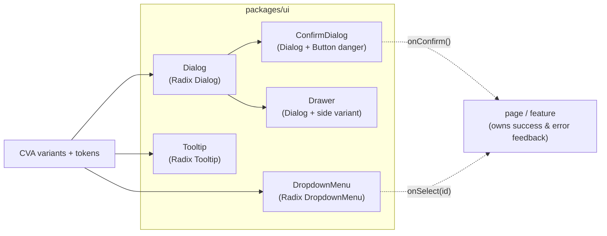

# AIS-117 — `packages/ui` overlay primitives (Dialog, ConfirmDialog, Drawer, Tooltip, DropdownMenu) with Radix behaviour

**Ticket:** AIS-117 (subtask of AIS-104 _"Megjelenítés: közös táblázat-, lapozás-, állapot- és overlay-primitívek"_)
**Date:** 2026-11-04 17:10 (Europe/Budapest)
**Priority:** High · labels: `a11y`, `frontend`, `ui`
**Scope:** `packages/ui` (+ its tests, + docs). **No admin page change** — see §1.
**Status:** implemented (2026-11-04 17:45) — see
[`../history/2026-11-04--17-45-00-ais-117-overlay-primitives.md`](../history/2026-11-04--17-45-00-ais-117-overlay-primitives.md:1)
and [`../milestones/2026-11-04--17-45-00-ais-117-radix-overlay-layer.milestone.md`](../milestones/2026-11-04--17-45-00-ais-117-radix-overlay-layer.milestone.md:1)

---

## 1. Ticket vs. reality

| Ticket statement                                                     | Reality today                                                                                                                                                                              | Plan                                                                                                                                        |
| -------------------------------------------------------------------- | ------------------------------------------------------------------------------------------------------------------------------------------------------------------------------------------ | ------------------------------------------------------------------------------------------------------------------------------------------- |
| 5 new primitives (`Dialog`, `ConfirmDialog`, `Drawer`, `Tooltip`, `DropdownMenu`) | none exists; `packages/ui/src/components/` has 25 primitives, all hand-rolled, **zero runtime dependencies besides CVA/clsx/tailwind-merge**                                  | §4 — build all five on Radix behaviour                                                                                                       |
| "Radix only supplies behaviour" (D1)                                  | `@radix-ui/*` is **not installed anywhere** (`search_files` for `radix` in all `*.json`: 0 hits)                                                                                              | §3 — 3 new packages as `dependencies` of `@callback/ui`                                                                                      |
| D4: "_`@radix-ui/react-popover`_ a `Drawer`-hez"                       | a `Drawer` (sequential form / filter panel) is **modal**: it needs focus trap, `Esc`, `aria-modal`, scroll lock — `Popover` provides none of these                                          | **deviation, see D3** — the `Drawer` is built on `react-dialog` + a `side` variant ⇒ `popover` is **not** needed, one package fewer           |
| "`ConfirmDialog` … a `onConfirm` callbacket hívja"                    | correct and cheap                                                                                                                                                                            | D4                                                                                                                                           |
| DoD: RTL tests + `vitest-axe` a11y + palette gate + docs              | `vitest-axe` already wired (`test/mocks/axe-options.mock.ts`), palette gate covers `packages/ui/src`                                                                                           | §6, §7                                                                                                                                       |
| "Párhuzamosítható az AIS-115-tel (data-display)"                      | AIS-115 is `useAppForm`; the **data-display** ticket is **AIS-116**, and it is **done** (its primitives are exported from `src/index.ts`)                                                     | Jira text fix (§8)                                                                                                                           |
| "A `ConfirmDialog`-ot az AIS-22 … használják"                         | AIS-22 (emails page) does not exist yet; `apps/admin` has **no** dialog, no dialog trigger, no row-actions menu, no `z-*` usage                                                               | **first consumers land later** (AIS-22). This ticket proves the API with its own tests, exactly as AIS-113 did for the form primitives        |

### Prerequisites

| Prerequisite                                                                      | State                                                                                  |
| --------------------------------------------------------------------------------- | -------------------------------------------------------------------------------------- |
| Design tokens (`surface-overlay`, `shadow-neu-raised`, `radius-card`, `duration-*`) | ✅ [`theme.css:36`](packages/ui/src/styles/theme.css:36)                               |
| `Button` vocabulary (`primary`/`secondary`/`ghost`/`danger`, `isLoading`)           | ✅ [`button.variants.ts:1`](packages/ui/src/components/button/button.variants.ts:1)     |
| `vitest-axe` harness (jsdom, `color-contrast` off)                                | ✅ [`axe-options.mock.ts:1`](packages/ui/test/mocks/axe-options.mock.ts:1)              |
| Palette gate on `packages/ui/src`                                                  | ✅ [`palette-gate.mjs:1`](scripts/quality/palette-gate.mjs:1)                           |
| A consumer needing confirm / menu / tooltip                                        | ❌ AIS-22 (emails) — deliberately **out of scope**                                      |

---

## 2. What "overlay" means here (conceptual)



Every overlay is **controlled** (`open` + `onOpenChange`) except the two that are
purely transient (`Tooltip`, `DropdownMenu`, where Radix owns the state).
No overlay knows about notifications, toasts, routing or server state.

---

## 3. Design decisions

| #        | Decision                                                                                                                                                                                                | Reason                                                                                                                                                                                                                                                                                                          |
| -------- | ------------------------------------------------------------------------------------------------------------------------------------------------------------------------------------------------------- | --------------------------------------------------------------------------------------------------------------------------------------------------------------------------------------------------------------------------------------------------------------------------------------------------------------- |
| **D1**   | Radix supplies **behaviour only** (focus trap, `Esc`, `aria-modal`, portal, dismiss-on-outside, roving focus). The visual layer is ours: CVA variants + `theme.css` tokens. **No** Radix CSS import, no `--radix-*` styling, no shadcn variables. | Ticket D1. One visual recipe per element (React standard §0.5: a new visual concept is built once in `packages/ui`).                                                                                                                                                                                            |
| **D2**   | Only the **used** Radix packages go in: `@radix-ui/react-dialog`, `@radix-ui/react-dropdown-menu`, `@radix-ui/react-tooltip` — all three as `dependencies` (they ship runtime code); `react`/`react-dom` stay `peerDependencies`. | Ticket D4 (bundle size). `@radix-ui/react-popover` is dropped — see D3.                                                                                                                                                                                                                                          |
| **D3**   | **`Drawer` = `Dialog` + `side: 'left' \| 'right'` variant** (slide-in panel, position classes from `drawer.variants.ts`), **not** Radix `Popover`.                                                      | A drawer hosting a form must trap focus, close on `Esc`, hide the background from AT and lock scroll — exactly the `Dialog` contract. `Popover` is a non-modal, trigger-anchored layer; using it for a side panel silently loses all four behaviours, which is the opposite of the ticket's goal. Net: 3 packages instead of 4. |
| **D4**   | `ConfirmDialog` **returns the decision and does nothing else**: confirm → `onConfirm()`, cancel / `Esc` / outside → `onOpenChange(false)`. No navigation, no toast, no mutation. `tone` defaults to `danger`, caller may pass `primary`. | Ticket D2. The caller owns success/error feedback (AIS-111 error surfaces stay in the page).                                                                                                                                                                                                                     |
| **D5**   | Every overlay renders into **`document.body`** through the Radix portal, stacked with the Tailwind scale utilities `z-40` (backdrop) / `z-50` (panel). **No `z-index` token is added.**                   | `theme.css` has no z-scale and overlay depth is *layout*, not *colour* — the palette gate does not cover it. A token scale is a separate design-system change.                                                                                                                                                    |
| **D6**   | `Tooltip` ships **its own `Tooltip.Provider`** internally (delay from `tooltip.const.ts`), so no app-level provider is needed. A `TooltipProvider` export is **not** added until a real need appears.     | Keeps `app/` untouched (scope) and prevents "forgot the provider ⇒ silent no-op". A per-app provider (for `skipDelayDuration`) is a later, additive change.                                                                                                                                                       |
| **D7**   | `Tooltip` **never replaces a label**: content is wired as `aria-describedby`; the trigger must already have an accessible name. Documented in JSDoc and asserted by a test.                             | Ticket requirement + React standard §8 (every input has a `<label>`).                                                                                                                                                                                                                                            |
| **D8**   | `DropdownMenu` is **data-driven**: `items: readonly DropdownMenuItem[]` plus optional `label`, not a consumer-assembled JSX tree. `DropdownMenuItem = { id, label, onSelect, tone?, disabled? }`, `tone: 'default' \| 'danger'`. | The row-action list is data in every real page (`api-keys`, `emails`). A small fixed vocabulary keeps the markup in one place (DRY) and makes the menu testable without DOM spelunking. Extending later = adding an item field, not rewriting pages.                                                               |
| **D9**   | User-visible default strings live in `<primitive>.const.ts` in **Hungarian**, matching `FORM_ACTIONS_CANCEL_LABEL = 'Mégsem'`. Only `cancelLabel` has a default; **`title` and `confirmLabel` are required props**. | Coding standards (constants file) + consistency with the existing kit. A generic "OK" confirm label is an a11y/behaviour trap in a destructive flow.                                                                                                                                                            |
| **D10**  | `src/index.ts` gets explicit exports only (components, variant functions, consts, types) — no `export *`.                                                                                                | Existing convention; `src/index.ts` is a `knip` entry, so app-unused exports are not flagged.                                                                                                                                                                                                                    |
| **D11**  | Triggers are **slots** (`trigger: ReactNode` / `children`), never a built-in `Button`.                                                                                                                   | Keeps `packages/ui` composable: the caller decides `Button` variant/size; no `asChild` casts leaking into the public API.                                                                                                                                                                                        |

---

## 4. Files

```text
packages/ui/src/components/
  dialog/          dialog.interface.ts          dialog.const.ts          dialog.variants.ts          Dialog.tsx
  confirm-dialog/  confirm-dialog.interface.ts  confirm-dialog.const.ts                              ConfirmDialog.tsx
  drawer/          drawer.interface.ts          drawer.const.ts          drawer.variants.ts          Drawer.tsx
  tooltip/         tooltip.interface.ts         tooltip.const.ts         tooltip.variants.ts         Tooltip.tsx
  dropdown-menu/   dropdown-menu.interface.ts   dropdown-menu.const.ts   dropdown-menu.variants.ts   DropdownMenu.tsx
packages/ui/test/
  dialog.test.tsx  confirm-dialog.test.tsx  drawer.test.tsx  tooltip.test.tsx  dropdown-menu.test.tsx
  overlay-a11y.test.tsx                       # vitest-axe: every overlay open
  mocks/overlay-user.mock.ts                  # shared userEvent setup + jsdom Radix shims
  mocks/overlay-harness.mock.tsx              # trigger + controlled wrapper used by every test
packages/ui/src/index.ts                      # explicit exports (D10)
packages/ui/package.json                      # 3 Radix dependencies (D2)
```

No new `*.logic.ts`: the surviving "logic" is Radix's plus `useId()`; there is no pure
rule worth extracting. If one appears during implementation (e.g. item filtering), it
goes into `dropdown-menu.logic.ts` **with a unit test** — never into JSX.

---

## 5. Primitive contracts

### 5.1 `Dialog`

```ts
export interface DialogProps {
  readonly open: boolean;
  readonly onOpenChange: (open: boolean) => void;
  readonly title: string;
  readonly description?: string;
  /** Slot: the caller owns the button variants (D11). */
  readonly footer?: ReactNode;
  readonly children?: ReactNode;
  readonly size?: 'sm' | 'md' | 'lg';
  readonly closeLabel?: string;
  readonly className?: string;
}
```

- Markup: `Dialog.Root` → `Dialog.Portal` → `Dialog.Overlay` (`bg-surface-sunken`
  with `opacity-80`) → `Dialog.Content` (`role="dialog"`, `aria-modal="true"`,
  `rounded-card border border-hairline border-border-hairline bg-surface-raised shadow-neu-raised`).
- `aria-labelledby` / `aria-describedby` are produced by `Dialog.Title` /
  `Dialog.Description` with ids from `useId()` — never from a manual `id` prop, so two
  dialogs on one page cannot collide.
- Close button: `Button variant="ghost" size="sm"` with `aria-label={closeLabel}`.
- **Controlled only** (`open` is required; Radix's uncontrolled mode is not exposed), so the
  page store remains the single owner of "is it open". `onOpenChange(false)` fires on `Esc`,
  outside click and the close button — all three are Radix behaviour.

### 5.2 `ConfirmDialog`

```ts
export interface ConfirmDialogProps {
  readonly open: boolean;
  readonly onOpenChange: (open: boolean) => void;
  readonly title: string;
  readonly description?: string;
  readonly confirmLabel: string;
  readonly cancelLabel?: string; // default: CONFIRM_DIALOG_CANCEL_LABEL
  readonly tone?: 'danger' | 'primary'; // default: 'danger'
  readonly isPending?: boolean; // disables both buttons + aria-busy
  readonly onConfirm: () => void;
}
```

- Composes `Dialog` (no additional Radix usage); footer = `Button variant="ghost"` (cancel)
  + `Button variant={tone} type="button"` (confirm).
- **D4:** `onConfirm` is the only callback besides `onOpenChange`; the component **never
  closes itself** on confirm — the caller closes it (usually in the mutation's `onSuccess`).
  Otherwise a failing mutation would already have dismissed the dialog and lost context.

### 5.3 `Drawer`

```ts
export interface DrawerProps {
  readonly open: boolean;
  readonly onOpenChange: (open: boolean) => void;
  readonly title: string;
  readonly description?: string;
  readonly side?: 'right' | 'left'; // default: 'right'
  readonly footer?: ReactNode;
  readonly children?: ReactNode;
  readonly closeLabel?: string;
}
```

- `Dialog` + `drawer.variants.ts` positioning: full height, `w-full max-w-md`, slide from the
  chosen edge, body area `overflow-y-auto`.
- Same a11y contract as `Dialog` (`aria-modal`, `aria-labelledby`, focus trap, `Esc`, focus
  returned to the trigger).

### 5.4 `Tooltip`

```ts
export interface TooltipProps {
  readonly content: ReactNode;
  readonly children: ReactNode; // the trigger element
  readonly side?: 'top' | 'right' | 'bottom' | 'left'; // default: 'top'
  readonly delayMs?: number; // default: TOOLTIP_DEFAULT_DELAY_MS (400)
  readonly disabled?: boolean;
}
```

- Internal `Tooltip.Provider` (D6); panel = `rounded-control border border-hairline
  border-border-hairline bg-surface-overlay shadow-neu-raised text-sm text-text-primary`.
- D7: content lands in `aria-describedby`; a test asserts the trigger keeps its own accessible
  name and the tooltip is **not** the only name source.

### 5.5 `DropdownMenu`

```ts
export type DropdownMenuItemTone = 'default' | 'danger';

export interface DropdownMenuItem {
  readonly id: string;
  readonly label: string;
  readonly onSelect: (id: string) => void;
  readonly tone?: DropdownMenuItemTone;
  readonly disabled?: boolean;
}

export interface DropdownMenuProps {
  readonly trigger: ReactNode; // slot (D11)
  readonly items: readonly DropdownMenuItem[];
  readonly label?: string; // menu heading / aria-label
  readonly align?: 'start' | 'end'; // default: 'end' (row actions)
  readonly emptyLabel?: string; // when items is empty
}
```

- `DropdownMenu.Root` → `Trigger asChild` → `Portal` → `Content` (token surface, `z-50`) →
  `Item` per entry; `tone: 'danger'` → `text-danger` and a sunken focus surface.
- `onSelect(id)` receives the item id; the menu closes itself (Radix behaviour).
- Empty `items` → the `emptyLabel` row rendered disabled, so a permission-filtered action list
  never shows an empty floating box.

---

## 6. Tests

### 6.1 jsdom reality (why two mock files)

Radix Dialog/DropdownMenu need DOM APIs jsdom does not implement. Instead of patching inside
test files (forbidden: mocks live in `test/mocks/`):

| File                                  | Content                                                                                                                                                                                                                                                       |
| ------------------------------------- | ------------------------------------------------------------------------------------------------------------------------------------------------------------------------------------------------------------------------------------------------------------- |
| `test/mocks/overlay-user.mock.ts`     | `ResizeObserver`, `Element.prototype.hasPointerCapture` / `releasePointerCapture` / `scrollIntoView` shims + `createOverlayUser()` = `userEvent.setup({ pointerEventsCheck: 0 })` (Radix sets `pointer-events: none` on `body` while modal, which would turn every click into a false failure) |
| `test/mocks/overlay-harness.mock.tsx` | A controlled `Dialog` / `Drawer` / `ConfirmDialog` harness with a named trigger button and visible open/closed state, plus a `DropdownMenu` item fixture — shared by all five tests, no per-test fixtures                                                        |

### 6.2 Cases (`packages/ui/test/`)

| File                                   | Cases                                                                                                                                                                                                                                                                       |
| -------------------------------------- | ----------------------------------------------------------------------------------------------------------------------------------------------------------------------------------------------------------------------------------------------------------------------------- |
| `dialog.test.tsx`                      | closed → nothing in the a11y tree; open → `role="dialog"`, `aria-modal="true"`, title wired via `aria-labelledby`; **`Esc` closes**; close button closes; outside click closes; closing returns focus to the trigger; `size` classes; `footer` slot renders                      |
| `confirm-dialog.test.tsx`              | confirm → `onConfirm` called **once** and `onOpenChange` **not** called with `false` (D4); cancel → `onOpenChange(false)`, no `onConfirm`; `Esc` behaves as cancel; `isPending` disables both buttons + `aria-busy`; `tone="primary"`; default `cancelLabel` from the const       |
| `drawer.test.tsx`                     | `side="right"`/`"left"` positioning classes; `role="dialog"` + `aria-modal`; `Esc` closes; focus returns to the trigger; `footer` slot; scrollable body area                                                                                                                     |
| `tooltip.test.tsx`                    | hidden by default; focus on trigger → visible content; content linked via `aria-describedby`; **trigger accessible name unchanged** (D7); `disabled` → never shown; `side` variant class                                                                                        |
| `dropdown-menu.test.tsx`              | closed → no `menu` role; open via trigger → `role="menu"` + items; keyboard (`ArrowDown`/`Enter`) selects → `onSelect('rename')`; `danger` item carries the danger class; `disabled` item does not fire; empty `items` → `emptyLabel`, no crash; `align="end"` default          |
| `overlay-a11y.test.tsx` (`vitest-axe`) | `Dialog`, `ConfirmDialog`, `Drawer`, `DropdownMenu` open and `Tooltip` visible → `expectNoViolations` (assert on `results.violations`, per the existing `form-a11y.test.tsx` pattern, with `AXE_JSDOM_OPTIONS`)                                                                 |

No network, no real timers (Radix delays overridden with `delayMs={0}` in tests).

---

## 7. Documentation

| File                                                                    | Change                                                                                                                                                                                                                    |
| ----------------------------------------------------------------------- | -------------------------------------------------------------------------------------------------------------------------------------------------------------------------------------------------------------------------- |
| [`docs/Specs/UI-Architecture.md:151`](docs/Specs/UI-Architecture.md:151) §4 | 5 new rows in the primitives table (props, notes: controlled-ness, D3/D4/D7)                                                                                                                                           |
| same §3.3                                                               | one paragraph: overlays render in a `body` portal, stacked with `z-40`/`z-50`; **no z token** exists yet (D5)                                                                                                              |
| same §7                                                                 | `@radix-ui/react-dialog`, `@radix-ui/react-dropdown-menu`, `@radix-ui/react-tooltip` rows (`installed`, `where: packages/ui`, `why: behaviour-only overlay layer`) + a note on why `popover` is absent (D3) and the measured bundle delta |
| same header                                                             | `**Utolsó frissítés:**` bumped                                                                                                                                                                                            |
| `docs/history/…`                                                        | change narrative (files, bundle delta, test count)                                                                                                                                                                        |
| `docs/milestones/…`                                                     | decision-grade summary (D1–D5, D11) — multi-file, design-decision change                                                                                                                                                  |

---

## 8. Order of work

1. `pnpm --filter @callback/ui add @radix-ui/react-dialog @radix-ui/react-dropdown-menu @radix-ui/react-tooltip` (D2) — record resolved versions.
2. `test/mocks/overlay-user.mock.ts` + `overlay-harness.mock.tsx` (get jsdom out of the way **before** writing components).
3. `Dialog` (+ `dialog.variants.ts`, consts) + `dialog.test.tsx`.
4. `ConfirmDialog` on top of `Dialog` + test (D4 proofs).
5. `Drawer` (+ `drawer.variants.ts`) + test.
6. `Tooltip` + test (D6/D7 proofs).
7. `DropdownMenu` + test.
8. `overlay-a11y.test.tsx`; `src/index.ts` exports; `pnpm --filter @callback/ui test` + `build` + `pnpm quality`.
9. Measure the admin bundle delta (`pnpm --filter @callback/admin build`, compare `dist/assets/*.js` before/after) → the number goes into the history doc.
10. Docs (§7), Jira comment (ticket text fixes: AIS-115 → AIS-116 for the data-display parallelism; D4 popover → dialog for the `Drawer`), history + milestone, status → In Review.

---

## 9. Verification

```powershell
pnpm --filter @callback/ui test
pnpm --filter @callback/ui build
pnpm --filter @callback/admin build   # bundle delta + consumer tsc
pnpm quality                          # palette gate, layer gate, field-error gate
pnpm test                             # whole repo
```

Expected: the `ui` suite grows by 6 files; palette gate `0 violations` (no Radix CSS, no
palette utility); `z-40`/`z-50` are layout utilities, not colour tokens, so they must pass the
gate; `knip` clean (`src/index.ts` is an entry).

## 10. Risks

| Risk                                                                  | Mitigation                                                                                                                                                                                                |
| --------------------------------------------------------------------- | ---------------------------------------------------------------------------------------------------------------------------------------------------------------------------------------------------------- |
| Radix in jsdom produces false failures (`pointer-events`, `ResizeObserver`) | §6.1 shims + `pointerEventsCheck: 0`, centralised in `test/mocks/`, never per test                                                                                                                    |
| Bundle growth from three Radix packages                               | D2 keeps only what is used, D3 drops `popover` entirely; the delta is measured (§8.9) and recorded in `UI-Architecture.md` §7                                                                              |
| The `Drawer`-on-`Dialog` deviation contradicts the ticket text (D4)   | Explicit decision D3 with the a11y argument + a Jira comment before coding. If the reviewer insists on `popover`, the fallback is `@radix-ui/react-popover` + a hand-written focus trap — more code, not less |
| `ConfirmDialog` closing itself would swallow a failed mutation        | D4: the caller closes it; a test proves `onOpenChange(false)` is **not** called on confirm                                                                                                                  |
| Two dialogs on one page collide on `aria-labelledby` ids              | `useId()` inside `Dialog` (§5.1); the id is never a prop                                                                                                                                                   |
| A `Tooltip` silently becoming the only accessible name                | D7 + an explicit test case                                                                                                                                                                                 |
| `z-50` hard-coded in five files                                       | Overlay `z-*` values live in the const files (`dialog.const.ts`, `dropdown-menu.const.ts`), referenced by the variants — not repeated literals in JSX                                                       |
