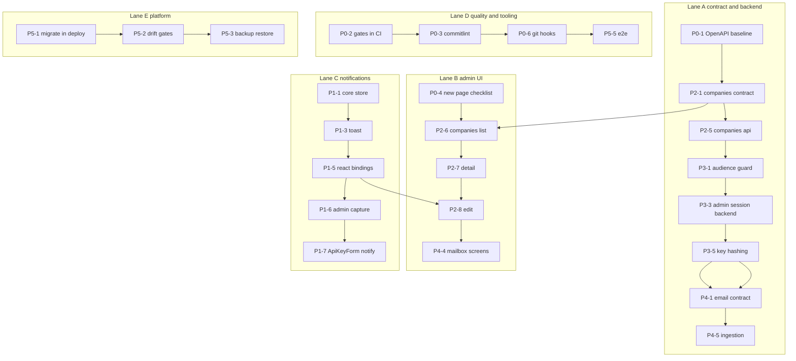

# Standardised feature roadmap — implementation order + parallel lanes

**Date:** 2026-11-04 18:25, revised 18:35 (Europe/Budapest)
**Purpose:** tell the next developer **what to build, in what order, and which parts can run in parallel** without breaking the
already-standardised server ↔ client contract, error handling, data shapes, UI primitives and error copy.
**Method:** every claim was checked against the working tree (`apps/api/src`, `apps/admin/src`, `apps/web/src`, `packages/*/src`),
the full Jira board (`AIS-1 … AIS-127`) and the commit history (`7d246da` back to `1b6afca`). `docs/history/` was ignored
by request; `docs/plans/` and `docs/milestones/` were used only where ticket text was empty.

**Agreed order (owner decision, 2026-11-04):**

1. **Admin** — notifications, then companies.
2. **Security** — audience split, admin session, key hashing.
3. **Email processing** — the next product feature. The call-back / VAPI flow is **parked** (see §7).

---

## 1. What is already the standard (do not re-invent)

| Concern                                 | Standard artefact                                                                                                                                                 | Status                                                                                                 |
| --------------------------------------- | ----------------------------------------------------------------------------------------------------------------------------------------------------------------- | ------------------------------------------------------------------------------------------------------ |
| Wire contract, envelope, error envelope | [`packages/shared/src/contract/`](../../packages/shared/src/contract/) — `envelope.schema.ts`, `error-envelope.ts`, `error-code.const.ts`, `http-status.const.ts` | done (AIS-88)                                                                                          |
| Route as data                           | [`endpoint.registry.ts`](../../packages/shared/src/contract/endpoint.registry.ts) + `<resource>.contract.ts`                                                      | done (AIS-89)                                                                                          |
| List / paging contract                  | `list-query.schema.ts`, `paginated.schema.ts`, `api-result.interface.ts`                                                                                          | done (AIS-106)                                                                                         |
| Format schemas + validation copy        | `contract/common/*.schema.ts`, `validation-message.const.ts` (en + hu)                                                                                            | done (AIS-112)                                                                                         |
| Server error taxonomy                   | `apps/api/src/common/http/app-error.ts`, `api-exception.filter.ts`, `zod-error.mapper.ts`                                                                         | done (AIS-90/91)                                                                                       |
| Client transport + parse                | `packages/api-client/src/` — `http-client.ts`, `envelope.logic.ts`, `clientPathOf`                                                                                | done (AIS-94/109/110)                                                                                  |
| Admin data flow                         | [`docs/Specs/Admin-Data-Flow.md`](../Specs/Admin-Data-Flow.md:1)                                                                                                  | living doc                                                                                             |
| Admin forms                             | [`docs/Specs/Forms-and-Validation.md`](../Specs/Forms-and-Validation.md:1), `features/forms/use-app-form.ts`                                                      | done (AIS-115)                                                                                         |
| Field errors + copy table               | `apps/admin/src/lib/field-errors.logic.ts`, `api-error-code.const.ts`, `error-message.ts`                                                                         | done (AIS-111)                                                                                         |
| UI primitives                           | `packages/ui/src/components/*` — form, data-display, overlay sets                                                                                                 | done (AIS-113/116/117)                                                                                 |
| Error surfaces                          | `AppErrorBanner`, `PageErrorState`, `features/error-surface/*`                                                                                                    | done (AIS-96)                                                                                          |
| Reference vertical slice                | `apps/admin/src/pages/api-keys/*` + `apps/api/src/api-keys/*`                                                                                                     | done — **template for every new resource**                                                             |
| Quality gates                           | `scripts/quality/*`, `.dependency-cruiser.cjs`, `knip.json`, `pnpm typecheck`                                                                                     | green (AIS-122 close-out, 2026-11-04) — required-check setup documented in `UI-Architecture.md` §9.5.1 |

**Rule for every new feature:** copy the `api-keys` slice in the same five places (contract → api-client → api → feature hook →
page) per [`Admin-Data-Flow.md` §3](../Specs/Admin-Data-Flow.md:45). No new transport, no new error shape, no inline colours,
no `code ===` inside a component.

### Verified gaps in the standard itself

| Gap                             | Evidence                                                                                                     | Consequence                                                   |
| ------------------------------- | ------------------------------------------------------------------------------------------------------------ | ------------------------------------------------------------- |
| No OpenAPI baseline             | `docs/Specs/openapi.json` missing (AIS-99)                                                                   | no drift/breaking-change detection, no generated client types |
| No commit-title enforcement     | AIS-127 `To Do`; convention lives only in [`.roo/rules/instructions.md`](../../.roo/rules/instructions.md:1) | ticket ↔ commit traceability is voluntary                     |
| `apps/web` outside the standard | `App.tsx` + 2 pages, no tests, no service layer                                                              | any public surface will be built a second way                 |
| No written product scope        | [`Functional-Specification.md`](../Specs/Functional-Specification.md:1) is still the empty template          | product tickets stay guesswork                                |
| Migrations never run in deploy  | AIS-43…46 open                                                                                               | the first companies migration would drift the droplet         |

---

## 2. Implementation order

`⇄` marks a shared single-instance file that must be serialised (see §5).

### Phase 0 — close the standard, remove drift (small, highest leverage, do it first)

| #    | Ticket               | Work                                                                                                                                                                                         | Why first                                                |
| ---- | -------------------- | -------------------------------------------------------------------------------------------------------------------------------------------------------------------------------------------- | -------------------------------------------------------- |
| P0-1 | **AIS-99 / AIS-125** | deterministic `openapi:generate` → committed `docs/Specs/openapi.json`; `openapi:check` (staleness + breaking change); CI job                                                                | every endpoint built afterwards is validated for free    |
| P0-2 | **AIS-122**          | **done 2026-11-04** — `pnpm typecheck` and its `build-test` step landed; the required-check `gh` command is written down in `UI-Architecture.md` §9.5.1 and only needs an operator to run it | the rules become machine-enforced before more code lands |
| P0-3 | **AIS-127**          | `commitlint` + CI commit-title check (`AIS-###: type(scope): summary`)                                                                                                                       | traceability from the first admin commit                 |
| P0-4 | **AIS-123**          | `Admin-Data-Flow` and `Forms-and-Validation` exist → remaining: `UI-Architecture` §5/§7 refresh, "new admin page" checklist, history + milestone                                             | three pages will be built against this recipe            |
| P0-5 | **AIS-100**          | board hygiene only — the convention doc is complete                                                                                                                                          | no code                                                  |
| P0-6 | _(no ticket)_        | lefthook git hooks per `docs/plans/2026-10-27--11-41-38-git-hooks-quality-gate-plan.md`                                                                                                      | local prevention of what CI catches later                |

### Phase 1 — Admin: notifications + live log (start immediately, no server dependency)

| #    | Ticket        | Work                                                                                                                                     |
| ---- | ------------- | ---------------------------------------------------------------------------------------------------------------------------------------- |
| P1-1 | **AIS-79**    | `packages/notifications` core: observer store, ring buffer, dedupe, redaction                                                            |
| P1-2 | **AIS-80**    | sessionStorage persistence — injected `StorageLike`, versioned envelope, cap 200                                                         |
| P1-3 | **AIS-81**    | `Toast` + `ToastStack` primitives (CVA, tokens, a11y, max 3 visible) ⇄ `packages/ui/src/index.ts`                                        |
| P1-4 | **AIS-82**    | `LogDrawer` + `LogEntryRow` (side tab, filters, paging) ⇄ same index                                                                     |
| P1-5 | **AIS-83**    | React bindings: provider, `useSyncExternalStore` hooks, `notify` facade, `NotificationHost`                                              |
| P1-6 | **AIS-84**    | admin capture: `QueryCache`/`MutationCache`, `HttpEvent`/`onEvent` in the transport ⇄ `packages/api-client/src/http-client.interface.ts` |
| P1-7 | **AIS-85**    | `ApiKeyForm` → `notify`; `UI-Architecture` + history + milestone (end-to-end proof of the whole chain)                                   |
| P1-8 | _(no ticket)_ | make the `notify` port of `useAppForm` mandatory once P1-5 exists (today it is optional)                                                 |

**Why before companies:** the companies pages must show submit feedback through `notify`; building them on `Alert` and then
retrofitting is exactly the duplication this roadmap exists to prevent.

### Phase 2 — Admin: companies domain (first real consumer of the standard)

| #    | Ticket                  | Work                                                                                                                                         | Depends on |
| ---- | ----------------------- | -------------------------------------------------------------------------------------------------------------------------------------------- | ---------- |
| P2-1 | **AIS-16** + **AIS-14** | field set + formats (tax number, phone, IBAN, postal code from `contract/common/*`), list/detail/update schemas, registry entries, fixture   | P0-1, P0-4 |
| P2-2 | **AIS-18**              | Drizzle schema + migration on the `platform` pattern (named constraints, `updated_at $onUpdate`)                                             | P2-1       |
| P2-3 | **AIS-17**              | screen design with the existing primitives (`DataTable` columns, filters, `DescriptionList`, `useAppForm`)                                   | P2-1       |
| P2-4 | _(lane A)_              | api-client service + service-registry row + coverage test ⇄                                                                                  | P2-1       |
| P2-5 | _(lane A)_              | `apps/api/src/companies/*` — `responses.ok`, `AppError`s, repository `findPage` ⇄                                                            | P2-2       |
| P2-6 | **AIS-19**              | paginated list page (URL state, `EmptyState`, `Skeleton`, `PageErrorState`)                                                                  | P2-4, P2-5 |
| P2-7 | **AIS-20**              | detail page (`DescriptionList`, `StatusBadge`, 404 branch)                                                                                   | P2-6       |
| P2-8 | **AIS-21**              | edit (`PATCH` + `updatedAt`, `STALE_WRITE` → page error, field errors from `details[].path`, success toast)                                  | P2-7, P1-7 |
| P2-9 | **AIS-22**              | "process emails" action: `ConfirmDialog` + mutation + feedback. Ships against a documented stub endpoint, rewired to the real engine in P4-8 | P2-8       |

> **Schedule P5-1 (migrations in deploy) together with P2-2.** The first new product migration is the moment "migrations are
> run manually from a laptop" becomes a production risk.

### Phase 3 — Security foundation

Strict order — each step edits the same path constants or the same session surface as the previous one.

| #    | Ticket     | Work                                                                                                                                |
| ---- | ---------- | ----------------------------------------------------------------------------------------------------------------------------------- |
| P3-1 | **AIS-71** | `@Audience()` + fail-closed `AudienceGuard` as `APP_GUARD`; a route without an audience is a boot/test failure                      |
| P3-2 | **AIS-72** | `/api/api-keys` → `/api/admin/api-keys` (registry entry) + client const + e2e + two doc spots ⇄                                     |
| P3-3 | **AIS-73** | `platform.admin_users`, httpOnly cookie session, `AdminSessionGuard` + `RolesGuard`                                                 |
| P3-4 | **AIS-74** | admin SPA cookie session (`features/auth/*`, `auth.logic.ts` on `toFieldErrors`), delete `auth/session-token.ts` + `sessionStorage` |
| P3-5 | **AIS-75** | `api_key` → `api_key_hash` migration, show-once response, changed read schema + `createdApiKeySchema` ⇄ `api-keys.schema.ts`        |
| P3-6 | **AIS-76** | `/api/public/v1/*` namespace, `X-API-Key` guard, rate limiting, `createPublicClient`                                                |

> Until P3-5 lands `GET /api/api-keys` returns live provider tokens unauthenticated. Keep the droplet private until then.

### Phase 4 — Email processing (the next product feature; replaces the parked call-back flow)

Design authority already exists and must be followed, not re-derived:
[`2026-10-14-email-module-structural-design-plan.md`](2026-10-14-email-module-structural-design-plan.md:1) (hexagonal module,
ports + adapters, 17 use cases, 12 ports), [`2026-10-15--02-15-46-email-engine-profile-builder-plan.md`](2026-10-15--02-15-46-email-engine-profile-builder-plan.md:1)
(style profile builder), context: [`2026-09-21--18-12-48-email-assistant-mvp-integration-plan.md`](2026-09-21--18-12-48-email-assistant-mvp-integration-plan.md:1).

Build it as thin vertical slices, each slice using the standard contract → transport → api → hook → page chain.

| #     | Slice                     | Work                                                                                                                                                                                    | Standard-chain touchpoints                        |
| ----- | ------------------------- | --------------------------------------------------------------------------------------------------------------------------------------------------------------------------------------- | ------------------------------------------------- |
| P4-1  | Shared contract           | `contract/email/` — `mailbox`, `message`, `classification`, `rule`, `draft`, `approval`, `digest` schemas + registry entries + fixtures; the `email` Postgres schema is currently empty | `packages/shared/src/contract/email/*` ⇄ registry |
| P4-2  | Platform ports            | `ClockPort`, `JobSchedulerPort`, `SecureTokenStorePort` (AES-GCM over Postgres), `AuditLogPort`, `OperatorAlertPort` as tokens + adapters                                               | `apps/api/src/platform/*`                         |
| P4-3  | DB schema                 | `email` schema tables: mailbox, message, summary, rule, change log, style profile, draft, approval, idempotency                                                                         | migration on the P2-2 pattern                     |
| P4-4  | Mailbox connect           | OAuth start/callback, credential store, `MailboxRegistry`, admin connect/disconnect/suspend. **First admin screen of Phase 4** — reuse the companies recipe                             | `api/email/*` + `pages/mailboxes/*`               |
| P4-5  | Ingestion                 | `SyncCoordinator` — Gmail watch/poll → dedupe by `historyId`/`messageId` → canonical message → store; polling fallback via the same port                                                | port `MailProviderPort`, `MailWatchPort`          |
| P4-6  | Triage                    | five-category classification, urgency threshold, rules precedence (VIP/block/mute), context assembler                                                                                   | `domain/policies/*` pure functions                |
| P4-7  | Draft + approval gate     | `DraftService`, `SendApprovalGate` — the **only** path to a send; single-use approval for a frozen revision, no reply-all, no attachments                                               | `ConfirmDialog` + `useAppForm` in admin           |
| P4-8  | Message/draft admin pages | message list (`DataTable` + `Pagination` + URL state), message detail with summary, drafts/approvals queue, rules editor. Rewire **AIS-22** to the real engine                          | `pages/email/*`, feature hooks                    |
| P4-9  | Digest + notifications    | `DigestComposer`, `NotificationDispatcher`, quiet hours — the digest surfaces through the Phase 1 notification stack                                                                    | uses `notifications` package                      |
| P4-10 | Retention + audit         | daily purge (14d full text / 90d summary / 30d muted / 12m change log), audit trail                                                                                                     | scheduled job + `AuditLogPort`                    |
| P4-11 | Specs                     | **AIS-12 / AIS-13** are spec tickets only → write `docs/Specs/Email-Engine.md` and update `Functional-Specification.md`                                                                 | docs                                              |

MVP constraints to honour (from the design plan): Gmail only, push-first with polling fallback, one mailbox today / many later,
no send without explicit approval, external services are executors — our DB is the source of truth.

### Phase 5 — Platform hardening (parallel with everything above)

| #    | Ticket              | Work                                                                                                                                                                                 |
| ---- | ------------------- | ------------------------------------------------------------------------------------------------------------------------------------------------------------------------------------ |
| P5-1 | **AIS-43 … AIS-46** | advisory-lock migration runner, migrations baked into the image, one-shot `migrate` compose service, deploy step **before** the API recreate                                         |
| P5-2 | **AIS-47 / AIS-48** | schema-drift + destructive-DDL lint in CI; DB checks in the smoke suite                                                                                                              |
| P5-3 | **AIS-49 … AIS-55** | pre-migration snapshot, `backup.sh` (encrypted, off-host, retention), `restore.sh`, monthly `restore-drill.sh`, expand/contract policy, RPO/RTO, `Database-Migrations-and-Backup.md` |
| P5-4 | _(no ticket)_       | `apps/web` brought to the admin layer standard (`app/pages/features/entities/services/lib`, route registry, MSW harness, tests)                                                      |
| P5-5 | _(no ticket)_       | admin Playwright E2E: login → list → create → edit → delete on a seeded stack                                                                                                        |
| P5-6 | _(no ticket)_       | observability standard: log schema, metrics, 5xx alerting (requestId exists, nothing consumes it)                                                                                    |
| P5-7 | _(no ticket)_       | fix the misleading specs: `Local-Development.md` §2b.3, `Three-Env-Verification.md` §2.7, `Caddy-Reverse-Proxy.md` apex contradiction, `Production-Runbook.md` §4.3                  |

---

## 3. Parallel lanes

| Lane                       | Owns                                                 | Start today           | Blocked by                   |
| -------------------------- | ---------------------------------------------------- | --------------------- | ---------------------------- |
| **A — contract & backend** | `packages/shared`, `packages/api-client`, `apps/api` | P0-1 → P2-1           | nothing                      |
| **B — admin UI**           | `apps/admin`, `packages/ui`                          | P0-4 (docs) then wait | P2-1 for P2-6, P1-5 for P2-8 |
| **C — notifications**      | `packages/notifications`, toast/log primitives       | P1-1 immediately      | nothing                      |
| **D — quality & tooling**  | `scripts/`, `.github/`, root `package.json`          | P0-2, P0-3            | nothing                      |
| **E — platform**           | `infra/`, `deploy/`, `apps/api/src/migrate.ts`       | P5-1 immediately      | nothing                      |

**Recommended kick-off for two developers in parallel:** dev 1 takes Lane C (P1-1 → P1-7), dev 2 takes Lane A (P0-1 → P2-1 →
P2-5) with Lane B following the contract. A third developer can own Lane D/E without touching product code.

---

## 4. Conflict hotspots — serialise these files

| Hotspot                                                                    | Written by                       | Rule                                                               |
| -------------------------------------------------------------------------- | -------------------------------- | ------------------------------------------------------------------ |
| `packages/shared/src/contract/endpoint.registry.ts`                        | every new endpoint               | one PR per resource, rebase before merge                           |
| `packages/api-client/src/service.registry.ts` + `http-client.interface.ts` | every service / transport change | P1-6 (`onEvent`) must not land in the same PR as P2-4              |
| `packages/ui/src/index.ts`                                                 | every new primitive              | toast/log (Lane C) and mailbox/table work (Lane B) in separate PRs |
| `apps/admin/src/app/router/route-registry.tsx`                             | every new page                   | one entry per page, one PR per page                                |
| `apps/admin/src/lib/api-error-code.const.ts`                               | every new error code             | add codes in the PR that introduces them on the server             |
| `docs/Specs/*` headers                                                     | every change                     | bump `Utolsó frissítés` in the same PR                             |

---

## 5. Backlog with **no Jira ticket** (create them)

| #    | Item                                                                                                                   | Why it matters                             | Suggested type     |
| ---- | ---------------------------------------------------------------------------------------------------------------------- | ------------------------------------------ | ------------------ |
| U-1  | `pnpm typecheck` aggregate script                                                                                      | required by CI, git hooks, every lane      | Task               |
| U-2  | lefthook git hooks (plan from 2026-10-27, never implemented)                                                           | catches violations before CI               | Task               |
| U-3  | Email engine implementation tickets — P4-2 … P4-10 exist only as plan sections                                         | the next product feature has no work items | Story + 6 Subtasks |
| U-4  | `docs/Specs/Email-Engine.md` (AIS-12/13 are spec tickets, no implementation doc)                                       | single source for the module               | Task               |
| U-5  | `apps/web` layer standard + MSW harness + tests                                                                        | a second, divergent frontend today         | Story              |
| U-6  | Admin Playwright E2E                                                                                                   | no end-to-end proof of any flow            | Task               |
| U-7  | Observability: log schema, metrics, 5xx alerting                                                                       | failures are invisible                     | Story              |
| U-8  | Stale specs fix (`Local-Development` §2b.3, `Three-Env-Verification` §2.7, `Caddy` apex, `Production-Runbook` §4.3)    | actively misleading                        | Task               |
| U-9  | `useAppForm` `notify` port made mandatory after P1-5                                                                   | two form behaviours otherwise              | Task               |
| U-10 | Admin bootstrap: first admin user + seed data (needed by P3-4 and P5-5)                                                | login cannot be tested without it          | Task               |
| U-11 | Zod version consolidation (`@hookform/resolvers` had to pin zod 3)                                                     | dependency drift                           | Task               |
| U-12 | Board hygiene: `AIS-31/32/33/38` sit in a _Backlog_ status with a _Done_ category; `AIS-78/100` look open but are done | reporting lies                             | Task               |
| U-13 | Functional spec content: email-processing scope, call-back decision, MVP boundaries                                    | P4-11 depends on it                        | Task               |

---

## 6. Definition of done for any new feature (unchanged, restated)

1. Schema in `packages/shared/src/contract/<resource>/` + registry entry + fixture.
2. Service in `packages/api-client/src/<resource>/` with `clientPathOf` + registry row + coverage test.
3. `apps/api` module: `ZodBodyPipe`/`ZodQueryPipe`, `responses.ok()`, `AppError` subclasses, repository `findPage`.
4. `apps/admin`: feature hook with the uniform return shape, mapper in `entities/`, page composition, loading/empty/error/success.
5. Copy: field errors from `ERROR_CODE_CATALOGUE`, page errors from `toErrorMessage`, Hungarian, never the server `message`.
6. Tests: logic, hooks (MSW), primitives, error branches; `pnpm qa:all` green.
7. Docs: `docs/plans/` before, `docs/history/` + `docs/milestones/` after, affected `docs/Specs/*` in the same change.
8. Commit title `AIS-###: type(scope): imperative summary`.

---

## 7. Parked: call-back / VAPI flow (do not build now)

The previous roadmap version had this as Phase 4. It is **parked by owner decision**, not cancelled, and nothing was deleted:

- `vapi-webhooks/*` stays as an in-memory receiver (`vapi-webhooks.service.ts`), **not** a source of truth;
- the "Hívások" nav entry stays a placeholder;
- the missing pieces are recorded so the work is not re-discovered later: `callback_requests` contract + table, public submit
  endpoint under `/api/public/v1`, call state machine + worker, VAPI client, webhook persistence with idempotency,
  owner notification.

Resume only after Phase 4 has a running email slice, and start by writing the decision into
[`Functional-Specification.md`](../Specs/Functional-Specification.md:1).
