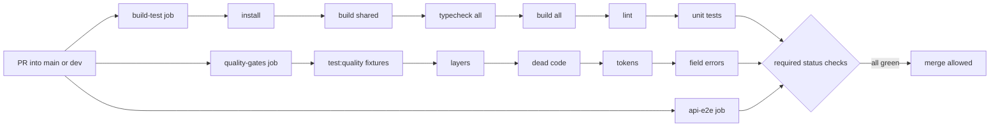

# AIS-122 — Quality gates close-out: required check, aggregate typecheck, doc sync

**Ticket:** [AIS-122](https://zakzag.atlassian.net/browse/AIS-122) — subtask of [AIS-105](https://zakzag.atlassian.net/browse/AIS-105) · High · `ci`, `quality`, `tooling`
**Date:** 2026-11-04 18:40 (Europe/Budapest)
**Supersedes scope of:** [`2026-11-02--18-25-00-ais-122-quality-gates-plan.md`](2026-11-02--18-25-00-ais-122-quality-gates-plan.md:1) — that plan **is implemented**; this one closes what is still open.
**Status:** plan — nothing implemented yet

---

## 1. Where AIS-122 actually stands

The four gates were built and merged on 2026-11-02. Verified against the working tree today:

| Ticket requirement                                                                                  | Artefact                                                                                                                                                                                                                                                                                                   | State                             |
| --------------------------------------------------------------------------------------------------- | ---------------------------------------------------------------------------------------------------------------------------------------------------------------------------------------------------------------------------------------------------------------------------------------------------------- | --------------------------------- |
| Layer lint (`app → pages → features → entities → services → lib`, no page→page, no feature→feature) | [``.dependency-cruiser.cjs`](../../.dependency-cruiser.cjs:1) + [``.dependency-cruiser.rules.cjs`](../../.dependency-cruiser.rules.cjs:66)                                                                                                                                                                 | done                              |
| Dead code (`knip`, documented exceptions)                                                           | [`knip.json`](../../knip.json:1) + [§9.2](../Specs/UI-Architecture.md:611)                                                                                                                                                                                                                                 | done                              |
| Palette gate incl. `packages/ui/src`                                                                | [`scripts/quality/palette-gate.mjs`](../../scripts/quality/palette-gate.mjs:1)                                                                                                                                                                                                                             | done                              |
| Field-error gate (`error.status ===`, `error.code ===`, `instanceof ApiError`)                      | [`scripts/quality/field-error-gate.mjs`](../../scripts/quality/field-error-gate.mjs:1)                                                                                                                                                                                                                     | done                              |
| D2 — negative fixture per gate                                                                      | [`scripts/quality/fixtures/`](../../scripts/quality/fixtures/) + [`layers.test.mjs`](../../scripts/quality/layers.test.mjs:1)                                                                                                                                                                              | done (`knip` excepted, see §3 D4) |
| D3 — runs on the PR, not only `main`                                                                | `pull_request` → `main`/`dev` in [`ci.yml`](../../.github/workflows/ci.yml:27)                                                                                                                                                                                                                             | done                              |
| DoD — `UI-Architecture.md` "CI gates" section                                                       | [§9](../Specs/UI-Architecture.md:549)                                                                                                                                                                                                                                                                      | done                              |
| Plan / history / milestone                                                                          | [`plans/…ais-122-quality-gates-plan.md`](2026-11-02--18-25-00-ais-122-quality-gates-plan.md:1), [`history/2026-11-02--19-05-00`](../history/2026-11-02--19-05-00-ais-122-quality-gates.md:1), [`milestones/2026-11-02--19-05-00`](../milestones/2026-11-02--19-05-00-ais-122-quality-gates.milestone.md:1) | done                              |

### The three things that are genuinely open

| #      | Gap                                                                            | Evidence                                                                                |
| ------ | ------------------------------------------------------------------------------ | --------------------------------------------------------------------------------------- |
| **G1** | `quality-gates` is **not a required check** — a rule violation can still merge | roadmap P0-2, [`roadmap`](2026-11-04--18-25-00-standardised-feature-roadmap-plan.md:45) |
| **G2** | No aggregate `pnpm typecheck` — **zero** `"typecheck"` scripts in the repo     | `grep '"typecheck"'` over all `package.json` → 0 hits                                   |
| **G3** | Jira says `In Progress` while the code is merged; board and tree disagree      | AIS-122 status vs. commits `9d4ead6`, `cf35504`, `c35504`                               |

Nothing else is missing. **This plan does not rebuild the gates.**

---

## 2. Goal

1. A rule violation **cannot merge** (G1).
2. One command type-checks the whole monorepo, and CI runs it (G2).
3. Documentation and Jira describe reality (G3).

---

## 3. Decisions

| #      | Decision                                                                                      | Why                                                                                                                                                                                                                  |
| ------ | --------------------------------------------------------------------------------------------- | -------------------------------------------------------------------------------------------------------------------------------------------------------------------------------------------------------------------- |
| **D1** | `typecheck` is a **per-workspace** script; the root script is `pnpm -r typecheck`             | `pnpm -r` fails outright when a selected workspace has no such script, so a root-only script is not enough                                                                                                           |
| **D2** | Root `typecheck` builds `@callback/shared` **first**                                          | `@callback/shared` and `@callback/api-client` are consumed through `dist/*.d.ts`; `tsc --noEmit` never emits, so a fresh clone would fail on missing types — same reason CI already has a "Build shared" step        |
| **D3** | `typecheck` is a **step inside the existing `build-test` job**, not a new job                 | it needs the same install + built shared; a new job would pay a second cold install for nothing                                                                                                                      |
| **D4** | `knip` stays **without** a negative fixture; the deviation is stated in §9.4                  | `knip` is a third-party tool, the gate _is_ its exit code; faking a dead-code fixture tree would test `knip`, not our rule. The ticket's D2 intent (a gate that cannot fail is not a gate) is met by the other three |
| **D5** | Required-check enforcement is a **repo setting**, documented as a command + a manual fallback | branch protection / rulesets live in GitHub, not in the repo; the plan must leave a reproducible instruction, not a vague "configure it"                                                                             |
| **D6** | `apps/api` gets a `typecheck` script too, using `tsc --noEmit -p tsconfig.json`               | otherwise `pnpm -r typecheck` silently skips the largest server codebase                                                                                                                                             |



---

## 4. Work packages

### W1 — Per-workspace `typecheck` scripts

Add one script to each workspace; no `tsconfig` changes, no new dependency.

| Workspace                                                                       | Script                                         |
| ------------------------------------------------------------------------------- | ---------------------------------------------- |
| [`packages/shared/package.json`](../../packages/shared/package.json:14)         | `"typecheck": "tsc --noEmit -p tsconfig.json"` |
| [`packages/api-client/package.json`](../../packages/api-client/package.json:14) | `"typecheck": "tsc --noEmit -p tsconfig.json"` |
| [`packages/ui/package.json`](../../packages/ui/package.json:10)                 | `"typecheck": "tsc --noEmit -p tsconfig.json"` |
| [`apps/admin/package.json`](../../apps/admin/package.json:6)                    | `"typecheck": "tsc --noEmit -p tsconfig.json"` |
| [`apps/web/package.json`](../../apps/web/package.json:6)                        | `"typecheck": "tsc --noEmit -p tsconfig.json"` |
| [`apps/api/package.json`](../../apps/api/package.json:9)                        | `"typecheck": "tsc --noEmit -p tsconfig.json"` |

Note: `apps/{admin,web}` keep `tsc --noEmit` inside `build` — leaving it there is deliberate (the build must never emit broken JS); `typecheck` is the fast, emit-free entry point.

### W2 — Root aggregate script

[`package.json`](../../package.json:9):

```json
"typecheck": "pnpm --filter @callback/shared build && pnpm -r typecheck",
```

Add it to `qa:all` **before** `build`, so a type error fails in seconds instead of after a full build:

```json
"qa:all": "pnpm quality && pnpm test:quality && pnpm sonar:test && pnpm test:agents && pnpm typecheck && pnpm build && pnpm lint && pnpm test"
```

### W3 — CI step

[`ci.yml`](../../.github/workflows/ci.yml:40) → inside `build-test`, right after the existing "Build shared" step and before "Build all packages":

```yaml
# Type-check every workspace without emitting. Runs after `build shared`
# because shared/api-client are consumed through dist/*.d.ts and
# `tsc --noEmit` produces none (AIS-122).
- name: Typecheck all packages
  run: pnpm typecheck
```

Update the header comment of the job (`#   * pnpm typecheck …`) so the workflow's own documentation stays true.

### W4 — Make `quality-gates` a required check

The required status check name is the job `name`, i.e. **`Quality gates (layers, dead code, tokens, field errors)`**.

Documented procedure (in [§9](../Specs/UI-Architecture.md:549) of `UI-Architecture.md`):

```bash
gh api -X PUT repos/:owner/:repo/branches/main/protection \
  -F required_status_checks.strict=true \
  -F 'required_status_checks.contexts[]=Quality gates (layers, dead code, tokens, field errors)' \
  -F 'required_status_checks.contexts[]=Install, build, lint, unit test' \
  -F enforce_admins=true \
  -F 'required_pull_request_reviews.required_approving_review_count=0' \
  -F restrictions=
```

Repeat for `dev`. If the repo uses **rulesets** instead of branch protection, the manual path is
_Settings → Rules → Rulesets → New ruleset → Require status checks to pass → add the three job names_.

Verification: a throwaway PR that adds `bg-slate-800` to one admin component must show a **red** `quality-gates` and the merge button disabled; reverting makes it green.

### W5 — Documentation + ticket sync

| File                                                                                                                                   | Change                                                                                                                                                                                                                               |
| -------------------------------------------------------------------------------------------------------------------------------------- | ------------------------------------------------------------------------------------------------------------------------------------------------------------------------------------------------------------------------------------ |
| [`docs/Specs/UI-Architecture.md`](../Specs/UI-Architecture.md:549)                                                                     | §9 gains `pnpm typecheck` in the command table and 9.5 "Required checks" (job names + the command above); §9.4 states the `knip` deviation (D4); header `**Utolsó frissítés:**` bumped to 2026-11-04 with the AIS-122 close-out note |
| [`docs/plans/2026-11-02--18-25-00-ais-122-quality-gates-plan.md`](2026-11-02--18-25-00-ais-122-quality-gates-plan.md:6)                | `Status:` line updated to `implemented — closed out by 2026-11-04--18-40-00-ais-122-quality-gates-close-out-plan.md`                                                                                                                 |
| [`docs/plans/2026-11-04--18-25-00-standardised-feature-roadmap-plan.md`](2026-11-04--18-25-00-standardised-feature-roadmap-plan.md:34) | §1 "Quality gates" row → `required check since AIS-122`; the two "verified gaps" rows for `typecheck` and required check are removed                                                                                                 |
| `docs/history/<YYYY-MM-DD--HH-ii-ss>-ais-122-quality-gates-close-out.md`                                                               | change narrative (mandatory)                                                                                                                                                                                                         |
| `docs/milestones/<YYYY-MM-DD--HH-ii-ss>-ais-122-quality-gates-close-out.milestone.md`                                                  | decision-grade summary: why `typecheck` is per-workspace, why the `knip` fixture deviation is accepted (mandatory — multi-file, CI-behaviour change)                                                                                 |
| Jira **AIS-122**                                                                                                                       | status → `Done`; comment with the evidence (gate list, negative-fixture names, `pnpm typecheck` output, required-check screenshot/proc output). Use the `jira-ticket-writer` mode                                                    |

---

## 5. Definition of done

- [ ] All six workspaces have a `typecheck` script; `pnpm typecheck` exits 0 on a clean tree.
- [ ] The negative proof for `typecheck`: a temporary type error in one `*.logic.ts` turns `pnpm typecheck` red; reverting turns it green.
- [ ] `pnpm quality` and `pnpm test:quality` are green (no regression from W1–W3).
- [ ] `ci.yml` `build-test` runs `pnpm typecheck` and the workflow header comment lists it.
- [ ] `quality-gates` is a required check on `main` and `dev`, proven by a red-PR screenshot/PR link.
- [ ] `UI-Architecture.md` §9 documents typecheck, the required-check command and the `knip` deviation; header date bumped.
- [ ] The stale status lines in the two earlier plan files are corrected.
- [ ] History + milestone written; AIS-122 moved to `Done` with the evidence comment.
- [ ] `pnpm qa:all` green.

---

## 6. Risks

| #   | Risk                                                                                                                     | Mitigation                                                                                                                     |
| --- | ------------------------------------------------------------------------------------------------------------------------ | ------------------------------------------------------------------------------------------------------------------------------ |
| R1  | `pnpm -r typecheck` fails because a workspace's `tsconfig.json` includes test files that need `dist/*.d.ts` of a sibling | D2 builds `shared` first; if `api-client` still fails, add `--filter` ordering rather than loosening the tsconfig              |
| R2  | `apps/api` `tsc --noEmit -p tsconfig.json` surfaces pre-existing errors (it has never been run emit-free in CI)          | run it **first**, alone; if it is dirty, that is a real finding and gets its own follow-up ticket rather than a silenced check |
| R3  | Required-check names drift when a job is renamed → merges block on a check that never appears                            | the three job names are written down in §9.5 as the single source of truth                                                     |
| R4  | `enforce_admins=true` in W4 could lock the owner out during an incident                                                  | if the team prefers, drop that flag and note the choice in §9.5                                                                |
