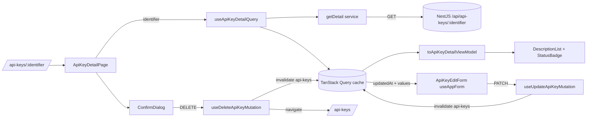

# AIS-131 — api-keys CRUD reference slice (detail, PATCH edit, ConfirmDialog delete)

**Ticket:** [AIS-131](https://zakzag.atlassian.net/browse/AIS-131) — subtask of AIS-129 (standardised admin page)
**Date:** 2026-11-04 19:50 (Europe/Budapest)
**Purpose:** turn the `api-keys` page from list + create into the **complete** CRUD reference slice, so AIS-19…22 (companies) and every later resource have a working template for detail, edit and delete.
**Owner decision (2026-11-04):** edit stays **inline** on the detail page; `Drawer` remains unused for now.

---

## 1. Verified starting point (checked against the working tree)

| Layer                 | Artefact                                                                                         | State                                                                                        |
| --------------------- | ------------------------------------------------------------------------------------------------ | -------------------------------------------------------------------------------------------- |
| Server routes         | [`api-keys.controller.ts`](../../apps/api/src/api-keys/api-keys.controller.ts:80)                 | `GET /:identifier`, `PATCH /:identifier`, `DELETE /:identifier` **already exist** (AIS-108)   |
| Client service        | [`api-keys.service.ts`](../../packages/api-client/src/api-keys/api-keys.service.ts:58)            | `findByIdentifier`, `update`, `remove` **already implemented**, no consumer                  |
| Generic hooks         | [`use-api-detail.ts`](../../apps/admin/src/features/api/use-api-detail.ts:23), [`use-api-mutation.ts`](../../apps/admin/src/features/api/use-api-mutation.ts:31) | exist, **zero call sites**                                                    |
| Query keys            | [`api-keys.const.ts`](../../apps/admin/src/features/api-keys/api-keys.const.ts:30)                | `API_KEYS_QUERY_KEYS.detail` declared, **unused**                                            |
| MSW handlers          | [`api-keys.handlers.ts`](../../apps/admin/src/test/mocks/handlers/api-keys.handlers.ts:92)        | detail success/404 exist; **no PATCH/DELETE handler**                                        |
| Close, not reuse      | [`ApiKeyForm.tsx`](../../apps/admin/src/pages/api-keys/ui/ApiKeyForm.tsx:55)                      | uses raw `useForm` + `toFieldErrors`, predates `useAppForm` (AIS-115)                        |
| Registry invariant    | [`route-registry.test.ts`](../../apps/admin/src/app/router/route-registry.test.ts:60)             | asserts *every* protected entry has a `navLabel` — a detail route would break it              |
| Primitives available  | `DescriptionList`, `StatusBadge`, `ConfirmDialog`, `EmptyState`, `Skeleton` in `@callback/ui`     | exported, unused by `api-keys`                                                               |

**Consequence:** this ticket writes almost no infrastructure — it wires existing, tested pieces into one page and proves the wiring with MSW tests.

---

## 2. Decisions

| #   | Decision                                                                                                                                                                                                                                                         |
| --- | ---------------------------------------------------------------------------------------------------------------------------------------------------------------------------------------------------------------------------------------------------------------- |
| D1  | Route is `/api-keys/:identifier` (deep-linkable, one registry entry, `navLabel: null`). The identifier is the API's own key (`toApiKeyDetailPath`), not the uuid.                                                                                                  |
| D2  | Edit is **inline** on the detail page: `DescriptionList` (read) + `Card`-hosted `useAppForm` form (write) + `Törlés` → `ConfirmDialog`. No `Drawer`, no modal form.                                                                                              |
| D3  | The edit form **never** touches `identifier` or `apiKey`: the shared `updateApiKeySchema` is `.strict()` and rejects `identifier`, and token rotation is AIS-75. Editable fields: `name`, `description`, `expiresAt`.                                             |
| D4  | `updatedAt` is **not a form field**. It is passed as a prop and merged in by a pure `toUpdateApiKeyInput(values, updatedAt)` (PATCH body convention).                                                                                                            |
| D5  | After a successful PATCH the form is remounted via `key={updatedAt}` on the page, because `useAppForm` ends a submit with `reset(defaultValues)` — with static defaults that reset would show the **pre-edit** values. The remount also makes the "new version" explicit. |
| D6  | `STALE_WRITE` (409) is **not** a field error (`fieldMessage: null`), so it lands on the page tier. The page renders an `Alert` **with a reload action** (`refetch`) instead of a generic sentence. The 409 branch is decided by one new pure helper in the allowlisted [`error-surface.logic.ts`](../../apps/admin/src/lib/error-surface.logic.ts:1) — never by `error.code ===` inside a component (the `quality:field-errors` gate would fail). |
| D7  | `422 SEMANTIC_VALIDATION_FAILED` goes through `useAppForm` → `toFieldErrors` onto `expiresAt`; unaddressable detail → `formError`.                                                                                                                              |
| D8  | Success feedback is an inline success `Alert` (a `useState` flag set by `onSuccess`). The `notify` port is passed as `null` until AIS-79…85 exists; swapping it in is a one-line change, not a rewrite.                                                          |
| D9  | The expiry badge is derived, not server data: `expiresAt` → `active` / `expired` / `none` with a `StatusBadge` variant, computed in the entity mapper (AIS-116 §5 `toStatusVariant` pattern).                                                                     |
| D10 | `route-registry.test.ts` invariant is **corrected**, not worked around: “a protected entry without a `navLabel` must be a parameter route” (the interface doc at [`route-entry.interface.ts`](../../apps/admin/src/app/router/route-entry.interface.ts:18) already says a detail page has `navLabel: null`; the test contradicted it). |

---

## 3. Data flow



---

## 4. Work breakdown

### Step 1 — registry, route and navigation entry

- [`apps/admin/src/app/app.const.ts`](../../apps/admin/src/app/app.const.ts:37): add `APP_ROUTE_API_KEY_DETAIL_PATH = '/api-keys/:identifier'` (next to the existing list path, with a comment that the param name matches the API's `:identifier`).
- [`apps/admin/src/app/router/route-registry.tsx`](../../apps/admin/src/app/router/route-registry.tsx:56): add the entry `{ path: APP_ROUTE_API_KEY_DETAIL_PATH, navLabel: null, element: <ApiKeyDetailPage />, protected: true }`. The nav derives itself — **no** new nav code.
- [`apps/admin/src/app/router/route-registry.test.ts`](../../apps/admin/src/app/router/route-registry.test.ts:60): replace the “gives every protected entry a label” test with the corrected invariant (D10) and keep the “declares every path exactly once” / “no `/api/` prefix” tests green.

### Step 2 — feature hooks (the only new server-state code)

- [`apps/admin/src/features/api-keys/api-keys.interface.ts`](../../apps/admin/src/features/api-keys/api-keys.interface.ts:63):
  `UseApiKeyDetailQueryResult`, `UseUpdateApiKeyMutationOptions/Result`, `UseDeleteApiKeyMutationOptions/Result`, and `ApiKeyEditFormFieldName` (`name` | `description` | `expiresAt`).
- [`apps/admin/src/features/api-keys/use-api-keys.ts`](../../apps/admin/src/features/api-keys/use-api-keys.ts:40): three adapters over the generic layer —
  `useApiKeyDetailQuery(identifier)` → `useApiDetail<ApiKey>` with `API_KEYS_QUERY_KEYS.detail(identifier)`;
  `useUpdateApiKeyMutation(identifier)` → `useApiMutation<ApiKey, UpdateApiKeyInput>` with `invalidateKeys: [API_KEYS_QUERY_KEYS.all]`;
  `useDeleteApiKeyMutation(identifier)` → `useApiMutation<null, void>`, same invalidation.
- [`apps/admin/src/features/api-keys/api-keys.const.ts`](../../apps/admin/src/features/api-keys/api-keys.const.ts:49): `API_KEY_EDIT_FIELD_PATHS`, and reuse `DEFAULT_FIELD_PATH_BY_CODE` unchanged (no default path for `SEMANTIC_VALIDATION_FAILED`).

### Step 3 — entity view model + expiry badge

- [`apps/admin/src/entities/api-key/api-key.interface.ts`](../../apps/admin/src/entities/api-key/api-key.interface.ts:9): add `ApiKeyDetailViewModel` (`name`, `identifier`, `description`, `expiresAtLabel`, `createdAtLabel`, `updatedAtLabel`, `expiry: { status, label, variant }`). The `apiKey` token still does not survive the mapper.
- [`apps/admin/src/entities/api-key/api-key.mapper.ts`](../../apps/admin/src/entities/api-key/api-key.mapper.ts:1): `toApiKeyDetailViewModel(apiKey)` reusing the existing label formatters, plus `toExpiryStatus(expiresAt, now)` (pure, injectable clock) returning the `StatusBadge` verdict.

### Step 4 — pure page logic

- [`apps/admin/src/pages/api-keys/api-keys.logic.ts`](../../apps/admin/src/pages/api-keys/api-keys.logic.ts:65): `toUpdateApiKeyInput(values, updatedAt)` (trim, `''` → `null` for `description`/`expiresAt`, `expiresAt` day → ISO via existing `toExpiryIso`, `updatedAt` passed through) and `toApiKeyDetailRoute(identifier)`.
- [`apps/admin/src/lib/error-surface.logic.ts`](../../apps/admin/src/lib/error-surface.logic.ts:75): `isStaleWriteFailure(error): boolean` (allowlisted decision module, D6).

### Step 5 — detail page and its UI parts

- [`apps/admin/src/pages/api-keys/ApiKeyDetailPage.tsx`](../../apps/admin/src/pages/api-keys/ApiKeyDetailPage.tsx) — route entry, composition only:
  `useParams` → identifier → `useApiKeyDetailQuery`; `Skeleton`/`DescriptionList isLoading`; `PageErrorState` for `errorSurface === 'page'` with a **404 branch** (own copy: “nem található”, link back to the list) instead of an empty `DescriptionList`; `EmptyState` never replaces a missing resource (a 404 is an error, not empty data).
- [`apps/admin/src/pages/api-keys/ui/ApiKeyDetailCard.tsx`](../../apps/admin/src/pages/api-keys/ui/ApiKeyDetailCard.tsx) — `DescriptionList` + `StatusBadge` (expiry) + `Törlés` button + `ConfirmDialog` (`isPending` bound to the mutation, closes only on success).
- [`apps/admin/src/pages/api-keys/ui/ApiKeyEditForm.tsx`](../../apps/admin/src/pages/api-keys/ui/ApiKeyEditForm.tsx) — `useAppForm` with `apiKeyEditFormSchema` (derived from the shared `updateApiKeySchema` the same way `apiKeyFormSchema` is derived from `createApiKeySchema`), success `Alert`, `formError` `Alert` (renders `STALE_WRITE` copy + “Újratöltés” when `isStaleWriteFailure(error)`), `FormActions` submit.
- [`apps/admin/src/pages/api-keys/ui/ApiKeysTable.tsx`](../../apps/admin/src/pages/api-keys/ui/ApiKeysTable.tsx:21) — the `name` cell becomes a `<Link>` to `toApiKeyDetailRoute(identifier)`; the identifier stays plain text.
- [`apps/admin/src/pages/api-keys/api-keys.const.ts`](../../apps/admin/src/pages/api-keys/api-keys.const.ts:17) — all new copy (detail title, field labels, delete dialog title/description/confirm label, stale-write reload label, success/error headings), Hungarian, in this one file.
- [`apps/admin/src/pages/api-keys/api-keys.interface.ts`](../../apps/admin/src/pages/api-keys/api-keys.interface.ts:1) — props of the two new UI parts and `ApiKeyEditFormValues`.

### Step 6 — MSW handlers (the network is the only mock point)

[`apps/admin/src/test/mocks/handlers/api-keys.handlers.ts`](../../apps/admin/src/test/mocks/handlers/api-keys.handlers.ts:92) — add, next to the existing detail handlers:

| Handler                       | Response                                                                     |
| ----------------------------- | ---------------------------------------------------------------------------- |
| `apiKeysUpdateSuccess`        | `200`, updated row echoed with a newer `updatedAt`                           |
| `apiKeysUpdateStaleWrite`     | `409 STALE_WRITE`, `details: [{ path: 'updatedAt' }]`                         |
| `apiKeysUpdateSemanticInvalid`| `422 SEMANTIC_VALIDATION_FAILED`, `details: [{ path: 'expiresAt' }]`          |
| `apiKeysUpdateNotFound`       | `404 NOT_FOUND`                                                              |
| `apiKeysDeleteSuccess`        | `200`, `data: null` (never `204`)                                            |
| `apiKeysDeleteNotFound`       | `404 NOT_FOUND`                                                              |

All bodies go through the existing `successResponse` / `errorResponse` helpers; the new handlers join the `apiKeysHandlers` default set.

---

## 5. Test matrix (all MSW, no real network)

| File                                                                                          | Cases |
| --------------------------------------------------------------------------------------------- | ----- |
| [`ApiKeyDetailPage.test.tsx`](../../apps/admin/src/pages/api-keys/ApiKeyDetailPage.test.tsx)   | loading → skeleton; success → `DescriptionList` values + expiry badge; 500 → `PageErrorState` + retry; **404 → dedicated branch, not an empty list**; `STALE_WRITE` on PATCH → page `Alert` + reload, **not** a toast |
| [`ui/ApiKeyEditForm.test.tsx`](../../apps/admin/src/pages/api-keys/ui/ApiKeyEditForm.test.tsx) | success → success alert + detail cache refreshed (invalidate); `422` → `expiresAt` field error **and focus**; unknown-path detail → `formError`; pending → submit disabled |
| [`ui/ApiKeyDetailCard.test.tsx`](../../apps/admin/src/pages/api-keys/ui/ApiKeyDetailCard.test.tsx) | confirm-less dismiss → no request; confirm → `DELETE` sent, dialog closes, navigate back; `isPending` blocks `Esc`/cancel |
| [`ui/ApiKeysTable.test.tsx`](../../apps/admin/src/pages/api-keys/ui/ApiKeysTable.test.tsx)     | name cell links to `/api-keys/<identifier>`; identifier is not a link |
| [`api-keys.logic.test.ts`](../../apps/admin/src/pages/api-keys/api-keys.logic.test.ts)         | `toUpdateApiKeyInput` (empty → `null`, day → ISO, `updatedAt` preserved); `toApiKeyDetailRoute` (encoding); existing sort tests unchanged |
| [`api-key.mapper.test.ts`](../../apps/admin/src/entities/api-key/api-key.mapper.test.ts)         | detail view model; `toExpiryStatus` for future / past / `null` expiry (boundary: now) |
| [`api-keys/use-api-keys.test.tsx`](../../apps/admin/src/features/api-keys/use-api-keys.test.tsx) | detail success + 404; update success + error surface; delete success + error |
| [`lib/error-surface.logic.test.ts`](../../apps/admin/src/lib/error-surface.logic.test.ts)       | `isStaleWriteFailure` true / false / non-`ApiError` |
| [`route-registry.test.ts`](../../apps/admin/src/app/router/route-registry.test.ts)              | corrected label invariant; detail path declared once, no `/api/` prefix |

Mocks/fixtures go to [`test/mocks/`](../../apps/admin/src/test/mocks) — never inline in a test file.

---

## 6. Documentation and artefacts (in the same change)

- [`docs/Specs/Admin-Data-Flow.md`](../../docs/Specs/Admin-Data-Flow.md:1) — the reference slice is now **full CRUD**: detail read, PATCH with `updatedAt`, DELETE with confirmation; header date bumped.
- [`docs/Specs/UI-Architecture.md`](../../docs/Specs/UI-Architecture.md:368) §5 state plan — new row for `/api-keys/:identifier`: **no store** (identifier in the URL, server data in Query, form in RHF, transient dialog flag in `useState`), plus the `key={updatedAt}` remount note; header date bumped.
- `docs/history/<YYYY-MM-DD--HH-ii-ss>-ais-131-api-keys-crud-reference-slice.md`.
- `docs/milestones/<YYYY-MM-DD--HH-ii-ss>-ais-131-api-keys-crud-reference-slice.milestone.md` — the decision-grade record (D3/D5/D6 are what the second developer would otherwise re-invent).

---

## 7. Verification

```text
pnpm quality          # layers, dead code (knip sees the new exports), tokens, field-errors
pnpm typecheck
pnpm -r build
pnpm -r lint
pnpm test
```

Manual smoke (optional): `pnpm dev` → `/api-keys` → click a name → edit a field → save → reload → delete with confirmation.

Commit title: `AIS-131: feat(admin): complete api-keys CRUD reference slice`

---

## 8. Risks and notes

| Risk / note                                                                                                   | Handling                                                                                                             |
| ------------------------------------------------------------------------------------------------------------- | -------------------------------------------------------------------------------------------------------------------- |
| `route-registry.test.ts` label invariant rejects a detail route                                                | D10 — fix the invariant, do not fake a label with `hidden: true`                                                      |
| `useAppForm` resets to `defaultValues` after success, showing pre-edit values                                 | D5 — `key={updatedAt}` remount                                                                                        |
| `PATCH` requires `updatedAt`; a stale one is a `409` that looks like a generic conflict without D6            | D6 — dedicated reload affordance, decided in an allowlisted `.logic.ts`                                              |
| `knip` may flag the new exports as unused if a hook is written but not consumed                               | every new hook is consumed by the page in the same change                                                             |
| `apps/api` routes are still unauthenticated (AIS-71/73) and return the token value                            | out of scope here; no auth work, no new exposure — the read schema change belongs to AIS-75                           |
| No toast yet (AIS-79…85)                                                                                      | D8 — inline success `Alert` behind the `notify` seam                                                                  |
| A `Drawer`-based edit remains unproven                                                                        | accepted by owner decision; `Drawer` stays unused until a page genuinely needs a side panel                            |
