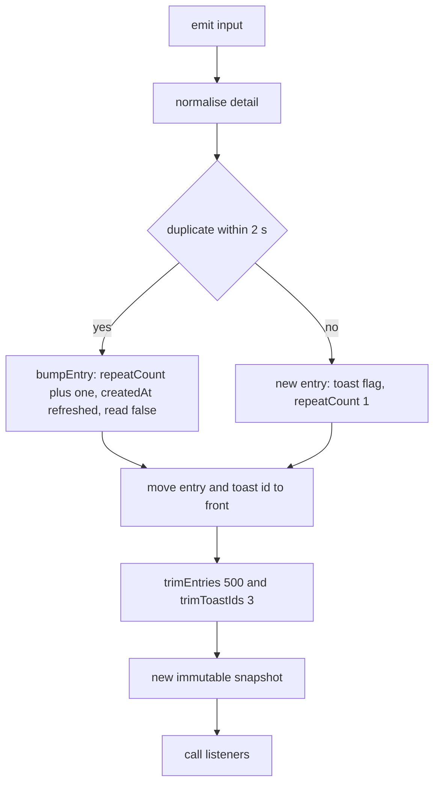

# AIS-79 — `packages/notifications` core: UI-independent notification + log store — implementation plan

**Created:** 2026-11-04 21:33 (Europe/Budapest)
**Ticket:** AIS-79 (subtask of AIS-86) · **Status:** APPROVED 2026-11-04 — decisions D1–D3 confirmed as written, ready for implementation
**Scope:** new workspace package `packages/notifications` (core only) + repo wiring + docs. **No** app change, **no** React, **no** persistence, **no** toast/log primitives.
**Predecessors:** none. **Successors:** AIS-80 (sessionStorage adapter), AIS-83 (React bindings + host), AIS-84 (admin wiring), AIS-85 (`ApiKeyForm`).
**Base plan:** [`2026-10-22--15-40-00-frontend-notification-and-log-system-plan.md`](2026-10-22--15-40-00-frontend-notification-and-log-system-plan.md:1) §4.1–4.2, work points 1–2.

---

## 0. Pre-work — clean tree, one commit per ticket

The working tree still carries changes from earlier tickets (AIS-111/113/116/117/…). AIS-79 starts from
a clean tree: inventory with `git status --porcelain=v1 --untracked-files=all`, map every path to its
key, and land one commit per key titled `<KEY>: <type>(<scope>): <summary>`. Never `git add -A` across
tickets. This runs in **Code mode** (Architect has no command tool rooted in this workspace).

---

## 1. Goal

One framework-independent store that holds **notifications and system log entries in a single source**,
callable from plain TypeScript (service, hook, guard) with the UI as a *subscriber*.

Delivered API (ticket contract, unchanged):

```ts
createNotificationStore(options?): NotificationStore
// emit · dismiss · markAllRead · clear · subscribe · getSnapshot · getServerSnapshot
```

---

## 2. Decisions locked before implementation

| # | Decision | Why |
| - | -------- | --- |
| D1 | The core **declares** `NotificationLevel` (`success\|error\|warning\|info\|system`) in `notification.interface.ts`; it does **not** alias `ToastLevel` from `@callback/ui` | `@callback/ui` has React as a peer and its types import `react`. A type-only import would force `@types/react` and a DOM lib into a React-free package and would invert the package dependency table ([base plan §7](2026-10-22--15-40-00-frontend-notification-and-log-system-plan.md:355)). Drift is prevented by the **parity guard** in D2. |
| D2 | Both packages pin the same five literals: `NOTIFICATION_LEVELS` in `notification.const.ts` (asserted in a test) and `TOAST_LEVEL_GLYPHS` keys in `packages/ui` (already asserted) | A cross-package test would import the other package and reintroduce D1's coupling. Two pinned literal lists plus one doc line is the cheapest drift alarm. |
| D3 | `NOTIFICATION_MAX_VISIBLE_TOASTS = 3` is a **store-side** constant; `packages/ui` keeps its own `TOAST_MAX_VISIBLE = 3` | Same reason as D2 (no import allowed in either direction). Both are asserted, both documented as mirrors. |
| D4 | `MAX_VISIBLE_TOASTS` caps the **`toasts` id list**, not the entry list: a 4th toast drops the oldest **toast id**, its entry stays in the log | Ticket decision 5. Consequence, documented: dismissing the newest toast does **not** reveal a hidden 4th one — that entry is log-only. |
| D5 | Both `entries` and `toasts` are **newest-first** (index `0` = newest); `trimEntries` keeps the **head** | `ToastStackProps.toasts` is already newest-first ([AIS-81 D3](2026-11-04--20-59-00-ais-81-toast-toaststack-plan.md:52)) and the log drawer renders newest first. One ordering everywhere. |
| D6 | Dedupe window is **inclusive**: `now - createdAt <= 2000` bumps, `2001` creates | Ticket test names 1.9 s vs 2.1 s; inclusive is the only rule that makes the 2.0 s boundary testable without a tie-break. |
| D7 | A bumped entry gets `repeatCount + 1`, a refreshed `createdAt`, `read: false`, and its toast id **moves to the front**; no new entry, no second toast | "A toast nem sokszorozódik", and newest-first (D5) must stay truthful after a repeat. |
| D8 | Clock and id generation are **injected/pure**: `now?: () => number` (default `Date.now`) and `createNotificationId(now, sequence)` | DI rule + deterministic tests; no `crypto`/`Math.random` inside the core. |
| D9 | `emit` accepts `detail?: string \| Record<string, unknown>`; a record is redacted then serialised by the store. A serialisation failure yields `'<unserializable detail>'` | Redaction is mandatory on **every** emit path (ticket decision 6), so the store — not the caller — owns the normalisation. |
| D10 | `NotificationStoreOptions.initialEntries` seeds **`entries` only**; `toasts` always starts empty | Encodes the "a reload must not resurrect a toast" rule ([base plan N6](2026-10-22--15-40-00-frontend-notification-and-log-system-plan.md:330)) inside AIS-79, so AIS-80/83 need no store change (AIS-80 is adapter-only by design). |
| D11 | `toast` defaults to `level !== 'system'` when `emit` omits it | System noise is log-only; `success/info/warning/error` are user-facing by default. Explicit `toast: false` still wins. |
| D12 | Listener errors are caught **per listener** and forwarded to `onListenerError` (default `console.error`, commented) | One broken subscriber must not silence the rest, and a silent `catch` is forbidden by the coding standards. |
| D13 | No store mutation notifies when the state reference does not change (`dismiss` of an unknown id, second `markAllRead`, `clear` on an empty store) | `getSnapshot()` must stay referentially stable (`useSyncExternalStore` in AIS-83 would loop otherwise). |
| D14 | Source-only package: `exports` → `./src/index.ts`, `build` = `tsc --noEmit`, `emitDeclarationOnly` off | Mirrors `packages/ui`: consumers bundle TS, so there is no artefact to keep in sync and no `prepare` step. |
| D15 | `notification-event.const.ts` holds **event kinds + default level/source/toast**, no human copy | Ticket decision 7: the store knows nothing about i18n. The Hungarian sentences belong to the emitters (AIS-84). |

---

## 3. Files

```text
packages/notifications/package.json                       name @callback/notifications, source-only
packages/notifications/tsconfig.json                      extends ../../tsconfig.base.json, lib ES2022 only
packages/notifications/vitest.config.ts                   environment node, lcov -> ../../coverage/notifications
packages/notifications/src/index.ts                       explicit exports, no export *
packages/notifications/src/core/notification.interface.ts NotificationLevel, NotificationSource, NotificationEntry,
                                                          NotificationState, EmitNotificationInput,
                                                          NotificationStoreOptions, NotificationStore
packages/notifications/src/core/notification.const.ts     NOTIFICATION_MAX_ENTRIES 500, NOTIFICATION_MAX_VISIBLE_TOASTS 3,
                                                          NOTIFICATION_DEDUPE_WINDOW_MS 2000, NOTIFICATION_LEVELS,
                                                          NOTIFICATION_SOURCES, NOTIFICATION_REDACTED_PLACEHOLDER,
                                                          NOTIFICATION_SENSITIVE_KEY_PATTERN, EMPTY_NOTIFICATION_STATE
packages/notifications/src/core/notification.logic.ts     createNotificationId, trimEntries, trimToastIds,
                                                          findDuplicate, bumpEntry, markEntriesRead,
                                                          redactValue, redactRecord, toRedactedDetail
packages/notifications/src/core/notification.store.ts     createNotificationStore factory (closure state, no class)
packages/notifications/src/core/notification-event.const.ts NOTIFICATION_EVENTS + NOTIFICATION_EVENT_DEFAULTS
packages/notifications/test/notification.logic.test.ts
packages/notifications/test/notification.store.test.ts
packages/notifications/test/notification-event.const.test.ts
```

Repo wiring (no source change):

```text
package.json                 test + sonar:coverage filters, notifications appended
knip.json                    new workspace entry packages/notifications (src/**/*.ts)
sonar-project.properties     sonar.sources + sonar.tests entries
pnpm-lock.yaml               pnpm install
```

Docs:

```text
docs/Specs/UI-Architecture.md   @callback/notifications dependency row → installed core; AIS-81 §toast note corrected
docs/history/2026-11-04--<hh-mm>-ais-79-notifications-core-store.md
docs/milestones/2026-11-04--<hh-mm>-ais-79-notifications-core-store.milestone.md
```

No new npm dependency. `zod`, `react`, `@callback/ui` never appear in the package.

---

## 4. State machine of `emit`



`dismiss`, `markAllRead`, `clear` go straight to `TRIM` → `SNAP`, and skip `NOTIFY` when the snapshot
reference is unchanged (D13).

---

## 5. Work order

1. **Skeleton** — `package.json`, `tsconfig.json`, `vitest.config.ts`, empty `src/index.ts`; `pnpm install`; `pnpm --filter @callback/notifications build` green with zero behaviour.
   `tsconfig` deliberately omits `"DOM"` from `lib`, so any `window`/`document`/`localStorage` use fails the type check.
2. **Types + constants** — `notification.interface.ts`, `notification.const.ts` (all fields `readonly`, JSDoc on every export).
3. **Pure logic** — `notification.logic.ts`, with its test file written alongside.
4. **Event catalogue** — `notification-event.const.ts` + test.
5. **Store factory** — `notification.store.ts`, closure state, no class, no module-level instance.
6. **Exports** — `src/index.ts`, explicit value exports, `export type` for every type.
7. **Repo wiring** — root `package.json` (`test`, `sonar:coverage`), `knip.json`, `sonar-project.properties`.
8. **Docs** — this plan → final, `UI-Architecture.md`, history entry, milestone.
9. **Gates** (see §8).

---

## 6. Test plan (mirrors the ticket, file by file)

`notification.logic.test.ts`

| Case | Assert |
| ---- | ------ |
| `createNotificationId` | stable for the same `now`+`sequence`, distinct for a different sequence, no `Math.random`/`crypto` |
| `trimEntries` | 500 kept, 501 drops the **last** (oldest), order preserved |
| `trimToastIds` | 3 kept, 4th drops the oldest id, empty stays empty |
| `findDuplicate` | hit at 1900 ms, miss at 2001 ms, level or message mismatch misses, newest-first first match |
| `bumpEntry` | `repeatCount + 1`, `createdAt` replaced, `read: false`, other fields untouched |
| `markEntriesRead` | all `read: true`, already-read entries keep identity |
| `redactValue` | `authorization`, `token`, `password`, `apiKey`, `secret` (any case) → placeholder; `message`, `status` untouched |
| `redactRecord` | mixed record redacts only the sensitive keys, does not mutate the input |
| `toRedactedDetail` | string passthrough, record redacted + serialised, `undefined` → `undefined`, circular record → placeholder |

`notification.store.test.ts`

| Case | Assert |
| ---- | ------ |
| `emit` fields | `id`, `level`, `source`, `createdAt` from the injected clock, `read: false`, `repeatCount: 1`, `toast` default per D11, returned entry is the stored one |
| `emit` toast override | explicit `toast: false` keeps the entry log-only, `toasts` unchanged |
| dedupe | second identical emit within 2 s: no new entry, `repeatCount: 2`, bumped id first in `toasts`, listener called once |
| dedupe expiry | emit at 2001 ms creates a second entry and a second toast |
| `dismiss` | id removed from `toasts`, entry still in `entries`, other entries untouched |
| `dismiss` unknown id | `getSnapshot()` returns the **same** reference, listener not called |
| `markAllRead` | every `read: true`; second call is a no-op reference |
| `clear` | empty state, `toasts` empty, listener called exactly once; second `clear` is a no-op |
| `subscribe` | called after each mutation, not after unsubscribe, two subscribers both fire |
| listener error | first listener throws → `onListenerError` receives it and the second listener still runs |
| snapshot identity | `getSnapshot()` twice with no mutation → same reference |
| entry cap | 501 emits → 500 entries, first (newest) is the last emitted, the oldest dropped |
| toast cap | 4 emits → 3 toast ids (oldest dropped), all 4 entries present (D4) |
| `getServerSnapshot` | empty state, same reference on every call, frozen |
| `initialEntries` | seeds `entries` (trimmed to cap) and leaves `toasts` **empty** (D10) |
| options override | `maxEntries`, `maxVisibleToasts`, `dedupeWindowMs` honoured |

`notification-event.const.test.ts` — every event kind has defaults, every default level is in
`NOTIFICATION_LEVELS`, no sentence-like copy (no `' '`-separated Hungarian text) in the catalogue.

---

## 7. Documentation changes

- [`docs/Specs/UI-Architecture.md`](../Specs/UI-Architecture.md:221) — the §toast paragraph currently
  says *AIS-79 aliases the `ToastLevel` union*; replace it with the D1/D2/D3 reality (core declares its
  own union, both sides pin the literals, no cross-package import) and move the notification rows of the
  dependency table from *planned* to *installed core (React bindings in AIS-83)*.
- `docs/history/` entry for the change narrative, `docs/milestones/` for the decision record
  (no library, factory over singleton, ring buffer, dedupe window, redaction, D10).

---

## 8. Definition of done — gates

```powershell
pnpm install
pnpm --filter @callback/notifications build
pnpm --filter @callback/notifications test
pnpm typecheck
pnpm quality
pnpm test
```

Plus three greps proving the boundaries:

```powershell
Select-String -Path packages/notifications/src/core/*.ts -Pattern 'react|@callback/ui|window|document|localStorage'
Select-String -Path packages/notifications/src/index.ts -Pattern 'export \*'
Select-String -Path packages/notifications/src -Pattern ': any'
```

All three must return nothing. Ticket DoD items (build, test, no React in `src/core/**`, explicit
exports, JSDoc, store callable without a React tree, no `any`) are all covered above.

---

## 9. Out of scope

`sessionStorage` adapter (AIS-80) · React hooks, `notify` facade, `NotificationHost`, timers (AIS-83) ·
admin wiring, query/runtime capture (AIS-84) · `LogDrawer` primitive and `ApiKeyForm` retrofit
(AIS-82/85) · `apps/web` · any new npm dependency.
