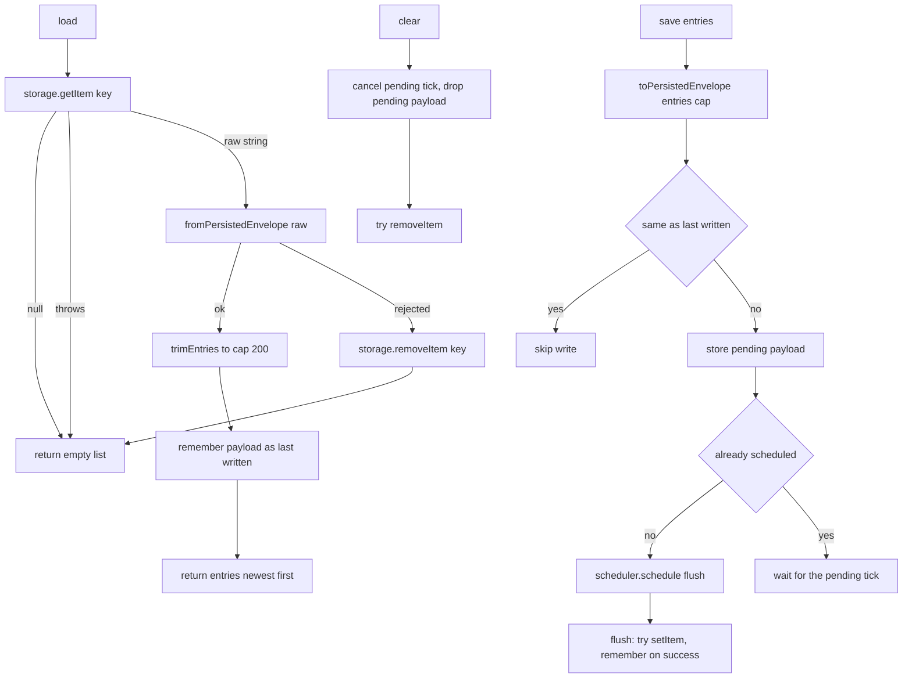

# AIS-80 — `packages/notifications`: sessionStorage persistence (cap 200, versioned envelope, injected `StorageLike`) — implementation plan

**Created:** 2026-11-04 22:14 (Europe/Budapest)
**Ticket:** AIS-80 (subtask of AIS-86) · **Status:** DRAFT — awaiting approval
**Scope:** adapter only — three new source files + two test files + fixtures + docs in `packages/notifications`. **No** store change, **no** React, **no** app change, **no** new dependency.
**Predecessor:** AIS-79 (core store, In Review) — it already shipped `initialEntries` (seeds `entries` only, never `toasts`), so this ticket needs no store edit.
**Successors:** AIS-83 (provider wires `load` → `initialEntries`, `store.subscribe` → `save`, `pagehide` → `flush`), AIS-84 (admin capture).
**Base plan:** [`2026-10-22--15-40-00-frontend-notification-and-log-system-plan.md`](2026-10-22--15-40-00-frontend-notification-and-log-system-plan.md:226) §4.3 Persistence, §4.6 Storage schema and adapter.

---

## 1. Goal

Give the log produced by the AIS-79 store a **`sessionStorage` mirror** so an F5 keeps the history
the user needs to understand what happened, while a new tab or a new session does not inherit it.
The store stays storage-free; the adapter is the only thing that knows a storage exists, and it knows
it only through an **injected `StorageLike`** — so every branch is testable in the `node` environment.

Ticket contract (unchanged):

```ts
createNotificationStorage({ storage, key, cap }): NotificationStorage
// load · save · clear
toPersistedEnvelope(entries, cap)      // pure
fromPersistedEnvelope(raw)             // pure
```

---

## 2. Decisions locked before implementation

| #   | Decision                                                                                                                                                                                                 | Why                                                                                                                                                                                                 |
| --- | -------------------------------------------------------------------------------------------------------------------------------------------------------------------------------------------------------- | --------------------------------------------------------------------------------------------------------------------------------------------------------------------------------------------------- |
| D1  | File names follow the ticket exactly: `notification.storage.interface.ts`, `notification.storage.logic.ts`, `notification.storage.ts`, `test/notification-storage.logic.test.ts`, `test/notification-storage.test.ts` | The ticket's §Hatókör is the reviewable contract; the base plan's earlier `notification-storage.logic.ts` spelling is superseded.                                                                     |
| D2  | Key, version and cap become constants in the existing [`notification.const.ts`](../../packages/notifications/src/core/notification.const.ts:1): `NOTIFICATION_STORAGE_KEY = 'aisztens.notifications.v1'`, `NOTIFICATION_STORAGE_VERSION = 1`, `NOTIFICATION_STORAGE_MAX_ENTRIES = 200` | Constants never live inline (ts rules); the key carries the schema version in its own name, so a future v2 can be read side by side instead of guessing.                                             |
| D3  | `fromPersistedEnvelope` returns a **discriminated result**, never throws: `{ ok: true; entries } \| { ok: false; reason: PersistedEnvelopeRejection }` where `reason` is `missing \| malformed-json \| wrong-version \| wrong-shape` | A rejected payload is an expected outcome, not an exception (the app must never break); the reason exists for tests and for a future debug log, and it is *not* surfaced to the UI.                   |
| D4  | Validation is **all-or-nothing and hand-written** (no `zod`): `version === 1`, `entries` is an array, and **every** entry passes a field guard (`id` non-empty string, `level` in `NOTIFICATION_LEVELS`, `message` string, `detail` optional string, `source` in `NOTIFICATION_SOURCES`, `createdAt` finite number, `read`/`toast` boolean, `repeatCount` integer ≥ 1). One bad entry drops the whole payload | Ticket decision 3 + the ticket test "*hiányzó kötelező mező egy elemen → az egész payload eldobva*". Partial accept would silently rewrite history; `zod` would add the package's first dependency for 9 field checks. |
| D5  | `load()` trims the restored list to `cap` **defensively**, reusing `trimEntries(entries, cap)` from `notification.logic.ts` (keeps the head, i.e. the newest) | A hand-written or older payload may exceed 200; the ring buffer must be honoured on the way in as well, and the trimming rule must not be reimplemented.                                               |
| D6  | Writes are **coalesced through an injected scheduler**: `scheduler.schedule(flush): () => void` (the returned function cancels). The pending write holds the **latest** entries (last write wins). Default scheduler is a **microtask** (`Promise.resolve().then`) whose cancel sets a flag | The package's `tsconfig` has `lib: ["ES2022"]` only, so `requestAnimationFrame` is a type error; a microtask default still coalesces a burst of five `save` calls into one `setItem`. AIS-83 injects the rAF-based scheduler. |
| D7  | `NotificationStorage.flush()` writes a pending payload **synchronously** and cancels the scheduled tick | Extension beyond the ticket's minimal API, agreed for AIS-83: on `pagehide` a queued rAF may never run, and the last entry before F5 must not be lost.                                                    |
| D8  | `clear()` **cancels a pending write first**, then `removeItem` | Otherwise a queued flush resurrects the key right after the user pressed "Törlés" — the exact opposite of the intent.                                                                                 |
| D9  | A write whose serialised payload **equals the last successfully written (or loaded) payload is skipped** | `dismiss` and toast-only changes notify the store without changing `entries`, and an unchanged log must not burn an `setItem` (5 MB quota, synchronous main-thread cost).                             |
| D10 | Every storage call is wrapped in `try/catch`; a write failure is **not** recorded as written (so the next `save` retries); a read failure returns `[]` **without** calling `removeItem` | Ticket decision 4: quota/disabled storage degrades to memory-only and never breaks the caller. Calling `removeItem` on a storage that already throws would only throw a second time for no gain.     |
| D11 | A rejected payload removes the key (`removeItem`) and yields `[]` | Ticket decision 3: no migration in phase 1, and a foreign payload must not survive to be re-parsed on every reload.                                                                                    |
| D12 | `storage` is optional: `undefined`/`null` → a **memory-only** adapter (`load` → `[]`, `save` → no-op, `clear` → no-op) | Lets AIS-83 pass a null storage when the browser blocks it (private mode / server render) without a branch at the call site.                                                                          |
| D13 | No custom error class, and the adapter never throws | Deliberate, documented deviation from the ts-rules "custom error classes": the contract is *silent degradation*, so there is no error to model. The only `catch` blocks carry a comment stating the degraded mode. |
| D14 | Only `entries` are persisted, never `toasts`, never timers — the envelope is `{ version: 1, entries }` with **no** other fields | Ticket decision 1. Restoring a toast would resurrect an already expired card; AIS-79's `initialEntries` already ignores `toasts`, so the two layers agree by construction.                              |
| D15 | No store↔storage binding in this ticket | Ticket DoD: the wiring happens once, in the React provider (AIS-83). Shipping a bridge here would create a second place where the store and storage meet.                                             |

---

## 3. Files

```text
packages/notifications/src/core/notification.const.ts            + NOTIFICATION_STORAGE_KEY / _VERSION / _MAX_ENTRIES
packages/notifications/src/core/notification.storage.interface.ts StorageLike, PersistedNotificationLog,
                                                                  PersistedEnvelopeReadResult, PersistedEnvelopeRejection,
                                                                  NotificationStorageScheduler, NotificationStorageOptions,
                                                                  NotificationStorage
packages/notifications/src/core/notification.storage.logic.ts     toPersistedEnvelope, fromPersistedEnvelope,
                                                                  isPersistedEnvelope, isPersistedEntry (internal guards)
packages/notifications/src/core/notification.storage.ts           createNotificationStorage (closure state, scheduler,
                                                                  last-written payload, try/catch degradation)
packages/notifications/src/index.ts                               + explicit value/type exports for the four names above
packages/notifications/test/mocks/notification-storage.fixtures.ts createMemoryStorage (honest / throwing / quota /
                                                                  foreign-payload variants), createManualScheduler,
                                                                  createCorruptStoragePayload helpers
packages/notifications/test/notification-storage.logic.test.ts
packages/notifications/test/notification-storage.test.ts
```

Repo wiring: **none**. `package.json` (`test`, `sonar:coverage`), `knip.json` and
`sonar-project.properties` already list `packages/notifications` from AIS-79 — verify, do not re-add.

Docs:

```text
docs/Specs/UI-Architecture.md     §packages/notifications core (AIS-79) → new "Persistence (AIS-80)" block:
                                  key, envelope, cap, coalescing, injected StorageLike + scheduler, failure table
docs/history/2026-11-04--<hh-mm>-ais-80-notifications-session-storage.md
docs/milestones/2026-11-04--<hh-mm>-ais-80-notifications-session-storage.milestone.md
```

---

## 4. Behaviour



Key properties: at most **one** `setItem` per scheduled tick; the payload is always the latest
entries; a failure leaves the adapter usable and retryable; `clear` never races a queued write.

---

## 5. Work order

1. **Constants** — extend `notification.const.ts` with D2 (JSDoc on each: why the key embeds `v1`).
2. **Types** — `notification.storage.interface.ts`; all fields `readonly`, JSDoc on every export,
   `StorageLike` kept structurally minimal (three methods, no `Storage`/DOM type).
3. **Pure logic + tests** — `notification.storage.logic.ts` with `notification-storage.logic.test.ts`
   written alongside; guards narrow `unknown` → `NotificationEntry` with no `any` and no casts.
4. **Adapter + tests** — `notification.storage.ts`; fixtures in `test/mocks/` first (memory storage
   with three failure modes, manual scheduler with an explicit `runPending()`), then the adapter tests.
5. **Exports** — `src/index.ts`: values (`createNotificationStorage`, `toPersistedEnvelope`,
   `fromPersistedEnvelope`) and `export type` for the interfaces; **no** `export *`.
6. **Docs** — `UI-Architecture.md` persistence block, history entry, milestone.
7. **Gates** — see §7.

---

## 6. Test plan (mirrors the ticket, file by file)

`notification-storage.logic.test.ts`

| Case                                            | Assert                                                                              |
| ----------------------------------------------- | ----------------------------------------------------------------------------------- |
| `toPersistedEnvelope` empty input               | `{ version: 1, entries: [] }`, JSON with no extra field (no `toasts`, no timers)    |
| `toPersistedEnvelope` over cap                  | 201 entries → 200 kept, the **oldest** dropped, order preserved                     |
| round-trip                                      | `fromPersistedEnvelope(toPersistedEnvelope(entries, 200))` → `ok: true`, same ids   |
| `missing`                                       | `null` and `''` → `{ ok: false, reason: 'missing' }`                                |
| `malformed-json`                                | `'{ not json'` → `malformed-json`                                                   |
| `wrong-version`                                 | `{ version: 2, entries: [] }` and missing `version` → `wrong-version`               |
| `wrong-shape` — container                       | `entries` not an array, envelope not an object, `entries: [null]`                   |
| `wrong-shape` — one bad entry drops everything  | 2 valid + 1 entry missing `id` → `wrong-shape`, zero entries returned               |
| `wrong-shape` — per-field                        | unknown `level`, unknown `source`, non-boolean `read`, `repeatCount: 0`, `createdAt: 'x'`, non-string `detail` |
| tolerated extras                                | an unknown extra key on the envelope and on an entry is ignored, payload accepted    |
| `load` cap defence                              | a stored payload of 250 valid entries → adapter returns 200                          |

`notification-storage.test.ts`

| Case                              | Assert                                                                                              |
| --------------------------------- | --------------------------------------------------------------------------------------------------- |
| empty storage                     | `load()` → `[]`                                                                                     |
| round-trip through the adapter    | `save(entries)` → `flush()` → a second adapter on the same storage returns the same ids, newest first |
| rejected payload                  | `removeItem` called **once**, `load()` → `[]`                                                       |
| `getItem` throws                  | `load()` → `[]` and `removeItem` **not** called                                                     |
| `setItem` throws (quota)          | `save` never throws, no listener/exception escapes; the next `save` **retries** the write            |
| coalescing (ticket test)          | five `save` calls in one tick → exactly **one** `setItem`, carrying the **last** payload             |
| `flush()`                         | writes immediately, cancels the scheduled tick (no second `setItem` when the tick is pumped)         |
| identical payload                 | a second `save` with an unchanged list → **no** `setItem`                                            |
| `clear()`                         | `removeItem` called; a pending save is dropped, so pumping the scheduler afterwards writes nothing   |
| memory-only mode                  | `storage: undefined` → `load`/`save`/`clear` are silent no-ops, no throw                             |
| custom key / cap                  | `key` and `cap` options are honoured (different key, cap 3)                                          |

Fixtures live in `test/mocks/notification-storage.fixtures.ts` (no fakes inside test files); no real
`sessionStorage`, no real timers, no `vi.useFakeTimers()` needed — the manual scheduler drives ticks.

---

## 7. Definition of done — gates

```powershell
pnpm --filter @callback/notifications build
pnpm --filter @callback/notifications test
pnpm typecheck
pnpm quality
pnpm test
```

Boundary greps — each must return nothing:

```powershell
Select-String -Path packages/notifications/src/core/*.ts -Pattern 'window|document|localStorage|sessionStorage|requestAnimationFrame'
Select-String -Path packages/notifications/src/index.ts -Pattern 'export \*'
Select-String -Path packages/notifications/src -Pattern ': any'
```

Plus the ticket DoD: `notification.storage.logic.ts` has no I/O and no `window`; every branch covered;
the adapter is the only new code (no store, no provider); JSDoc on the public API; explicit exports.

---

## 8. Out of scope

Store↔storage binding, `pagehide` listener, provider, `notify` facade (AIS-83) · admin capture and host
(AIS-84) · `LogDrawer` (AIS-82) · `localStorage` option, cross-tab sync, TTL expiry, schema migration
(`version: 2`) · any new npm dependency (no `zod`).
