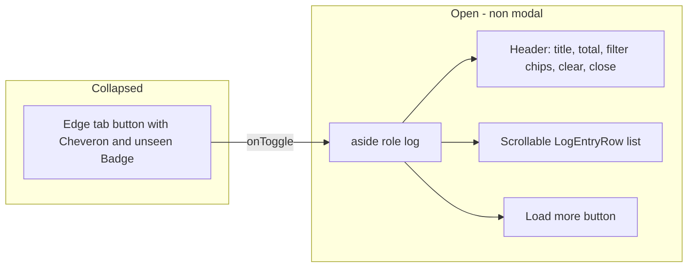

# AIS-82 — `LogDrawer` + `LogEntryRow` primitives — implementation plan

**Created:** 2026-11-04 22:58 (Europe/Budapest)
**Ticket:** AIS-82 (subtask of AIS-86) · **Status:** `To Do` in Jira, nothing in the tree yet
**Scope:** `packages/ui` only (+ `docs/Specs/UI-Architecture.md`, history/milestone doc, Jira close-out).
No store, no host, no paging window, no app/route change.

Base spec: [`docs/plans/2026-10-22--15-40-00-frontend-notification-and-log-system-plan.md`](docs/plans/2026-10-22--15-40-00-frontend-notification-and-log-system-plan.md:197) §4.3
Model source: [`notification.interface.ts`](packages/notifications/src/core/notification.interface.ts:26)
Pattern to copy: [`Toast.tsx`](packages/ui/src/components/toast/Toast.tsx:23) / [`ToastStack.tsx`](packages/ui/src/components/toast/ToastStack.tsx:24) (AIS-81)

---

## 1. Component shape



Everything is **props in, callbacks out**: the drawer owns no data, no filter state, no page
window. The host (AIS-83) slices `entries`, counts `unseenCount`, decides `hasMore`.

## 2. Decisions

| # | Decision | Why |
| - | -------- | --- |
| D1 | `LogEntryItem` is a **structural** type (`id`, `level`, `message`, `detail?`, `createdAt`) and `level` is `ToastLevel` | A `NotificationEntry` is assignable with no mapper, exactly like `ToastItem` (AIS-81). `packages/ui` must not import `@callback/notifications`. |
| D2 | `LogLevelFilter = 'all' \| 'success' \| 'error' \| 'warning' \| 'info' \| 'system'` — **six** chips: `Mind` / `Siker` / `Hiba` / `Figyelmeztetés` / `Info` / `Rendszer` | The ticket lists five, but the store (AIS-79) emits `success` as well; with five chips those entries would be reachable only under `Mind`. **Resolved 2026-11-04:** the `Siker` chip is added in this ticket. |
| D3 | Non-modal: no focus trap, no overlay, page stays scrollable, `Escape` closes | Diagnostics side view, not a blocking dialog. Reuses none of `OverlayShell` (that one is modal and traps focus). |
| D4 | Placement: fixed right edge, `LOG_DRAWER_Z_INDEX = 'z-40'` | Below `DIALOG_CONTENT_Z_INDEX` (`z-50`) and `TOAST_STACK_Z_INDEX` (`z-60`), above page content. |
| D5 | Closed = only the tab is mounted; open = panel mounts and slides in with Tailwind `starting:translate-x-full` | No `useState`, no `data-mounted`, no exit animation — the same trick as `Toast` (AIS-81). |
| D6 | The single `useEffect` in the package: a `document` `keydown` listener active only while `isOpen` | `Escape` must work even when focus is outside the panel. Documented as the only side effect; no timer, no storage, no network, no store. |
| D7 | Paging numbers (`20` initial / `50` next) are **not** here | The ticket says the primitive only knows `hasMore` + `onLoadMore`; the window belongs to AIS-83. |
| D8 | `LogEntryRow` reuses `toastLevelChipVariants` + `TOAST_LEVEL_GLYPHS` from the toast module | One colour recipe for the five levels; the level vocabulary is already pinned by tests on both sides. Cross-folder import inside `packages/ui` is allowed (no page-level rule applies). |
| D9 | Level is shown as glyph **plus** short text (`LOG_LEVEL_LABELS`), never colour alone | WCAG: colour must not be the only state indicator. |

## 3. Files

```text
packages/ui/src/components/log-drawer/
  LogDrawer.tsx                 tab + panel + header + list + footer
  LogEntryRow.tsx               one entry: glyph, level text, time, message, optional detail
  log-drawer.interface.ts       LogEntryItem, LogLevelFilter, LogDrawerProps, LogEntryRowProps
  log-drawer.const.ts           labels, glyph/label maps, z-index, panel id suffix
  log-drawer.variants.ts        tabVariants, panelVariants, headerVariants, filterChipVariants, entryRowVariants
packages/ui/src/index.ts        explicit exports (components, constants, types)
packages/ui/test/log-drawer.test.tsx
packages/ui/test/log-entry-row.test.tsx
packages/ui/test/mocks/log-entries.mock.ts
```

Public API (from the ticket, plus what the DOM contract needs):

```ts
export type LogLevelFilter = 'all' | 'success' | 'error' | 'warning' | 'info' | 'system';
export interface LogEntryItem {
  readonly id: string;
  readonly level: ToastLevel;
  readonly message: string;
  readonly detail?: string;
  readonly createdAt: number; // epoch ms
}
export interface LogDrawerProps {
  readonly entries: readonly LogEntryItem[]; // already sliced, newest first
  readonly isOpen: boolean;
  readonly unseenCount: number;
  readonly levelFilter: LogLevelFilter;
  readonly hasMore: boolean;
  readonly onToggle: () => void;
  readonly onClose: () => void;
  readonly onFilterChange: (filter: LogLevelFilter) => void;
  readonly onLoadMore: () => void;
  readonly onClear: () => void;
  readonly formatTimestamp: (epochMs: number) => string;
}
```

The panel gets an id from `useId()` (`LOG_DRAWER_PANEL_ID_SUFFIX`), so the tab's `aria-controls`
and `aria-expanded` are always correct — no caller-supplied id.

## 4. Steps

1. **Create `log-drawer.interface.ts`** — the types above, JSDoc noting the newest-first contract
   and that `entries` is already sliced.
2. **Create `log-drawer.const.ts`** — `LOG_DRAWER_TITLE` (`Rendszernapló`),
   `LOG_DRAWER_OPEN_LABEL` / `LOG_DRAWER_CLOSE_LABEL`, `LOG_DRAWER_EMPTY_LABEL` (`Még nincs bejegyzés.`),
   `LOG_DRAWER_LOAD_MORE_LABEL` (`Korábbiak betöltése`), `LOG_DRAWER_CLEAR_LABEL` (`Törlés`),
   `LOG_DRAWER_FILTER_GROUP_LABEL`, `LOG_FILTER_LABELS: Record<LogLevelFilter, string>`,
   `LOG_LEVEL_LABELS: Record<ToastLevel, string>`, `LOG_DRAWER_Z_INDEX = 'z-40'`,
   `LOG_DRAWER_PANEL_ID_SUFFIX = '-log-panel'`.
3. **Create `log-drawer.variants.ts`** (CVA, tokens only):
   - `logDrawerTabVariants` — `~40px` wide strip, `fixed right-0 top-1/2 -translate-y-1/2`,
     `rounded-l-card`, `bg-surface-overlay`, `border-hairline`, `shadow-neu-raised`,
     `focus-visible:` ring per the house recipe.
   - `logDrawerPanelVariants` — `fixed inset-y-0 right-0 w-[22rem] max-w-full`, `flex-col`,
     `bg-surface-overlay`, `border-l border-hairline`, `shadow-neu-raised`,
     `transition-transform duration-base ease-neu`, `starting:translate-x-full`, plus the z-index const.
   - `logDrawerHeaderVariants`, `logDrawerListVariants` (`flex-1 overflow-y-auto`),
     `logDrawerFooterVariants`.
   - `logFilterChipVariants` — `selected: true \| false` (`bg-primary`/`bg-surface-sunken` +
     `text-*` token pair), `aria-pressed` on a real `<button>`.
   - `logEntryRowVariants` — level-driven left border accent, same four state tokens as `Toast`.
4. **Create `LogEntryRow.tsx`** — glyph chip (`toastLevelChipVariants`, `aria-hidden`), visible
   `LOG_LEVEL_LABELS[level]` text, `formatTimestamp(createdAt)` in a `<time>`, `break-words` message,
   `detail` rendered only when present. No click handler, no state.
5. **Create `LogDrawer.tsx`**:
   - closed → `<button aria-expanded={false} aria-controls={panelId} aria-label={openLabel( unseenCount )}>`
     with the chevron glyph and a `Badge` only when `unseenCount > 0`; one click → `onToggle`.
   - open → `<aside id={panelId} role="log" aria-live="off" aria-label={LOG_DRAWER_TITLE}>` with the
     header (title + total `entries.length`, filter chip group `role="group"`, `Törlés`, close
     button), the scrollable list (`LogEntryRow` per item, grouped, key = `id`), and the footer
     `Korábbiak betöltése` button (`disabled={!hasMore}`, exactly one `onLoadMore` per click).
   - empty list → `LOG_DRAWER_EMPTY_LABEL` inside the list container (not `EmptyState`: the panel is
     narrow, one sentence is enough).
   - one `useEffect` installing the `Escape` listener while `isOpen`, cleaned up on close/unmount.
6. **Export from [`index.ts`](packages/ui/src/index.ts:253)** — `LogDrawer`, `LogEntryRow`, the
   variants, the constants and the types, in the same grouped style as the toast block.
7. **Tests** (`packages/ui/test/`, mocks in `test/mocks/log-entries.mock.ts`, no inline fixtures):
   - closed: only the tab renders, the panel is absent from the DOM, `aria-expanded="false"`.
   - tab click → `onToggle` once; `unseenCount > 0` → badge with the number, `0` → no badge.
   - open: entries render **newest first** (DOM order equals input order); total count shown.
   - `formatTimestamp` is called once per row with that row's `createdAt`.
   - row without `detail` renders no detail element; row with `detail` renders it.
   - load more: one click → one `onLoadMore`; `hasMore={false}` → `disabled`.
   - filter chips: six chips rendered from `LOG_FILTER_LABELS`; click → `onFilterChange` with the
     exact value; `aria-pressed` reflects `levelFilter`.
   - `Escape` → `onClose` (and does **not** fire while closed); `Törlés` → `onClear`; close button →
     `onClose`.
   - empty list → `Még nincs bejegyzés.`.
   - level is not colour-only: each row has the level text.
8. **Verify** (all green before Jira):
   - `pnpm --filter @callback/ui test`
   - `pnpm --filter @callback/ui build`
   - `pnpm quality:tokens`, `pnpm quality:dead-code`, `pnpm typecheck`
   - `rg "#[0-9a-fA-F]{3,8}|(bg|text|border|ring|from|to|via)-(slate|gray|zinc|neutral|stone|indigo|red|amber|green|emerald|blue)-[0-9]{2,3}" packages/ui/src` → no match
   - `rg "localStorage|sessionStorage|fetch|@callback/notifications|useState" packages/ui/src/components/log-drawer` → no match (only the one `useEffect`)
9. **Update [`docs/Specs/UI-Architecture.md`](docs/Specs/UI-Architecture.md:216)** — two table rows
   (`LogDrawer` AIS-82, `LogEntryRow` AIS-82) after the `ToastStack` row, one short paragraph after
   the AIS-81 toast paragraph (non-modal, props-only, `z-40`, injected `formatTimestamp`, filter
   passed through), and refresh the `**Utolsó frissítés:**` header line.
10. **Docs** — `docs/history/2026-11-04--23-xx-00-ais-82-log-drawer.md` and a milestone
    `docs/milestones/2026-11-04--23-xx-00-ais-82-log-drawer-primitives.milestone.md` (decision-grade
   record: non-modal choice, `z-40`, the `Escape` effect, the `success` filter question).
11. **Jira** — comment with the verification output, transition AIS-82 `To Do → In Progress → Done`.
12. **Commit** — `AIS-82: feat(ui): add LogDrawer and LogEntryRow primitives`.

## 5. Definition of done

- [ ] `LogDrawer`, `LogEntryRow`, their variants, constants and types are explicit exports.
- [ ] Token classes only; palette gate clean; no palette utility, no colour literal.
- [ ] No store, storage, network or state in the components — the only effect is the `Escape` listener.
- [ ] `test`, `build`, `quality:tokens`, `quality:dead-code`, `typecheck` green.
- [ ] `UI-Architecture.md` primitives table + paragraph updated, header date refreshed.
- [ ] History entry + milestone written; AIS-82 `Done` with evidence.

## 6. Out of scope

`NotificationHost`, the `notify` facade, the paging window and auto-mark-read (AIS-83); admin capture,
query/runtime hooks (AIS-84); `ApiKeyForm` retrofit (AIS-85); any `apps/web` or `apps/admin` change;
persisting the filter choice; virtualised list.
