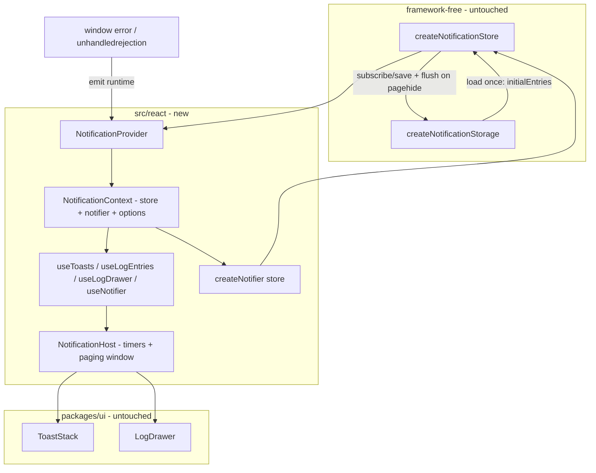

# AIS-83 — `@callback/notifications` React bindings (provider, hooks, `notify` facade, `NotificationHost` + timers) — implementation plan

**Created:** 2026-11-04 23:12 (Europe/Budapest)
**Ticket:** AIS-83 (subtask of AIS-86) · **Status:** `To Do` in Jira, nothing of the React layer exists yet
**Prerequisites (all merged):** AIS-79 (core store + logic + consts), AIS-80 (storage adapter), AIS-81
(`Toast` / `ToastStack`), AIS-82 (`LogDrawer` / `LogEntryRow`)
**Scope:** `packages/notifications` only (+ `docs/Specs/UI-Architecture.md`, history + milestone doc, Jira
close-out). No `apps/admin` change, no query/runtime capture, no route wiring.

Base spec: [`2026-10-22--15-40-00-frontend-notification-and-log-system-plan.md`](docs/plans/2026-10-22--15-40-00-frontend-notification-and-log-system-plan.md:197) §4.3, §4.4, §4.5
Model + store contract: [`notification.interface.ts`](packages/notifications/src/core/notification.interface.ts:128)
Storage contract: [`notification.storage.interface.ts`](packages/notifications/src/core/notification.storage.interface.ts:107)
UI primitives to compose: [`ToastStack`](packages/ui/src/components/toast/ToastStack.tsx:24), [`LogDrawer`](packages/ui/src/components/log-drawer/LogDrawer.tsx:1)

---

## 1. Goal

Turn the deliberately dumb pieces into one pair an app mounts once:

```tsx
<NotificationProvider>{/* app */}<NotificationHost /></NotificationProvider>
```

The provider owns the store instance, the `sessionStorage` mirror and the global listeners; the host owns
the only *policy* left — toast lifetimes (timers, pause, tab-hidden) and the log drawer's paging window.
Everything else already exists and is not touched.

## 2. What exists today (facts)

| Piece | State |
| ----- | ----- |
| Store | [`createNotificationStore()`](packages/notifications/src/core/notification.store.ts:79) — `emit`/`dismiss`/`markAllRead`/`clear`/`subscribe`/`getSnapshot`/`getServerSnapshot`, referentially stable snapshot, `initialEntries` seeding, `toasts[]` always starts empty |
| Storage | [`createNotificationStorage()`](packages/notifications/src/core/notification.storage.ts:63) — `load`/`save`/`flush`/`clear`, memory-only degradation, baseline-skip, injectable scheduler |
| Event catalogue | [`NOTIFICATION_EVENT_DEFAULTS`](packages/notifications/src/core/notification-event.const.ts:29) — level/source/toast per kind, **no text** |
| UI toasts | `ToastStack` takes `ToastItem[]` (newest first), `onDismiss`/`onPause`/`onResume` |
| UI log | `LogDrawer` takes already-sliced `LogEntryItem[]`, `unseenCount`, `LogLevelFilter`, `hasMore`, callbacks, injected `formatTimestamp` |
| Package tooling | `tsconfig.json` is `lib: ["ES2022"]`, no JSX, no DOM; `vitest.config.ts` is `environment: 'node'`, `include: test/**/*.test.ts` |
| Package manifest | no `react`, no `@callback/ui`, single `exports` entry `"."` |

Consequence: the React layer needs JSX + DOM types, a `./react` subpath, peer React and a
production `@callback/ui` dependency — **without** weakening the core's framework-free guarantee.

## 3. Architecture



Data flows one way: emitters → `store.emit` → snapshot → hooks → presentational primitives. The host
decides *when* a toast disappears; it never decides *what* is in the log.

## 4. Public API

```ts
// @callback/notifications/react
export interface NotificationProviderProps {
  readonly children: ReactNode;
  /** Injected for tests; default: createNotificationStore seeded from storage.load(). */
  readonly store?: NotificationStore;
  /** Injected for tests; default: createNotificationStorage over window.sessionStorage. */
  readonly storage?: NotificationStorage;
  /** Attach `stack` to runtime error details. The app passes `import.meta.env.DEV`. */
  readonly includeDetails?: boolean;
  /** Injected; default: `toLocaleTimeString('hu-HU')`. */
  readonly formatTimestamp?: (epochMs: number) => string;
  /** Test seam: the storage write coalescer; default: requestAnimationFrame. */
  readonly scheduleWrite?: NotificationWriteScheduler;
}

export interface Notifier {
  success(message: string, options?: NotifyOptions): NotificationEntry;
  error(message: string, options?: NotifyOptions): NotificationEntry;
  warning(message: string, options?: NotifyOptions): NotificationEntry;
  info(message: string, options?: NotifyOptions): NotificationEntry;
  /** Log-only entry: `toast: false` unless overridden. */
  system(message: string, options?: NotifyOptions): NotificationEntry;
}
export interface NotifyOptions {
  readonly source?: NotificationSource;         // default 'manual'
  readonly detail?: string | Readonly<Record<string, unknown>>;
  readonly toast?: boolean;
}

export function createNotifier(store: NotificationStore): Notifier;   // no React needed
export function useNotifier(): Notifier;                             // bound to the provider store
export function useToasts(): readonly ToastItem[];                   // newest first, ids of state.toasts
export function useLogDrawer(): LogDrawerController;
/** Filtered + windowed rows; the window is owned by the controller the caller holds. */
export function useLogEntries(controller: LogDrawerController): readonly NotificationEntry[];
export function NotificationProvider(props: NotificationProviderProps): JSX.Element;
export function NotificationHost(): JSX.Element;

export interface LogDrawerController {
  readonly isOpen: boolean;
  readonly levelFilter: LogLevelFilter;
  readonly hasMore: boolean;
  readonly unseenCount: number;
  readonly toggle: () => void;
  readonly close: () => void;
  readonly setLevelFilter: (filter: LogLevelFilter) => void;
  readonly loadMore: () => void;
  readonly clear: () => void;
}
```

## 5. Decisions

| # | Decision | Why |
| - | -------- | --- |
| D1 | **Subpath exports**: `"."` stays the core (no React, no DOM), the bindings live behind `"./react"` | The core's framework-free guarantee stays *provable* — importing `@callback/notifications` can never pull React in, and `apps/web` or a service can use the notifier without the UI kit |
| D2 | **Two tsconfigs**: `tsconfig.core.json` (`lib: ["ES2022"]`, `src/core` + core tests) and `tsconfig.json` (adds `DOM`, `jsx: react-jsx`, whole tree); `build` runs both | Adding DOM to the single config would let `window`/`document` silently leak into `src/core`. The extra config turns the boundary into a compile error instead of a code-review habit |
| D3 | Store **and** storage are created in a `useState` lazy initialiser, so `storage.load()` runs **exactly once, synchronously**, and seeds `createNotificationStore({ initialEntries })` | Ticket key decision 2: no loading flash, no effect-based flicker, and the first paint already shows the restored log |
| D4 | Every hook reads through `useSyncExternalStore(store.subscribe, store.getSnapshot, store.getServerSnapshot)`; **derivation happens in `useMemo`**, never inside `getSnapshot` | Returned snapshot must be referentially stable or React loops forever. Deriving a filtered array inside `getSnapshot` would allocate on every call — the classic infinite-render bug |
| D5 | Timers live **only** in `NotificationHost`: `success`/`info` 4 s, `warning` 6 s, `error`/`system` sticky; one `setTimeout` per toast id in a `Map` ref | Ticket key decision 3. The primitives stay presentational; the policy is testable in one place |
| D6 | `pointerenter` **clears** the timer, `pointerleave` **restarts the full TTL**; `document.hidden` clears every timer, becoming visible restarts the TTL of the still-visible toasts | Restarting instead of tracking remaining time keeps the bookkeeping pure (`resolveToastTtl(level)`), and a paused toast never disappears while the user reads it |
| D7 | Drawer UI state (`isOpen`, `levelFilter`, `visibleCount`) is `useState` inside `useLogDrawer` — **not** in the store, **not** in a global Zustand store | Ticket key decision 6: the store owns content, the hook owns the window. Nothing here belongs in the URL, is server data, or is shared page state |
| D8 | `markAllRead()` is called in the **toggle handler** when it opens, not in an effect watching `isOpen` | One store write per user action; an effect would double-fire under StrictMode and could re-mark entries after a new one arrives |
| D9 | Paging: `LOG_INITIAL_PAGE = 20`, `LOG_PAGE_STEP = 50`, `visibleCount` grows by 50 per `loadMore()`; `hasMore` = filtered length > `visibleCount`; the window resets to 20 on filter change | Ticket key decision 7 |
| D10 | `notify.*` is exposed as `createNotifier(store)` (framework-free) + `useNotifier()` (provider-bound). **No module-level singleton** | A module singleton silently binds to whichever provider mounted last — two stores, two apps or two tests would then share state |
| D11 | Global listeners registered by the **provider**: `window` `error` and `unhandledrejection` → `emit({ level: 'error', source: 'runtime', detail })`, `stack` only when `includeDetails`, cleanup removes both | Ticket key decision 4 + redaction rule §4.7 of the base plan; no `import.meta` inside the package (key decision 8) |
| D12 | `logNavigation` is **not** implemented in AIS-83 | Router logging needs `react-router` callbacks that only live in the app; the package would accept a prop it cannot honour. AIS-84 adds it where the router is. Deviation from the ticket's API sketch, recorded in the Jira comment |
| D13 | `formatTimestamp` is **injected** into the provider (default `toLocaleTimeString('hu-HU')`) and forwarded to `LogDrawer` | `packages/ui` requires it as a prop, and the package must not import `apps/admin/src/lib/date.ts` |
| D14 | Storage wiring: provider subscribes to the store, forwards `state.entries` to `storage.save`, `pagehide` → `storage.flush()`, unmount → `flush()` + unsubscribe; default scheduler is a `requestAnimationFrame` coalescer | AIS-80 D6 explicitly reserved the rAF scheduler for this ticket |
| D15 | React tests opt into jsdom per file with `// @vitest-environment jsdom`; the global vitest environment stays `node` | `environmentMatchGlobs` is deprecated in Vitest 3; the docblock is version-proof and keeps the core tests DOM-free |
| D16 | `react`/`react-dom` are **peer** dependencies, `@callback/ui` is a real dependency; testing libraries stay dev-only | Ticket DoD, mirrors [`packages/ui/package.json`](packages/ui/package.json:25) |
| D17 | Timers, listeners and the paging window are verified with `vi.useFakeTimers()` + `renderHook`/`render`; every effect has an explicit cleanup assertion | Ticket test list, and "no state update on an unmounted component" must be a test, not a hope |

## 6. Files

```text
packages/notifications/src/react/
  notification-react.interface.ts      ProviderProps, Notifier, NotifyOptions, LogDrawerController, HostState
  notification-react.const.ts          TOAST_TTL_MS_BY_LEVEL, LOG_INITIAL_PAGE, LOG_PAGE_STEP,
                                       DEFAULT_NOTIFIER_SOURCE, DEFAULT_LOCALE, RUNTIME_ERROR_MESSAGE
  notification-react.logic.ts          resolveToastTtl(level), toToastItems(entries, ids),
                                       filterEntries(entries, filter), sliceWindow(entries, n),
                                       countUnseen(entries), toRuntimeDetail(error, includeDetails),
                                       createRafScheduler(win)
  notification.context.tsx             NotificationContext + NotificationProvider (+ global listeners,
                                       storage wiring, context value memo)
  notification.facade.ts               createNotifier(store), useNotifier()
  use-notifications.ts                 useToasts, useLogEntries, useLogDrawer
  NotificationHost.tsx                 ToastStack + LogDrawer + timers + drawer controller
  index.ts                             explicit exports of the whole React surface (no `export *`)
packages/notifications/src/index.ts    unchanged (core only)
packages/notifications/package.json    exports "./react"; deps: @callback/ui; peers: react, react-dom;
                                       devDeps: @testing-library/react, @testing-library/jest-dom,
                                       jsdom, react, react-dom, @types/react, @types/react-dom;
                                       build runs tsconfig.core.json + tsconfig.json
packages/notifications/tsconfig.core.json  new: lib ES2022, src/core + test/*.ts
packages/notifications/tsconfig.json       widened: DOM + jsx react-jsx
packages/notifications/vitest.config.ts    include test/**/*.test.{ts,tsx}; environment stays node
packages/notifications/test/react/…
  notification-facade.test.ts          createNotifier against a real store (no React)
  use-notifications.test.tsx           renderHook + fake timers
  notification-host.test.tsx           render(<NotificationHost />) with a real store
  notification-react.logic.test.ts     every pure branch
packages/notifications/test/mocks/react/
  notification-store.mock.ts           in-memory NotificationStore double
  notification-storage.mock.ts         in-memory NotificationStorage double + StorageLike fake
  notification-entries.fixture.ts      entry/tost fixtures (no inline fixtures in test files)
```

## 7. Steps

1. **Manifest + tooling** — add the `./react` export, deps/peers/devDeps, `tsconfig.core.json`, widen
   `tsconfig.json` (`DOM`, `jsx: "react-jsx"`), extend the vitest `include` to `.tsx`. Run
   `pnpm install` and confirm the core suite is still green **before** writing React code.
2. **`notification-react.interface.ts`** — the types of §4, plus `NotificationHostState` internals
   (holder for the paused/timer bookkeeping types). JSDoc on the newest-first and "props in, callbacks
   out" contracts.
3. **`notification-react.const.ts`** — `TOAST_TTL_MS_BY_LEVEL` (`success`/`info` 4 000, `warning`
   6 000, `error`/`system` `null` = sticky), `LOG_INITIAL_PAGE = 20`, `LOG_PAGE_STEP = 50`,
   `DEFAULT_NOTIFIER_SOURCE = 'manual'`, `DEFAULT_LOCALE = 'hu-HU'`,
   `RUNTIME_ERROR_MESSAGE = 'Váratlan hiba történt.'` (the message is app-owned vocabulary, the level
   classification comes from `NOTIFICATION_EVENT_DEFAULTS['runtime.error']`).
4. **`notification-react.logic.ts`** — pure functions only, one responsibility each:
   - `resolveToastTtl(level): number | null`
   - `toToastItems(entries, toastIds): readonly ToastItem[]` — preserves the store's newest-first order,
     drops ids whose entry already left the ring buffer
   - `filterEntries(entries, filter)` / `sliceWindow(entries, visibleCount)` /
     `countUnseen(entries)` / `hasMoreEntries(entries, visibleCount)`
   - `toRuntimeDetail(error, includeDetails): Readonly<Record<string, unknown>>` — `name` + `message`,
     plus `stack` only when allowed; non-`Error` values go through `String(...)`
   - `createRafScheduler(win): NotificationWriteScheduler` — rAF when available, microtask fallback
     (keeps the adapter's guarantee in Node/jsdom when rAF is missing)
5. **`notification.facade.ts`** — `createNotifier(store)` returns the five shortcuts delegating to
   `store.emit`; `useNotifier()` reads the context and returns a memoised notifier.
6. **`notification.context.tsx`** — `NotificationProvider`:
   - `useState(() => props.storage ?? createNotificationStorage({ storage: window.sessionStorage, schedule }))` →
     `useState(() => props.store ?? createNotificationStore({ initialEntries: storage.load() }))`
     (order matters: storage first, exactly one `load()`);
   - context value `useMemo` of `{ store, notifier, includeDetails, formatTimestamp }`, throwing a typed
     `MissingNotificationProviderError` in the hook when the context is `null`;
   - effect 1: `store.subscribe` → `storage.save(state.entries)`, `pagehide` → `flush()`, cleanup
     unsubscribes, removes the listener and flushes what is still pending;
   - effect 2: `error` + `unhandledrejection` listeners → `emit(runtime.error)`, cleanup removes both.
   All DOM access goes through `globalThis` lookups guarded for SSR (`typeof window`), never a bare
   `window`.
7. **`use-notifications.ts`** — the three hooks, each `useSyncExternalStore` + `useMemo` (D4):
   - `useToasts()` → `toToastItems(state.entries, state.toasts)`;
   - `useLogEntries(controller)` → the windowed rows. The window cannot be read off the store, so the
     caller passes the controller it owns; the host is the only caller today, but a page can compose
     its own host without duplicating the paging policy. Signature: `useLogEntries(controller:
     LogDrawerController): readonly NotificationEntry[]` — `filter → sliceWindow` (D9);
   - `useLogDrawer()` → `useState` for `isOpen`/`levelFilter`/`visibleCount`, `toggle()` calls
     `store.markAllRead()` on open, `setLevelFilter()` resets `visibleCount` to `LOG_INITIAL_PAGE`,
     `loadMore()` adds `LOG_PAGE_STEP`, `clear()` calls `store.clear()` + `storage.clear()`.
8. **`NotificationHost.tsx`** — composition + the only effects of the host:
   - `const controller = useLogDrawer(); const toasts = useToasts(); const entries = useLogEntries(controller);`
   - render `<ToastStack … />` and `<LogDrawer … />` with the controller callbacks and
     `formatTimestamp` from the context;
   - timer effect over `toasts.map(t => t.id).join()`: for every non-sticky id without a timer, schedule
     `store.dismiss(id)` at `resolveToastTtl(level)`; clear timers of ids that left the state; cleanup
     clears the whole `Map`;
   - `onPause(id)` / `onResume(id)` implement D6; a `visibilitychange` effect pauses/resumes every
     visible toast;
   - **no** `useEffect` that calls `emit` — the host never produces notifications.
9. **`react/index.ts`** — explicit exports: the two components, the four hooks, `createNotifier`, the
   constants and all types. No `export *`.
10. **Tests** (mocks/fixtures in `test/mocks/react/`, never inline):
    - `createNotifier`: each shortcut emits the right level/source, `detail` is redacted through the
      store, `system` defaults to `toast: false`, explicit `toast`/`source` win.
    - `useToasts`: newest first after 4 emits; text updates on emit; only the state's toast ids appear.
    - `useLogDrawer`/`useLogEntries`: 20 → 70 → … window, `hasMore` false at the end, filter change
      resets the window, `toggle` marks all read exactly once, `clear` empties the log.
    - provider mount: `storage.load()` called **once**; a restored log is visible on the first render;
      `store.subscribe` replaces the snapshot on emit.
    - timers: `success` disappears after 4 000 ms, `warning` survives 5 999 ms and disappears at 6 000,
      `error` never disappears, hover pause → no dismissal, resume → dismissal after a full TTL,
      `document.hidden` → no dismissal, visible again → dismissal.
    - global capture: `window.dispatchEvent(new ErrorEvent('error', …))` and an
      `unhandledrejection` event produce one `runtime`/`error` entry each; `includeDetails: false`
      leaves `stack` out, `true` includes it.
    - unmount: listeners removed (no entry after dispatch), pending timers cleared
      (`vi.getTimerCount() === 0`), `pagehide` still flushes the mirror.
    - `NotificationHost` render: `ToastStack` + `LogDrawer` present, 4 emits → 3 toast cards, newest
      first, drawer shows the same entries with the injected `formatTimestamp`.
11. **`src/index.ts`** — verify it still exports core only (the boundary test lives in the tsconfig pair);
    add a short package-boundary note to the file header pointing at `./react`.
12. **Docs** — `docs/Specs/UI-Architecture.md`: the `@callback/notifications` row (§7) switches to
    "core + react bindings installed (AIS-83)", a short paragraph next to the toast/log paragraphs
    documenting the provider/host pair, the timer table, the paging numbers and the subpath export;
    refresh the `**Utolsó frissítés:**` line. Then
    `docs/history/2026-11-04--23-xx-00-ais-83-notifications-react-bindings.md` and a milestone
    `docs/milestones/2026-11-04--23-xx-00-ais-83-notifications-react-bindings.milestone.md`
    (decision-grade: subpath export, dual tsconfig, timer policy, `logNavigation` deviation).
13. **Jira** — comment with the verification output and the D12 deviation, transition AIS-83
    `To Do → In Progress → Done`.
14. **Commit** — `AIS-83: feat(notifications): add React provider, hooks and NotificationHost`.

## 8. Verification

```powershell
pnpm --filter @callback/notifications test
pnpm --filter @callback/notifications build      # runs tsconfig.core.json then tsconfig.json
pnpm --filter @callback/ui test
pnpm typecheck
pnpm quality:dead-code                            # new exports must be consumed or deliberately kept
pnpm quality:tokens
```

Manual greps that must return nothing:

```powershell
rg "from 'react'" packages/notifications/src/core
rg "window|document|sessionStorage|localStorage" packages/notifications/src/core
rg "export \*" packages/notifications/src
```

## 9. Definition of done

- [ ] `<NotificationProvider>` + `<NotificationHost />` is a working pair in any React 18 app; the
      package imports no application code.
- [ ] `@callback/notifications` (root) pulls in **no** React; `./react` pulls in `@callback/ui`.
- [ ] `react`/`react-dom` are peer deps, `@callback/ui` is a dependency, testing libraries are dev-only.
- [ ] `storage.load()` runs exactly once per provider mount, synchronously, before the first paint.
- [ ] Timer table (4 s / 6 s / sticky), hover pause/resume and tab-hidden pause are covered by tests.
- [ ] Unmount removes every listener and timer; no `act` warnings, no state update after unmount.
- [ ] `test`, `build`, `typecheck`, `quality:tokens`, `quality:dead-code` green.
- [ ] `docs/Specs/UI-Architecture.md` dependency row + paragraph + header date updated.
- [ ] History entry and milestone written; AIS-83 `Done` with evidence.

## 10. Out of scope

`apps/admin` wiring, `QueryCache`/`MutationCache` callbacks, the `HttpClient` `onEvent` hook, router
navigation logging (AIS-84); retrofitting `ApiKeyForm` (AIS-85); `apps/web`; persisting the filter or
the open state; virtualised log list; changing any core file, store rule or UI primitive.

## 11. Risks / follow-ups

| Risk | Mitigation |
| ---- | ---------- |
| `useSyncExternalStore` loop from an unstable snapshot | D4: derive only in `useMemo`; the host test renders 4 emits without a "getSnapshot should be cached" warning |
| StrictMode double mount calls `storage.load()` twice in dev | Dev-only; the test renders without StrictMode, the JSDoc on the provider notes it |
| Adding `DOM` to the package tsconfig weakens the core boundary | `tsconfig.core.json` keeps `src/core` DOM-free at compile time; `build` runs both |
| `knip` flags the new exports as dead until AIS-84 consumes them | The React surface is a public package API; if the gate complains, record the entry in `knip.json` in this change instead of hiding the export |
| Timers in `jsdom` need fake timers everywhere | `vi.useFakeTimers()` in the timer suites only, restored in `afterEach` |
