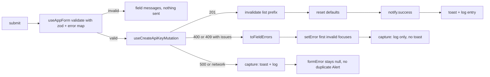

# AIS-85 — `ApiKeyForm` migrated to `notify` + form pattern, and the notification story closed

**Ticket:** AIS-85 (subtask of AIS-86) · **Date:** 2026-11-05 00:58 (Europe/Budapest)
**Scope:** `apps/admin/src/pages/api-keys/**` (create form + its test), `apps/admin/src/test/mocks/render-with-providers.tsx`,
`apps/admin/src/features/forms/use-app-form.logic.ts` (+ its test), docs.
**No** `packages/notifications` change, **no** `packages/ui` change, **no** new dependency.

---

## 1. Goal

Make the create form the reference proof that wiring a form into the notification system costs
*no per-form infrastructure*: the form declares its schema, its ordered field paths, its submit and
one `notify` port — nothing else. Then close the story with the acceptance checklist, the specs
update, the history entry and the milestone.

## 2. Verified starting point

| Fact | Evidence |
| ---- | -------- |
| The create form is still hand-wired: own `useForm`, `useState(pageError)`, success `Alert`, its own `setError` loop | [`ApiKeyForm.tsx`](../../apps/admin/src/pages/api-keys/ui/ApiKeyForm.tsx:46) |
| The shared pattern already exists with a `notify` port and `formError` | [`use-app-form.ts`](../../apps/admin/src/features/forms/use-app-form.ts:47) |
| The notifier facade exists and is provider-bound | [`useNotifier`](../../packages/notifications/src/react/notification.facade.ts:62) |
| The host (toast stack + log drawer) is mounted by the shell, so no page renders it | [`AdminLayout.tsx`](../../apps/admin/src/app/layout/AdminLayout.tsx:59) |
| A failure is toasted **only** when its surface is `page`; `field`/`banner` are log-only | [`notification-events.logic.ts`](../../apps/admin/src/app/notifications/notification-events.logic.ts:279) |
| `useApiMutation` never forwards `meta` to `useMutation`, so the cache’s success path cannot fire for our writes | [`use-api-mutation.ts`](../../apps/admin/src/features/api/use-api-mutation.ts:37) |
| The test render helper mounts the provider but **not** `NotificationHost`, so no test can see a toast today | [`render-with-providers.tsx`](../../apps/admin/src/test/mocks/render-with-providers.tsx:53) |
| Two specs still say “ApiKeyForm migrates in AIS-85” and show a `FormField` + `Input` sample that would render two labels | [`UI-Architecture.md`](../../docs/Specs/UI-Architecture.md:560), [`Forms-and-Validation.md`](../../docs/Specs/Forms-and-Validation.md:35) |

## 3. Decisions

| # | Decision | Why |
| - | -------- | --- |
| **D1** | The success toast comes from the form’s `notify` port (`useNotifier()` as `FormNotifier`), and the api-keys mutations never set `meta.successMessage`. | Exactly one success surface. `meta` cannot even reach the cache handler today (`use-api-mutation.ts:37`), so this makes the single owner explicit instead of accidental. Resolves the AIS-84 D5 “double success toast” risk note. |
| **D2** | The page-level failure message is owned by the **capture toast** for `page`-surface failures, and by the form’s `formError` `Alert` only for the residue of a `field`-surface failure the mapping could not address (unowned path — e.g. the multi-field `400` handler). Implemented in `toFormErrorPlan` (pure, allowlisted): when the failure’s `toErrorSurface` is `page`, `formMessage` is `null`. | The ticket’s `meta: { notify: 'manual' }` marker predates AIS-84/115: adding a second notification policy would only re-suppress what the classifier already decides. Without D2 a `500` shows the same sentence twice (toast + `Alert`), and dropping the `Alert` unconditionally would silently swallow an unowned-path `400` (the capture is log-only for `field`). |
| **D3** | No `FormField` wrapper around `Input`/`Textarea`; they *are* the field + ARIA bundle. `FormField` stays for controls that do not bundle a label. | [`Input.tsx`](../../packages/ui/src/components/input/Input.tsx:42) sets `aria-describedby` **after** `...rest`, so `field.ariaProps` would be dropped, and `FormField`’s `<label>` would render a second label above `Input`’s own. The DoD bullet “uses the `FormField` primitive” is satisfied by the primitive-internal wiring, and the doc samples are fixed instead. |
| **D4** | Pending state goes through `FormActions isSubmitting` (as in [`ApiKeyEditForm`](../../apps/admin/src/pages/api-keys/ui/ApiKeyEditForm.tsx:89)), not a bare `Button disabled`. | One pending affordance in the app; `FormActions` also sets `aria-busy`. |
| **D5** | `pageError` state, the success `Alert`, `isSuccess` / `resetMutation` usage and the hand-written field-error loop are **deleted** from the form, not commented out. | The DoD forbids a second error state; `useAppForm` already sequences reset → notify → `onSuccess`. |
| **D6** | `apps/admin/src/pages/api-keys/api-keys.const.ts` is expected to stay **unchanged** (`API_KEY_FORM_ERROR_TITLE` still titles the residue `Alert`; success/pending copies are still consumed). | Scope list mentions the file, but no copy disappears. If an implementation detail forces a change, it is a review finding. |

## 4. Resulting data flow



## 5. Work items

### 5.1 Form — `apps/admin/src/pages/api-keys/ui/ApiKeyForm.tsx`
1. Replace `useForm` + `zodResolver` + `useState(pageError)` + `setError` loop with one `useAppForm` call:
   `schema: apiKeyFormSchema`, `defaultValues: API_KEY_FORM_DEFAULTS`, `fieldPaths: API_KEY_FIELD_PATHS`,
   `defaultPathByCode: DEFAULT_FIELD_PATH_BY_CODE`, `submit: (values) => createApiKey(toCreateApiKeyInput(values))`,
   `notify: useNotifier()`, `successMessage: API_KEY_FORM_SUCCESS_MESSAGE`.
2. Keep `Input`/`Textarea` calls as they are (`label`/`hint`/`error` + `{...register}`); wrap buttons in `FormActions`.
3. Render the residue `Alert` from `formError` only (title `API_KEY_FORM_ERROR_TITLE`), and only when non-null.
4. Update the doc comment: the form owns **no** error state; it declares, the pattern decides.

### 5.2 Pattern — `apps/admin/src/features/forms/use-app-form.logic.ts` (D2)
1. Extend the pure plan builder so the caller passes the failure’s surface (`toErrorSurface`) and a `page`
   surface yields `formMessage: null`; `field` surface keeps today’s residue rule.
2. Pass the surface from `applyServerError` in [`use-app-form.ts`](../../apps/admin/src/features/forms/use-app-form.ts:79) — one added argument, no behaviour branch inside the component.
3. Extend [`use-app-form.logic.test.ts`](../../apps/admin/src/features/forms/use-app-form.logic.test.ts:1): `page` → no message, `field` + unowned path → message, `field` + all owned → no message.

### 5.3 Tests — `apps/admin/src/pages/api-keys/ui/ApiKeyForm.test.tsx` + harness
1. `render-with-providers.tsx`: mount `NotificationHost` next to the provider (production parity with
   `AdminLayout`) and return the harness so a test can assert store entries without scraping the DOM.
2. Rewrite the assertions: success → toast text + exactly **one** log entry + fields cleared + list refetched;
   `409` → `identifier` invalid + focused, **no** toast, no title; `500` → error toast with `toErrorMessage`
   copy and **no** page `Alert`; multi-field `400` with an unowned path → two field messages + residue
   `Alert` + no toast; pending → `FormActions` pending label, no second submit; client validation unchanged.
3. Keep the existing payload/expiry assertions — they must survive the migration untouched.

### 5.4 Docs
1. [`UI-Architecture.md`](../../docs/Specs/UI-Architecture.md:1): header/AIS notes — `ApiKeyForm` **is** migrated;
   §4.4 sample and rules (D1–D3, `FormField` vs `Input`), §5 `pages/api-keys` row (no `pageError`; failure
   surfaces: toast / field / residue `Alert`), refresh `**Utolsó frissítés:**`. §4.1 primitives rows and the
   §7 `@callback/notifications` row already exist — verify only, do not duplicate.
2. [`Forms-and-Validation.md`](../../docs/Specs/Forms-and-Validation.md:1): fix the sample (no `FormField`
   around `Input`), document the “who speaks” table (toast vs `formError` residue), mark AIS-85 delivered,
   refresh the date.
3. `docs/history/2026-11-05--<hh-ii-ss>-ais-85-apikeyform-notify-migration.md`.
4. `docs/milestones/2026-11-05--<hh-ii-ss>-frontend-notification-and-log-system-closeout.milestone.md`
   (problem · evidence · rationale for D1–D3 · files · verify commands · follow-ups).

### 5.5 Story close-out
1. Run the manual acceptance checklist of
   [`2026-10-22--15-40-00-frontend-notification-and-log-system-plan.md`](../../docs/plans/2026-10-22--15-40-00-frontend-notification-and-log-system-plan.md:436) §9 and tick each item:
   one submit = one toast + one log entry; 3 visible toasts; 20 → +50 paging; reload restores the log (≤200)
   without toasts; corrupt payload dropped silently; no secret in the log.
2. Record the checklist result in the history entry (there is no e2e harness for the admin app).
3. Comment the result on AIS-86 and move AIS-85 → Done.

## 6. Verification

```bash
pnpm --filter @callback/admin test
pnpm --filter @callback/admin lint
pnpm --filter @callback/admin build
pnpm quality:field-errors   # must report nothing under pages/api-keys or features/forms
pnpm quality:layers
pnpm quality:dead-code
```

Manual: `/api-keys` → create a key (toast + log row), duplicate identifier (`409`, field only),
`500` (toast only), then the story checklist above.

Commit title: `AIS-85: feat(admin): migrate ApiKeyForm to notify and close the notification story`

## 7. Out of scope

Router navigation logging (`logNavigation`, follow-up ticket), `ApiKeyEditForm` migration to `notify`
(it inherits the pattern change but gets no toast port here), `packages/ui` and `packages/notifications`
changes, `apps/web`, an e2e harness, `zustand`.

## 8. Risks

| Risk | Mitigation |
| ---- | ---------- |
| A form outside the admin shell would lose its page message under D2 | Only two `useAppForm` consumers exist and both live inside `AdminLayout`; the invariant is recorded in the spec. |
| The residue `Alert` and the log drawer disagree about one `400` | Both read the same mapping; the test asserts exactly one visible surface per failure kind. |
| `render-with-providers` change destabilises existing tests | The host renders into a fixed container and only appears when a toast exists; run the full admin suite. |
| DoD says “use `FormField`” but the form uses `Input` | D3 documents the parity and the doc bug; a future control without a bundled label uses `FormField`. |
