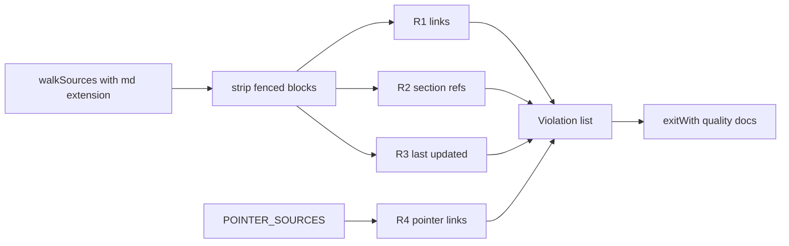

# Plan — AIS-133: single "new admin page" checklist + `quality:docs` gate

**Date:** 2026-11-05 · **Parent:** AIS-129 · **Reference slice:** `api-keys`
**Input:** the AIS-133 ticket body (D1–D8) plus an independent re-verification of the repo on 2026-11-05.

## 1. Goal

One normative artefact — `docs/Specs/New-Admin-Page.md` — that takes a developer (or agent) from
"new resource" to "merged page" in file-name order, plus a deterministic gate (`pnpm quality:docs`)
that turns documentation drift red in CI. No new runtime dependency, no page implementation.

## 2. Verified facts the plan relies on

| Claim | Verified location | Note |
| --- | --- | --- |
| Four sources, not three | [`react.coding-standards.md:350`](.roo/rules/react.coding-standards.md:350) §12 · [`UI-Architecture.md:628`](docs/Specs/UI-Architecture.md:628) §6 · [`Admin-Data-Flow.md:45`](docs/Specs/Admin-Data-Flow.md:45) §3.1–3.5 · [`Admin-Data-Flow.md:119`](docs/Specs/Admin-Data-Flow.md:119) §3.6–3.7 | the ticket's "four" is correct |
| Stale `§12` cross-references | [`Admin-Data-Flow.md:25`](docs/Specs/Admin-Data-Flow.md:25) and [`Admin-Data-Flow.md:116`](docs/Specs/Admin-Data-Flow.md:116) | the page recipe is §6, not §12 |
| §6 header text also points at §12 | [`UI-Architecture.md:630`](docs/Specs/UI-Architecture.md:630) — "The rule file's §12 in repo terms." | must be rewritten, not just shortened |
| State plan already complete | [`UI-Architecture.md:574`](docs/Specs/UI-Architecture.md:574) §5 | 5/5 route entries have a row; DoD = maintenance |
| `quality` chain | [`package.json:16`](package.json:16) → layers, dead-code, tokens, field-errors | `quality:docs` appends here |
| Gate tests are auto-discovered | [`package.json:17`](package.json:17) `node --test "scripts/quality/*.test.mjs"` | new `docs-gate.test.mjs` needs no script change |
| `qa:all` already calls `quality` | [`package.json:25`](package.json:25) | no `qa:all` change needed |
| CI job name is a required check | [`ci.yml:207`](.github/workflows/ci.yml:207) `Quality gates (layers, dead code, tokens, field errors)` | **must not be renamed** |
| Gate scaffolding to copy | [`field-error-gate.mjs`](scripts/quality/field-error-gate.mjs:39) + [`report.mjs:93`](scripts/quality/report.mjs:93) `exitWith` + [`walk-sources.mjs:44`](scripts/quality/walk-sources.mjs:44) | same shape: const → pure logic → CLI → test |
| knip entry rule | [`knip.json:10`](knip.json:10) root entry is only `scripts/lib/agent-artifacts/generate.mjs` | the new gate is "used" because a `package.json` script calls it — keep that script |
| Rule files are generated sources | `.roo/rules/**` → `scripts/init.ps1` / `scripts/init.sh` regenerate `.claude/`, `.cursor/`, `.github/` copies | rerun init after editing; generated copies stay out of git |

## 3. Design decisions

Inherited from the ticket: **D1** (new file is the truth source), **D2** (file-name, layer-ordered),
**D3** (rules §12 → ≤5-line pointer), **D4** (`Admin-Data-Flow` keeps the flows §3.6–3.7),
**D5** (nav is derived — "no work" is written down), **D6** (no page store by default),
**D7** (machine gate), **D8** (AIS-135 derives from this file).

Added while planning:

| # | Decision | Reason |
| --- | --- | --- |
| **D9** | The gate reuses `walkSources` with `extensions: ['.md']` and roots `docs/Specs` + `.roo/rules`; `docs/Specs/outdated` is ignored | no second file walker, no new dependency |
| **D10** | R1–R3 evaluate **only** `docs/Specs/*.md`; R4 evaluates only the four pointer sources | keeps the gate's blast radius small and its failures actionable |
| **D11** | Headings are matched by their **numeric prefix** (`## 6.` → `6`, `### 6.4` → `6.4`), never by slug | slugs change with wording; numbers are what the docs cite |
| **D12** | Fenced code blocks (```` ``` ````) are stripped before link/heading parsing | otherwise examples inside the checklist become false links |
| **D13** | The gate never checks whether a link is *semantically* right, only that it resolves | stated as a limit in the checklist itself (ticket comment §5) |

## 4. Work breakdown

1. **`docs/Specs/New-Admin-Page.md`** (new, normative) — header (`**Utolsó frissítés:**`, `**Status:** living document`, `**Owner:** AIS-133`, `**Reference slice:** api-keys`), §1 decision test + "no store is a decision" + `useAppForm` mandatory, §2 the 0–15 file-order table (contract → `endpoint.registry` → shared tests → api-client → `service.registry` → api → drizzle → api tests → features → entities → pages → optional store → route-registry → nav = no work → MSW → state-plan row), §3 "do not", §4 done signal, §5 pointers to `API-Convention.md`, `Forms-and-Validation.md`, `UI-Architecture.md` §3.3/§4/§5/§6, `Admin-Data-Flow.md` §3.6–3.7.
2. **`react.coding-standards.md` §12** → ≤5 lines: link + the four non-negotiables (render-only component, no `fetch`, state-bucket order, tests required). Delete the 10-step list.
3. **`UI-Architecture.md` §6** → 3–5 line pointer; rewrite the stale "rule file's §12 in repo terms" sentence; keep §5 as the state plan with the rule "new page = new row"; bump `**Utolsó frissítés:**` (two header lines: [`UI-Architecture.md:3`](docs/Specs/UI-Architecture.md:3) and [`UI-Architecture.md:49`](docs/Specs/UI-Architecture.md:49) — update the one that carries the change log).
4. **`Admin-Data-Flow.md` §3** → §3.1–3.5 collapse into one paragraph + pointer; keep §3.6 and §3.7 untouched; fix the `§12` → `§6` references on lines 25 and 116; bump the header date.
5. **`scripts/quality/docs-gate.const.mjs`** — `DOC_ROOTS`, `DOC_EXTENSIONS ('.md')`, `DOC_IGNORE ('docs/Specs/outdated', 'node_modules')`, `POINTER_SOURCES` (rules §12 file, `UI-Architecture.md`, `Admin-Data-Flow.md`, checklist path), `LAST_UPDATED_LABEL`.
6. **`scripts/quality/docs-gate.logic.mjs`** — pure functions returning the shared `Violation` shape: `stripFencedBlocks`, `extractLinks`, `splitLinkTarget` (`:line`, `#anchor`), `resolveRelativeLink`, `extractHeadingNumbers`, `checkLinks` (R1), `checkSectionRefs` (R2), `checkLastUpdated` (R3), `checkPointers` (R4), `checkDocs`.
7. **`scripts/quality/docs-gate.mjs`** — `runDocsGate({ base, roots, ignore, pointerSources })` + `isEntryPoint()` + `exitWith(..., 'quality:docs')`, same shape as [`field-error-gate.mjs:55`](scripts/quality/field-error-gate.mjs:55).
8. **`scripts/quality/docs-gate.test.mjs`** — `node --test`, all branches + the four negative fixture families.
9. **`scripts/quality/fixtures/docs/{positive,negative}/*`** — minimal markdown trees proving each rule can go red (R1 missing file, R2 missing section, R3 missing/bad date, R4 missing pointer).
10. **Wiring** — `"quality:docs": "node scripts/quality/docs-gate.mjs"` in `package.json`, append `&& pnpm quality:docs` to the `quality` chain, one new CI step in the `quality-gates` job (+ extend its leading comment block), `UI-Architecture.md` §9 gate list gets the fifth gate; regenerate agent artefacts with `scripts/init.ps1`.

## 5. Gate rules (v1)

| # | Rule | Red when | Edge cases covered by tests |
| --- | --- | --- | --- |
| R1 | relative markdown link resolves | target file missing (`[...](X.md)`, `[...](X.md:12)`) | `:line` suffix stripped; `#anchor` stripped; external `http(s)` links ignored; links inside fenced blocks ignored |
| R2 | `§N` / `§N.M` reference exists | the target doc has no heading with that number | `§6.4` does not satisfy `§6`; `§3.1–3.7` treated as a range of existing numbers; `§` inside inline code ignored |
| R3 | living-document header | `docs/Specs/*.md` lacks `**Utolsó frissítés:**` or the date is not `YYYY-MM-DD` | `2026.11.04` and `2026-13-01` are red; `docs/Specs/outdated/**` skipped |
| R4 | pointer discipline | any `POINTER_SOURCES` file does not link to `New-Admin-Page.md` | file missing entirely is also red |



## 6. Test plan

- `docs-gate.test.mjs`: one `describe` per rule, positive + negative fixture, then the CLI contract
  (`exitWith` exit code 0/1 with injected `io`, no `process.exit`).
- Regression: `pnpm test:quality` keeps the palette, field-error, walk-sources and report suites green;
  `pnpm quality` stays green with the new fifth gate on the real repo.
- Manual acceptance (the "single source" proof): on a throwaway branch, follow §2 of the checklist
  0→15 for a dummy resource **without opening any other document**; note every point where a second
  file was needed and fix the checklist. AIS-135 automates this later.

## 7. Acceptance criteria

- [ ] `docs/Specs/New-Admin-Page.md` exists with the §2 table, file names and the living-doc header.
- [ ] Rules §12 ≤5 lines, no step list, links the checklist.
- [ ] `UI-Architecture.md` §6 is a pointer, §5 keeps 5/5 rows, header date bumped.
- [ ] `Admin-Data-Flow.md` §3.1–3.5 collapsed to a pointer, §3.6–3.7 intact, `§12` references fixed, date bumped.
- [ ] `Forms-and-Validation.md` linked, not duplicated.
- [ ] `pnpm quality:docs` exists, green, part of `pnpm quality`; CI has a separate step and the job name is unchanged.
- [ ] All four rules provably fail on their negative fixtures.
- [ ] No new dependency; `pnpm quality && pnpm test:quality && pnpm typecheck && pnpm -r build && pnpm -r lint && pnpm test` green.

## 8. Risks

| Risk | Mitigation |
| --- | --- |
| Renaming the CI job breaks a required status check | job name and `id` untouched; only a step is added |
| `.roo/rules` edit is incomplete until init reruns | run `scripts/init.ps1` in the same change; generated copies are gitignored |
| The gate becomes a linter of prose | R1–R3 stay syntactic; semantic correctness is out of scope (D13) |
| `knip` flags the new gate as dead code | the `quality:docs` script keeps it an entry; verify with `pnpm quality:dead-code` |
| The checklist drifts from the real slice again | R4 fails the build when a pointer source loses the link; §2 is derived from `api-keys`, which is test-covered |

## 9. Out of scope

`pnpm new-resource` (AIS-135), `API-Convention.md` updates (AIS-100), board hygiene (AIS-134),
Page/Storybook/E2E/i18n work, and any change to the state-plan content itself.

## 10. Implementation notes (deviations from this plan)

The gate's first run over the real repo produced 45 violations and forced three adjustments:

| Planned | Implemented | Why |
| --- | --- | --- |
| R1 probes "is readable as text" | R1 probes `existsSync` (files **and** directories) | `../../infra/postgres/init/` is a legitimate directory link; six valid links were flagged |
| R2 checks every `§N` | R2 checks only refs on a line that also links a document, and only in `SECTION_CHECKED_DOCS` (the five process docs) | a bare `§N` in prose has no resolvable target, and the legacy runbooks number their subsections in code comments (`# 2.7.1 …`) rather than as headings |
| Fences toggled on any ` ``` ` line | the stripper tracks the fence character and its length | a ` ``` ` inside a ```` ```` ```` example must not close the outer block |

The remaining 26 findings were real drift and were fixed in this change: six missing
`**Utolsó frissítés:**` headers, ten links to renamed or archived artefacts, one link to a module that
moved from `features/` to `pages/`, and one §1 row that mixed two documents' sections.

A fourth Jest config (`packages/api-client`) also received the `*.json.js` mapper guard from the earlier
test-infrastructure fix, because its suite printed the same `libphonenumber-js` warning.
