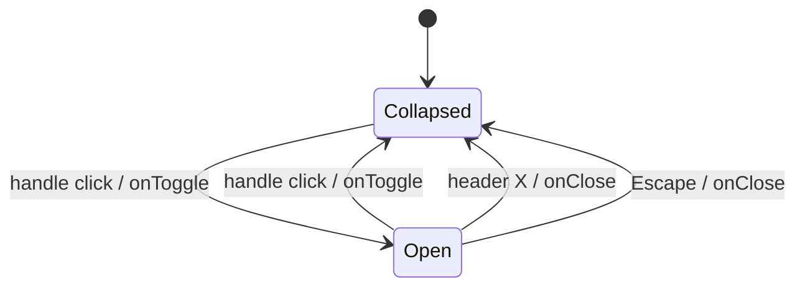

# Plan — AIS-136: admin app-shell notification polish

**Date:** 2026-11-05 · **Ticket:** AIS-136 · **Parent area:** notifications (AIS-79…AIS-85, all Done)
**Input:** the AIS-136 ticket body (G1–G5, work items 1–5, D1–D8) plus an independent re-verification of the
code on 2026-11-05. Nothing in the notification core is rebuilt.

## 1. Goal

Close the four gaps that stop the already-shipped notification subsystem from being *automatic*:

1. the log drawer is reachable in **both** states through one always-mounted arrow handle;
2. `banner` failures (`401`, `503`, offline) **toast** in addition to the banner and the log;
3. render crashes reach the log **and** a toast;
4. `ApiKeyEditForm` reports a successful `PATCH` through the notify port;
5. the convention is written down so the next page wires nothing by hand.

## 2. Verified current state

| Claim | Verified location | Reality |
| --- | --- | --- |
| G1 — handle only while collapsed | [`LogDrawer.tsx:77`](packages/ui/src/components/log-drawer/LogDrawer.tsx:77) `{isOpen ? null : (<button …>)}` | confirmed; `aria-expanded` hard-coded `false` |
| G1 — label helper is collapsed-only | [`log-drawer.logic.ts:13`](packages/ui/src/components/log-drawer/log-drawer.logic.ts:13) `toLogDrawerTabLabel(unseenCount)` | no open-state name |
| G2 — banner is log-only | [`notification-events.logic.ts:279`](apps/admin/src/app/notifications/notification-events.logic.ts:279) `toast: surface === 'page'` | confirmed; module JSDoc at `:37` states the old rule |
| G3 — boundary only logs | [`AppErrorBoundary.tsx:48`](apps/admin/src/app/error/AppErrorBoundary.tsx:48) `componentDidCatch` → `console.error` | no port, no entry |
| G4 — no notify port | [`ApiKeyEditForm.tsx:41`](apps/admin/src/pages/api-keys/ui/ApiKeyEditForm.tsx:41) `useAppForm({…})` without `notify` | **but** the page renders a success `Alert` from `isSaved` ([`ApiKeyDetailPage.tsx:238`](apps/admin/src/pages/api-keys/ApiKeyDetailPage.tsx:238)) — see §3 |
| Port contract exists | [`use-app-form.ts:130`](apps/admin/src/features/forms/use-app-form.ts:130) `notify.success(successMessage)`; reference wiring [`ApiKeyForm.tsx:54`](apps/admin/src/pages/api-keys/ui/ApiKeyForm.tsx:54) | AIS-85 pattern to copy |
| Host is app-level | [`AdminLayout.tsx:59`](apps/admin/src/app/layout/AdminLayout.tsx:59) `<NotificationHost />` | D6 needs **no** code change |
| Store singleton | [`notification.store.ts:69`](apps/admin/src/app/notifications/notification.store.ts:69) `notificationStore` | the emitter source for W3 |
| Runtime helpers exist | [`notification-react.const.ts:43`](packages/notifications/src/react/notification-react.const.ts:43) `RUNTIME_ERROR_MESSAGE` · [`notification-react.logic.ts:145`](packages/notifications/src/react/notification-react.logic.ts:145) `toRuntimeDetail` | exported from `@callback/notifications/react` |
| `meta.successMessage` not used by updates | grep over `features/api-keys` — only `use-api-mutation` *carries* it | no duplicate toast from the cache |
| Test files already exist | `AppErrorBoundary.test.tsx`, `AdminLayout.test.tsx`, `ApiKeyEditForm.test.tsx`, `notification-capture.integration.test.tsx` | extend, do not create |
| Docs targets exist | `UI-Architecture.md` §4.1.3 (`:370`), `Forms-and-Validation.md` §3.1 (`:83`), `API-Convention.md` tiers (`:336`), `New-Admin-Page.md` §2 (`:34`) | all four need edits |

## 3. Deviations from the ticket

| # | Ticket says | Decision | Why |
| --- | --- | --- | --- |
| **AIS136-D1** | “Exactly one success surface: the form owns it” (work item 4) | **Keep** the `isSaved` success `Alert` on the detail page **and** add the notify port → two intentional success surfaces | Owner decision on 2026-11-05. Same reasoning as D2 for errors: the `Alert` marks the persistent state of the page (you saved this row), the toast marks the moment. [`ApiKeyDetailPage.test.tsx:153`](apps/admin/src/pages/api-keys/ApiKeyDetailPage.test.tsx:153) therefore stays valid. |
| **AIS136-D2** | G4 says “no feedback at all” | Corrected wording: the page already renders the `Alert`; what is missing is the **toast + log entry** | Factual correction, no behaviour change beyond D1. |
| **AIS136-D3** | — | The handle keeps `right-0` in **both** states; the **panel reserves a right gutter** while open instead of the handle moving left of the panel | One fixed position means no position jump, no width-dependent breakpoint, and the handle can never end up off-screen on a narrow viewport. The panel's `pr-*` gutter is the only layout cost. |

## 4. Work items

### W1 — `packages/ui`: persistent drawer handle

Files: [`LogDrawer.tsx`](packages/ui/src/components/log-drawer/LogDrawer.tsx:1),
[`log-drawer.const.ts`](packages/ui/src/components/log-drawer/log-drawer.const.ts:1),
[`log-drawer.interface.ts`](packages/ui/src/components/log-drawer/log-drawer.interface.ts:1),
[`log-drawer.variants.ts`](packages/ui/src/components/log-drawer/log-drawer.variants.ts:1),
[`log-drawer.logic.ts`](packages/ui/src/components/log-drawer/log-drawer.logic.ts:1).

1. `log-drawer.logic.ts` — replace `toLogDrawerTabLabel(unseenCount)` with
   `toLogDrawerHandleLabel(unseenCount, isOpen)`: `LOG_DRAWER_CLOSE_LABEL` when open, `LOG_DRAWER_OPEN_LABEL`
   when collapsed, and the existing ` (N új)` suffix in **both** states. Pure, total, no branches beyond the
   two flags.
2. `log-drawer.const.ts` — add the two glyphs (`‹` collapsed, `›` open) and the caption (`Log`); keep
   `LOG_DRAWER_OPEN_LABEL` / `LOG_DRAWER_CLOSE_LABEL` as the single source of the accessible names.
3. `log-drawer.variants.ts` — `logDrawerTabVariants` gains an `isOpen` variant (`true`/`false`) that only sets
   the state-independent surface plus the pressed shadow while open; add `logDrawerPanelGutter` (or a
   `logDrawerBodyVariants`) so header, list and footer each reserve the handle's width on the right.
4. `LogDrawer.tsx` — render **one** `<button>` unconditionally, as a sibling **after** the panel so it paints
   above it, with:
   - `type="button"`, `aria-expanded={isOpen}`, `aria-controls={panelId}` in both states;
   - `aria-label={toLogDrawerHandleLabel(unseenCount, isOpen)}`;
   - the glyph flipping with `isOpen` (`aria-hidden`), the `Badge` shown in both states when `unseenCount > 0`;
   - `onClick={onToggle}` — the only intent, no second handler.
   Keep `✕` and `Escape` (the existing `useEffect`), keep the panel non-modal (`pointer-events-none` while
   closed, `aria-hidden={!isOpen}`, content rendered only while open), keep the panel element mounted.
5. `log-drawer.interface.ts` — fix the `onToggle` JSDoc (“the collapsed tab was activated” → “the handle was
   activated: open the panel when closed, close it when open”); note that the badge is state-independent.



Constraint: no colour literal, palette utility or arbitrary **colour**; the gutter/width arbitrary values are
layout and allowed (`react.coding-standards.md` §7.3).

### W2 — `apps/admin`: the toast matrix

File: [`notification-events.logic.ts`](apps/admin/src/app/notifications/notification-events.logic.ts:1) +
its test.

1. Add a pure `toFailureToast(surface: ErrorSurface): boolean` — `field → false`, `banner → true`, `page → true`
   (`silent` never reaches it, it returns `null` earlier). One responsibility, exhaustive `switch`.
2. `toFailureEntry` (`:260`) uses it: `toast: toFailureToast(surface)`. Nothing else changes.
3. Rewrite the module JSDoc at `:37` to the new rule.

| Surface | Log entry | Toast | Other owner |
| --- | --- | --- | --- |
| `silent` | no | no | — |
| `field` | yes | **no** | the input + `formError` residue `Alert` |
| `banner` | yes | **yes** | `AppErrorBanner` (kept, D2) |
| `page` | yes | yes | page region |
| render crash | yes | yes | `PageErrorState` (W3) |

### W3 — `apps/admin`: the boundary emits

Files: [`app-error-boundary.interface.ts`](apps/admin/src/app/error/app-error-boundary.interface.ts:1),
[`AppErrorBoundary.tsx`](apps/admin/src/app/error/AppErrorBoundary.tsx:1), [`App.tsx`](apps/admin/src/App.tsx:1),
new `apps/admin/src/app/notifications/runtime-error.ts` (+ `.test.ts`).

1. Interface: add the injected port `readonly onError?: (report: AppRenderErrorReport) => void` and
   `AppRenderErrorReport` (`error: unknown`, `componentStack: string | null`) in the same `.interface.ts`.
2. Boundary: in `componentDidCatch` build the report and call `this.props.onError?.(report)` **inside a
   `try/catch`** (a throwing emitter must not break the fallback), then keep the existing `console.error`.
   No store import, no hooks (class component, D3). Exactly one report per caught error.
3. `app/notifications/runtime-error.ts`: `createRuntimeErrorEmitter(store: NotificationStore, includeDetails: boolean)`
   → returns `(report) => void` that emits `NOTIFICATION_EVENT_DEFAULTS['runtime.error']` with
   `message: RUNTIME_ERROR_MESSAGE` and `detail: toRuntimeDetail(report.error, includeDetails)`.
   Verify the `runtime.error` kind exists in [`notification-event.const.ts`](packages/notifications/src/core/notification-event.const.ts:1);
   if it does not, stop and report instead of inventing a kind.
4. `App.tsx`: build the emitter once from the singleton
   (`notificationStore` imported from `./app/notifications/notification.store.js`) and pass
   `onError={emitRenderError}` with `import.meta.env.DEV` as `includeDetails`. `AppProps` unchanged.

### W4 — `apps/admin`: edit-form notify port

Files: [`ApiKeyEditForm.tsx`](apps/admin/src/pages/api-keys/ui/ApiKeyEditForm.tsx:1),
[`ApiKeyDetailPage.tsx`](apps/admin/src/pages/api-keys/ApiKeyDetailPage.tsx:1),
[`api-keys.const.ts`](apps/admin/src/pages/api-keys/api-keys.const.ts:1).

1. `ApiKeyEditForm`: `const notify = useNotifier();` and pass `notify` + `successMessage: API_KEY_EDIT_FORM_SUCCESS_MESSAGE`
   into `useAppForm` — exactly the `ApiKeyForm` shape. Keep `submit` / `onSaved` untouched; the existing
   `reset(defaultValues)` + `key={updatedAt}` remount still own the post-save state.
2. `ApiKeyDetailPage`: keep the `isSaved` `Alert` (AIS136-D1). No new const needed —
   `API_KEY_EDIT_FORM_SUCCESS_MESSAGE` is reused by both surfaces, so they cannot drift.
3. Confirm `useUpdateApiKeyMutation` sets **no** `meta.successMessage` (it does not today) — otherwise the
   cache-level success callback would add a second toast.

### W5 — docs (all four, headers refreshed, doc gate stays green)

| File | Change |
| --- | --- |
| [`UI-Architecture.md`](docs/Specs/UI-Architecture.md:370) | §4.1.3 capture table: `banner` → toast **yes** (and the `field`-only note at `:382`); `LogDrawer` primitive row (`:254`) — handle present in both states, `aria-expanded`/`aria-controls`, flipping glyph + name, state-independent badge, panel gutter; §5 state-plan row for `pages/api-keys/ApiKeyDetailPage` — success `Alert` **and** toast (AIS136-D1); `**Utolsó frissítés:**` |
| [`Forms-and-Validation.md`](docs/Specs/Forms-and-Validation.md:83) | §3.1 who-speaks table: `banner` row → banner **and** toast; §5 notify port — the port is mandatory for a save form; §6 migration table: `ApiKeyEditForm` → wired (AIS-136); header date |
| [`API-Convention.md`](docs/Specs/API-Convention.md:336) | error-tier table: tier 3 (banner) is additionally toasted — condition and moment are two different signals; header date |
| [`New-Admin-Page.md`](docs/Specs/New-Admin-Page.md:34) | §2 new **no work** row after step 12/13: notifications are automatic — a page never mounts `NotificationProvider`/`NotificationHost`, never creates a store, never sets `meta.successMessage`; §3 add both as “do not” rows; header date |

`pnpm quality:docs` rules R1–R4 must stay satisfied: relative links resolve, `§N` references match real
sections, every touched doc keeps `**Utolsó frissítés:** YYYY-MM-DD`.

### W6 — artifacts

- this plan (`docs/plans/2026-11-05--15-15-00-ais-136-admin-notification-polish-plan.md`);
- `docs/history/<ts>-ais-136-admin-notification-polish.md` — narrative **including the manual browser checklist**;
- `docs/milestones/<ts>-ais-136-notification-toast-matrix.milestone.md` — the toast matrix and the
  non-modal drawer handle are durable UX contracts.

## 5. Test plan

### `packages/ui/test/log-drawer.test.tsx` (extend; the label helper rename touches the existing queries)

handle rendered while collapsed · handle rendered while open · glyph + accessible name flip with the state ·
`aria-expanded` + `aria-controls` in both states · `onToggle` from the collapsed handle · `onToggle` from the
open handle · unseen badge in both states and hidden at `0` · `✕` and `Escape` still close · panel
`aria-hidden` + `pointer-events-none` + no focusable content while collapsed · filters and paging unchanged ·
`toLogDrawerHandleLabel` unit cases (0, >0, both states).

### `apps/admin/src/app/notifications/notification-events.logic.test.ts`

toasts a banner `401` · toasts a `503` · toasts an offline failure (`status === null`) · toasts a page `5xx` ·
does **not** toast a field failure · drops a silent failure · `toFailureToast` exhaustive by surface ·
`toHttpEntry` stays `toast: false`.

### `apps/admin/src/app/error/AppErrorBoundary.test.tsx`

reports a caught error through `onError` exactly once · still renders `PageErrorState` · works without a port ·
does not throw when the port throws · keeps `console.error` · with a real store: one `error` entry,
`source: 'runtime'`, `toast: true`.

### `apps/admin/src/app/notifications/runtime-error.test.ts` (new)

emits the catalogued `runtime.error` defaults · message is `RUNTIME_ERROR_MESSAGE` · includes the stack only
when `includeDetails` · tolerates a thrown non-`Error` value.

### Wiring

[`notification-capture.integration.test.tsx`](apps/admin/src/app/notifications/notification-capture.integration.test.tsx:1)
— banner failure → one entry **and** one toast; field failure → one entry, no toast ·
[`AdminLayout.test.tsx`](apps/admin/src/app/layout/AdminLayout.test.tsx:1) — the drawer handle renders on every
protected page ·
[`ApiKeyEditForm.test.tsx`](apps/admin/src/pages/api-keys/ui/ApiKeyEditForm.test.tsx:1) — one success toast +
one log entry on save, field message and no toast for a stale write (reuse the `ApiKeyForm.test.tsx` notifier
setup; mocks stay under `apps/admin/src/test/mocks/`).

**Not automatable** (no admin e2e harness) — recorded in the history entry: handle in both states on two
pages, F5 keeps the log, `401` → banner **and** toast **and** log, forced render crash → page error state +
toast + log, `409` → inline only.

## 6. Verification

```bash
pnpm --filter @callback/ui test
pnpm --filter @callback/notifications test
pnpm --filter @callback/admin test
pnpm lint
pnpm typecheck
pnpm quality        # layers + palette + field-errors + docs + dead-code
```

Plus the palette check from `react.coding-standards.md` §13 over `apps/web/src` and `apps/admin/src`, and a
grep proving no page imports `NotificationProvider` / `NotificationHost` / `notification.store`.

## 7. Risks

| Risk | Mitigation |
| --- | --- |
| The panel gutter while open reflows the toast stack visually | toasts are `z-60` above `z-40`; verify no clipping in the manual checklist |
| The handle overlapping the panel header actions (`Törlés`, `✕`) | the gutter reserves the handle's full width on the right for header, list and footer |
| Two success surfaces on the detail page (AIS136-D1) read as a bug | documented in `UI-Architecture.md` §5 and in the milestone as an owner decision |
| `runtime.error` may not exist in `NOTIFICATION_EVENT_DEFAULTS` | W3 step 3 stops and reports instead of inventing an event kind |
| `componentDidCatch` firing twice under StrictMode | the test pins “exactly once” per commit; `console.error` stays the dev aid |
