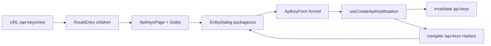

# AIS-155 — Route-alapú, szabványos entitás-overlay (EntityDialog) + api-keys lista-első oldal

**Date:** 2026-11-07 · **Ticket:** AIS-155 · **Subtasks:** AIS-156 … AIS-162 · **Revision:** 2 (repo-state verified)

## Goal

Minden entitás-létrehozó/-módosító felület **egyetlen, újrahasznosítható, route-alapú overlay ablakban**
nyíljon a lista fölött, és az `api-keys` oldal alapból **csak a listát** mutassa. Az overlay a szabvány:
cím, alcím, fejléc SVG `X` bezárással, opcionális extra gombok bal/jobb oldalon, opcionális submit
(címkével) és cancel — hogy egy következő entitásnál ne kelljen újra megírni.

## Decisions

| #   | Decision | Why |
| --- | -------- | --- |
| D1 | A prezentáció `packages/ui`-ban él (`EntityDialog`), a route-kötés az adminban | A primitíva nem importálhat routert és nem ismerhet entitást; a domain-tudás az adminban marad |
| D2 | **Nested route**: `RouteEntry.children` + `<Outlet/>`; a gyerek `path` **abszolút** (a szülő path-jával kezdődik), és a szülő `element`-e rendereli az `<Outlet/>`-et | Megosztható URL, reload-biztos, és a lista **mountolva marad** a dialógus mögött |
| D3 | A regisztrált fa **lapítását** egy tiszta `flattenRouteEntries()` adja (`app/router`), és ezt fogyasztja `ALL_ROUTE_ENTRIES`, a nav és a breadcrumb-matcher | A meglévő [breadcrumb matcher](apps/admin/src/app/router/breadcrumb.logic.ts:181) és a nav flat listán dolgozik — nem kell átírni, csak etetni |
| D4 | A submit **opcionális és a formhoz van kikötve**: `submit: { label, pendingLabel?, isSubmitting?, formId }`, a gomb `type="submit" form={formId}`; `submit` hiányában nincs submit gomb | A `<form>` + `useAppForm` marad a tulajdonos, a footer csak egy külső submit-gomb; read-only módban egy gomb sincs |
| D5 | Az `EntityDialog`-nak **nincs `open` propja**: mountolva = nyitva; `onOpenChange` → `onClose` | Az URL az egyetlen láthatóság-tulajdonos, így nem lehet második igazság |
| D6 | Fejléc-slotok: `headerStart`, `headerEnd`; az `X` mindig utolsó; az api-keys oldalon egyik slot sincs kitöltve | Paraméterezhető, de a konkrét oldal minimál marad |
| D7 | Bezárás mindig `navigate(listPath, { replace: true })`, egy shared hookból (`features/entity-dialog/use-entity-dialog.ts`) | Deep linkből is a listára kell jutni, nem az előzménybe; a page nem importálhat `app`-ot, a `features/api/use-list-params.ts` pedig már most is használ router-hookot |
| D8 | A táblázat sor-linkje **most rögtön a `/view` overlay-re** mutat; a régi `/api-keys/:identifier` detail oldal változatlanul megmarad, és a view overlay footer-extrája („Kulcs törlése”) navigál rá | Az overlay a valódi belépési pont (különben halott route lenne), a törlés pedig nem tűnik el: a read-only ablak maga nem destruktív, csak átadja a régi oldalnak |
| D9 | Egy `PlusIcon` + `Button.icon` slot szolgálja ki a „+ új elem” mintát mindenhol | Egyszer megírt, konzisztens akció a jövőbeli listákon |
| D10 | Az overlay route-ok **saját morzsát** kapnak: create → `breadcrumbLabel: 'Új API kulcs'`, view → `resolveBreadcrumbLabel: (p) => p.identifier`, mindkettő `breadcrumbParentPath: '/api-keys'` | A [registry teszt](apps/admin/src/app/router/route-registry.test.ts:134) tiltja a morzsa nélküli protected entry-t, és a felhasználó lássa, hol van |
| D11 | A `✕` → `CloseIcon` csere **csak az `OverlayShell`-ben** történik meg; a Toast/Banner/LogDrawer glyphje marad | Egy közös shell érinti a `Dialog`/`Drawer`/`ConfirmDialog` teszteket is — a három másik komponens külön follow-up, nincs benne a ticketben |
| D12 | A read-only nézet a meglévő mezőlistát használja: `ui/ApiKeyDetailFields.tsx` kiemelve a `ApiKeyDetailCard`-ból, a kártya és a dialog is ezt rendereli | Ne legyen két mezőlista; a `Card` wrapper a dialogban vizuálisan rossz lenne |

## Routes

| Route | Tartalom |
| ----- | -------- |
| `/api-keys` | lista (parent, `<Outlet/>`-tel a modálokhoz) + „Új API kulcs” gomb jobb felül |
| `/api-keys/new` | create overlay (`EntityDialog`, submit: „Létrehozás”) — statikus szegmens, a React Router és a breadcrumb-matcher is a `:identifier` elé sorolja |
| `/api-keys/:identifier/view` | read-only overlay (`submit` nélkül, footer: „Bezárás”) |
| `/api-keys/:identifier` | marad: régi detail oldal (törlés + inline szerkesztő); a view overlay „Kulcs törlése” footer-extrája navigál ide |



## Steps (subtask order)

1. **AIS-156** — `packages/ui`: `PlusIcon`, `CloseIcon` az [`icons.tsx`](packages/ui/src/components/icon/icons.tsx:1)-ben (Lucide geometria, ISC fejléc), `Button.icon` slot ([`button.interface.ts`](packages/ui/src/components/button/button.interface.ts:10) + `Button.tsx`), exportok az [`index.ts`](packages/ui/src/index.ts:1)-ben; tesztek (`icon.test.tsx`, `button.test.tsx`).
2. **AIS-157** — `packages/ui`: [`dialogVariants`](packages/ui/src/components/dialog/dialog.variants.ts:23) `fit` méret (`w-auto max-w-[calc(100vw-2rem)]`), [`OverlayShell`](packages/ui/src/components/dialog/OverlayShell.tsx:23) `headerStart`/`headerEnd` slot + görgethető body + `CloseIcon`; új `EntityDialog` (`entity-dialog.interface.ts`, `EntityDialog.tsx`, `entity-dialog.const.ts`) + `overlay-shell.interface.ts` bővítés; `dialog.test.tsx`, `drawer.test.tsx`, `entity-dialog.test.tsx`, `overlay-a11y.test.tsx` frissítés.
3. **AIS-158** — admin: [`RouteEntry.children`](apps/admin/src/app/router/route-entry.interface.ts:14) + `flattenRouteEntries()` (`app/router/route-tree.logic.ts` + teszt), rekurzív [`AppRouter`](apps/admin/src/app/router/AppRouter.tsx:67), `features/entity-dialog/` (`use-entity-dialog.ts`, `.interface.ts`, `.const.ts` + teszt), [`route-registry.test.ts`](apps/admin/src/app/router/route-registry.test.ts:68) invariánsok frissítése (top-level vs. child szabály, morzsa-kötelezettség).
4. **AIS-159** — admin: [`ApiKeysPage`](apps/admin/src/pages/api-keys/ApiKeysPage.tsx:47) lista-elsővé tétele (`<ApiKeyForm/>` ki, `<Outlet/>` be), fejléc-akció „Új API kulcs” (`PlusIcon` + `Button.icon` + `variant="primary"`), `API_KEYS_CREATE_ROUTE_PATH`, `API_KEYS_EMPTY_MESSAGE` szöveg frissítése (ne az űrlapra hivatkozzon).
5. **AIS-160** — admin: `ui/ApiKeyCreateDialog.tsx` (`/api-keys/new`), [`ApiKeyForm`](apps/admin/src/pages/api-keys/ui/ApiKeyForm.tsx:53) átalakítása mezőkké (nincs `Card`, nincs cím, nincs `FormActions`; `formId` + `onSuccess` prop), registry child entry; a create flow tesztje.
6. **AIS-161** — admin: `ui/ApiKeyViewDialog.tsx` (`/api-keys/:identifier/view`, `useApiKeyDetailQuery`, loading/404/error ágak, `footerExtras`: „Kulcs törlése” → régi detail oldal), `ui/ApiKeyDetailFields.tsx` kiemelése + `ApiKeyDetailCard` átállítása, `toApiKeyViewRoute()` az `api-keys.logic.ts`-ben, [`ApiKeysTable`](apps/admin/src/pages/api-keys/ui/ApiKeysTable.tsx:1) sor-linkjének átállítása a view route-ra (+ teszt), registry child entry.
7. **AIS-162** — docs (`docs/Specs/UI-Architecture.md` §4.0 + §5 + §6, `docs/Specs/New-Admin-Page.md`), `docs/history/<ts>-ais-155-entity-dialog.md`, milestone, teljes regresszió + manuális QA.

## Tests

- **ui**: ikonok render/`aria-hidden`; `Button` icon-slot (ikon + felirat, csak ikon); `EntityDialog` minden módja (submit, submit nélkül, címkék, `headerStart`/`headerEnd`/`footerExtras`, `X`/`Esc`/backdrop → `onClose`, fókusz-csapda és visszaadás, axe); `Dialog`/`Drawer`/`ConfirmDialog` meglévő tesztjei a `CloseIcon`-ra.
- **admin**: `flattenRouteEntries` (fa → flat, sorrend, egyedi path); registry nested entry-k + morzsa; `ApiKeysPage` (csak lista + gomb, gomb a create route-ra mutat, `<Outlet/>` jelen van); create overlay (séma validáció, 409 → mezőhiba, siker → `navigate('/api-keys')` + invalidate + toast); view overlay (read-only, nincs submit gomb, loading/404/error ágak, `Esc`/`X` → lista).
- Mockok a `packages/ui/test/mocks/` és `apps/admin/src/test/mocks/` alatt — tesztfájlban nincs mock.

## Gates

```bash
pnpm --filter @callback/ui test
pnpm --filter @callback/admin test
pnpm typecheck
pnpm lint
pnpm quality
```

## Risks

- Az `OverlayShell` közös: a bezárás-glyph és a body-görgetés a `Drawer`/`ConfirmDialog` teszteket is érinti → azokat egy lépésben kell frissíteni (AIS-157).
- A `RouteEntry.children` bevezetése a registry **minden** fogyasztóját érinti (nav, router, breadcrumb, teszt-mock) → a lapítás egy helyen történik, a fogyasztók flat listát kapnak.
- `quality:dead-code` (knip): minden új exportot fel kell használni ugyanabban a változásban.

## Out of scope

- A régi `/api-keys/:identifier` detail oldal kivezetése (follow-up); addig a törlés onnan érhető el.
- Törlés az overlay-ből (a read-only ablak szándékosan nem destruktív).
- Soronkénti ikon-akciók a táblázatban.
- A Toast/Banner/LogDrawer `✕` glyphjének cseréje.
- Más entitások átállítása az új overlay-re (külön ticketek).
