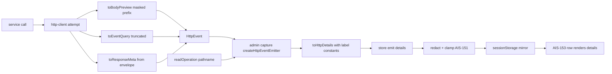

# AIS-152 — api-client + admin capture: `HttpEvent` enrichment and `details` mapping

**Ticket:** [AIS-152](https://zakzag.atlassian.net/browse/AIS-152) · **Parent:** AIS-143 · **Requires:** AIS-151 (Done)
**Scope:** the **data** that reaches the log. No UI: the expandable row is AIS-153.

## Goal

Today the transport emits `{ method, path, status, durationMs, outcome }` and throws away the
success `meta`, the `X-Request-Id` header, the query string and the request body; a failure flattens
`requestId` and the field issues into one `detail` string. AIS-151 gave the entry a structured
`details?: NotificationDetailField[]`, so this ticket fills it from all three capture channels
(HTTP, query/mutation failure, runtime crash) while `detail` stays the unchanged one-line summary.

## Verified starting state

| Fact | Where |
| ---- | ----- |
| `details` exists on `NotificationEntry` and `EmitNotificationInput`, redacted + clamped by the store | [`notification.interface.ts`](packages/notifications/src/core/notification.interface.ts:28) |
| `NotificationEntryDraft` **is** `EmitNotificationInput`, so it already accepts `details` | [`notification.interface.ts`](apps/admin/src/app/notifications/notification.interface.ts:10) |
| `HttpEvent` has no requestId/query/body/meta field; its JSDoc claims no body field can exist | [`http-client.interface.ts`](packages/api-client/src/http-client.interface.ts:40) |
| `attempt()` emits three events (network, non-2xx, drift) with status only | [`http-client.ts`](packages/api-client/src/http-client.ts:251) |
| The serialised body is computed inline in each verb, so the preview source is available | [`http-client.ts`](packages/api-client/src/http-client.ts:334) |
| Failure contexts carry only the key, no `operation` | [`notification.interface.ts`](apps/admin/src/app/notifications/notification.interface.ts:18) |
| `HttpEvent` test fixtures are written inline in two spec files | [`notification-events.logic.test.ts`](apps/admin/src/app/notifications/notification-events.logic.test.ts:40) |

## Decisions (frozen)

| # | Decision |
| - | -------- |
| A | `requestId`: `x-request-id` **header first**, then, when the header is absent, the parsed envelope — success: `meta.requestId`; non-2xx/drift: the thrown `ApiError.requestId` (which already came from `error.requestId`). Network error → `null`. This gives **successful** requests a trace too. |
| B | `query` is emitted **unfiltered**, truncated only (`HTTP_QUERY_MAX_LENGTH` + `…`). Source is the path the attempt already received, so the generated `getList` query travels the same route. |
| C | `bodyPreview` is the **serialised request payload** — not the caller's object — truncated to `HTTP_BODY_PREVIEW_MAX_LENGTH` + `…`. Header/`Authorization` never enters the event; **and** a top-level sensitive JSON key (`token`, `password`, `apiKey`, `secret`, `authorization`) is replaced with `<redacted>` before serialisation, so a credential in a body cannot leak into the log. |
| D | `details` reaches **the log only**; `Toast.detail` stays `string` (`D-D`). The collapsed row keeps using `detail`. |
| E | `operation` label: query/mutation → `meta.operation` (validated string); HTTP event → the injected `readOperation()` reader (`() => window.location.pathname`, wired once in `main.tsx`). The transport cannot know a domain operation. |
| F | Existing behaviour unchanged: `2xx` → `system`/no toast, `4xx` → `error`/no toast, and every `detail` string stays byte-identical. |
| G | **Deviation from the ticket, 2 labels dropped.** `DETAIL_LABEL_REPEAT` and `DETAIL_LABEL_TIMESTAMP` are **not** created: `repeatCount` and `createdAt` are store-owned and the row renders them from the entry (AIS-153), so a constant here would be an unused export and fail `pnpm quality:dead-code`. Revisit only if AIS-153 proves it needs a label. |
| H | **Deviation, signature.** `toRuntimeDetails(report: AppRenderErrorReport, includeStack: boolean)` keeps the ticket's shape and imports the existing port **type** from `app/error`, instead of re-declaring `error`/`componentStack` — the same type `runtime-error.ts` already consumes. |
| I | Preview, query and meta extraction are **pure functions** in a new `http-event.logic.ts`, so every branch is testable without a `fetch` double. |
| J | `attempt()` stops growing positional parameters: it takes one `AttemptRequest` object (`method`, `path`, `init`, `body`, `parse`). `parse` now returns `{ data, responseMeta }` so the meta comes from the body the transport already read — no second read. |

## Behaviour contract

```text
HttpEvent (all readonly)
├─ method, path, status, durationMs, outcome        unchanged
├─ requestId      header → envelope meta/ApiError → null
├─ query          path after '?', '' when absent, truncated
├─ bodyPreview    masked top-level secrets → JSON → prefix + '…', null when no body
└─ responseMeta   { requestId, timestamp, totalItems } | null
                  totalItems = meta.pagination.total, null when the endpoint does not paginate
```

```text
NotificationDetailField[] built per channel
HTTP event   → method, path, query, status, durationMs, outcome, requestId,
               responseTimestamp, totalItems, body, operation, source(api)
failure      → code, status, requestId, key(queryKey|mutationKey), <one field per issue>,
               url, surface, errorName
runtime      → errorName, message, stack (DEV only), componentStack
```

Rules for every builder: an **empty/absent value is skipped**, never emitted as `''`; the order is
the insertion order above (matches AIS-151 decision A); `mono: true` for identifiers, query strings,
bodies, urls and stacks.

## Files and changes

### A) `packages/api-client`

1. **New** [`src/http-event.const.ts`](packages/api-client/src/http-event.const.ts)
   `HTTP_BODY_PREVIEW_MAX_LENGTH = 500`, `HTTP_QUERY_MAX_LENGTH = 500`,
   `HTTP_EVENT_TRUNCATION_SUFFIX = '…'`, `REQUEST_ID_HEADER = 'x-request-id'`,
   `HTTP_PREVIEW_SENSITIVE_KEY_PATTERN`, `HTTP_PREVIEW_REDACTED_PLACEHOLDER = '<redacted>'`.
2. **New** [`src/http-event.logic.ts`](packages/api-client/src/http-event.logic.ts) — pure, JSDoc'd:
   `toEventQuery(path)`, `toBodyPreview(body)`, `toResponseMeta(body)` (validated with the shared
   `responseMetaSchema`), internal `truncateForEvent()`.
3. [`src/http-client.interface.ts`](packages/api-client/src/http-client.interface.ts:40) — four new
   readonly fields + new `HttpEventResponseMeta`; the privacy JSDoc is **rewritten** (token never,
   body only as a masked truncated prefix, redaction of values stays a store responsibility).
4. [`src/http-client.ts`](packages/api-client/src/http-client.ts:251) — `AttemptRequest` object,
   `parse` returns payload + meta, all three emit paths fill the new fields (D-A/J).
5. [`src/index.ts`](packages/api-client/src/index.ts:58) — export `HttpEventResponseMeta`; the new
   logic helpers stay internal (only the transport uses them).
6. Tests: [`test/http-event.logic.test.ts`](packages/api-client/test/http-event.logic.test.ts) (new)
   and new cases in [`test/http-client.test.ts`](packages/api-client/test/http-client.test.ts:807);
   `test/mocks/fetch.mock.ts` gains a response helper with an `X-Request-Id` header.

### B) `apps/admin/src/app/notifications`

7. [`notification.const.ts`](apps/admin/src/app/notifications/notification.const.ts:1) — one label
   constant per detail row (`DETAIL_LABEL_METHOD`, `_PATH`, `_QUERY`, `_STATUS`, `_DURATION`,
   `_OUTCOME`, `_REQUEST_ID`, `_RESPONSE_TIMESTAMP`, `_TOTAL_ITEMS`, `_BODY_PREVIEW`, `_OPERATION`,
   `_SOURCE`, `_CODE`, `_KEY`, `_ISSUES`, `_URL`, `_SURFACE`, `_ERROR_NAME`, `_STACK`,
   `_COMPONENT_STACK`) + `OPERATION_META_KEY = 'operation'`. No inline string/number in the logic.
   (`_REPEAT` and `_TIMESTAMP` deliberately absent — decision G.)
8. [`notification.interface.ts`](apps/admin/src/app/notifications/notification.interface.ts:18) —
   `OperationContext { readonly operation: string | null }`, `OperationReader = () => string | null`;
   `QueryFailureContext` / `MutationContext` extend it. (`details` needs no change — decision table.)
9. [`notification-events.logic.ts`](apps/admin/src/app/notifications/notification-events.logic.ts:157) —
   three new one-responsibility pure functions `toHttpDetails`, `toFailureDetails`,
   `toRuntimeDetails`, plus `readOperationMeta(meta)` next to `readSuccessMessage`; the four existing
   entry builders set `details` and keep `detail` untouched (decision F).
10. [`notification-capture.ts`](apps/admin/src/app/notifications/notification-capture.ts:30) —
    `createHttpEventEmitter(store, readOperation)`; query/mutation handlers pass `meta` through
    `readOperationMeta`. No `window`/`location` in this file.
11. [`main.tsx`](apps/admin/src/main.tsx:33) — compose the reader once:
    `createHttpEventEmitter(notificationStore, () => window.location.pathname)`.
12. Tests + mocks: **new** `src/test/mocks/http-event.fixture.ts` (`createTestHttpEvent(overrides)`,
    `createTestHttpEventMeta()`), the inline `createHttpEvent` in the logic spec and the literal events
    in [`notification-capture.test.ts`](apps/admin/src/app/notifications/notification-capture.test.ts:66)
    are replaced by the fixture; `notification-capture.integration.test.tsx` re-checked.
13. [`runtime-error.ts`](apps/admin/src/app/notifications/runtime-error.ts:37) — emit
    `details: toRuntimeDetails(report, includeDetails)`; `detail` unchanged.

### C) Documentation

14. [`docs/Specs/API-Convention.md`](docs/Specs/API-Convention.md:323) — the `onEvent` bullet (new
    fields, privacy wording), the log-drawer tier row ([line 338](docs/Specs/API-Convention.md:338))
    and the `**Utolsó frissítés:**` date.
15. [`docs/Specs/UI-Architecture.md`](docs/Specs/UI-Architecture.md:488) — the AIS-84 capture matrix
    and the section explaining why a transport event is log-only (the `details` mapping, `operation`,
    the fact that `HttpEvent` still has no `code`/`issues[]`); `**Utolsó frissítés:**` date.
16. `docs/history/<ts>-ais-152-http-event-details.md` (the ticket says `ais-143`, but the handled key
    is AIS-152 — the history file is named after the ticket being implemented) and
    `docs/milestones/<ts>-http-event-details.milestone.md` (multi-file, cross-package, decision-grade).

## Tests

| File | Cases |
| ---- | ----- |
| `packages/api-client/test/http-event.logic.test.ts` (new) | `toEventQuery`: query-less path → `''`, `getList` query keeps order, over-limit truncated + suffix. `toBodyPreview`: `undefined` → `null`, sensitive key masked, over-limit truncated, unserialisable → `null` without throwing. `toResponseMeta`: full meta, no `pagination` → `totalItems === null`, non-envelope body → `null`. |
| `packages/api-client/test/http-client.test.ts` | `requestId` from header; fallback to `meta.requestId`; fallback to `ApiError.requestId` on 4xx; `null` on network error. `query` from a generated list query and `''` for a bare path. `bodyPreview` on POST/PATCH, `null` on GET, never contains the injected token. `responseMeta` on a success, `null` on drift and on non-2xx. Regression: the existing 8 event tests stay green. |
| `apps/admin/.../notification-events.logic.test.ts` | `toHttpDetails`: exact field order + content, absent values skipped, no `body` row when `bodyPreview === null`, no `operation` row when `operation === null`. `toFailureDetails`: one row per issue (`path` label, message value), empty `issues` → only `issues` fallback absent, `code`/`status`/`requestId`/`url`/`surface` present, non-`ApiError` → name only. `toRuntimeDetails`: stack only when `includeStack`, optional `componentStack`. Regression: `detail` still `"{ms} ms"` and `"status=… · code=… · requestId=… · queryKey=…"`. |
| `apps/admin/.../notification-capture.test.ts` | HTTP emitter forwards `readOperation()`; query/mutation handlers forward a string `meta.operation`; missing/non-string `meta` → `null`. |

## Out of scope

- The expandable row itself (`packages/ui`, AIS-153) and the resize panel (AIS-150, done).
- Any `Toast` change: `details` never reaches a toast.
- Store/schema changes: AIS-151 already redacts, clamps and guards `details` in `sessionStorage`.
- Server-side changes: `X-Request-Id` and `meta` already exist
  ([`API-Convention.md`](docs/Specs/API-Convention.md:301)).

## Definition of done

- [ ] `HttpEvent` carries the four new fields with JSDoc; the privacy sentence is corrected.
- [ ] All three emit paths fill what is knowable; no `Authorization`/token anywhere in the event.
- [ ] All three capture channels produce `details`; every `detail` string unchanged.
- [ ] Every label and limit is a constant; the fixture lives in `test/mocks`, no `any`, no inline type.
- [ ] `pnpm --filter @callback/api-client test` / `build`, `pnpm --filter @callback/admin test`,
      `pnpm typecheck`, `pnpm lint`, `pnpm quality` all green (incl. `quality:dead-code` — decision G).
- [ ] `docs/Specs/API-Convention.md` + `docs/Specs/UI-Architecture.md` updated with fresh dates,
      `docs/history/` and `docs/milestones/` entries written.

## Flow


