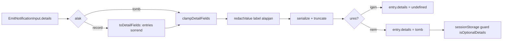

# AIS-151 — notifications core: strukturált bejegyzés-részletek (`details`)

**Ticket:** [AIS-151](https://zakzag.atlassian.net/browse/AIS-151) · **Parent:** AIS-143
**Scope:** csak a core adatmodell. **Nincs** UI, **nincs** transport (AIS-152), **nincs** lenyíló sor (AIS-153).

## Cél

A `NotificationEntry` ma egyetlen `detail: string` mezőt hordoz, minden technikai adat belelapítva. A lenyitható
sorhoz kulcs–érték lista kell. A ticket egy **opcionális, backward compatible** `details: readonly NotificationDetailField[]`
mezőt vezet be, a redakciót egy helyen tartva (store), limitekkel a `sessionStorage` kvóta miatt.

## Döntések (rögzítve)

| #   | Döntés                                                                                                                                                                            |
| --- | --------------------------------------------------------------------------------------------------------------------------------------------------------------------------------- |
| A   | `toDetailFields(record)` **beszúrási sorrendet** követ (`Object.entries`), nincs ábécé-rendezés — a log a hívó által megírt sorrendet mutatja.                                       |
| B   | `clampDetailFields` **is** futtat `redactValue(label, value)`-t, tehát a tömb-ág sem kerülheti meg a redakciót (D-B).                                                              |
| C   | Dedupe/bump esetén: ha az ismételt emit **nem** ad `details`-t, a korábbi `details` **megmarad**; ha ad, az **lecseréli** (normalizált alakban).                                    |
| D   | `detail: string` **marad** (a `Toast` `detail?: string`-et vár, a csukott sor ezt mutatja); a `details` kiegészít, nem helyettesít (D-A).                                          |
| E   | `details: []` eredmény → `undefined`, hogy üres tömb ne kerüljön a state-be és a snapshotba (D-D kvázi: quota + memória).                                                          |
| F   | A `label` az emitter felelőssége — a csomagban nincs i18n; a core továbbra sem tartalmaz DOM-ot/Reactet (`tsconfig.core.json` `lib: ["ES2022"]`).                                 |

## Viselkedési szerződés

```
EmitNotificationInput.details
  ├─ undefined            → entry.details = undefined
  ├─ Record<string, unknown> → Object.entries → redactValue(kulcs, érték) → stringify → truncate → max 20 mező
  └─ NotificationDetailField[] → clampDetailFields (redakció label alapján + limitek)
                                 → ha az eredmény hossza 0 → entry.details = undefined
```

Mezőnkénti szabályok:

- `label`: `String`-ként kezelt kulcs, `NOTIFICATION_DETAIL_LABEL_MAX_LENGTH`-re vágva (`…` suffix), a trimmelés után **üres label eldobandó**.
- `value`: `redactValue(label, value)` → szerializálás (`string` változatlan, egyébként `JSON.stringify`, hiba esetén `NOTIFICATION_DETAILS_INVALID_PLACEHOLDER`) → `NOTIFICATION_DETAIL_VALUE_MAX_LENGTH`-re vágva (`…` suffix).
- `mono`: csak `true` esetén kerül a mezőbe (`mono === true`), így a tárolt alak minimális.
- Mezőszám limit: `NOTIFICATION_DETAIL_MAX_FIELDS`, a feletti mezők csendben eldobódnak.
- Nem szerializálható érték (körkörös, `BigInt`, `Symbol`, `function`) → placeholder, **soha nem dob**.

## Fájlok és változások

### 1. [`packages/notifications/src/core/notification.interface.ts`](packages/notifications/src/core/notification.interface.ts:1)

- Új `NotificationDetailField` interfész: `readonly label: string; readonly value: string; readonly mono?: boolean;` + JSDoc.
- `NotificationEntry`: `readonly details?: readonly NotificationDetailField[];` (opcionális → a `packages/ui` `Toast*` propok strukturálisan továbbra is kompatibilisek).
- `EmitNotificationInput`: `readonly details?: readonly NotificationDetailField[] | Readonly<Record<string, unknown>>;`
- JSDoc: miért marad a `detail` (egysoros összefoglaló a toasthoz és a csukott sorhoz), miért `details` a lenyílóhoz, `label` az emitter felelőssége.

### 2. [`packages/notifications/src/core/notification.const.ts`](packages/notifications/src/core/notification.const.ts:1)

| Konstans                                  | Érték             | Miért                                                     |
| ----------------------------------------- | ----------------- | --------------------------------------------------------- |
| `NOTIFICATION_DETAIL_MAX_FIELDS`           | `20`              | 200 bejegyzés × mezők a `sessionStorage` kvótában marad   |
| `NOTIFICATION_DETAIL_LABEL_MAX_LENGTH`     | `40`              | egy sorban elférő label                                   |
| `NOTIFICATION_DETAIL_VALUE_MAX_LENGTH`     | `2_000`           | body-prefix / stack nélkül reális marad                   |
| `NOTIFICATION_DETAIL_TRUNCATION_SUFFIX`    | `'…'`             | a csonkolás látható                                       |
| `NOTIFICATION_DETAILS_INVALID_PLACEHOLDER` | `'<invalid value>'` | nem szerializálható érték helyére                        |

### 3. [`packages/notifications/src/core/notification.logic.ts`](packages/notifications/src/core/notification.logic.ts:1)

Új, tiszta függvények (a meglévő `toRedactedDetail` **változatlan**):

- `toDetailFields(input: readonly NotificationDetailField[] | Readonly<Record<string, unknown>> | undefined): readonly NotificationDetailField[]`
  — `undefined` → üres lista; record → beszúrási sorrend; tömb → `clampDetailFields`.
- `clampDetailFields(details: readonly NotificationDetailField[]): readonly NotificationDetailField[]`
  — mezőszám-limit + label/value csonkolás + label-alapú redakció + üres label eldobás. A típusőr és a store közös belépője.
- Belső segédek (nem exportáltak): `isDetailRecord()`, `serializeDetailValue()`, `truncateDetailText()` — egy felelősség/függvény.
- `bumpEntry(entry, now, details?)` **opcionális harmadik paraméter**: `undefined` → a korábbi `entry.details` marad (C döntés).

### 4. [`packages/notifications/src/core/notification.store.ts`](packages/notifications/src/core/notification.store.ts:1)

- `createEntry`: `const details = toDetailFields(input.details)` → `details.length === 0 ? undefined : details`.
- `emit`: a normalizált `details` a `bumpEntry` harmadik argumentumaként megy tovább, tehát a dedupe is frissíti, ha van új.
- A redakció továbbra is **kizárólag** a store/logic útvonalon történik (nincs emitter-oldali kikerülés).

### 5. [`packages/notifications/src/core/notification.storage.logic.ts`](packages/notifications/src/core/notification.storage.logic.ts:1)

- Új `isDetailField(value)`: record, `label` nem üres string, `value` string, `mono` `undefined` vagy boolean.
- Új `isOptionalDetails(value)`: `undefined`, vagy tömb, amelynek minden eleme `isDetailField`.
- `isPersistedEntry` kiegészítése `isOptionalDetails(value['details'])`-szel.
- Az **all-or-nothing** szabály marad: egy hibás elem → az egész payload `wrong-shape`, a verzió marad `1`, régi (`details` nélküli) payload továbbra is betölthető.

### 6. [`packages/notifications/src/index.ts`](packages/notifications/src/index.ts:1)

Explicit exportok: `NotificationDetailField` típus, az öt új konstans, `toDetailFields`, `clampDetailFields`.

### 7. Tesztek

| Fájl                                                                                  | Esetek                                                                                                                                                                                                                                 |
| ------------------------------------------------------------------------------------- | ---------------------------------------------------------------------------------------------------------------------------------------------------------------------------------------------------------------------------------------- |
| [`test/notification.logic.test.ts`](packages/notifications/test/notification.logic.test.ts:1)       | `toDetailFields`: beszúrási sorrend determinisztikus; érzékeny kulcs redaktált (`NOTIFICATION_SENSITIVE_KEY_PATTERN`); hosszú érték csonkolva + suffix; `MAX_FIELDS` feletti mezők eldobva; üres label eldobva; `mono` átvitele tömb-ágon; körkörös érték → placeholder (nem dob); `undefined` → üres lista. `clampDetailFields`: `0`, `MAX_FIELDS`, `MAX_FIELDS + 1`, üres tömb; label-alapú redakció. `toRedactedDetail` regresszió (változatlan viselkedés). |
| [`test/notification.store.test.ts`](packages/notifications/test/notification.store.test.ts:1)       | `emit({ details: record })` → redaktált tömb a state-ben; `emit` `details` nélkül → `undefined`; üres record → `undefined`; dedupe/bump: új `details` lecseréli, hiányzó megtartja a korábbit.                                          |
| [`test/notification-storage.logic.test.ts`](packages/notifications/test/notification-storage.logic.test.ts:1) | `details`-szel rendelkező bejegyzés túlél; hiányzó `details` túlél; `details: 'x'` → payload eldobva; egy hibás elem → payload eldobva; `mono` nem boolean → payload eldobva; cap (200) változatlan.                                     |
| [`test/mocks/notification.fixtures.ts`](packages/notifications/test/mocks/notification.fixtures.ts:1) | `createTestDetailField(overrides)` és `createTestDetailsRecord()` fixture-ök (mock nem kerülhet tesztfájlba).                                                                                                                          |

### 8. Dokumentáció

- [`docs/Specs/UI-Architecture.md`](docs/Specs/UI-Architecture.md:392) — `packages/notifications core` tábla: `details` mező, sorrend, redakció, limitek, bump-szabály; `sessionStorage mirror` tábla `Validation` sora kiegészítve `details`-szel; `**Utolsó frissítés:**` dátum frissítése.
- `docs/history/<YYYY-MM-DD--HH-ii-ss>-ais-151-notification-detail-fields.md` — változás-összefoglaló.
- `docs/milestones/<YYYY-MM-DD--HH-ii-ss>-notification-detail-fields.milestone.md` — rövid, egy oldalas milestone a D-A…D-F döntésekkel, mert AIS-152/153 erre épül.

## Nincs benne (szándékosan)

- Toast megjelenítés (`details` sosem kerül a toastba), `NotificationHost`, `use-notifications`.
- `packages/ui` lenyitható sor (AIS-153), `HttpEvent` → `details` mapping (AIS-152).
- Séma-verzió emelés (`v1` marad) és migráció — a mező opcionális, a régi payload betölthető.

## Ellenőrzés (DoD)

- [ ] `pnpm --filter @callback/notifications test`
- [ ] `pnpm --filter @callback/notifications build` (ez futtatja a `tsconfig.core.json`-t is — DOM/React-mentesség)
- [ ] `pnpm typecheck`
- [ ] `pnpm quality:dead-code` (az új exportok az `index.ts`-en át használtak)
- [ ] `pnpm quality:docs` (Specs dátum + hivatkozott fájlok)
- [ ] Nincs `any`, nincs inline típus, minden konstans `.const.ts`-ben
- [ ] `docs/Specs/UI-Architecture.md` + `docs/history/` + `docs/milestones/` bejegyzés megvan

## Folyamat


