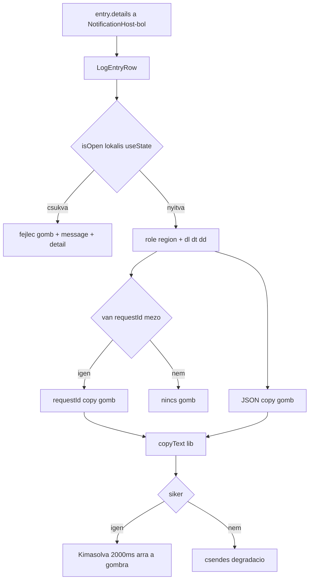

# AIS-153 — `packages/ui`: lenyitható log sor

**Ticket:** [AIS-153](https://zakzag.atlassian.net/browse/AIS-153) · **Parent:** AIS-143
**Előfeltétel:** AIS-151 (kész — `NotificationEntry.details` és `NotificationDetailField` él)
**Scope:** csak `packages/ui` primitíva + tesztek + docs. **Nincs** transport/mapping (AIS-152), **nincs** store,
**nincs** új `LogDrawer` prop.

## Döntés (rögzítve a ticket-en felül)

| #   | Döntés                                                                                                                                                                                                                             |
| --- | ---------------------------------------------------------------------------------------------------------------------------------------------------------------------------------------------------------------------------------- |
| A0  | A copy-visszajelzés **gombonként független**: a `requestId` és a `JSON` gomb külön időzítővel vált `Kimásolva`-ra, egymást nem írják felül (`Record<LogEntryCopyTarget, boolean>` state + `Map<LogEntryCopyTarget, timer>` a `useRef`-ben). |
| A1  | A chevron külön, kis recipe-et kap (`logEntryChevronVariants`), mert a cva nem tud gyerek-elemet stilizálni; a ticket három recipe-je így négyre nő, a token-szabály viszont nem sérül.                                               |
| A2  | Az üres régió szövege egy `id`-vel ellátott `<p>`, amit a régió `aria-describedby`-jal hivatkozik — ezért kell a `LOG_ENTRY_DETAILS_EMPTY_ID_SUFFIX`.                                                                                 |

## 1. Adatmodell — [`log-drawer.interface.ts`](packages/ui/src/components/log-drawer/log-drawer.interface.ts:31)

```ts
export interface LogDetailField {
  readonly label: string;
  readonly value: string;
  readonly mono?: boolean;
}
```

- `LogEntryItem`: `readonly details?: readonly LogDetailField[];`
- Új `export type LogEntryCopyTarget = 'requestId' | 'json';` (a per-gombos visszajelzés kulcsa, nem inline string).
- JSDoc: a `LogDetailField` a `packages/ui` **saját** strukturális típusa (mint `ToastLevel`), a
  `@callback/notifications` `NotificationDetailField`-je import nélkül assignable; a nyitottság
  komponens-lokális `useState`, **nem** prop, mert egy sor saját interakciója (state-döntési sor 4. szintje).

## 2. Konstansok — [`log-drawer.const.ts`](packages/ui/src/components/log-drawer/log-drawer.const.ts:1)

| Konstans                            | Érték                        |
| ----------------------------------- | ---------------------------- |
| `LOG_ENTRY_DETAILS_TOGGLE_LABEL_OPEN`  | `'Részletek megnyitása'`  |
| `LOG_ENTRY_DETAILS_TOGGLE_LABEL_CLOSE` | `'Részletek bezárása'`    |
| `LOG_ENTRY_DETAILS_REGION_LABEL`       | `'Részletes adatok'`      |
| `LOG_ENTRY_DETAILS_EMPTY_LABEL`        | `'Nincs részletes adat'`  |
| `LOG_ENTRY_DETAILS_REGION_ID_SUFFIX`   | `'-log-entry-details'`    |
| `LOG_ENTRY_DETAILS_EMPTY_ID_SUFFIX`    | `'-log-entry-details-empty'` |
| `LOG_ENTRY_COPY_REQUEST_ID_LABEL`      | `'requestId másolása'`    |
| `LOG_ENTRY_COPY_ENTRY_LABEL`           | `'JSON másolása'`         |
| `LOG_ENTRY_COPY_DONE_LABEL`            | `'Kimásolva'`             |
| `LOG_ENTRY_COPY_FEEDBACK_MS`           | `2000`                    |
| `LOG_ENTRY_REQUEST_ID_FIELD_LABEL`     | `'requestId'`             |

## 3. Tiszta logika — [`log-drawer.logic.ts`](packages/ui/src/components/log-drawer/log-drawer.logic.ts:1)

- `toEntryToggleLabel(isOpen: boolean, detailCount: number): string`
  → `isOpen ? CLOSE : OPEN`, `detailCount > 0` esetén `` `${base} (${detailCount} részlet)` ``.
- `toEntryJson(entry: LogEntryItem): string` — fix mezősorrend:
  `id`, `level`, `message`, `detail` (csak ha van), `createdAt` (nyers epoch ms, locale-független),
  `details` (csak ha nem üres; `label`/`value`/`mono`), `JSON.stringify(value, null, 2)`.
- `findRequestIdField(details: readonly LogDetailField[] | undefined): LogDetailField | null`
  — `trim().toLowerCase()` összevetés a `LOG_ENTRY_REQUEST_ID_FIELD_LABEL`-lel, első találat, egyébként `null`.

## 4. Recipe-ek — [`log-drawer.variants.ts`](packages/ui/src/components/log-drawer/log-drawer.variants.ts:134)

Csak token osztályok (nincs hex/rgb, nincs paletta utility, nincs arbitrázs szín).

- `logEntryToggleVariants` — `isOpen` variáns; teljes szélességű `<button>`: `flex w-full items-center gap-2
  rounded-control bg-transparent text-left transition-shadow duration-fast focus-visible:outline-none
  focus-visible:border-border-focus focus-visible:shadow-focus-ring`; `true` → `text-text-primary`,
  `false` → `text-text-secondary`.
- `logEntryChevronVariants` — `size-3 shrink-0 transition-transform duration-fast`; `isOpen`
  `true` → `rotate-180`, `false` → `rotate-0`.
- `logEntryDetailsVariants` — `mt-1 flex flex-col gap-2 border-t border-hairline pt-2 max-h-64
  overflow-y-auto whitespace-pre-wrap break-words`.
- `logDetailFieldVariants` — `slot: { label: 'text-xs font-semibold tracking-wide text-text-muted uppercase',
  value: 'text-sm text-text-secondary' }`, `mono: { true: 'font-mono text-xs' }`.
- A meglévő `logEntryRowVariants`, `Toast` chip/glyph marad; a csukott sor `detail` sora **változatlan**.
- Típus-exportok: `LogEntryToggleVariants`, `LogEntryChevronVariants`, `LogDetailFieldVariants`.

## 5. `lib/copy-text.ts` (új) — [`lib/`](packages/ui/src/lib/cn.ts:1)

```ts
export async function copyText(text: string): Promise<boolean>;
```

- `navigator.clipboard.writeText` guarded hívás (`typeof navigator === 'undefined'`,
  `typeof clipboard?.writeText !== 'function'` → `false`), `try/catch` → `false`.
- Nem dob, nem ír konzolra. Ez a csomag **egyetlen** új mellékhatása, és a `lib/` szinten van.

## 6. [`LogEntryRow.tsx`](packages/ui/src/components/log-drawer/LogEntryRow.tsx:22)

State (mind komponens-lokális, JSDoc-kal indokolva):

- `const [isOpen, setIsOpen] = useState(false)` — alapból csukva, bármennyi sor nyitható egyszerre.
- `const [copied, setCopied] = useState<Readonly<Record<LogEntryCopyTarget, boolean>>>({ requestId: false, json: false })`.
- `const copyTimers = useRef<Map<LogEntryCopyTarget, ReturnType<typeof setTimeout>>>(new Map())`,
  egy `useEffect` cleanup az unmountkor minden handle-t töröl.
- `const regionId = useId() + LOG_ENTRY_DETAILS_REGION_ID_SUFFIX`,
  `const emptyId = useId() + LOG_ENTRY_DETAILS_EMPTY_ID_SUFFIX`; `const requestIdField = findRequestIdField(entry.details)`.

Szerkezet (a gyökér továbbra is a `logEntryRowVariants` div, `data-level`-lel):

```text
<div data-level class=row>
  <button type=button aria-expanded aria-controls={regionId} aria-label={toEntryToggleLabel} class=toggle>
    glyph chip (aria-hidden) | level text | <ChevronDownIcon aria-hidden class=chevron /> | time (ml-auto)
  </button>
  <p>{message}</p>
  {detail ? <p>{detail}</p> : null}
  <div id={regionId} role=region aria-label={REGION_LABEL} aria-describedby={isEmpty ? emptyId : undefined} hidden={!isOpen}>
    {details?.length ? <dl><dt/><dd/></dl> : <p id={emptyId}>{EMPTY_LABEL}</p>}
    <div class=copy-row>  // csak nyitva
      {requestIdField ? <Button variant=ghost size=sm onClick>{copied.requestId ? DONE : COPY_REQUEST_ID}</Button> : null}
      <Button variant=ghost size=sm onClick>{copied.json ? DONE : COPY_ENTRY}</Button>
    </div>
  </div>
</div>
```

- A `message` és a `detail` a fejléc-gombon **kívül** marad (hosszú szöveg nem lesz gomb belseje).
- Keyboard: natív `<button>` → `Enter`/`Space` ingyen.
- `handleCopy(target, text)`: `await copyText(text)`; `false` → nincs állapotváltás, nincs kivétel;
  `true` → a **célzott** kapcsoló `true`, a korábbi timer törlése, új timer `LOG_ENTRY_COPY_FEEDBACK_MS`-re.
- Recsegésmentes regresszió: a csukott sor külseje és szövegei nem változnak.

## 7. [`LogDrawer.tsx`](packages/ui/src/components/log-drawer/LogDrawer.tsx:85)

Nincs változás (`key={entry.id}` már ma is megvan, nincs új prop, nincs emelt állapot). A dokumentált
viselkedés: a szűrt listából kikerülő bejegyzés visszakerülve **csukva** jelenik meg.

## 8. Exportok — [`index.ts`](packages/ui/src/index.ts:294)

`LogDetailField`, `LogEntryCopyTarget` típus; a 11 új konstans; `toEntryToggleLabel`, `toEntryJson`,
`findRequestIdField`; `copyText`; a négy új recipe és a három új recipe-típus. Explicit export, nincs `export *`.

## 9. Tesztek

Új mock-ok (a `test/mocks/` alatt, nem a tesztfájlban):

- [`test/mocks/log-entries.mock.ts`](packages/ui/test/mocks/log-entries.mock.ts:15) — `buildLogDetailField(overrides)`,
  `buildLogDetails()` (requestId + url + body, egy `mono: true`).
- `test/mocks/clipboard.mock.ts` — `stubClipboard({ writeText })` → `{ writeText, restore }`
  (`Object.defineProperty(navigator, 'clipboard', …)`), és `stubClipboardMissing()`.

| Fájl                                                                     | Új esetek                                                                                                                                                                                                                                                                                                                                                                  |
| ------------------------------------------------------------------------ | ---------------------------------------------------------------------------------------------------------------------------------------------------------------------------------------------------------------------------------------------------------------------------------------------------------------------------------------------------------------------------- |
| [`test/log-drawer.logic.test.ts`](packages/ui/test/log-drawer.logic.test.ts:1) | `toEntryToggleLabel`: csukva/nyitva 0 részlettel (nincs suffix), csukva/nyitva N-nel (tartalmazza az N-t és a helyes igét). `toEntryJson`: kétszer hívva azonos string; tartalmazza `id`/`level`/`message`/`createdAt`/`details`; `details` nélkül is valid JSON; `undefined` mezők nem jelennek meg `null`-ként. `findRequestIdField`: megtalálja kis/nagybetű-függetlenül; hiányzó/üres lista → `null`; több jelölt → az első. |
| [`test/log-entry-row.test.tsx`](packages/ui/test/log-entry-row.test.tsx:11) | A meglévő 5 eset marad. Új: alapból csukva (`aria-expanded=false`, régió `hidden`); kattintás → nyit + `dl/dt/dd` a `details` sorrendjében; második kattintás → zár; **két sor egyszerre nyitva**; `details` nélkül a `Nincs részletes adat` szöveg; `mono: true` megkapja a mono osztályt, a `false`/hiányzó nem; requestId gomb csak requestId mező esetén; requestId copy a várt szöveget adja a clipboard mocknak; JSON copy a `toEntryJson` kimenetét adja; siker után 2 s-ig `Kimásolva`, majd visszaáll (fake timer); **a két gomb visszajelzése független** (A0); clipboard hiba → nincs kivétel, nincs `Kimásolva`; accessible name tartalmazza az igét és a részletek számát; unmount a timert törli (nincs `act` warning / state update). |
| [`test/log-drawer.test.tsx`](packages/ui/test/log-drawer.test.tsx:1)      | A meglévő 24 eset zöld marad; +1: két bejegyzés, mindkettő kinyitva, a lista renderelése nem törik.                                                                                                                                                                                                                                                                          |

## 10. Dokumentáció

- [`docs/Specs/UI-Architecture.md`](docs/Specs/UI-Architecture.md:323) — `LogEntryRow` sor: `details` prop-viselkedés,
  `aria-expanded`/`aria-controls`/`role=region`, copy gombok, csukott sor változatlan; §5 state plan új sora
  („Sor-nyitottság” — komponens-lokális `useState`, nem store/URL); `Utolsó frissítés` dátum.
- `docs/history/2026-11-07--17-18-00-ais-153-log-entry-expandable.md` — változás-összefoglaló.
- `docs/milestones/2026-11-07--17-18-00-log-entry-expandable-row.milestone.md` — egy oldalas milestone a
  D-A…D-F + A0/A1 döntésekkel (a szülő AIS-143 következő lépései hivatkoznak rá).

## 11. Ellenőrzés (DoD)

- [ ] `pnpm --filter @callback/ui build` (a `packages/notifications` a `dist` típusaira épül — előbb build)
- [ ] `pnpm --filter @callback/ui test`
- [ ] `pnpm --filter @callback/notifications test` (strukturális kompatibilitás, regresszió)
- [ ] `pnpm typecheck`, `pnpm lint`
- [ ] `pnpm quality` (layers, dead-code, palette, field-errors, docs)
- [ ] Nincs `any`, nincs inline típus, minden konstans `.const.ts`-ben, minden mock `test/mocks/`-ban
- [ ] `packages/ui` nem importál `@callback/notifications`-t; a komponens nem olvas storage-ot és nem hálózik

## Folyamat


